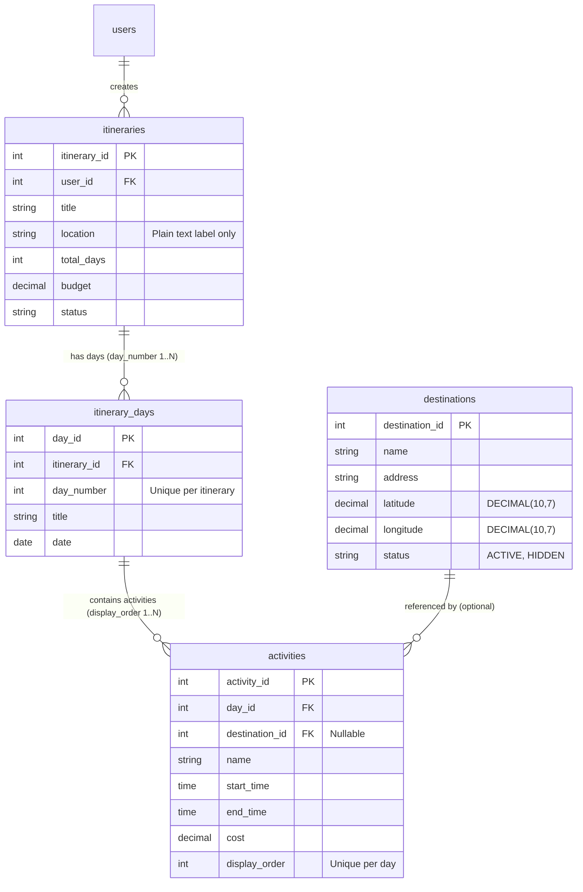
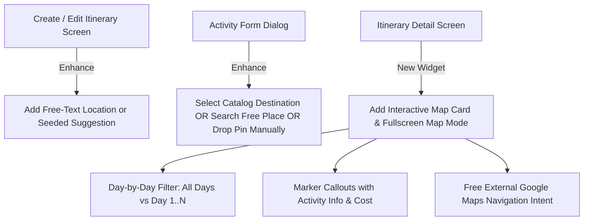

# Map Integration Audit and Implementation Plan — Strictly Free Services & Cost-Controlled Architecture

## 1. Executive Summary: Free-Only Strategy & Cost Boundaries

This document presents a comprehensive technical audit and implementation plan for integrating map and geographical capabilities into the **Travel Planner** platform.

Following project mandates, this plan is engineered under **strict cost-controlled, free-first architectural principles**:
- **No mandatory paid dependencies, no paid subscriptions, and no automatic billing.**
- **No paid usage beyond free tiers.**
- **No automatic fallback to paid providers.**
- **No automatic production fallback to public community infrastructure:** Public OpenStreetMap tile servers (`tile.openstreetmap.org`) and the public OSRM demo server (`router.project-osrm.org`) are strictly restricted to manual local development/testing; they are **never** configured as automatic production fallbacks.
- **Clear cost boundaries:** Free software and free-tier API usage are strictly distinguished from potentially paid hosting, domain, SSL, and server infrastructure.
- **Explicit human approval required:** Introducing any paid service, commercial plan upgrade, or billing account requires explicit human approval from the project owner.
- **Non-commercial usage assumption:** CARTO Basemaps provides 5,000,000 monthly tile requests for non-commercial/academic use (versus 1,000,000 for commercial use). This project operates under an explicit non-commercial academic assumption (university capstone project `TLCN`); any future commercialization requires formal reassessment of tile licensing and quota limits.
- **Core feature independence:** Core map and location features (creating activities, dropping pins, saving coordinates, displaying markers, and local straight-line distance calculations) remain fully operational even if all third-party geocoding and routing services are exhausted or disabled.

### Verified Technology Stack (from Codebase)
- **Backend:** Spring Boot 4.1.1 (Java 22), Spring Security, Spring Data JPA, MySQL 8 (verified in [`pom.xml`](file:///d:/CODE/HCMUTE/TLCN/Travel-planner-community/Travel_Planner/backend/pom.xml#L8-L32))
- **Mobile Client:** Flutter (Dart 3.13.5, Flutter 3.47.7, Material 3)
- **Web Client:** Flutter Web (Admin/Moderation & Content Management)
- **Communication:** RESTful JSON API with JWT Bearer Token Authentication

### Current State Overview
1. **Database & Data Model:** The `destinations` table in MySQL contains `latitude` and `longitude` fields (`DECIMAL(10, 7)`) and `address`. Seed data ([`DataSeeder.java`](file:///d:/CODE/HCMUTE/TLCN/Travel-planner-community/Travel_Planner/backend/src/main/java/Travel_Planner/Travel_Planner/seeder/DataSeeder.java#L261-L442)) contains 15+ realistic Vietnamese coordinates (Hanoi, Ha Long, Da Nang, Da Lat, Phu Quoc). However, the `activities` table does not store coordinates directly, and the `itineraries` table stores only a free-form string for `location`.
2. **Backend APIs:** [`DestinationController.java`](file:///d:/CODE/HCMUTE/TLCN/Travel-planner-community/Travel_Planner/backend/src/main/java/Travel_Planner/Travel_Planner/controller/DestinationController.java) exposes basic read-only APIs (`GET /api/destinations?keyword=...` and `GET /api/destinations/{id}`). There are no APIs for external place search, geocoding, reverse geocoding, route calculation, or user/admin destination creation.
3. **Flutter Mobile:** Destination selection in [`ActivityFormDialog`](file:///d:/CODE/HCMUTE/TLCN/Travel-planner-community/Travel_Planner/frontend/mobile/lib/features/itinerary/presentation/widgets/activity_form_dialog.dart#L504-L560) is currently a plain `DropdownButtonFormField` that lists pre-seeded database destinations. Itinerary location in `CreateItineraryScreen` is a simple text field. **Zero map rendering packages or widgets exist in the mobile codebase.**
4. **Flutter Web:** Flutter Web is currently in an early skeleton stage (only Auth and Profile are implemented). Destination and itinerary management features (`locations/`, `itineraries/`) contain only `.gitkeep`.
5. **No External Map Provider:** No map SDK, tile service, or geocoding provider has been integrated or configured.

### Strategic Architecture: Decoupled & Free-First
We adopt a **Decoupled Free-First Architecture** where client map rendering, core data management, and optional cloud services are isolated into distinct tiers:
1. **Free Client Map Canvas (`flutter_map`):** An open-source (MIT), pure Dart rendering engine that draws raster map tiles directly on the Flutter canvas without native SDK bindings, license fees, or platform view bugs.
2. **Direct Tile Delivery without Secrets:** Flutter clients stream raster tiles directly from free-tier tile CDNs (primarily CARTO Basemaps Voyager/Positron) configured via `--dart-define` (`String.fromEnvironment`). Direct tile requests eliminate backend proxy bottlenecks.
3. **Core Feature Independence (Offline-Ready Pinning):** Users can manually drop pins on the map to save exact coordinates (`latitude`, `longitude`) without calling any external geocoding API. An itinerary with coordinates displays markers and calculates straight-line connections purely from internal database records.
4. **Optional Backend Proxy for Search & Routing:** Upstream geocoding (LocationIQ free tier) and routing (OpenRouteService standard tier) are encapsulated behind Spring Boot REST endpoints (`/api/locations/*`, `/api/itineraries/{id}/days/{dayId}/route`). These services are strictly optional enhancements: if quotas are reached, the system gracefully degrades to manual coordinate input and local straight-line distance calculations.
5. **Universal Free External Navigation:** Turn-by-turn navigation is handed off to native navigation apps (Google Maps / Apple Maps) via standard, completely free deep-link URLs (`https://www.google.com/maps/dir/?api=1&...`), requiring zero API keys or billing accounts.

*Latest Pricing and Terms Verification Date: October 2026.*

---

## 2. Current Implementation Audit

| Component | Feature / Capability | Documented in Docs | Codebase Reality | Status |
| :--- | :--- | :--- | :--- | :--- |
| **Backend** | Spring Boot Version | Docs mentioned v3 | [`pom.xml`](file:///d:/CODE/HCMUTE/TLCN/Travel-planner-community/Travel_Planner/backend/pom.xml#L8) specifies `spring-boot-starter-parent` v4.1.1 (Java 22) | **Verified** |
| **Backend** | Destination Entity with Lat/Lng | Yes (`00-project-context.md`, specs) | Defined in [`Destination.java`](file:///d:/CODE/HCMUTE/TLCN/Travel-planner-community/Travel_Planner/backend/src/main/java/Travel_Planner/Travel_Planner/model/Destination.java#L52-L56) | **Already Implemented** |
| **Backend** | Seed Destination Coordinates | Yes | 15+ Vietnamese POIs in [`DataSeeder.java`](file:///d:/CODE/HCMUTE/TLCN/Travel-planner-community/Travel_Planner/backend/src/main/java/Travel_Planner/Travel_Planner/seeder/DataSeeder.java#L261-L442) | **Already Implemented** |
| **Backend** | Destination Read Endpoints | Yes | `GET /api/destinations`, `GET /api/destinations/{id}` in [`DestinationController.java`](file:///d:/CODE/HCMUTE/TLCN/Travel-planner-community/Travel_Planner/backend/src/main/java/Travel_Planner/Travel_Planner/controller/DestinationController.java) | **Already Implemented** |
| **Backend** | Activity Linking to Destination | Yes | Optional `destination_id` in [`Activity.java`](file:///d:/CODE/HCMUTE/TLCN/Travel-planner-community/Travel_Planner/backend/src/main/java/Travel_Planner/Travel_Planner/model/Activity.java#L47-L49) | **Already Implemented** |
| **Backend** | Activity Ordering & Two-Pass Reorder | Yes | Implemented in [`ItineraryServiceImpl.java`](file:///d:/CODE/HCMUTE/TLCN/Travel-planner-community/Travel_Planner/backend/src/main/java/Travel_Planner/Travel_Planner/service/impl/ItineraryServiceImpl.java#L670-L730) | **Already Implemented** |
| **Backend** | Itinerary Day Ordering | Yes | Implemented with `uk_itinerary_day_number` | **Already Implemented** |
| **Backend** | Admin Destination Management CRUD | Mentioned in Spec §12 | Only public read operations exist; no POST, PUT, DELETE in [`DestinationController.java`](file:///d:/CODE/HCMUTE/TLCN/Travel-planner-community/Travel_Planner/backend/src/main/java/Travel_Planner/Travel_Planner/controller/DestinationController.java) | **Not Implemented** |
| **Backend** | External Place Search / Autocomplete | Mentioned in Spec §8 | No search service or external map provider integration | **Not Implemented** |
| **Backend** | Geocoding & Reverse Geocoding | Mentioned in Spec §8 | No geocoding service | **Not Implemented** |
| **Backend** | Per-Day Route Calculation | Mentioned in Spec §8 | No routing service or distance calculation | **Not Implemented** |
| **Backend** | Activity Custom Coordinates | Not specified | `Activity` has no coordinate columns; relies strictly on `destination_id` | **Not Implemented** |
| **Mobile** | Destination Selection Dropdown | Yes | Implemented in [`ActivityFormDialog`](file:///d:/CODE/HCMUTE/TLCN/Travel-planner-community/Travel_Planner/frontend/mobile/lib/features/itinerary/presentation/widgets/activity_form_dialog.dart#L504-L560) | **Already Implemented** |
| **Mobile** | Destination Display in Timeline | Yes | Implemented in [`ActivityTimelineItem`](file:///d:/CODE/HCMUTE/TLCN/Travel-planner-community/Travel_Planner/frontend/mobile/lib/features/itinerary/presentation/widgets/activity_timeline_item.dart#L235-L310) | **Already Implemented** |
| **Mobile** | Map Display / Viewer Widget | Mentioned in Spec §8 | No map library in `pubspec.yaml`; zero map widgets | **Not Implemented** |
| **Mobile** | Place Search / Map Picker Modal | Mentioned in Spec §8 | Only static database dropdown; no map picker | **Not Implemented** |
| **Mobile** | Itinerary Route Visualization | Mentioned in Spec §8 | No polyline or route display | **Not Implemented** |
| **Mobile** | Day-by-Day Marker Filtering | Mentioned in Spec §8 | No map-related filtering | **Not Implemented** |
| **Web** | Admin Destination Management UI | Mentioned in Spec §12 | Feature directory `locations/` contains only `.gitkeep` | **Not Implemented** |
| **Web** | Map Display on Web | Mentioned in Spec §8 | No map package in web `pubspec.yaml` | **Not Implemented** |

---

## 3. Existing Data Model and Relationships

### 3.1 Entity Analysis

#### 1. `Itinerary` (`Travel_Planner.Travel_Planner.model.Itinerary`)
- **Source File:** [`Itinerary.java`](file:///d:/CODE/HCMUTE/TLCN/Travel-planner-community/Travel_Planner/backend/src/main/java/Travel_Planner/Travel_Planner/model/Itinerary.java)
- **Key Fields:**
  - `itineraryId`: `Integer` (PK, Identity)
  - `user`: `User` (ManyToOne, FK `user_id`, non-null)
  - `originalItinerary`: `Itinerary` (ManyToOne, FK `original_itinerary_id`, nullable)
  - `title`: `String(150)` (non-null)
  - `description`: `TEXT`
  - `location`: `String(150)` (non-null) — *Free-form text label (e.g., "Đà Lạt, Lâm Đồng"); has NO foreign key to `destinations` and stores no coordinates.*
  - `coverImage`: `String(500)`
  - `totalDays`: `Integer` (non-null)
  - `budget`: `BigDecimal(15, 2)`
  - `theme`: `String(100)`
  - `visibility`: `Visibility` (`PUBLIC`, `PRIVATE`)
  - `status`: `ItineraryStatus` (`ACTIVE`, `DRAFT`, `DELETED`)
  - Counters: `viewCount`, `favoriteCount`, `ratingCount`, `commentCount`, `reuseCount`
  - Timestamps: `createdAt`, `updatedAt`

#### 2. `ItineraryDay` (`Travel_Planner.Travel_Planner.model.ItineraryDay`)
- **Source File:** [`ItineraryDay.java`](file:///d:/CODE/HCMUTE/TLCN/Travel-planner-community/Travel_Planner/backend/src/main/java/Travel_Planner/Travel_Planner/model/ItineraryDay.java)
- **Key Fields:**
  - `dayId`: `Integer` (PK, Identity)
  - `itinerary`: `Itinerary` (ManyToOne, FK `itinerary_id`, non-null)
  - `dayNumber`: `Integer` (non-null)
  - `title`: `String(150)` (nullable)
  - `date`: `LocalDate` (nullable)
  - Timestamps: `createdAt`, `updatedAt`
- **Constraints:** Unique constraint `uk_itinerary_day_number (itinerary_id, day_number)`.
- **Note:** Stores no location, address, or coordinate data.

#### 3. `Activity` (`Travel_Planner.Travel_Planner.model.Activity`)
- **Source File:** [`Activity.java`](file:///d:/CODE/HCMUTE/TLCN/Travel-planner-community/Travel_Planner/backend/src/main/java/Travel_Planner/Travel_Planner/model/Activity.java)
- **Key Fields:**
  - `activityId`: `Integer` (PK, Identity)
  - `itineraryDay`: `ItineraryDay` (ManyToOne, FK `day_id`, non-null)
  - `destination`: `Destination` (ManyToOne, FK `destination_id`, nullable=true)
  - `name`: `String(150)` (non-null) — *Describes what the user is doing (e.g., "Ăn trưa bún bò").*
  - `description`: `TEXT`
  - `startTime`: `LocalTime` (nullable)
  - `endTime`: `LocalTime` (nullable)
  - `cost`: `BigDecimal(15, 2)` (non-null, default 0)
  - `displayOrder`: `Integer` (non-null)
  - Timestamps: `createdAt`, `updatedAt`
- **Constraints:** Unique constraint `uk_activity_day_order (day_id, display_order)`.

#### 4. `Destination` (`Travel_Planner.Travel_Planner.model.Destination`)
- **Source File:** [`Destination.java`](file:///d:/CODE/HCMUTE/TLCN/Travel-planner-community/Travel_Planner/backend/src/main/java/Travel_Planner/Travel_Planner/model/Destination.java)
- **Key Fields:**
  - `destinationId`: `Integer` (PK, Identity)
  - `name`: `String(150)` (non-null)
  - `address`: `String(255)` (non-null)
  - `description`: `TEXT`
  - `imageUrl`: `String(500)`
  - `latitude`: `BigDecimal(10, 7)` (nullable)
  - `longitude`: `BigDecimal(10, 7)` (nullable)
  - `status`: `DestinationStatus` (`ACTIVE`, `HIDDEN`)
  - Timestamps: `createdAt`, `updatedAt`

### 3.2 Key Architectural Findings & Data Questions

1. **Can activities exist without a predefined destination?**
   **YES.** In `Activity.java`, `@JoinColumn(name = "destination_id", nullable = true)`. Activities such as "Nghỉ ngơi", "Tự do dạo phố", or "Ăn uống tự do" can be created without selecting a destination.
2. **Does an activity currently store latitude and longitude?**
   **NO.** `Activity` has no coordinate columns. If an activity is not linked to a `Destination`, it has zero geographical presence.
3. **Does a destination store geographical coordinates?**
   **YES.** `Destination` stores `latitude` and `longitude` as `BigDecimal(10, 7)`.
4. **Can an itinerary contain multiple destinations?**
   **YES, but only indirectly.** An itinerary has days, days have activities, and activities reference destinations. There is no direct relation between `Itinerary` and `Destination`. At the itinerary header level, `location` is just a single string label.
5. **Are activity ordering and day ordering supported?**
   **YES.** Day ordering is enforced by `dayNumber` with `uk_itinerary_day_number`. Activity ordering within each day is enforced by `displayOrder` with `uk_activity_day_order`. A safe two-pass reordering API is already operational.
6. **Does the existing database schema support storing geographical information?**
   **Partially.** Only the `destinations` table holds coordinates. If an activity requires a location that does not exist in the catalog, it cannot record coordinates without adding a new row to `destinations`.

### 3.3 Existing Entity-Relationship Diagram



---

## 4. Backend API Audit

### 4.1 Existing APIs Related to Itineraries & Destinations

| Controller | Method | Endpoint | Auth | Purpose |
| :--- | :--- | :--- | :--- | :--- |
| `DestinationController` | `GET` | `/api/destinations` | Public | List active destinations (optional `keyword` filter) |
| `DestinationController` | `GET` | `/api/destinations/{id}` | Public | Get single destination detail by ID |
| `ItineraryController` | `GET` | `/api/itineraries` | Public | Explore public itineraries with pagination and filters |
| `ItineraryController` | `GET` | `/api/itineraries/{id}` | Public / Owner | Retrieve full itinerary detail (including days, activities, destination objects) |
| `ItineraryController` | `POST` | `/api/itineraries` | Bearer JWT | Create itinerary with initial days |
| `ItineraryController` | `PUT` | `/api/itineraries/{id}` | Bearer JWT (Owner) | Update basic itinerary info |
| `ItineraryController` | `DELETE`| `/api/itineraries/{id}` | Bearer JWT (Owner) | Soft delete itinerary (`status = DELETED`) |
| `ItineraryController` | `POST` | `/api/itineraries/{id}/days` | Bearer JWT (Owner) | Append day to itinerary |
| `ItineraryController` | `PUT` | `/api/itineraries/{id}/days/{dayId}` | Bearer JWT (Owner) | Update day title and date |
| `ItineraryController` | `DELETE`| `/api/itineraries/{id}/days/{dayId}` | Bearer JWT (Owner) | Delete day and cascaded activities |
| `ItineraryController` | `POST` | `/api/itineraries/{id}/days/{dayId}/activities` | Bearer JWT (Owner) | Create activity in day (nullable `destinationId`) |
| `ItineraryController` | `PUT` | `/api/itineraries/{id}/days/{dayId}/activities/{activityId}` | Bearer JWT (Owner) | Update activity info and destination reference |
| `ItineraryController` | `DELETE`| `/api/itineraries/{id}/days/{dayId}/activities/{activityId}` | Bearer JWT (Owner) | Delete activity & renumber display order |
| `ItineraryController` | `PUT` | `/api/itineraries/{id}/days/{dayId}/activities/reorder` | Bearer JWT (Owner) | Two-pass batch reorder activities |

### 4.2 Gaps in Backend API
1. **No External Place Search / Autocomplete API:**
   Clients cannot search real-world places. `GET /api/destinations?keyword=...` only matches substrings against rows currently seeded in MySQL.
2. **No Geocoding / Reverse Geocoding API:**
   Converting coordinates into a structured address cannot be performed through the backend.
3. **No Admin Destination Management API:**
   Shared catalog destinations can only be created via `DataSeeder.java`. There are no admin endpoints for `POST /api/admin/destinations`, `PUT`, or `DELETE`.
4. **No Per-Day Route Calculation API:**
   There is no endpoint to calculate travel distance, travel time, or turn-by-turn route geometry between consecutive activities within an itinerary day.
5. **No Coordinate Validation Utility:**
   No reusable validator verifying that latitude is in `[-90.0, 90.0]` and longitude is in `[-180.0, 180.0]`.

---

## 5. Flutter Mobile Audit

### 5.1 Current Screens & User Flows

1. **`CreateItineraryScreen` & `EditItineraryScreen`:**
   - [`create_itinerary_screen.dart`](file:///d:/CODE/HCMUTE/TLCN/Travel-planner-community/Travel_Planner/frontend/mobile/lib/features/itinerary/presentation/screens/create_itinerary_screen.dart)
   - Location input is a standard `AppTextField` with `controller: _locationController`.
   - The user types a free-form string (e.g., "Đà Lạt, Lâm Đồng").
   - No map preview, no location autocomplete, no coordinates captured.

2. **`ActivityFormDialog`:**
   - [`activity_form_dialog.dart`](file:///d:/CODE/HCMUTE/TLCN/Travel-planner-community/Travel_Planner/frontend/mobile/lib/features/itinerary/presentation/widgets/activity_form_dialog.dart)
   - Fetches destinations from `itineraryCrudRepository.getDestinations()`.
   - Displays a `DropdownButtonFormField<int?>`:
     - Option 1: "Không liên kết địa điểm" (value `null`)
     - Option 2..N: Seeded destinations from MySQL (e.g., "Hồ Hoàn Kiếm & Phố Cổ Hà Nội")
   - Cannot search on a map, cannot drop a pin, cannot add custom locations.

3. **`ItineraryDetailScreen` & `ActivityTimelineItem`:**
   - [`itinerary_detail_screen.dart`](file:///d:/CODE/HCMUTE/TLCN/Travel-planner-community/Travel_Planner/frontend/mobile/lib/features/itinerary/presentation/screens/itinerary_detail_screen.dart)
   - Renders header, statistics, day list via `ItineraryDayCard`, and timeline items.
   - [`activity_timeline_item.dart`](file:///d:/CODE/HCMUTE/TLCN/Travel-planner-community/Travel_Planner/frontend/mobile/lib/features/itinerary/presentation/widgets/activity_timeline_item.dart) displays destination name, address, description, and thumbnail.
   - **Tapping the destination card does nothing.** There is no map view or coordinates modal.

4. **Dependencies (`pubspec.yaml`):**
   - Dependencies: `http: ^1.2.2`, `flutter_secure_storage: ^9.2.2`, `cupertino_icons: ^1.0.8`.
   - No map package (`flutter_map`, `google_maps_flutter`, or `mapbox_maps_flutter`) is installed.

### 5.2 Mobile Touchpoints & Enhancements



---

## 6. Flutter Web Audit

### 6.1 Current Status of Flutter Web
- **Source Root:** `frontend/web/lib/`
- **Implemented Features:**
  - `auth`: `LoginScreen`, `RegisterScreen`, `AuthNotifier`, `AuthRepository`
  - `profile`: `ProfileScreen`, `ProfileRepository`
- **Unimplemented Features:**
  - `itineraries/`, `locations/`, `dashboard/`, `moderation/`, `users/`, `violations/` all contain only `.gitkeep`.
- **Dependencies (`pubspec.yaml`):**
  - Dependencies: `http: ^1.2.2`, `shared_preferences: ^2.3.2`, `cupertino_icons: ^1.0.8`.
  - Zero map packages installed.

### 6.2 Platform Responsibilities & Anti-Duplication Rule
According to `00-project-context.md` and `01-architecture.md`:
- Flutter Web is **primarily for administration, content moderation, and destination management**.
- Mobile and Web share the exact same Spring Boot REST contracts.
- **Do not duplicate mobile consumer travel workflows onto Web.** On Web, map functionality is used exclusively for:
  1. Administrative Destination Management (`/admin/destinations`): viewing, creating, updating, and verifying shared destination coordinates on a map.
  2. Moderation: previewing reported itineraries with their stops on a read-only map.
- Map dependencies will be added to Flutter Web only in Phase 7 when Admin destination management is built.

---

## 7. Database Audit

### 7.1 Existing MySQL Schema Details

#### Table: `destinations`
```sql
CREATE TABLE `destinations` (
  `destination_id` int NOT NULL AUTO_INCREMENT,
  `name` varchar(150) NOT NULL,
  `address` varchar(255) NOT NULL,
  `description` text,
  `image_url` varchar(500) DEFAULT NULL,
  `latitude` decimal(10,7) DEFAULT NULL,
  `longitude` decimal(10,7) DEFAULT NULL,
  `status` varchar(20) NOT NULL DEFAULT 'ACTIVE',
  `created_at` datetime(6) NOT NULL,
  `updated_at` datetime(6) NOT NULL,
  PRIMARY KEY (`destination_id`)
) ENGINE=InnoDB DEFAULT CHARSET=utf8mb4;
```
- Coordinate Precision: `DECIMAL(10, 7)` provides precision to ~1.11 centimeters, which is more than sufficient for addresses and tourism POIs.
- Status: `ACTIVE`, `HIDDEN`.

#### Table: `activities`
```sql
CREATE TABLE `activities` (
  `activity_id` int NOT NULL AUTO_INCREMENT,
  `day_id` int NOT NULL,
  `destination_id` int DEFAULT NULL,
  `name` varchar(150) NOT NULL,
  `description` text,
  `start_time` time(6) DEFAULT NULL,
  `end_time` time(6) DEFAULT NULL,
  `cost` decimal(15,2) NOT NULL DEFAULT '0.00',
  `display_order` int NOT NULL,
  `created_at` datetime(6) NOT NULL,
  `updated_at` datetime(6) NOT NULL,
  PRIMARY KEY (`activity_id`),
  UNIQUE KEY `uk_activity_day_order` (`day_id`,`display_order`),
  CONSTRAINT `fk_activity_day` FOREIGN KEY (`day_id`) REFERENCES `itinerary_days` (`day_id`),
  CONSTRAINT `fk_activity_destination` FOREIGN KEY (`destination_id`) REFERENCES `destinations` (`destination_id`)
) ENGINE=InnoDB DEFAULT CHARSET=utf8mb4;
```
- Missing: Custom location snapshot fields (`custom_location_name`, `custom_address`, `latitude`, `longitude`, `place_id`, `location_provider`) for activities without a catalog destination.

---

## 8. Map Technology Evaluation & Official Terms Verification

*All pricing, quotas, rate limits, credit card requirements, and terms of service documented below were verified against official provider documentation in **October 2026**.*

### 8.1 Technical Layers & Independence Principles
To satisfy the cost-controlled mandate, we decouple mapping functionality into five distinct layers:
1. **Client Map Rendering Library (Free Software):** Open-source UI widget rendering tiles, markers, and polylines on the client canvas (e.g., `flutter_map`, licensed under MIT). Zero license fees, zero subscriptions.
2. **Map Geographic Data (Open Data):** OpenStreetMap (OSM) geographic database, licensed under the Open Database License (ODbL). Free to use with mandatory attribution.
3. **Map Tile CDN / Hosting (Free Tier):** Servers hosting pre-rendered raster tile slices. Evaluated: CARTO Basemaps (5M tiles/month for non-commercial use, 1M for commercial use).
4. **Place Search & Geocoding (Free Tier / Self-Hostable):** Translating search strings to coordinates. Evaluated: LocationIQ (free tier 5k req/day, caching allowed up to 48 hours).
5. **Routing & Directions (Free Tier / Free Software):** Calculating road networks. Evaluated: OpenRouteService (Standard Plan: 2,000 req/day directions, 1,000 req/day geocoding/reverse geocoding/autocomplete).

### 8.2 Provider Comparison Matrix (Verified October 2026)

| Criteria | `flutter_map` + CARTO | OpenRouteService (HeiGIT) | LocationIQ | Google Maps Platform *(DISALLOWED)* | Mapbox *(DISALLOWED)* |
| :--- | :--- | :--- | :--- | :--- | :--- |
| **Component Role** | Map Tile Rendering & Canvas | Driving / Walking Road Routing | Place Search & Reverse Geocode | All-in-One Proprietary Stack | All-in-One Proprietary Stack |
| **Software License / Access** | MIT (Library) + ODbL (Data) | LGPL v3 (Software) / Free Cloud API | Commercial Cloud API | Closed Proprietary SDK | Closed Proprietary SDK |
| **Genuinely Free Tier Exists?** | **YES** | **YES** | **YES** | No genuine zero-risk free tier ($200 recurring credit only) | Free tier exists, but overage triggers billing |
| **Free Quota & Limits** | **5,000,000 tiles/month** (non-commercial)<br>**1,000,000 tiles/month** (commercial)<br>*Assumes non-commercial use* | **Standard Plan:**<br>Directions: 2,000 req/day (40/min)<br>Geocoding: 1,000 req/day (100/min)<br>Reverse Geo: 1,000 req/day (100/min)<br>Autocomplete: 1,000 req/day (100/min) | **5,000 requests/day**<br>2 req/sec (60 req/min)<br>*Cache TTL $\le$ 48h allowed* | Autocomplete: ~$2.83/1k<br>Routes: ~$5.00/1k<br>Loads: $7/1k | Dynamic: 25k MAU<br>Geocoding: 100k/mo<br>Routing: 100k/mo |
| **Payment Method Required at Signup?** | Stated **NO** in terms for free account | **€0 verified**; payment flow requires confirmation during onboarding | Stated **NO** in pricing terms; live flow requires confirmation | **MANDATORY** | **MANDATORY** for account verification |
| **Outcome on Exceeding Quota** | Rate limiting, suspension, or blocking (no guaranteed status code); contact support;<br>**no automatic billing** | **HTTP 429 / 403** (Hard Stop);<br>**no billing system attached** | **HTTP 429** (Hard Stop);<br>**no automatic billing** | **Automatic pay-per-use billing** to credit card | **Automatic overage billing** ($0.50-$4.00 per 1k) |
| **Commercial / Academic Policy** | Non-commercial assumption (academic/student); commercial reassessment required | Humanitarian & research funded; free for standard tier | Limited commercial & non-commercial use with attribution | Commercial pay-per-use | Commercial pay-per-use |
| **Mandatory Attribution** | `© OpenStreetMap contributors, © CARTO` | `© openrouteservice.org by HeiGIT \| Map data © OpenStreetMap contributors` | `Search by LocationIQ.com` | Google Logo & Copyright | Mapbox Logo & Copyright |
| **Suitable for Student / Capstone?** | **SUITABLE** (No mandatory paid dependencies; hosting separate) | **SUITABLE** (No mandatory paid dependencies; hosting separate) | **SUITABLE** (No mandatory paid dependencies; hosting separate) | **PROHIBITED** (Financial overage risk) | **PROHIBITED** (Financial overage risk) |
| **Official Documentation URL** | [CARTO Basemaps](https://carto.com/help/building-maps/basemaps/) | [OpenRouteService Plans](https://openrouteservice.org/plans/) | [LocationIQ Pricing](https://locationiq.com/pricing) | [Google Maps Pricing](https://cloud.google.com/maps-platform/pricing) | [Mapbox Pricing](https://www.mapbox.com/pricing) |

### 8.3 Detailed Official Terms Verification

#### 1. CARTO Basemaps (Tile Provider)
- **Source:** [`https://carto.com/help/building-maps/basemaps/`](https://carto.com/help/building-maps/basemaps/), [`https://carto.com/legal/basemap-terms/`](https://carto.com/legal/basemap-terms/), and [`https://carto.com/pricing`](https://carto.com/pricing) (Verified October 2026).
- **Free Allowance & Commercial Distinction:**
  - **Non-Commercial Use:** Free up to **5,000,000 tile requests per calendar month**. This applies to personal projects, academic research, teaching, and non-profits.
  - **Commercial Use:** Free up to **1,000,000 tile requests per calendar month** for business/commercial applications.
- **Project Non-Commercial Assumption:** This project operates under an explicit non-commercial academic assumption (university capstone project `TLCN`). If the platform is commercialized or transferred to a business entity in the future, the project **must reassess tile consumption** against the lower 1,000,000 tile/month commercial ceiling and acquire a paid commercial plan if needed.
- **Academic Exemption Nuance:** Exceeding 5,000,000 tile requests does **not** grant an automatic or unconditional academic exemption. CARTO terms state that non-commercial users exceeding the limit may contact CARTO support to request an evaluation for an increased limit, which is granted on a case-by-case basis.
- **Fair-Use Limits & Quota Exceeded Behavior:**
  - Official Terms Reference: [CARTO Basemap Terms](https://carto.com/legal/basemap-terms/).
  - When monthly limits are reached or excessive usage is detected, CARTO may apply rate limiting, service suspension, or request blocking.
  - **No Guaranteed Status Code:** CARTO does **not guarantee a specific HTTP status code** (such as HTTP 429 or 403); responses may manifest as connection timeouts, failed image loads, non-standard HTTP errors, or empty/blank tiles.
  - **Application Handling Requirement:** Client map rendering (`flutter_map`) must handle unavailable, timed-out, or invalid tile responses gracefully (e.g. via `errorTileCallback` or `TileLayer.errorImage`) without relying on specific HTTP status codes and without crashing the canvas.
  - **Zero Auto-Billing:** CARTO does not initiate automatic billing or unexpected credit card charges on standard free developer plans.
- **Attribution:** Mandatory visible credit: `© OpenStreetMap contributors, © CARTO`.

#### 2. OpenRouteService by HeiGIT (Routing Engine)
- **Source:** [`https://openrouteservice.org/plans/`](https://openrouteservice.org/plans/) and [`https://heigit.org/`](https://heigit.org/) (Verified October 2026).
- **Verified Free Quotas (Standard Plan):**
  - **Directions V2 (Routing):** **2,000 requests/day** and **40 requests/minute**.
  - **Geocoding:** **1,000 requests/day** and **100 requests/minute**.
  - **Reverse Geocoding:** **1,000 requests/day** and **100 requests/minute**.
  - **Geocoding Autocomplete:** **1,000 requests/day** and **100 requests/minute**.
  - *Distinction from Collaborative Plan:* Higher quotas (such as 15,000 geocoding requests/day) belong strictly to the Collaborative Plan, which requires manual application and approval for recognized academic/humanitarian institutions. The Travel Planner architecture relies strictly on the public Standard Plan quotas.
- **Payment Method & Registration Nuance:** Public documentation confirms the Standard Plan costs €0 and does not feature a self-serve credit card billing gateway. However, exact registration requirements (email verification vs institutional affiliation) must be confirmed during initial account setup. We do not claim unconditional exemption from registration checks without live signup execution.
- **Quota Exceeded Behavior:** Responds with `HTTP 429 Too Many Requests` or `HTTP 403 Quota Exceeded`. No automatic billing occurs.
- **Attribution:** Mandatory visible credit: `© openrouteservice.org by HeiGIT | Map data © OpenStreetMap contributors`.

#### 3. LocationIQ (Geocoding & Place Search)
- **Source:** [`https://locationiq.com/pricing`](https://locationiq.com/pricing), [`https://locationiq.com/tos`](https://locationiq.com/tos), and LocationIQ Caching Policy (Verified October 2026).
- **Free Allowance:** **5,000 requests per day**, rate-limited to **2 requests/second** (60 requests/minute).
- **Commercial Use Policy:** Free tier permits **Limited Commercial Use** and non-commercial evaluation, provided visible attribution is displayed.
- **Attribution:** Mandatory: visible text or link stating `"Search by LocationIQ.com"`.
- **Caching Restrictions & TTL Compliance:** LocationIQ Terms of Service explicitly permit caching request-response pairs for **up to 48 hours** on the Free Plan to prevent redundant calls. Server-side caching of raster map tiles is strictly prohibited. The proposed Spring Boot Caffeine cache configured with a **24-hour TTL strictly complies** with this $\le 48\text{h}$ restriction.
- **Registration Payment Verification:** Official pricing documentation states that the Free tier requires only email registration without upfront credit card details. However, live execution of the registration flow must be confirmed during initial developer onboarding.
- **Quota Exceeded Behavior:** Hard cap returning `HTTP 429`. Failed requests do not count toward daily quota. No automatic upgrades or billing occur.

#### 4. OpenStreetMap Foundation Tile Server (`tile.openstreetmap.org`)
- **Source:** [`https://operations.osmfoundation.org/policies/tiles/`](https://operations.osmfoundation.org/policies/tiles/) (Verified October 2026).
- **Strict Prohibition on Automatic Production Fallback:**
  - The public OSM tile server is funded by donations and operated by volunteers with limited hardware.
  - **Public OSM tiles must NEVER be configured as an automatic production fallback** when CARTO or other tile hosts encounter downtime or quota exhaustion.
- **Policy Requirements:**
  - Valid `User-Agent` identifying the application and version.
  - Valid `Referer` or contact information.
  - Mandatory visible attribution: `© OpenStreetMap contributors`.
  - Client-side caching to prevent repeat downloads.
  - Strict prohibition on bulk downloading and automated scraping.
- **Flutter Web Technical Limitation:**
  - In Flutter Web, browser security sandboxing strictly controls the `User-Agent` HTTP header for cross-origin image requests (`Image.network` / HTML canvas `img`).
  - Web applications running in the browser **cannot override or set a custom `User-Agent` header** on tile image requests.
  - Consequently, direct client-side fetching of public OSM tiles on Flutter Web cannot strictly comply with OSM's custom `User-Agent` policy without an intermediate proxy (which is prohibited by our architecture).
- **Approved Scope:** Public OSM tiles may only be used during **manual, low-volume local development on mobile** where custom headers can be supplied via Dart HTTP clients. They are strictly excluded from production builds.

#### 5. Open Source Routing Machine (OSRM) Public Demo (`router.project-osrm.org`)
- **Source:** [`https://routing.openstreetmap.de/`](https://routing.openstreetmap.de/) (Verified October 2026).
- **Strict Terms:** The public demo server is a sandbox showcase. It has **no SLA, no uptime guarantee**, supports **driving mode only**, and strictly prohibits heavy or continuous polling.
- **Strict Prohibition on Automatic Production Fallback:**
  - The OSRM public demo server is strictly restricted to **manual development and sandbox testing**.
  - It is **never** used as an automatic production fallback when OpenRouteService fails or exceeds quota.
- **Production Routing Fallback:** When OpenRouteService is unavailable, the backend calculates straight-line indicative connections locally using the **Haversine formula (`ESTIMATED_INDICATIVE`)**, generating zero outbound network requests and incurring zero cost.

#### 6. Universal Google Maps Navigation Deep Links (External Navigation)
- **Source:** [`https://developers.google.com/maps/documentation/urls/get-started`](https://developers.google.com/maps/documentation/urls/get-started) (Verified October 2026).
- **Terms:** Universal URL intents (`https://www.google.com/maps/dir/?api=1&origin=...&destination=...&travelmode=...`) are standard deep links that launch the native Google Maps app or open in a browser.
- **Cost:** Free, requiring no API key, no SDK installation, and no billing account.

### 8.4 Self-Hosting Infrastructure & Cost Realities
While open-source software (OSRM, Nominatim, Photon, TileServer-GL) has **no software license fees**, self-hosting introduces non-zero infrastructure costs:
- Running Nominatim for Vietnam requires a server with at least 8 GB RAM and 60+ GB SSD (~$10–$20/month on cloud VPS).
- Running OSRM for Vietnam road networks requires 4–8 GB RAM for pre-processing graph hierarchy.
- Operating a custom vector tile server requires constant outbound bandwidth.

**Decision for Travel Planner:** We **do not mandate self-hosting** for this academic project. Mandating self-hosting would transfer API costs into server rental costs. Instead, we use free cloud tiers (CARTO, LocationIQ, OpenRouteService) with client debouncing, aggressive backend in-memory caching, and local straight-line fallbacks, avoiding server rental requirements for mapping services.

---

## 9. Cost Classification and Quota Reference Table

All components and external services utilized in this plan are classified below according to the project's strict cost taxonomy:
- **`FREE SOFTWARE`:** Open-source software with no license fee.
- **`FREE TIER`:** Free third-party cloud service with strict usage limits and no mandatory credit card.
- **`SELF-HOSTED`:** Open-source software requiring local or self-provided server infrastructure (infrastructure costs may exist if hosted on cloud VPS).
- **`OPTIONAL PAID`:** Commercial pay-per-request or subscription services. **Strictly banned from this project.**
- **`UNVERIFIED`:** Pricing or terms not officially verified. **Not allowed as dependencies.**

| System Component | Selected Solution | Cost Category | Free Quota & Limits | Possible Cost Risk | Required Mitigation & Failsafe | Official Source & Verification Date |
| :--- | :--- | :--- | :--- | :--- | :--- | :--- |
| **Client Map Rendering** | `flutter_map` (v7+) | `FREE SOFTWARE` | Unlimited (Pure Dart canvas) | None (Open-source MIT) | None required. | [pub.dev/flutter_map](https://pub.dev/packages/flutter_map) (Oct 2026) |
| **Coordinate Math** | `latlong2` | `FREE SOFTWARE` | Unlimited (Local math functions) | None (Apache 2.0) | None required. | [pub.dev/latlong2](https://pub.dev/packages/latlong2) (Oct 2026) |
| **Map Tile Provider** | CARTO Basemaps (Voyager) | `FREE TIER` | 5,000,000 tiles/month (non-commercial); 1,000,000 tiles/month (commercial) | Rate limiting, suspension, or blocking if fair-use limit exceeded (no guaranteed status code) | Non-commercial assumption; reassess before commercialization; client error tile handling | [CARTO Basemap Terms](https://carto.com/legal/basemap-terms/) / [Basemaps](https://carto.com/help/building-maps/basemaps/) (Oct 2026) |
| **Alternative Tile Host** | MapTiler Cloud | `FREE TIER` | 100,000 requests/month | Temporary suspension when quota reached | Hard suspension prevents any billing; no credit card required | [MapTiler Pricing](https://www.maptiler.com/pricing/) (Oct 2026) |
| **Place Search & Geocoding** | LocationIQ | `FREE TIER` | 5,000 requests/day, 2 req/sec; cache $\le$ 48h | HTTP 429 when quota exceeded | Client debouncing (400ms); Caffeine cache (24h TTL); manual pin fallback | [LocationIQ Pricing](https://locationiq.com/pricing) (Oct 2026) |
| **Road Routing Engine** | OpenRouteService (HeiGIT) | `FREE TIER` | Standard Plan — Directions: 2,000/day (40/min); Geocoding / Reverse Geo / Autocomplete: 1,000/day (100/min) | HTTP 429 when quota exceeded | Local straight-line Haversine fallback; no automatic production fallback to OSRM | [OpenRouteService Plans](https://openrouteservice.org/plans/) (Oct 2026) |
| **Turn-by-Turn Navigation** | Native Google Maps URL Intent | `FREE SOFTWARE` / Deep Link | Unlimited | None (Standard OS URL handler) | Standard `url_launcher` URI intent; requires no API key or account | [Google Maps URLs](https://developers.google.com/maps/documentation/urls/get-started) (Oct 2026) |
| **In-Memory Cache** | Caffeine Cache | `FREE SOFTWARE` | Unlimited (Local JVM heap) | High memory if unbounded | Bound cache to max 500 entries, 24-hour TTL (Apache 2.0) | [Caffeine GitHub](https://github.com/ben-manes/caffeine) (Oct 2026) |
| **Rate Limiter** | Bucket4j Core (`com.bucket4j:bucket4j-core` v8.10.1) | `FREE SOFTWARE` | Unlimited (In-memory token bucket on single JVM) | None (Apache 2.0; free for commercial & open source) | Evict inactive IP keys after 1 hour; no paid commercial license required | [Bucket4j License](https://github.com/bucket4j/bucket4j/blob/master/LICENSE) (Oct 2026) |
| **Relational Database** | MySQL Community Edition | `FREE SOFTWARE` | Unlimited (Local storage capacity) | Disk space exhaustion | Standard indexing; store coordinates as `DECIMAL(10,7)` | [MySQL Community](https://www.mysql.com/) (Oct 2026) |
| **Backend REST API** | Spring Boot 4.1.1 (Java 22) | `FREE SOFTWARE` | Unlimited (Open source framework) | None (Apache 2.0) | Standard Spring Boot architecture | [Spring Framework](https://spring.io/) (Oct 2026) |
| **Backup Tile Server** | OpenStreetMap Public Server | `FREE TIER` | Low-volume local dev only; custom UA required | IP block; policy violation; Flutter Web UA limitation | **MANUAL DEV ONLY:** Strictly excluded from automatic production fallback | [OSM Tile Policy](https://operations.osmfoundation.org/policies/tiles/) (Oct 2026) |
| **Sandbox Routing** | OSRM Public Demo Server | `FREE TIER` | Driving only; sandbox test only; no SLA | IP block on heavy use; service termination | **MANUAL DEV ONLY:** Strictly excluded from automatic production fallback | [OSRM Project](https://routing.openstreetmap.de/) (Oct 2026) |
| **Google Maps Platform APIs** | Places, Geocoding, Routes | `OPTIONAL PAID` | **BANNED** ($200 credit with credit card) | **Extreme:** Auto billing beyond credit | **STRICTLY PROHIBITED:** Removed from dependencies and plan | [Google Maps Pricing](https://cloud.google.com/maps-platform/pricing) |
| **Mapbox APIs** | Vector Tiles, Directions | `OPTIONAL PAID` | **BANNED** (Credit card required for tokens) | **High:** Auto overage billing | **STRICTLY PROHIBITED:** Removed from dependencies and plan | [Mapbox Pricing](https://www.mapbox.com/pricing) |

> [!NOTE]
> **Distinction Between Software/APIs and Infrastructure:**
> While all selected libraries, APIs, and frameworks operate with zero licensing fees and zero automatic billing on free tiers, public deployment to the Internet requires separate infrastructure:
> - Cloud Virtual Private Server (VPS) compute for Spring Boot & MySQL.
> - Custom domain name registration and DNS hosting.
> - Outbound network bandwidth (egress).
>
> For university evaluation, defense, and development, the platform runs on local workstations (localhost) or university-provided servers at zero infrastructure expense. Introducing any paid cloud hosting, paid API tier, or commercial subscription requires explicit human approval from the project owner.

---

## 10. Disallowed Services & Prohibited Architecture Patterns

To ensure financial safety and maintain architectural integrity, the following services, libraries, and patterns are **strictly prohibited**:

1. **PROHIBITED: Google Maps Platform Paid APIs:**
   - No Google Places API (New/Old), Google Geocoding API, Google Routes API, or Dynamic Maps SDK.
   - *Reason:* Mandates international credit card registration; exceeding monthly free credits incurs automatic, unbounded credit card charges.
   - *Allowed Exception:* Ordinary deep-link URLs to the external Google Maps application (`https://www.google.com/maps/dir/?api=1&...`) executed via `url_launcher` without API keys.
2. **PROHIBITED: Mapbox SDK & Cloud APIs:**
   - No `mapbox_maps_flutter` or Mapbox Directions/Geocoding REST endpoints.
   - *Reason:* Requires credit card account verification and implements automatic pay-per-request overage billing.
3. **PROHIBITED: Automatic Failover to Paid Providers:**
   - The backend and frontend must **never** contain fallback logic that switches to a commercial paid service when a free service fails.
   - When a free quota is exhausted, the system must **fail gracefully to local handling or display a polite notice**, never initiate a commercial transaction.
4. **PROHIBITED: Automatic Production Fallback to Community Sandbox Infrastructure:**
   - The production application must **never** automatically fall back to public OpenStreetMap tile servers (`tile.openstreetmap.org`) or the public OSRM demo server (`router.project-osrm.org`).
   - Community servers are operated on donated volunteer resources and prohibit production routing/tile traffic.
5. **PROHIBITED: Backend Map Tile Proxying:**
   - Spring Boot must never download, proxy, or cache map raster tiles.
   - *Reason:* Proxying thousands of tile images consumes server bandwidth and exhausts database/thread connection pools. Tiles must be streamed directly from CDN to client.
6. **PROHIBITED: Mandatory External Geocoding for Pin Dropping:**
   - Saving an activity with coordinates must **never** be gated on a successful external geocoding response.
   - Dropping a pin on the map must work offline or when upstream geocoding is rate-limited.
7. **PROHIBITED: Adding Paid Services Without Explicit Human Approval:**
   - No developer or agent may add a paid API key, upgrade a free subscription, or enter payment credentials without formal prior sign-off from the project owner.

---

## 11. Billing and Quota-Exhaustion Safeguards

```
┌────────────────────────────────────────────────────────────────────────┐
│                     QUOTA EXHAUSTION DEFENSE MATRIX                    │
├───────────────────────┬────────────────────────────────────────────────┤
│ FAILURE SCENARIO      │ SYSTEM BEHAVIOR & FAILSAFE RESPONSE            │
├───────────────────────┼────────────────────────────────────────────────┤
│ LocationIQ Daily Cap  │ 1. Backend catches HTTP 429 from upstream.     │
│ Exhausted (5k/day)    │ 2. Backend serves cached queries from Caffeine │
│                       │    (within 48h TTL limit).                     │
│                       │ 3. For cache misses, returns HTTP 429 with     │
│                       │    polite Vietnamese message.                  │
│                       │ 4. Client UI disables autocomplete search and  │
│                       │    guides user: "Ghim vị trí trên bản đồ".     │
│                       │ 5. Manual pin dropping remains 100% functional.│
├───────────────────────┼────────────────────────────────────────────────┤
│ Reverse Geocoding     │ 1. Upstream timeout or HTTP 429.               │
│ Timeout / Failure     │ 2. Backend returns null address snapshot.      │
│                       │ 3. Mobile UI preserves exact Lat/Lng.          │
│                       │ 4. UI assigns fallback: "Vị trí đã ghim".      │
│                       │ 5. Activity saves to database successfully.    │
├───────────────────────┼────────────────────────────────────────────────┤
│ OpenRouteService Cap  │ 1. Backend catches HTTP 429 or read timeout.   │
│ Exhausted (2k/day)    │ 2. Backend computes direct Haversine distance  │
│                       │    locally (Zero external network calls).      │
│                       │ 3. Returns routeType = ESTIMATED_INDICATIVE.   │
│                       │ 4. totalDurationSeconds set to null.           │
│                       │ 5. Mobile renders dashed amber straight line   │
│                       │    with disclaimer banner. No OSRM fallback.   │
├───────────────────────┼────────────────────────────────────────────────┤
│ CARTO Tile Server     │ 1. CARTO applies rate limiting, suspension, or │
│ Fair-Use Exceeded     │    blocking (no guaranteed status code).       │
│                       │ 2. flutter_map handles tile load failures      │
│                       │    gracefully (errorTileCallback / placeholder)│
│                       │    without relying on specific HTTP codes.     │
│                       │ 3. Offline-cached tiles continue rendering.    │
│                       │ 4. NO automatic fallback to OSM public tiles.  │
│                       │ 5. Admin can update --dart-define tile URL.    │
└───────────────────────┴────────────────────────────────────────────────┘
```

### 11.1 Cost and Architecture Safeguards
1. **No Payment Instrument Registration:** No payment instruments or credit cards are linked to any mapping service accounts used in development, testing, or deployment.
2. **Hard Rate Limiting & Cutoffs:** Upstream providers selected (LocationIQ, ORS, MapTiler) employ hard HTTP 429 cutoffs rather than automatic billing pipelines.
3. **Internal Haversine Math Engine:** Straight-line distance calculation is implemented in pure Java on Spring Boot using the Haversine formula, requiring zero external API requests:
   $$d = 2r \arcsin \left( \sqrt{\sin^2\left(\frac{\Delta \phi}{2}\right) + \cos(\phi_1)\cos(\phi_2)\sin^2\left(\frac{\Delta \lambda}{2}\right)} \right)$$

### 11.2 User-Facing Error Messages (Vietnamese)
- On search quota exhaustion (`HTTP 429`):
  *"Hệ thống tìm kiếm địa điểm trực tuyến đang tạm nghỉ do đạt giới hạn miễn phí trong ngày. Bạn vui lòng ghim vị trí trực tiếp trên bản đồ hoặc thử lại vào ngày mai."*
- On route calculation quota exhaustion (`ESTIMATED_INDICATIVE`):
  *"Không thể kết nối dịch vụ định tuyến đường bộ. Bản đồ đang hiển thị đường nối thẳng ước tính giữa các điểm dừng."*

---

## 12. Target Architecture & Decoupled Data Flow

### 12.1 Refined Activity Location Model (Three-State)
Activities support three mutually exclusive location states:

```
┌───────────────────────────────────────────────────────────────────────┐
│                        ACTIVITY LOCATION STATES                       │
├─────────────────────────┬───────────────────────┬─────────────────────┤
│ 1. CATALOG DESTINATION  │ 2. CUSTOM LOCATION    │ 3. NO LOCATION      │
├─────────────────────────┼───────────────────────┼─────────────────────┤
│ destinationId = <ID>    │ destinationId = null  │ destinationId = null│
│ customLocationName=null │ customLocationName="..."│customLocationName=null│
│                         │   (Optional / Nullable)│                     │
│ customAddress = null    │ customAddress = "..." │ customAddress = null│
│                         │   (Optional / Nullable)│                     │
│ latitude = null         │ latitude = 11.9404    │ latitude = null     │
│                         │   (Mandatory when set)│                     │
│ longitude = null        │ longitude = 108.4385  │ longitude = null    │
│                         │   (Mandatory when set)│                     │
│ placeId = null          │ placeId = "osm_123"   │ placeId = null      │
│                         │   (Optional / Nullable)│                     │
│ locationProvider = null │ locationProvider="LQ" │locationProvider=null│
│                         │   (Optional / Nullable)│                     │
└─────────────────────────┴───────────────────────┴─────────────────────┘
```

#### Detailed Validation Rules:
1. **Catalog Destination (`destinationId != null`):**
   - `destinationId` must reference an active record in `destinations`.
   - All custom location fields (`customLocationName`, `customAddress`, `latitude`, `longitude`, `placeId`, `locationProvider`) must be `null`.
   - Coordinates and address are resolved from the associated `Destination`.
2. **Custom Location (`destinationId == null`):**
   - `destinationId` must be `null`.
   - `latitude` and `longitude` must either **both be present** or **both be null**.
   - If a custom pin is placed: `latitude` and `longitude` are **mandatory**. Valid bounds: latitude $\in [-90.0, 90.0]$, longitude $\in [-180.0, 180.0]$.
   - **Crucial Rule:** `customLocationName`, `customAddress`, `placeId`, and `locationProvider` are **nullable / optional**. If reverse-geocoding fails or times out when dropping a pin in an unmapped area, **the user must still be permitted to save the activity with valid coordinates**.
   - **UI Fallback for Unnamed Locations:** If `customLocationName` is null or blank, the UI displays a clean fallback: *"Vị trí đã ghim"* ("Pinned location").
3. **No Location:**
   - `destinationId == null` AND `latitude == null` AND `longitude == null` AND all custom fields null. Represents non-physical activities (e.g. rest, free time).
4. **Disambiguation of `Activity.name` vs. `customLocationName`:**
   - `Activity.name` (required): Describes the activity itself (*"Thưởng thức cà phê sáng", "Check-in săn mây"*).
   - `customLocationName` (optional): Describes the physical venue name (*"Quán Cà Phê Tùng", "Đồi Chè Cầu Đất"*).

### 12.2 Destination Permissions & Catalog Management
- **Regular Users (`ROLE_USER`):**
  - Can search and select shared destinations via `GET /api/destinations`.
  - Can use custom locations in their activities without admin approval.
  - Custom locations **never** automatically pollute the shared destination catalog.
- **Administrators (`ROLE_ADMIN`):**
  - Shared destination catalog management is exposed via a dedicated controller: `AdminDestinationController` mapped to `/api/admin/destinations`.
  - Covered automatically by `SecurityConfig`: `.requestMatchers("/api/admin/**").hasRole("ADMIN")` and `@PreAuthorize("hasRole('ADMIN')")`.

### 12.3 Per-Day Route Calculation & Travel Mode Compatibility
1. **Provider Travel Mode Compatibility:**
   - OpenRouteService (ORS): Supports `driving` and `walking`.
   - OSRM Public Demo Server: Supports `driving` **ONLY** (restricted to manual dev testing; never in production).
   - **Strict Rule:** If an unsupported mode is requested, the backend returns `HTTP 400 Bad Request` with an explicit message: *"Chế độ di chuyển '{mode}' không được hỗ trợ bởi dịch vụ hiện tại"*. **Never silently convert walking to driving.**
2. **Route Integrity & Ownership Guards:**
   - Verify itinerary exists and `status != DELETED` (deleted returns 404).
   - Verify `dayId` belongs to `itineraryId` (cross-itinerary mismatch returns 400).
   - Private/draft itineraries require owner JWT authentication or `ROLE_ADMIN` (unauthorized returns 403).
   - Activities are queried strictly within the validated `dayId` in ascending `displayOrder`.
3. **Three Distinct Route Outcomes:**
   - `ACTUAL_ROAD`: Successful road routing. `totalDistanceMeters: <meters>`, `totalDurationSeconds: <seconds>`, `directDistanceMeters: <direct>`, `geometryCoordinates: [[lng, lat], ...]`. Solid primary polyline.
   - `ESTIMATED_INDICATIVE`: Road routing failed, timed out, or quota exceeded. Calculated via local Haversine formula. `totalDistanceMeters: null`, `totalDurationSeconds: null` (never invented), `directDistanceMeters: <direct>`, `geometryCoordinates: [[lng1, lat1], [lng2, lat2], ...]`. Dashed amber polyline with warning banner.
   - `INSUFFICIENT_WAYPOINTS`: Fewer than 2 activities in the day have coordinates.
     - `status: "INSUFFICIENT_WAYPOINTS"`, `routeType: "NONE"`, `totalDistanceMeters: null`, `totalDurationSeconds: null`, `directDistanceMeters: 0.0`, `geometryCoordinates: []`. `waypoints` contains only stops with valid coordinates.

### 12.4 Decoupled Architecture Diagram

```
┌────────────────────────────────────────────────────────────────────────┐
│                          FLUTTER CLIENTS                               │
│                                                                        │
│  Tile Delivery via --dart-define:                                      │
│  - MAP_TILE_URL_TEMPLATE (Direct CDN endpoint)                         │
│  - MAP_TILE_ATTRIBUTION ("© OpenStreetMap contributors, © CARTO")     │
│                                                                        │
│  Map Rendering Engine: `flutter_map` (v7+) [FREE SOFTWARE - MIT]       │
│  - Pure Dart Canvas rendering (Zero native platform channels)          │
│  - Direct Client Tile Requests (CARTO Basemaps CDN)                    │
│  - Offline Pin Dropper: Tap canvas -> captures Lat/Lng locally         │
│  - Turn-by-Turn Button: Deep links to native Google Maps App (FREE)    │
└───────────────────┬────────────────────────────────┬───────────────────┘
                    │                                │
Direct Tile HTTP    │                                │ REST Calls with JWT
(Client-to-CDN)     │                                │ (No master secrets in client)
                    ▼                                ▼
        ┌───────────────────────┐  ┌─────────────────────────────────────┐
        │ TILE HOST (FREE TIER) │  │     SPRING BOOT BACKEND PROXY       │
        │ CARTO Basemaps        │  │                                     │
        │ (5M non-commercial /  │  │  Location & Routing Facade:         │
        │  1M commercial)       │  │  - GET /api/locations/search        │
        └───────────────────────┘  │  - GET /api/locations/reverse-geo   │
                                   │  - GET .../days/{dayId}/route       │
                                   │  - Bucket4j Core Rate Limiter       │
                                   │  - In-Memory Caffeine Cache (24h)   │
                                   │  - Local Haversine Distance Engine  │
                                   └──────────────────┬──────────────────┘
                                                      │
                                        Outbound HTTP │ (Server-to-Server, Timeout: 3-4s)
                                                      ▼
                                   ┌─────────────────────────────────────┐
                                   │       OPTIONAL FREE PROVIDERS       │
                                   │  Search: LocationIQ (5k req/day)    │
                                   │  Route: OpenRouteService (2k/day)   │
                                   │  (If ORS fails: Local Haversine)    │
                                   │  *No automatic fallback to OSRM*    │
                                   └─────────────────────────────────────┘
```

---

## 13. Proposed Database Changes

All proposed database changes are strictly additive and backwards-compatible. Existing data remains untouched.

### 13.1 Modify Table `activities`
Add custom location snapshot columns to support activities without requiring a catalog `destination_id`:

```sql
ALTER TABLE `activities`
  ADD COLUMN `custom_location_name` VARCHAR(150) NULL AFTER `name`,
  ADD COLUMN `custom_address` VARCHAR(255) NULL AFTER `custom_location_name`,
  ADD COLUMN `latitude` DECIMAL(10, 7) NULL AFTER `custom_address`,
  ADD COLUMN `longitude` DECIMAL(10, 7) NULL AFTER `latitude`,
  ADD COLUMN `place_id` VARCHAR(100) NULL AFTER `longitude`,
  ADD COLUMN `location_provider` VARCHAR(30) NULL AFTER `place_id`;

CREATE INDEX `idx_activities_coordinates` ON `activities` (`latitude`, `longitude`);
```

### 13.2 Architectural Simplification: Deferrals
1. **Deferred: `Itinerary.latitude` & `Itinerary.longitude`:**
   An itinerary is a multi-day trip spanning regions, not a single coordinate. Adding coordinates to `Itinerary` is premature and deferred.
2. **Deferred: Persistent `location_search_cache` Table:**
   Phase 2 will implement an **in-memory Caffeine cache** (max 500 entries, 24-hour TTL) first. Persistent MySQL caching is deferred until query volume and rate limits justify database persistence.

---

## 14. Proposed API Contracts

### 14.1 Location Search API

#### `GET /api/locations/search`
- **Auth:** Public / Authenticated (Subject to in-memory rate limiting)
- **Rate Limit:** 30 requests/min per IP (anonymous), 60 requests/min (authenticated). Exceeding returns `HTTP 429 Too Many Requests`.
- **Validation Rules:**
  - `query`: Required, trimmed, min 2 chars, max 100 chars. Empty or whitespace-only returns `HTTP 400 Bad Request`.
  - `limit`: Optional integer, default 10, max 20.
  - `latitude`: Optional double, $\in [-90.0, 90.0]$.
  - `longitude`: Optional double, $\in [-180.0, 180.0]$.
- **Response `200 OK`:**
```json
[
  {
    "placeId": "osm_way_12345678",
    "name": "Hồ Hoàn Kiếm",
    "formattedAddress": "Phường Hàng Trống, Quận Hoàn Kiếm, Hà Nội, Việt Nam",
    "latitude": 21.0285110,
    "longitude": 105.8544441,
    "category": "tourism",
    "provider": "LOCATION_IQ"
  }
]
```

### 14.2 Reverse Geocoding API

#### `GET /api/locations/reverse-geocode`
- **Auth:** Public / Authenticated (Subject to rate limiting)
- **Query Parameters:**
  - `latitude`: Required, $\in [-90.0, 90.0]$.
  - `longitude`: Required, $\in [-180.0, 180.0]$.
- **Response `200 OK`:**
```json
{
  "placeId": "osm_node_87654321",
  "name": "58 Quốc Tử Giám",
  "formattedAddress": "58 Quốc Tử Giám, Văn Miếu, Đống Đa, Hà Nội, Việt Nam",
  "latitude": 21.0293500,
  "longitude": 105.8360500,
  "category": "amenity",
  "provider": "LOCATION_IQ"
}
```

### 14.3 Per-Day Route Calculation API

#### `GET /api/itineraries/{id}/days/{dayId}/route`
- **Auth:** Public (if itinerary is public active) / Owner JWT (if private/draft)
- **Query Parameters:**
  - `mode`: `String` (Optional: `driving` [default], `walking`)

**Response `200 OK` (Road Route Available):**
```json
{
  "itineraryId": 4,
  "dayId": 1,
  "status": "SUCCESS",
  "routeType": "ACTUAL_ROAD",
  "mode": "driving",
  "totalDistanceMeters": 4250.0,
  "directDistanceMeters": 3800.0,
  "totalDurationSeconds": 720.0,
  "waypoints": [
    {
      "activityId": 10,
      "name": "Ăn sáng Phở Thìn",
      "locationName": "Phở Thìn Lò Đúc",
      "latitude": 21.0285110,
      "longitude": 105.8544441,
      "displayOrder": 1
    },
    {
      "activityId": 11,
      "name": "Tham quan Văn Miếu",
      "locationName": "Văn Miếu - Quốc Tử Giám",
      "latitude": 21.0293500,
      "longitude": 105.8360500,
      "displayOrder": 2
    }
  ],
  "geometryCoordinates": [
    [105.8544441, 21.0285110],
    [105.8450000, 21.0290000],
    [105.8360500, 21.0293500]
  ]
}
```

**Response `200 OK` (Fallback when Upstream Route Fails or Quota Exceeded):**
```json
{
  "itineraryId": 4,
  "dayId": 1,
  "status": "FALLBACK",
  "routeType": "ESTIMATED_INDICATIVE",
  "mode": "driving",
  "totalDistanceMeters": null,
  "directDistanceMeters": 3800.0,
  "totalDurationSeconds": null,
  "waypoints": [
    {
      "activityId": 10,
      "name": "Ăn sáng Phở Thìn",
      "locationName": "Phở Thìn Lò Đúc",
      "latitude": 21.0285110,
      "longitude": 105.8544441,
      "displayOrder": 1
    },
    {
      "activityId": 11,
      "name": "Tham quan Văn Miếu",
      "locationName": "Văn Miếu - Quốc Tử Giám",
      "latitude": 21.0293500,
      "longitude": 105.8360500,
      "displayOrder": 2
    }
  ],
  "geometryCoordinates": [
    [105.8544441, 21.0285110],
    [105.8360500, 21.0293500]
  ]
}
```

**Response `200 OK` (Insufficient Stops with Coordinates):**
```json
{
  "itineraryId": 4,
  "dayId": 1,
  "status": "INSUFFICIENT_WAYPOINTS",
  "routeType": "NONE",
  "mode": "driving",
  "totalDistanceMeters": null,
  "directDistanceMeters": 0.0,
  "totalDurationSeconds": null,
  "waypoints": [
    {
      "activityId": 10,
      "name": "Ăn sáng Phở Thìn",
      "locationName": "Phở Thìn Lò Đúc",
      "latitude": 21.0285110,
      "longitude": 105.8544441,
      "displayOrder": 1
    }
  ],
  "geometryCoordinates": []
}
```

### 14.4 Admin Destination Management APIs (`/api/admin/destinations`)
Implemented in dedicated `AdminDestinationController` mapped to `/api/admin/destinations`:
- `POST /api/admin/destinations` (`hasRole('ADMIN')`): Create shared destination.
- `PUT /api/admin/destinations/{id}` (`hasRole('ADMIN')`): Update shared destination.
- `DELETE /api/admin/destinations/{id}` (`hasRole('ADMIN')`): Soft-delete / hide shared destination.

### 14.5 Enhanced Activity Request/Response Contracts

#### `CreateActivityRequest` and `UpdateActivityRequest` (Backend & Mobile Synchronized)
```json
{
  "name": "Ghé tiệm cà phê Tùng",
  "description": "Thưởng thức cà phê phin cổ điển Đà Lạt",
  "destinationId": null,
  "customLocationName": "Cà phê Tùng",
  "customAddress": "06 Khu Hòa Bình, Phường 1, TP. Đà Lạt",
  "latitude": 11.9404100,
  "longitude": 108.4385600,
  "placeId": "osm_node_11223344",
  "locationProvider": "LOCATION_IQ",
  "startTime": "08:30:00",
  "endTime": "09:30:00",
  "cost": 50000.00
}
```

#### `ActivityResponse` (Backend) & `ActivityDetail` (Mobile)
```json
{
  "activityId": 15,
  "name": "Ghé tiệm cà phê Tùng",
  "description": "Thưởng thức cà phê phin cổ điển Đà Lạt",
  "startTime": "08:30:00",
  "endTime": "09:30:00",
  "cost": 50000.00,
  "displayOrder": 1,
  "destination": null,
  "customLocationName": "Cà phê Tùng",
  "customAddress": "06 Khu Hòa Bình, Phường 1, TP. Đà Lạt",
  "latitude": 11.9404100,
  "longitude": 108.4385600,
  "placeId": "osm_node_11223344",
  "locationProvider": "LOCATION_IQ"
}
```

---

## 15. Revised Implementation Roadmap (Strictly Free-Only)

The roadmap is strictly ordered so that core user travel planning functionality is operational and independent before optional cloud integrations are attached:

$$\text{Create Activity} \longrightarrow \text{Pin Location} \longrightarrow \text{Save Coordinates} \longrightarrow \text{Open Map} \longrightarrow \text{Display Marker}$$

### Phase 0: Free Map Environment Setup & Configuration
- **Objective:** Establish open-source map dependencies and free tile endpoint conventions without committing secrets or requiring paid SDKs.
- **Cost Category:** `FREE SOFTWARE` + `FREE TIER`.
- **Backend Tasks:**
  - Create `MapConfig.java` reading environment variables with safe defaults:
    ```properties
    # Optional Third-Party Free Tier Credentials (Defaults to disabled if blank)
    app.map.geocoding.provider=${GEOCODING_PROVIDER:LOCATION_IQ}
    app.map.geocoding.api-key=${LOCATION_IQ_API_KEY:}
    app.map.geocoding.timeout-ms=${GEOCODING_TIMEOUT_MS:3000}

    app.map.routing.provider=${ROUTING_PROVIDER:OPEN_ROUTE_SERVICE}
    app.map.routing.api-key=${OPEN_ROUTE_SERVICE_API_KEY:}
    app.map.routing.timeout-ms=${ROUTING_TIMEOUT_MS:4000}
    ```
- **Mobile Tasks:**
  - Add `flutter_map: ^7.0.2` and `latlong2: ^0.9.1` (MIT & Apache 2.0) to `frontend/mobile/pubspec.yaml`.
  - Create `lib/core/constants/map_constants.dart` with free tile defaults:
    ```dart
    class MapConstants {
      static const String tileUrlTemplate = String.fromEnvironment(
        'MAP_TILE_URL_TEMPLATE',
        defaultValue: 'https://{s}.basemaps.cartocdn.com/rastertiles/voyager/{z}/{x}/{y}{r}.png',
      );
      static const String tileAttribution = String.fromEnvironment(
        'MAP_TILE_ATTRIBUTION',
        defaultValue: '© OpenStreetMap contributors, © CARTO',
      );
    }
    ```
- **Web Tasks:** None.
- **Acceptance Criteria:** `flutter test` passes; zero paid SDKs in dependencies.

### Phase 1: Activity Location Data Support & Schema Evolution
- **Objective:** Enable saving and retrieving geographical coordinates directly on activities without requiring external APIs.
- **Cost Category:** `FREE SOFTWARE` (Internal MySQL & Java).
- **Backend Tasks:**
  - Add additive columns to `Activity.java`: `customLocationName`, `customAddress`, `latitude`, `longitude`, `placeId`, `locationProvider`.
  - Implement coordinate bounds validation in `ItineraryServiceImpl` (lat: `[-90..90]`, lng: `[-180..180]`).
  - Update `CreateActivityRequest.java`, `UpdateActivityRequest.java`, `ActivityResponse.java`.
- **Mobile Tasks:**
  - Update `CreateActivityRequest.dart`, `UpdateActivityRequest.dart`, `ActivityDetail.dart` with coordinate fields and helper getters (`effectiveLatitude`, `effectiveLongitude`, `effectiveLocationName`, `hasCoordinates`).
- **Web Tasks:** None.
- **Acceptance Criteria:** Backend tests pass; activities can be created and saved with manual coordinates.

### Phase 2: Backend Location Services, Rate Limiting & Admin Destination APIs
- **Objective:** Add optional place search proxy, reverse geocoding, in-memory caching, rate limiting, and Admin destination management.
- **Cost Category:** `FREE SOFTWARE` (Caffeine, Bucket4j Core v8.10.1 under Apache 2.0) + `FREE TIER` (LocationIQ).
- **Backend Tasks:**
  - Implement in-memory rate limiting using Bucket4j Core (`com.bucket4j:bucket4j-core` v8.10.1, licensed under Apache 2.0; verified free for single-JVM in-memory token bucket rate limiting): 30 req/min/IP.
  - Implement query normalization (trim, max 100 chars, reject blank/empty queries).
  - Implement `LocationService` with 3-second upstream timeouts, mapped HTTP 429 errors, and Caffeine in-memory cache (**24h TTL, strictly adhering to LocationIQ's $\le 48\text{h}$ free caching restriction**, 500 entries max).
  - If `LOCATION_IQ_API_KEY` is not provided, the search endpoint returns an empty list gracefully without throwing exceptions.
  - Implement `AdminDestinationController` mapped to `/api/admin/destinations` (`POST`, `PUT`, `DELETE`).
- **Mobile Tasks:** Create `LocationRepository` and `LocationSearchResult` model.
- **Web Tasks:** None.
- **Acceptance Criteria:** Search queries hit cache; excessive queries return 429; admin endpoints reject non-admin users.

### Phase 3: Reusable Free Flutter Map Infrastructure on Mobile
- **Objective:** Build a reusable, memory-efficient Flutter map wrapper rendering free tiles directly from CDN.
- **Cost Category:** `FREE SOFTWARE` (`flutter_map`) + `FREE TIER` (CARTO CDN).
- **Mobile Tasks:**
  - Create `shared/widgets/app_map_view.dart` (reusable `FlutterMap` fetching tiles directly via `MapConstants`).
  - Create `shared/widgets/map_marker_builder.dart` (builds custom marker pins with day/sequence badges).
  - Include mandatory `RichAttributionWidget` displaying `MapConstants.tileAttribution`.
- **Web Tasks:** None.
- **Acceptance Criteria:** Reusable map widget renders cleanly without layout overflow or memory leaks.

### Phase 4: Activity Location Picker with Offline Pin-Drop Fallback
- **Objective:** Allow users to search places or manually drop a pin to assign location coordinates to an activity.
- **Cost Category:** `FREE SOFTWARE` + `FREE TIER`.
- **Mobile Tasks:**
  - Create `location_picker_sheet.dart` with place search autocomplete and manual map pin dropper.
  - **Zero-API Resilience:** Dropping a pin on the map allows saving coordinates immediately without waiting for or depending on reverse geocoding.
  - UI fallback label: *"Vị trí đã ghim"* ("Pinned location") if address resolution fails or is unavailable.
  - Update `ActivityFormDialog` and `ActivityTimelineItem`.
- **Acceptance Criteria:** Users can pick a location via search OR drop a pin manually without network/API errors.

### Phase 5: Itinerary Detail Map View & Day-by-Day Activity Markers
- **Objective:** Display all itinerary activities on an interactive map with day filtering, driven purely by stored database coordinates.
- **Cost Category:** `FREE SOFTWARE` (Pure Flutter canvas & stored data).
- **Mobile Tasks:**
  - Create `itinerary_map_preview_card.dart` embedded in `ItineraryDetailScreen`.
  - Create `itinerary_map_screen.dart` (full-screen map with day tabs: `Tất cả`, `Ngày 1`, `Ngày 2`, etc.).
  - Add camera bounding box calculation (`LatLngBounds`) to fit all day markers.
  - Display informative badge for activities missing coordinates (*"2 hoạt động không có vị trí"*).
  - Display single marker pin when only 1 stop has coordinates (`INSUFFICIENT_WAYPOINTS`).
- **Acceptance Criteria:** Changing day filters markers; camera animates to fit active day coordinates.

### Phase 6: Per-Day Route Calculation & Free Navigation Deep Links
- **Objective:** Calculate road routes between activities within an itinerary day, with automatic straight-line fallback and free external navigation.
- **Cost Category:** `FREE TIER` (OpenRouteService) + `FREE SOFTWARE` (Local Haversine & Google Maps URL deep links).
- **Backend Tasks:**
  - Create `RouteService` and `RouteController` (`GET /api/itineraries/{id}/days/{dayId}/route`).
  - Validate ownership and day integrity (`dayId` belongs to `itineraryId`).
  - Check provider mode compatibility (reject unsupported modes with HTTP 400).
  - Call OpenRouteService (4-second timeout).
  - **Local Haversine Fallback:** If upstream routing fails, times out, or quota is exhausted, compute straight-line geometry locally (`routeType = ESTIMATED_INDICATIVE`, `totalDurationSeconds = null`, `directDistanceMeters = <direct>`). **No automatic production fallback to OSRM demo.**
- **Mobile Tasks:**
  - Render solid polyline for `ACTUAL_ROAD` and dashed amber line for `ESTIMATED_INDICATIVE`.
  - Add "Chỉ đường" button launching native navigation apps via universal free URL deep link (`https://www.google.com/maps/dir/?api=1&...`).
- **Acceptance Criteria:** Day routes connect stops; fallback handles quota exhaustion cleanly; navigation deep link opens Google Maps.

### Phase 7: Flutter Web Admin Destination Management
- **Objective:** Implement destination catalog management on Flutter Web Admin.
- **Cost Category:** `FREE SOFTWARE`.
- **Web Tasks:**
  - Add `flutter_map` to `frontend/web/pubspec.yaml`.
  - Create `admin_destinations_screen.dart` with destination list and map picker consuming `/api/admin/destinations`.
- **Acceptance Criteria:** Admin can view, create, and verify shared destination coordinates on Flutter Web.

---

## 16. Risks and Mitigation

| Risk | Description | Impact | Mitigation Strategy |
| :--- | :--- | :--- | :--- |
| **Free Quota Exhaustion** | High search frequency or route requests exhaust LocationIQ (5k/day) or ORS (2k/day) limits. | Medium | Client debouncing (400ms); Caffeine in-memory cache (24h TTL $\le$ 48h limit); local Haversine fallback; manual pin dropping works 100% without external APIs. |
| **Accidental Billing / Surprise Costs** | Developers or evaluators accidentally trigger cloud billing charges. | Critical | **No payment instruments registered.** Proprietary paid SDKs (Google Maps Platform, Mapbox) are strictly banned. Free providers selected have hard HTTP 429 cutoffs. Introducing paid services requires explicit human approval. |
| **CARTO Commercial Reclassification** | If the platform transitions from academic to commercial use, CARTO free tier reduces from 5M to 1M requests/month. | Medium | Project operates under explicit non-commercial academic assumption; formal reassessment required prior to any commercialization. |
| **Flutter Web User-Agent Limitation for OSM** | Web browsers control the `User-Agent` HTTP header for cross-origin image requests, preventing custom User-Agent headers required by OSM policy. | Low | Public OSM tiles are strictly excluded from production; CARTO Basemaps is used for client tile streaming. OSM tiles are restricted to manual local mobile dev only. |
| **Travel Mode Incompatibility** | Client requests `walking` when active routing provider only supports `driving` (e.g. OSRM Demo). | Medium | Backend checks provider capability set; explicitly returns HTTP 400 Bad Request. Never silently convert walking to driving. |
| **Reverse Geocoding Failure on Map Pin Drop** | Dropping a pin in a remote or unmapped area causes reverse geocoding to return empty or error. | Low | Coordinate saving is completely decoupled from address resolution. UI displays *"Vị trí đã ghim"* as fallback name. |
| **Tile Provider Rate Throttling** | Heavy concurrent tile requests from client devices cause tile CDN throttling. | Low | Use CARTO Basemaps (5M tiles/month free for academic use). Flutter tiles are cached locally by HTTP cache headers. |
| **Activities Without Coordinates** | Activities like "Nghỉ ngơi" or "Ăn uống tự do" do not have specific geographic locations. | Low | Coordinate fields remain strictly nullable. The map view filters out non-geographic activities and shows an informative indicator. |
| **Route Calculation Failure** | Road routing fails due to ferry routes, road disconnects, or upstream timeouts. | Low | Backend automatically falls back to straight-line connection with `routeType: ESTIMATED_INDICATIVE`, null duration, and direct distance calculated via local Haversine formula. |
| **Hosting & Infrastructure Expenses** | Operating public servers, purchasing domain names, and cloud VPS compute carry real infrastructure costs. | Medium | Clear architectural distinction: mapping software and APIs are free-only, while server/hosting infrastructure is acknowledged and evaluated separately. Student local/university hosting used where feasible. |

---

## 17. Testing and Acceptance Criteria

### 17.1 Backend Testing
1. **Coordinate Validation Tests:**
   - Assert that latitude outside `[-90, 90]` or longitude outside `[-180, 180]` throws `BadRequestException`.
   - Assert that custom location with coordinates but null address/name succeeds (reverse-geocode resilience).
2. **Persistence & Mutually Exclusive State Tests:**
   - Test saving an activity with a catalog destination (`destinationId` set, custom fields null).
   - Test saving an activity with a custom location (`destinationId` null, custom fields populated).
   - Test clearing location (all fields null).
3. **Authorization, Ownership & RBAC Tests:**
   - Verify that `POST /api/admin/destinations` returns 403 Forbidden for `ROLE_USER` and succeeds for `ROLE_ADMIN`.
   - Verify that `GET /api/itineraries/{id}/days/{dayId}/route` returns 404 if the itinerary is soft-deleted (`status = DELETED`).
   - Verify that `GET /api/itineraries/{id}/days/{dayId}/route` returns 400 Bad Request if `dayId` does not belong to `itineraryId`.
4. **Rate Limiting & Quota Failsafe Tests:**
   - Assert that requests exceeding 30 req/min from the same IP return `HTTP 429 Too Many Requests` via Bucket4j Core.
   - Assert that upstream connect/read timeouts trigger friendly fallback responses without crashing backend threads.
5. **Per-Day Routing & Travel Mode Tests:**
   - Verify that requesting an unsupported mode returns `HTTP 400 Bad Request` without silent conversion.
   - Verify that days with fewer than 2 coordinates return `INSUFFICIENT_WAYPOINTS` with zero direct distance and empty geometry.
   - Verify that routing failures trigger `ESTIMATED_INDICATIVE` fallback with `totalDurationSeconds: null` and `directDistanceMeters` populated via local Haversine calculation.

### 17.2 Flutter Mobile Testing
1. **Location Search & Picker Widget Tests:**
   - Test `LocationPickerSheet`: verify typing triggers debounced repository call, and tapping a result updates selected state.
   - Test dropping a pin on the map and saving coordinates even when reverse geocoding returns null (fallback label: *"Vị trí đã ghim"*).
2. **Activity Form Dialog Tests:**
   - Test saving, editing, and removing activity location across both Create and Update forms.
3. **Map Display & Day Filtering Tests:**
   - Test `ItineraryMapScreen`: verify changing day selector filters the rendered markers list.
   - Test UI states: loading spinner, empty day state, tile failure banner, missing coordinates indicator.
4. **Route Rendering Tests:**
   - Verify that `ACTUAL_ROAD` renders as a solid primary polyline.
   - Verify that `ESTIMATED_INDICATIVE` routes render as dashed lines with a warning banner indicating travel duration is unavailable.
   - Verify that `INSUFFICIENT_WAYPOINTS` displays single marker pins without drawing polylines.
5. **Universal Deep Link Test:**
   - Verify tapping "Chỉ đường" invokes `launchUrl` with the expected Google Maps query string.

### 17.3 Flutter Web Testing
- Test Admin destination management screen rendering and permission guards against `/api/admin/destinations`.

---

## 18. Verification Summary & Next Steps

### Summary of Free Architecture Guarantees:
1. **No Mandatory Paid Dependencies:** No credit cards registered, no paid API keys required, and no automatic billing paths exist in the application.
2. **Decoupled Map Rendering:** `flutter_map` (MIT) renders tiles directly from CARTO Basemaps (5M requests/month free tier under non-commercial assumption) without backend proxy bottlenecks.
3. **Core Feature Independence:** Creating activities, dropping pins on the map, persisting coordinates, and viewing markers operate 100% locally from internal database records without external API dependencies.
4. **Resilient Local Fallback Engine:** Upstream search and routing failures trigger graceful degradations (in-memory Caffeine cache $\le 48\text{h}$, manual pin entry, and local straight-line Haversine routing without community server auto-failovers).
5. **Universal External Navigation:** Turn-by-turn routing is delegated to native Google Maps / Apple Maps apps via standard free deep links.
6. **Explicit Governance:** Introducing any paid service or commercial upgrade requires explicit human approval from the project owner.

### Recommended Next Step:
Proceed to **Phase 0 (Setup & Configuration)** followed by **Phase 1 (Activity Location Data Model & DTOs)**.

---
*Report compiled, refined, and verified against the Travel Planner codebase. All terms and pricing verified as of October 2026.*
