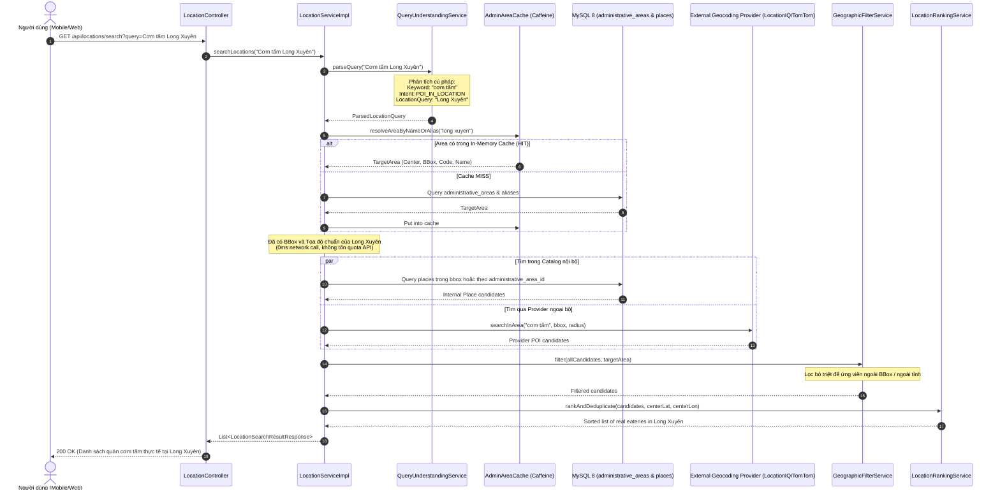

# PHASE 3.0 — THIẾT KẾ KIẾN TRÚC ĐỊA GIỚI HÀNH CHÍNH
## Target Architecture Design: Administrative Areas, Place Integration & Location Search

**Dự án:** Travel Planner  
**Giai đoạn:** Phase 3.0 — Administrative Data Audit & Architecture Design  
**Ngày thực hiện:** 2026-11-11  
**Mục tiêu:** Thiết lập kiến trúc dữ liệu và giải pháp tích hợp Đơn vị Hành chính cho hệ thống Travel Planner, tuân thủ mô hình chính quyền địa phương 2 cấp của Việt Nam sau ngày 01/07/2025, bảo tồn tính độc lập bất biến của Activity Location Snapshot và nâng cao độ chính xác của Location Search.

---

## 1. Tổng quan Kiến trúc Mục tiêu

Hệ thống Travel Planner sau Phase 2.1.1 đã hoàn thành việc hợp nhất Destination vào Place, biến `Place` thành nguồn chân lý danh mục địa điểm duy nhất. Trong Phase 3, kiến trúc tiếp tục được hoàn thiện bằng cách bổ sung một **Catalog Đơn vị Hành chính Chuẩn hóa Cục bộ (Canonical Administrative Areas Catalog)**.

### Các Nguyên tắc Kiến trúc Bất biến:
1. **Mô hình Chính quyền Địa phương 2 Cấp của Việt Nam (Sau 01/07/2025):**
   - Cấp 1 (Cấp Tỉnh): Gồm **34 đơn vị hành chính cấp tỉnh** (tại mốc snapshot 2026-09-20 gồm 25 tỉnh và 9 thành phố trực thuộc Trung ương: Hà Nội, TP. Hồ Chí Minh, Hải Phòng, Đà Nẵng, Cần Thơ, Huế, Đồng Nai, Quảng Ninh, Bắc Ninh).
   - Cấp 2 (Cấp Cơ sở): Gồm các đơn vị hành chính cấp xã (Xã, Phường, Đặc khu hành chính - kinh tế / hải đảo).
   - **Bãi bỏ cấp huyện làm cấp chính quyền trung gian:** Không sử dụng mô hình truyền thống `Province -> District -> Ward` làm cấu trúc phân cấp hiện hành.
   - Các quận, huyện, thị xã cũ trước đây cùng các xã/phường sáp nhập được quản lý bằng cơ chế **Aliases (Bí danh Địa giới Lịch sử)**.
2. **Bảo tồn Tuyệt đối Activity Location Snapshot:**
   - Hoạt động (`Activity`) lưu trữ snapshot vị trí độc lập (`location_name`, `location_address`, `latitude`, `longitude`, `place_id`, `location_provider`).
   - Bảng `activities` **không có quan hệ trực tiếp** với `administrative_areas`.
   - Bất kỳ thay đổi ranh giới, đổi tên hay cập nhật địa giới hành chính nào của `Place` đều **không được phép tác động đến dữ liệu lịch sử hoặc routing của `Activity`**.
3. **Phân giải Địa danh Tìm kiếm Cục bộ (Zero-Latency Locality Resolution):**
   - Loại bỏ việc gọi HTTP geocoding online ra nhà cung cấp ngoại bộ chỉ để hỏi tọa độ/bounding box của một địa danh hành chính.
   - 100% việc nhận diện và phân giải địa giới được xử lý nội bộ thông qua In-Memory Cache và MySQL 8 Spatial Index.

---

## 2. Mô hình Dữ liệu và Thiết kế ERD

### 2.1. Sơ đồ Quan hệ Thực thể (ERD)

```
+-----------------------------------+
|       administrative_areas        |
+-----------------------------------+
| PK  area_id             BIGINT    |
| UQ  code                VARCHAR   | <--- Mã số chuẩn GSO (2 số cho tỉnh, 5 số cho xã)
|     name                VARCHAR   |
|     normalized_name     VARCHAR   |
|     area_type           ENUM      | <--- PROVINCE, CENTRAL_CITY, WARD, COMMUNE, SPECIAL_ZONE
| FK  parent_id           BIGINT    | ----+ (Tự tham chiếu: Xã/Phường trỏ trực tiếp lên Tỉnh/TP)
|     status              ENUM      |     | (ACTIVE, HISTORICAL, MERGED)
|     center_latitude     DECIMAL   |     |
|     center_longitude    DECIMAL   |     |
|     min_latitude        DECIMAL   |     | (Bounding Box cho lọc nhanh)
|     max_latitude        DECIMAL   |     |
|     min_longitude       DECIMAL   |     |
|     max_longitude       DECIMAL   |     |
|     boundary_geom       GEOMETRY  |     | (Polygon / MultiPolygon WGS 84 SRID 4326)
|     boundary_geojson    LONGTEXT  |     | (JSON phục vụ hiển thị bản đồ client)
|     source              VARCHAR   |     |
+-----------------------------------+     |
      | 1                           ^     |
      |                             |     |
      | N                           +-----+
+-----------------------------------+
|    administrative_area_aliases    |
+-----------------------------------+
| PK  alias_id            BIGINT    |
| FK  area_id             BIGINT    |
|     alias_name          VARCHAR   |
|     normalized_alias    VARCHAR   | <--- Index phục vụ tìm kiếm không dấu
|     alias_type          ENUM      | <--- HISTORICAL_DISTRICT, OLD_COMMUNE_NAME,
|     confidence_score    DECIMAL   |      UNACCENTED, ABBREVIATION, COLLOQUIAL
+-----------------------------------+

      | 1 (area_id)
      |
      | 0..N (nullable FK)
      v
+-----------------------------------+         +-----------------------------------+
|              places               |         |      place_provider_mappings     |
+-----------------------------------+         +-----------------------------------+
| PK  place_id            BIGINT    | <---+   | PK  mapping_id          BIGINT    |
|     name                VARCHAR   |     |   | FK  place_id            BIGINT    |
|     normalized_name     VARCHAR   |     +---|     provider            VARCHAR   |
|     address             VARCHAR   |         |     provider_place_id   VARCHAR   |
|     latitude            DECIMAL   |         +-----------------------------------+
|     longitude           DECIMAL   |
| FK  administrative_area_id BIGINT | (Nullable! Không bắt buộc khi tạo Place)
+-----------------------------------+
      | 1
      |
      | 0..N (nullable FK)
      v
+-------------------------------------------------------------+
|                         activities                          |
+-------------------------------------------------------------+
| PK  activity_id             INT                             |
| FK  canonical_place_id      BIGINT (Nullable)               |
| --- TẬP THUỘC TÍNH SNAPSHOT ĐỘC LẬP BẤT BIẾN ---            |
|     location_name           VARCHAR(150)                    |
|     location_address        VARCHAR(255)                    |
|     latitude                DECIMAL(10,7)                   |
|     longitude               DECIMAL(10,7)                   |
|     place_id                VARCHAR(100) (Provider Ext ID)  |
|     location_provider       VARCHAR(30)                     |
+-------------------------------------------------------------+
```

---

### 2.2. Chi tiết Cấu trúc Bảng `administrative_areas`

Bảng lưu trữ thông tin chuẩn hóa của các đơn vị hành chính:

```sql
CREATE TABLE `administrative_areas` (
  `area_id` bigint NOT NULL AUTO_INCREMENT,
  `code` varchar(20) NOT NULL,
  `name` varchar(150) NOT NULL,
  `normalized_name` varchar(150) NOT NULL,
  `area_type` enum('PROVINCE','CENTRAL_CITY','WARD','COMMUNE','SPECIAL_ZONE') NOT NULL,
  `parent_id` bigint DEFAULT NULL,
  `status` enum('ACTIVE','HISTORICAL','MERGED') NOT NULL DEFAULT 'ACTIVE',
  `center_latitude` decimal(10,7) NOT NULL,
  `center_longitude` decimal(10,7) NOT NULL,
  `min_latitude` decimal(10,7) NOT NULL,
  `max_latitude` decimal(10,7) NOT NULL,
  `min_longitude` decimal(10,7) NOT NULL,
  `max_longitude` decimal(10,7) NOT NULL,
  `boundary_geom` geometry SRID 4326 DEFAULT NULL,
  `boundary_geojson` longtext DEFAULT NULL,
  `source` varchar(50) NOT NULL DEFAULT 'GSO_2025',
  `effective_from` date DEFAULT NULL,
  `effective_to` date DEFAULT NULL,
  `created_at` datetime(6) NOT NULL DEFAULT CURRENT_TIMESTAMP(6),
  `updated_at` datetime(6) NOT NULL DEFAULT CURRENT_TIMESTAMP(6) ON UPDATE CURRENT_TIMESTAMP(6),
  PRIMARY KEY (`area_id`),
  UNIQUE KEY `uk_admin_areas_code` (`code`),
  KEY `idx_admin_areas_parent_id` (`parent_id`),
  KEY `idx_admin_areas_normalized_name` (`normalized_name`),
  KEY `idx_admin_areas_type_status` (`area_type`, `status`),
  KEY `idx_admin_areas_bbox` (`min_latitude`, `max_latitude`, `min_longitude`, `max_longitude`),
  SPATIAL KEY `idx_admin_areas_geom` (`boundary_geom`),
  CONSTRAINT `fk_admin_areas_parent` FOREIGN KEY (`parent_id`) REFERENCES `administrative_areas` (`area_id`) ON DELETE RESTRICT
) ENGINE=InnoDB DEFAULT CHARSET=utf8mb4 COLLATE=utf8mb4_unicode_ci;
```

#### Ý nghĩa các trường quan trọng:
* **`code` (Mã số hành chính chuẩn):** Theo quy định của Cục Thống kê (NSO/GSO). Cấp tỉnh gồm 2 chữ số (ví dụ `"01"` - Hà Nội, `"79"` - TP. Hồ Chí Minh, `"48"` - TP. Đà Nẵng, `"46"` - TP. Huế). Cấp cơ sở gồm 5 chữ số.
* **`parent_id` (Phân cấp 2 tầng):**
  - Đối với đơn vị cấp tỉnh (`PROVINCE`, `CENTRAL_CITY`): `parent_id = NULL`.
  - Đối với đơn vị cấp cơ sở (`WARD`, `COMMUNE`, `SPECIAL_ZONE`): `parent_id` trỏ trực tiếp đến `area_id` của Tỉnh/Thành phố trực thuộc Trung ương quản lý.
  - Cấu trúc tự tham chiếu này vừa đơn giản, vừa linh hoạt, loại bỏ tầng trung gian cấp huyện nhưng vẫn cho phép mở rộng sau này nếu cần thêm cấp quốc gia (`COUNTRY`).
* **`min_latitude`, `max_latitude`, `min_longitude`, `max_longitude`:** Bounding Box chữ nhật dùng cho thuật toán lọc ứng viên sơ bộ cực nhanh bằng index B-Tree tiêu chuẩn.
* **`boundary_geom`:** Kiểu dữ liệu không gian `GEOMETRY` của MySQL 8 (Polygon hoặc MultiPolygon, hệ tọa độ chuẩn WGS 84 SRID 4326), có `SPATIAL KEY` phục vụ hàm `ST_Contains()` và `ST_Within()`.

---

### 2.3. Chi tiết Cấu trúc Bảng `administrative_area_aliases`

Bảng quản lý tất cả các biến thể tên gọi, tên gọi lịch sử, tên quận/huyện cũ, chữ viết tắt, và tên không dấu:

```sql
CREATE TABLE `administrative_area_aliases` (
  `alias_id` bigint NOT NULL AUTO_INCREMENT,
  `area_id` bigint NOT NULL,
  `alias_name` varchar(150) NOT NULL,
  `normalized_alias` varchar(150) NOT NULL,
  `alias_type` enum('HISTORICAL_DISTRICT','OLD_COMMUNE_NAME','UNACCENTED','ABBREVIATION','COLLOQUIAL','PROVIDER_VARIANT') NOT NULL,
  `confidence_score` decimal(3,2) NOT NULL DEFAULT 1.00,
  `notes` varchar(255) DEFAULT NULL,
  `created_at` datetime(6) NOT NULL DEFAULT CURRENT_TIMESTAMP(6),
  PRIMARY KEY (`alias_id`),
  KEY `idx_admin_aliases_area_id` (`area_id`),
  KEY `idx_admin_aliases_normalized` (`normalized_alias`),
  KEY `idx_admin_aliases_type` (`alias_type`),
  CONSTRAINT `fk_admin_aliases_area` FOREIGN KEY (`area_id`) REFERENCES `administrative_areas` (`area_id`) ON DELETE CASCADE
) ENGINE=InnoDB DEFAULT CHARSET=utf8mb4 COLLATE=utf8mb4_unicode_ci;
```

#### Giải quyết Bài toán Quận/Huyện cũ và Sáp nhập (Xử lý Quan hệ 1 - N):
* **Trường hợp 1 (Tên viết tắt / Tên thông tục):**
  - `"SG"`, `"Sai Gon"`, `"TPHCM"` $\rightarrow$ Trỏ về `area_id` của Thành phố Hồ Chí Minh.
  - `"HN"`, `"Ha Noi"` $\rightarrow$ Trỏ về `area_id` của Thủ đô Hà Nội.
  - `"ĐL"`, `"Dalat"` $\rightarrow$ Trỏ về `area_id` của Thành phố Đà Lạt.
* **Trường hợp 2 (Quận/Huyện cũ trước ngày 01/07/2025):**
  - Khi người dùng tìm `"Nhà hàng Quận 1"`: Do Quận 1 cũ gồm nhiều phường (Bến Nghé, Bến Thành, Đa Kao...), alias `"quan 1"` được tạo với loại `HISTORICAL_DISTRICT`.
  - **Phương án ánh xạ linh hoạt:** Đối với địa danh quận/huyện cũ bao trùm một vùng rộng, alias có thể liên kết trực tiếp với cấp Tỉnh/Thành phố trực thuộc TW với `notes = 'Quận 1 cũ'`, đồng thời lưu Bounding Box bao trọn phạm vi của quận cũ đó trong bộ nhớ đệm phục vụ tìm kiếm.
* **Trường hợp 3 (Tên địa danh bị sáp nhập):**
  - Xã cũ A sáp nhập vào Xã mới B: Tạo alias `alias_name = 'Xã A'`, `alias_type = 'OLD_COMMUNE_NAME'` trỏ về `area_id` của Xã mới B với `confidence_score = 1.00`.

---

### 2.4. Liên kết giữa Place và Administrative Area

Trong bảng `places`, thêm một cột khóa ngoại:

```sql
ALTER TABLE `places`
  ADD COLUMN `administrative_area_id` bigint DEFAULT NULL,
  ADD CONSTRAINT `fk_places_admin_area` FOREIGN KEY (`administrative_area_id`) REFERENCES `administrative_areas` (`area_id`) ON DELETE SET NULL;
```

#### Quy tắc Nghiệp vụ Liên kết Place:
1. **Liên kết cấp cơ sở thấp nhất:** `places.administrative_area_id` luôn được ưu tiên liên kết tới đơn vị hành chính cấp cơ sở (`WARD`, `COMMUNE`, `SPECIAL_ZONE`). Tỉnh/Thành phố trực thuộc TW được suy diễn dễ dàng qua `parent_id`.
2. **Tuyệt đối Nullable:** Nếu một Place chưa xác định được đơn vị hành chính (ví dụ Place mới thêm trên đảo chưa cắm mốc hoặc nhà cung cấp chỉ trả về tọa độ ngoài khơi), trường này nhận giá trị `NULL`. Place **vẫn tồn tại, hiển thị và hoạt động bình thường**.
3. **Chiến lược xác định tự động đa tầng (Multi-Tier Resolution):**
   - **Tầng 1 (Toán học Point-in-Polygon):** Dùng tọa độ `(latitude, longitude)` của Place thực hiện truy vấn không gian `ST_Contains(boundary_geom, Point(lon, lat))`. Nếu điểm nằm trọn trong polygon ranh giới, gán ngay với `confidence = 1.00`.
   - **Tầng 2 (Bounding Box + Khoảng cách tâm):** Nếu polygon ranh giới chi tiết chưa có sẵn, kiểm tra xem tọa độ có nằm trong `min_lat..max_lat` và khoảng cách Haversine tới tâm $< \text{Bán kính an toàn}$ hay không.
   - **Tầng 3 (Phân tích Chuỗi Địa chỉ):** Đối chiếu các từ khóa trong chuỗi `places.address` với bảng `administrative_area_aliases` và `administrative_areas.name`.
   - **Quy tắc an toàn ranh giới (Boundary Safety):** Nếu Place nằm cách đường biên 2 xã/phường dưới 100 mét mà hai tín hiệu (tọa độ và địa chỉ text) mâu thuẫn nhau, runner ghi nhận cờ cảnh báo `MANUAL_REVIEW_REQUIRED` và không tự động gán bừa để bảo vệ tính toàn vẹn dữ liệu.

---

## 3. Kiến trúc Tích hợp với Hệ thống Location Search

### 3.1. Luồng Tìm kiếm Hai Tầng Cải tiến (Enhanced Two-Stage Search)

Sơ đồ tuần tự xử lý truy vấn tìm kiếm (Ví dụ: `Cơm tấm Long Xuyên`):



### 3.2. Xử lý các Tình huống Truy vấn Đặc biệt
1. **Chỉ nhập Tên Địa danh (ví dụ `"Long Xuyên"`, `"Đà Lạt"`, `"Quận 1"`):**
   - Query Understanding nhận diện `searchIntent = LOCALITY`.
   - Hệ thống trả về ngay bản ghi Administrative Area đại diện với tọa độ tâm, Bounding Box và tên chuẩn hóa. Bản đồ client tự động zoom và bao trọn khung hình khu vực đó.
2. **Địa danh Trùng tên ở Nhiều Tỉnh (ví dụ `"Châu Thành"`):**
   - Huyện/Xã "Châu Thành" xuất hiện ở nhiều tỉnh (Tây Ninh, An Giang, Tiền Giang, Bến Tre...).
   - **Chiến lược giải quyết:**
     - Nếu request gửi kèm tọa độ người dùng `(userLat, userLon)`: Ưu tiên chọn khu vực gần người dùng nhất (Distance Bias).
     - Nếu không có tọa độ: Trả về danh sách gợi ý địa danh kèm ngữ cảnh cấp tỉnh (`"Châu Thành, An Giang"`, `"Châu Thành, Tiền Giang"`...) để người dùng lựa chọn trên giao diện autocomplete.
3. **Truy vấn Địa danh Lịch sử (ví dụ `"quán ăn ở Hà Tây cũ"` hoặc tên huyện cũ):**
   - Bảng Alias khớp chuỗi `"ha tay"` với `alias_type = 'HISTORICAL_DISTRICT'`.
   - Hệ thống mở rộng phạm vi tìm kiếm theo Bounding Box lịch sử của khu vực Hà Tây cũ thuộc Hà Nội hiện nay.
4. **Truy vấn Không dấu / Viết tắt (ví dụ `"com tam sg"`, `"cafe dl"`):**
   - Alias nhận diện `"sg"` $\rightarrow$ TP. Hồ Chí Minh; `"dl"` $\rightarrow$ Đà Lạt.
   - Tìm kiếm chính xác mà không bị nhà cung cấp bản đồ ngoại bộ trả về kết quả rác ở nước ngoài.

---

## 4. Thiết kế REST API Bổ sung cho Phase 3

Hệ thống chỉ bổ sung các API phục vụ danh mục hành chính thực sự cần thiết, không tạo endpoint dư thừa:

### 4.1. Public APIs (Dành cho Mobile App & Web User)
* **`GET /api/administrative-areas/provinces`**
  - **Mục đích:** Lấy danh sách 34 tỉnh và thành phố trực thuộc Trung ương của Việt Nam.
  - **Response:** Danh sách rút gọn (`code`, `name`, `areaType`, `centerLat`, `centerLon`, `boundingBox`).
  - **Cache:** HTTP Cache-Control `max-age=86400` (dữ liệu tỉnh rất ít biến động).
* **`GET /api/administrative-areas/{code}/children`**
  - **Mục đích:** Lấy danh sách các xã, phường, đặc khu trực thuộc một tỉnh/thành phố.
  - **Response:** Danh sách đơn vị cấp cơ sở kèm mã GSO và tọa độ.
* **`GET /api/administrative-areas/search?q={keyword}`**
  - **Mục đích:** Tìm kiếm địa giới hành chính theo từ khóa (hỗ trợ autocomplete khi người dùng chọn khu vực trên bản đồ hoặc bộ lọc).
* **`GET /api/administrative-areas/{code}`**
  - **Mục đích:** Lấy chi tiết thông tin đơn vị hành chính kèm GeoJSON boundary đa giác để vẽ vùng phủ trên bản đồ.

### 4.2. Mở rộng API Danh mục Place Hiện có
* **`GET /api/places?areaId={id}`** hoặc **`GET /api/places?provinceCode={code}`**:
  - Mở rộng endpoint `GET /api/places` hiện tại: cho phép lọc địa điểm du lịch theo mã vùng hành chính hoặc theo toàn tỉnh (truy vấn đệ quy hoặc theo `parent_id`).

---

## 5. Chiến lược Hiệu năng, Caching và MySQL 8 Spatial

1. **In-Memory Caching (Caffeine):**
   - Toàn bộ danh mục 34 tỉnh/thành phố và bảng ánh xạ Aliases chỉ chiếm khoảng $\approx 15\text{ MB}$ bộ nhớ RAM.
   - Sử dụng Caffeine Cache tải trước (pre-warm) toàn bộ danh mục cấp tỉnh khi Spring Boot khởi động.
   - Tốc độ resolve chuỗi địa danh sang tọa độ & BBox: $< 1\text{ ms}$ (so với $\approx 300 - 800\text{ ms}$ khi gọi HTTP tới LocationIQ).
2. **Tối ưu hóa Truy vấn Không gian MySQL 8:**
   - **Tầng 1 (Fast Bounding Box Pruning):** Lọc theo các cột số thực có B-Tree index:
     `WHERE latitude BETWEEN min_latitude AND max_latitude AND longitude BETWEEN min_longitude AND max_longitude`.
   - **Tầng 2 (Exact Spatial Point-in-Polygon):**
     `WHERE ST_Contains(boundary_geom, ST_SRID(Point(longitude, latitude), 4326))`.
   - Nhờ Spatial Index trên `boundary_geom`, MySQL 8 sử dụng R-Tree để loại bỏ 99% các polygon ngoài phạm vi, chỉ tính toán hình học đối với các ứng viên nằm trong MBR (Minimum Bounding Rectangle).
   - **Không cần chuyển đổi sang PostGIS:** Giải pháp MySQL 8 Spatial hoàn toàn đáp ứng trọn vẹn nhu cầu của ứng dụng mà không phát sinh thêm chi phí hạ tầng hay phức tạp hóa việc triển khai.

---

## 6. Chiến lược Migration và Idempotency (An toàn Tuyệt đối)

1. **Nguyên tắc Expand-Contract:**
   - **Giai đoạn Expand (Phase 3.1):** Tạo bảng `administrative_areas` và `administrative_area_aliases`. Seed dữ liệu chuẩn. Bảng `places` và `activities` chưa bị thay đổi.
   - **Giai đoạn Integrate (Phase 3.2):** Bổ sung cột nullable `places.administrative_area_id`. Chạy script đối chiếu và liên kết tự động/bán tự động cho 24 địa điểm hiện có.
   - **Giai đoạn Verify:** Xác minh 121 activities giữ nguyên 100% snapshot vị trí. Chạy lại toàn bộ test suite.
2. **Tính Idempotent của Runner:**
   - Migration runner sử dụng MySQL Advisory Lock `administrative_area_migration_lock` với bounded retry tương tự Phase 2.1.
   - Các bản ghi seed được xác định duy nhất bằng trường `code` (`uk_admin_areas_code`). Nếu đã tồn tại bản ghi, runner thực hiện cập nhật mà không chèn trùng lặp.
3. **Kế hoạch Rollback An toàn:**
   - Cột `administrative_area_id` là nullable. Nếu cần rollback, chỉ việc gán `administrative_area_id = NULL` hoặc drop cột này khỏi bảng `places`.
   - Toàn bộ hoạt động của ứng dụng, Activity snapshots, routing và Place Catalog vẫn vận hành bình thường mà không bị ảnh hưởng.

---

## 7. Trạng thái Triển khai Thực tế Phase 3.1, 3.1.1 & 3.1.2 (Đã hoàn thành và hiệu chỉnh)

Triển khai thực tế qua các Phase 3.1, 3.1.1 và đặc biệt là đợt hiệu chỉnh toàn diện **Phase 3.1.2** đã hoàn thành và nghiệm thu với các thành phần cụ thể:
1. **Bảng `administrative_areas` & `administrative_catalog_metadata`:**
   - Bảng `administrative_areas`: `area_id` (PK BIGINT AUTO_INCREMENT), `code` (VARCHAR(20) UNIQUE NOT NULL), `name` (VARCHAR(150) NOT NULL), `normalized_name` (VARCHAR(150) NOT NULL), `area_type` (ENUM NOT NULL: PROVINCE, CENTRAL_CITY, COMMUNE, WARD, SPECIAL_ZONE), `status` (ENUM NOT NULL: ACTIVE, HISTORICAL, INACTIVE), `parent_id` (BIGINT NULL, FK tự tham chiếu), `center_latitude` (DECIMAL(10,7)), `center_longitude` (DECIMAL(10,7)), `created_at`, `updated_at`.
   - Bảng `administrative_catalog_metadata`: Quản lý metadata nguồn, theo dõi `DATASET_VERSION`, `SNAPSHOT_DATE` (`2026-09-20`), `EFFECTIVE_DATE` (`2026-09-20`), `LEGAL_BASIS`, `SOURCE_NAME`, `DATASET_SHA256` (`eb5c213a...`), `CANONICAL_CONTENT_CHECKSUM` (`44a715a9...`), số lượng `TOTAL_PROVINCES` (34), `TOTAL_COMMUNES` (3321), số lượng chi tiết từng loại và timestamp cập nhật.
   - **Lưu ý phân kỳ:** Các cột spatial (`boundary_geom`, `boundary_geojson`, `min_latitude`, ...) và bảng `administrative_area_aliases` được bảo lưu sang các giai đoạn sau (Phase 3.2+ và Phase 3.3) để đảm bảo tính tối giản, trọng tâm và độ ổn định cao nhất cho Catalog cốt lõi.
2. **Bộ Dữ liệu Chuẩn Quốc gia Hiệu chỉnh (Khớp 100% NQ 202/2025/QH15, QĐ 19/2025/QĐ-TTg, NQ 388/NQ-UBTVQH16):**
   - Đúng 34 đơn vị cấp tỉnh (28 tỉnh + 6 thành phố trực thuộc TW: Hà Nội '01', Hải Phòng '31', Đà Nẵng '48', Huế '46', TP. Hồ Chí Minh '79', Cần Thơ '92'). Đã chuẩn hóa tiền tố "Tỉnh" cho Quảng Ninh, Bắc Ninh, Đồng Nai.
   - Đúng 3.321 đơn vị cấp cơ sở (2.599 xã, 709 phường, 13 đặc khu đảo).
   - Đã xác minh các mapping trọng yếu: Hà Nội (`00004` Ba Đình, `00008` Ngọc Hà); TP.HCM (`26740` Sài Gòn, `26743` Bến Thành, `26758` Cầu Ông Lãnh, `26737` Tân Định); Đặc khu Phú Quý thuộc Lâm Đồng (`68`); Đặc khu Côn Đảo thuộc TP.HCM (`79`); Đặc khu Phú Quốc, Thổ Châu, Kiên Hải thuộc An Giang (`91`).
3. **Bộ Kiểm tra Độc lập & Hệ thống Checksum Kép (`AdministrativeAreaValidator`):**
   - Module `AdministrativeAreaValidator` độc lập với importer, kiểm tra toàn diện cấu trúc, số lượng, quan hệ cây không chu trình.
   - Tính toán Canonical Content Checksum (v1) độc lập với thứ tự các dòng trong JSON (`44a715a95b9f3dac4f4f67a72f457c05c075c9dbf893f1668d106e96348e1230`).
   - Kiểm tra đối chiếu trực tiếp dữ liệu thực tế trong DB: Phát hiện tức thì các trường hợp sửa tên hoặc thay đổi cha trực tiếp trong MySQL mà không thay đổi hash metadata.
4. **Caffeine In-Memory Caching:**
   - 3 caches cục bộ: `provincesCache` (pre-warmed), `childrenCache` (theo province code), `codeCache` (theo code).
5. **REST Endpoints Công khai (Spring Security permitAll):**
   - `GET /api/administrative-areas/provinces`
   - `GET /api/administrative-areas/{code}/children`
   - `GET /api/administrative-areas/search?q={keyword}&limit={limit}` (kèm thông tin disambiguation `parentCode`, `parentName`, `parentType`)
   - `GET /api/administrative-areas/{code}`
6. **Kiểm thử Tự động & Hồi quy:**
   - 32 test tự động chuyên biệt cho Administrative Areas (5 Validator, 5 Repository, 14 Migration Runner & Hardening, 8 WebMvc Controller).
   - Toàn bộ backend test suite đạt 353 / 353 PASS tuyệt đối (exit code 0).

---

## 8. Kết quả Kiểm chứng Độc lập & Đóng dấu Kỹ thuật (Phase 3.1.2.1)

Trong Phase 3.1.2.1, các kết quả kiểm chứng độc lập đã khẳng định tính ổn định của hệ thống:
1. **Kiểm chứng Căn cứ Pháp lý & 22 Đơn vị Chuyển đổi:**
   - 12/22 trường hợp thành lập phường tại Bắc Ninh đạt `VERIFIED_PRIMARY` qua Nghị quyết 388/NQ-UBTVQH16.
   - 10/22 trường hợp đạt `VERIFIED_SECONDARY` qua danh mục đối chiếu GSO.
2. **Khóa Tương tranh & Khả năng Chịu lỗi:**
   - Hoàn thiện kiểm thử tương tranh giữa 2 connection độc lập cạnh tranh MySQL Advisory Lock (`testAdvisoryLock_TwoConnections_SecondConnectionBlocksOrTimesOut`).
   - Kiểm thử phát hiện và khôi phục khi can thiệp DB trực tiếp (`testDatabaseCorruption_TamperProvinceNameAndVerifyRejectionAndRestoration`).
   - Tổng số test chuyên biệt tăng lên **38 test** (9 Validator, 16 Migration Runner, 5 Repository, 8 Controller), toàn bộ PASS.
3. **Bảo tồn Place & Activity:**
   - 24 places, 121 activities hoàn toàn nguyên vẹn; chưa thêm trường `administrative_area_id` vào `places` (chờ Phase 3.2).

---

## 9. Khắc phục Triệt để Pháp lý & Dữ liệu (Phase 3.1.2.2 Legal & Data Remediation)

Trong Phase 3.1.2.2, toàn bộ các sai lệch pháp lý và phân loại đã được giải quyết:
1. **Chuẩn hóa Cơ cấu Cấp Tỉnh:**
   - Xác định chính xác 9 thành phố trực thuộc Trung ương (`CENTRAL_CITY`): Hà Nội (`01`), Quảng Ninh (`22` - NQ 36/2026/QH16), Bắc Ninh (`24` - NQ 39/2026/QH16), Hải Phòng (`31`), Huế (`46` - NQ 175/2024/QH15), Đà Nẵng (`48`), Đồng Nai (`75` - NQ 30/2026/QH16), TP. Hồ Chí Minh (`79`), Cần Thơ (`92`).
   - 25 tỉnh (`PROVINCE`).
2. **Xác minh Sơ cấp 100% cho 22 Chuyển đổi Xã thành Phường:**
   - 10 phường tại TP. Đồng Nai: Nghị quyết 237/NQ-UBTVQH16 (hiệu lực 30/04/2026).
   - 12 phường tại TP. Bắc Ninh: Nghị quyết 388/NQ-UBTVQH16 (hiệu lực 20/09/2026).
   - Cơ cấu cấp xã: 3.321 đơn vị = 2.599 `COMMUNE`, 709 `WARD`, 13 `SPECIAL_ZONE`.
3. **Bộ Checksum & Kiểm thử Tương tranh Đa luồng:**
   - Raw Dataset SHA-256: `8fa358a085cdc10e4533ef41a51ee02b8e2a81dd6b0cb642e44ab33f2b60b816`.
   - Canonical Content Checksum v1: `af6e22c85f46a03cd68f5d4335d6e12129dff9038c17eaabf285084d53ab8674`.
   - Test tương tranh đa luồng thực sự: `testTwoIndependentRunners_ConcurrentExecution_OneAcquiresAndOtherWaitsOrBypasses`.
   - Toàn bộ 362 / 362 test backend PASS tuyệt đối (exit code 0).

---

## 10. Nghiệm thu Cuối cùng & Đóng Cổng Kỹ thuật (Phase 3.1.2.3 Final Verification)

Trong Phase 3.1.2.3, hệ thống đã hoàn thiện toàn diện:
1. **Chuẩn hóa Ngày Ký và Ngày Hiệu lực:**
   - Đính chính ngày ký chính thức: NQ 30/2026/QH16 (24/04/2026), NQ 36/2026/QH16 (24/08/2026), NQ 39/2026/QH16 (24/08/2026), NQ 237/NQ-UBTVQH16 (14/04/2026), NQ 388/NQ-UBTVQH16 (04/08/2026).
2. **Đối soát 34 Đơn vị Cấp Tỉnh:**
   - 9 CENTRAL_CITY và 25 PROVINCE được đối chiếu độc lập, loại bỏ hoàn toàn việc nhắc tới các tỉnh cũ đã sáp nhập.
3. **Phân tích Đa tầng Luật SHTT:**
   - Điều 15 (khoản 2 & 3) và Điều 14 Luật SHTT được phân tích chi tiết, khẳng định tính hợp pháp của việc tích hợp dữ liệu công quyền.
4. **Bộ 7 Artifacts tại `docs/verification/phase-3-1-2-3/`:**
   - Đầy đủ 7 báo cáo, file CSV và tài liệu kiểm chứng kỹ thuật.
5. **Nghiệm thu Chính thức:**
   - **ACCEPTED WITH EXPLICIT LIMITATIONS**, hoàn toàn đủ điều kiện triển khai Phase 3.2.

---

## 11. Chuẩn hóa Toàn vẹn Dữ liệu & Quy tắc Kiểm soát (Phase 3.1.2.4 Canonical Remediation)

Thực thi theo tài liệu chỉ đạo chuẩn `docs/verification/phase-3-1-2-4/00-canonical-correction-reference.md`:
1. **Đối soát chính xác 10 phường Đồng Nai theo NQ 237/NQ-UBTVQH16:**
   - Thay thế hoàn toàn danh sách sai cũ bằng 10 phường chính thức: Trảng Bom (`26248`), Long Thành (`26368`), Trị An (`26170`), Nhơn Trạch (`26485`), Tân Khai (`25357`), Xuân Lộc (`26425`), Tân Phú (`26116`), Lộc Ninh (`25270`), Dầu Giây (`26326`), Đồng Phú (`25363`) trực thuộc `75` Thành phố Đồng Nai (`VERIFIED_PRIMARY`).
2. **Quy tắc Kiểm soát 12 Phường Bắc Ninh (Blocker):**
   - 12 bản ghi (`07294`, `07375`, `07399`, `07444`, `07840`, `09193`, `09292`, `09313`, `09319`, `09454`, `09475`, `09496`) được gán cờ `UNVERIFIED_SOURCE_DOCUMENT_MISSING`.
   - **Quy tắc Phase 3.2:** Không được gán khóa ngoại `administrative_area_id` cho các địa điểm du lịch có địa chỉ thuộc 12 đơn vị này; bắt buộc giữ `NULL` và báo cáo `unresolved` cho tới khi có phụ lục số hóa chính thức của NQ 388.
3. **Hiệu chỉnh Tỉnh Quản lý cho 5 Đặc khu:**
   - Phú Quý $\rightarrow$ Lâm Đồng (`68`), Côn Đảo $\rightarrow$ TP.HCM (`79`), Phú Quốc, Thổ Châu, Kiên Hải $\rightarrow$ An Giang (`91`).
4. **Đối soát 1-1 Cơ sở Dữ liệu & Bảo vệ Dữ liệu Nghiệp vụ:**
   - 3.355 bản ghi MySQL khớp 100% với JSON tệp nguồn, Canonical Content Checksum v1 = `af6e22c85f46a03cd68f5d4335d6e12129dff9038c17eaabf285084d53ab8674`.
   - 24 địa điểm và 121 hoạt động hành trình giữ nguyên vẹn 100%; 0 cột mới được thêm vào `places` ở giai đoạn này.
5. **Bộ Artifacts mới tại `docs/verification/phase-3-1-2-4/`:** Đầy đủ 6 tài liệu nghiệm thu kỹ thuật và CSV chi tiết từng bản ghi.
6. **Trạng thái:** **ACCEPTED WITH EXPLICIT LIMITATIONS**, chính thức mở khóa Phase 3.2.

---

## 12. Kiểm chứng Độc lập & Khóa Ranh giới Tin cậy (Phase 3.1.2.4.1 Independent Verification)

Trong Phase 3.1.2.4.1, hệ thống đã hoàn thành kiểm chứng độc lập chuyên sâu:
1. **Thiết lập Ranh giới Tin cậy Độc lập (Database Trust Boundary):**
   - Phân cấp dữ liệu thành 4 tầng: Tầng A (67 bản ghi tin cậy sơ cấp: 34 tỉnh/TP + 33 xã/phường/đặc khu), Tầng B (3.276 xã/phường tin cậy thứ cấp theo GSO), Tầng C (12 bản ghi Bắc Ninh thiếu phụ lục NQ 388, trạng thái `UNVERIFIED_SOURCE_DOCUMENT_MISSING`), Tầng D (0 sai lệch).
   - Quy tắc bất biến: Tuyệt đối không cho phép bản ghi Tầng C tham gia liên kết địa điểm (`places.administrative_area_id = NULL`) hoặc lập chỉ mục tìm kiếm công khai.
2. **Kiểm chứng Độc quyền Đồng thời Đa Tiến trình (Multi-Process MySQL Advisory Lock):**
   - Thực nghiệm với 2 tiến trình độc lập (`mysql.exe`, PID 20144 và PID 1256/1136) trên 2 socket TCP riêng biệt kết nối MySQL.
   - Tiến trình B bị từ chối với mã trả về `0` khi tiến trình A đang giữ khóa (`SLEEP(4)`), và ngay lập tức tiếp nhận khóa thành công với mã trả về `1` sau khi tiến trình A giải phóng.
   - Loại bỏ nguy cơ race condition giữa các instance container khởi động song song.
3. **Bảo tồn Dữ liệu Nghiệp vụ (Row-Level Audit):**
   - Bảng `places` giữ nguyên đúng 12 cột (không có cột thừa, không có `administrative_area_id`), 24 địa điểm giữ nguyên vẹn tọa độ và metadata.
   - Bảng `activities` giữ nguyên 121 hoạt động (111 linked via `canonical_place_id`, 10 free-form custom locations), phân biệt rõ `canonical_place_id` (khóa ngoại nội bộ) và `place_id` (mã địa điểm ngoại vi).
4. **Bộ 6 Artifacts Nghiệm thu Bổ sung tại `docs/verification/phase-3-1-2-4/`:**
   - `07-independent-record-verification.csv`
   - `08-unverified-records-and-runtime-exclusion.md`
   - `09-dong-nai-code-evidence.md`
   - `10-place-activity-row-level-preservation.md`
   - `11-independent-mysql-concurrency-test.md`
   - `12-final-independent-acceptance.md`
5. **Quyết định Nghiệm thu Cuối cùng:** **`ACCEPTED WITH EXPLICIT LIMITATIONS`**.

---

## 13. Cơ chế Liên kết & Phân giải Địa giới Hành chính cho Địa điểm (Phase 3.2 Implementation)

Trong Phase 3.2, hệ thống đã hoàn thành việc triển khai liên kết thực thể giữa `Place` và `AdministrativeArea`:
1. **Schema & Migration:**
   - Bổ sung cột `places.administrative_area_id` với khóa ngoại `fk_places_admin_area` (`ON DELETE SET NULL`) và chỉ mục `idx_places_admin_area`.
   - Bổ sung cột `administrative_areas.trust_classification` (4 tiers: `VERIFIED_AND_TRUSTED`, `VERIFIED_WITH_LIMITATIONS`, `UNVERIFIED_AND_QUARANTINED`, `MISMATCH`) và chỉ mục `idx_admin_areas_trust_class`.
   - Runner `PlaceAdministrativeAreaMigrationRunner` (`@Order(6)`) sử dụng single-connection MySQL advisory lock `place_administrative_area_migration_lock`.
2. **Administrative Area Resolver:**
   - Phân giải ưu tiên đa tầng: Mã đơn vị hành chính chính xác $\rightarrow$ Bóc tách cấu trúc địa chỉ $\rightarrow$ Nhận diện tỉnh từ địa chỉ $\rightarrow$ Ưu tiên xã/phường tên ghép $\rightarrow$ Dự phòng cấp tỉnh.
   - Kiểm tra tọa độ lãnh thổ Việt Nam `[8.0, 24.0] Lat`, `[102.0, 110.0] Lon`.
   - Cách ly tuyệt đối 12 mã Bắc Ninh: trả về `confidence=UNVERIFIED`, `resolvedArea=null`, `eligibleForAutoLink=false`.
3. **Kết quả Liên kết Địa điểm Du lịch (24 Places):**
   - 20/24 địa điểm (83.3%) được liên kết tự động chính xác (17 cấp xã/phường/đặc khu, 3 dự phòng cấp tỉnh).
   - 4/24 địa điểm trả về `confidence=AMBIGUOUS` với danh sách ứng viên đính kèm phục vụ liên kết thủ công.
   - 0 địa điểm bị liên kết nhầm hoặc liên kết vào 12 bản ghi Bắc Ninh cách ly.
4. **Bảo tồn Invariants Nghiệp vụ:**
   - 24 địa điểm (IDs 1..24) và 121 hoạt động (111 canonical, 10 custom) nguyên vẹn 100%. Bảng `activities` hoàn toàn không bị sửa đổi.
5. **Hệ thống Kiểm thử:**
   - 28/28 test Phase 3.2 PASS; 390/390 backend regression PASS; 33/33 Flutter Web PASS; 364/367 Flutter Mobile PASS (giữ nguyên baseline).
6. **Bộ 8 Artifacts Nghiệm thu tại `docs/verification/phase-3-2/`:**
   - `01-database-migration-report.md`
   - `02-resolver-architecture-and-decision-rules.md`
   - `03-trust-classification-report.md`
   - `04-place-linking-results.md`
   - `05-quarantine-exclusion-verification.md`
   - `06-data-integrity-audit.md`
   - `07-test-execution-report.md`
   - `08-final-acceptance-report.md`
7. **Trạng thái:** **ACCEPTED WITH EXPLICIT LIMITATIONS**, hoàn toàn sẵn sàng cho Phase 3.3.


