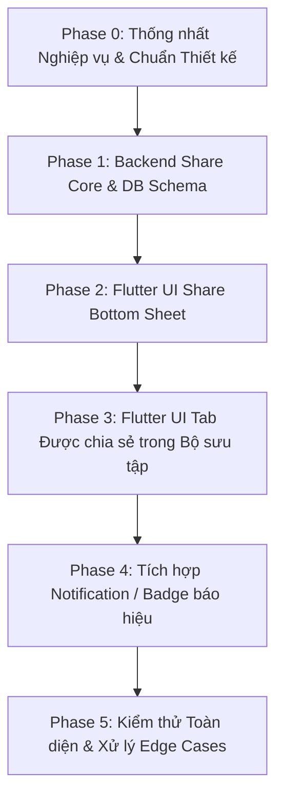

# Báo Cáo Audit Kiến Trúc & Kế Hoạch Triển Khai: In-App Sharing

**Tài liệu tham chiếu:** `docs/plan/05-in-app-sharing-architecture-audit.md`  
**Vị trí lưu trữ:** `Travel_Planner/docs/plan/05-in-app-sharing-architecture-audit.md`  
**Ngày thực hiện audit:** 21/11/2026  
**Trạng thái kiểm tra mã nguồn:** Đối chiếu trực tiếp mã nguồn Backend (Spring Boot 4.1.1, Java 22) và Mobile Client (Flutter 3.47.7, Dart 3.13.5).  
**Mục đích:** Audit toàn diện hệ thống hiện tại, đánh giá tính khả thi, phân tích các phương án chia sẻ nội bộ (In-app Sharing), đề xuất mô hình dữ liệu, thiết kế REST API, thiết kế luồng giao diện Flutter và lộ trình triển khai theo từng giai đoạn (Phase).  
**Ràng buộc giai đoạn:** **TUYỆT ĐỐI CHỈ AUDIT VÀ LẬP KẾ HOẠCH — KHÔNG SỬA CODE, KHÔNG SỬA DATABASE, KHÔNG SỬA SCHEMA, KHÔNG COMMIT HAY CHECKOUT GIT.**

---

## 1. Tổng quan kiến trúc In-App Sharing phù hợp với Travel Planner

### 1.1. Bối cảnh dự án & Phạm vi In-App Sharing
Travel Planner hiện đang trong giai đoạn phát triển nội bộ, chưa deploy môi trường production công khai trên Internet. Vì vậy:
- **Nằm ngoài phạm vi (Out of Scope):** Chia sẻ qua liên kết công khai (Public Web URLs), Deep Links / App Links / Universal Links, SDK tích hợp Facebook / Zalo / Telegram / hệ thống bên thứ ba.
- **Trọng tâm (In-App Sharing):** Người dùng đang đăng nhập trong Travel Planner có thể chủ động chia sẻ nội dung (Lịch trình - `Itinerary`, Bài viết cộng đồng - `Post`) trực tiếp cho những người dùng khác trong hệ thống. Người nhận có thể nhận diện nội dung được chia sẻ, xem chi tiết và lưu/tái sử dụng theo đúng quyền hạn được cấp.

### 1.2. Phân định ba khái niệm cốt lõi (Core Separation of Concerns)
Để kiến trúc hệ thống không bị xung đột hoặc chồng chéo nghiệp vụ, cần tách biệt rõ ràng 3 khái niệm:
1. **Share Record (Bản ghi hành động chia sẻ):** Đại diện cho sự kiện Người A gửi Nội dung X cho Người B, kèm lời nhắn (note) tùy chọn và thời điểm gửi. Phục vụ quản lý lịch sử gửi/nhận, thu hồi chia sẻ, và hiển thị hộp thư chia sẻ.
2. **Access Permission (Quyền truy cập nội dung):** Quyết định xem Người B có quyền đọc (READ-ONLY) dữ liệu chi tiết của Nội dung X hay không. Đặc biệt quan trọng khi Nội dung X là Lịch trình riêng tư (`PRIVATE`) hoặc Bài viết bạn bè (`FRIENDS`).
3. **Notification / Alert (Kênh truyền thông báo):** Phương thức báo hiệu tức thời cho Người B biết có nội dung mới được gửi tới (thông qua In-App Notification hoặc tin nhắn trong hộp thư Messaging).

---

## 2. Hiện trạng Codebase liên quan và khả năng tái sử dụng

Audit thực tế trên Git branch `develop` (working tree sạch, không có uncommitted changes):

| Thành phần | Đường dẫn mã nguồn | Trạng thái thực tế | Khả năng tái sử dụng cho Sharing |
|---|---|---|---|
| **Itinerary Entity & CRUD** | `backend/.../model/Itinerary.java`<br>`backend/.../service/impl/ItineraryServiceImpl.java`<br>`backend/.../controller/ItineraryController.java` | **Đã hoàn thành đầy đủ** (CRUD, Day, Activity, Clone, Reorder). | Có sẵn API lấy chi tiết `GET /api/itineraries/{id}`. Cần mở rộng quy tắc kiểm tra quyền xem cho người nhận chia sẻ nếu lịch trình là PRIVATE. |
| **Itinerary Visibility & Ownership** | `Itinerary.java` (`visibility` = PUBLIC / PRIVATE, `status` = ACTIVE / DELETED) | **Đã hoàn thành**. | Hiện tại nếu `visibility != PUBLIC` và `!isOwner`, `getItineraryDetail` ném `ResourceNotFoundException`. Đây là điểm chốt chặn phân quyền cần hỗ trợ thêm người được chia sẻ hợp lệ. |
| **Bảng `itinerary_shares` (Legacy)** | `backend/.../model/ItineraryShare.java`<br>`backend/.../repository/ItineraryShareRepository.java` | **Triển khai dang dở (Stub)**. Chỉ có entity và repository với các trường: `shareId`, `itinerary`, `shareToken`, `createdAt`, `expiresAt`. Không có service, không có controller. Chỉ được gọi trong `DataSeeder.java`. | **Không phù hợp cho In-App Sharing** vì thiết kế thuần túy cho token URL hết hạn, thiếu `sender_id`, `recipient_id`, `status`, loại nội dung. Cần tạo bảng/entity chuyên biệt cho User-to-User Sharing hoặc tái cấu trúc có kiểm soát. |
| **Community Post Entity & Feed** | `backend/.../model/Post.java`<br>`backend/.../service/impl/PostServiceImpl.java`<br>`backend/.../controller/CommunityPostController.java` | **Đã hoàn thành đầy đủ** (Public Feed, Following Feed, My Posts, Like, Comment, Report). Hỗ trợ gắn kèm Itinerary (`itinerary_id`). | Post đã có sẵn phân quyền (PUBLIC, FRIENDS, PRIVATE). Có thể chia sẻ Post trực tiếp cho người khác. Post card trên Flutter (`post_card_widget.dart`) đã có sẵn chú thích comment `// Action Buttons: Like, Comment, Share` nhưng nút Share chưa được dựng. |
| **User Entity & Search** | `backend/.../model/User.java`<br>`backend/.../service/PublicUserService.java`<br>`backend/.../controller/PublicUserController.java` | **Đã hoàn thành đầy đủ**. | API `GET /api/users/search?q={query}` đã có sẵn phân trang, tìm theo `username`, `handle`, `fullName`. Flutter Mobile đã có sẵn `UserSearchScreen` với bộ lọc debounce 350ms cực tốt, có thể tái sử dụng trực tiếp để tìm người nhận. |
| **Friendship & Social Connections** | `backend/.../model/Friendship.java`<br>`backend/.../service/FriendshipService.java`<br>`backend/.../controller/FriendshipController.java` | **Đã hoàn thành đầy đủ** (PENDING, ACCEPTED, DECLINED). | API `GET /api/users/me/friends` có sẵn, cho phép lấy nhanh danh sách bạn bè thân thiết để ưu tiên hiển thị đầu danh sách người nhận chia sẻ. |
| **Follow & Block** | `Follow.java`, `UserBlock.java`, `BlockAccess.java` | **Đã hoàn thành đầy đủ**. | Đã có sẵn logic kiểm tra chặn 2 chiều `blockAccess.isBlockedBetween(u1, u2)`. Tuyệt đối tái sử dụng để chặn chia sẻ giữa những người dùng đã block nhau. |
| **Messaging (Chat 1-1 & WebSocket)** | `backend/.../service/impl/MessagingServiceImpl.java`<br>`frontend/.../features/messaging/*` | **Đã hoàn thành đầy đủ** (STOMP WebSocket realtime, ChatScreen, Message Requests). | Có thể cân nhắc gửi một tin nhắn hệ thống/tin nhắn đính kèm lịch trình vào cuộc hội thoại chat nếu người dùng muốn chia sẻ qua Chat. |
| **Notification System** | `frontend/.../features/notifications/presentation/screens/notifications_screen.dart` | **Chưa triển khai Backend; Frontend chỉ là Placeholder tĩnh**. | Backend **hoàn toàn chưa có** `Notification.java`, `NotificationService`, hay bất kỳ API thông báo nào. Mobile chỉ có màn hình tĩnh hiển thị `AppEmptyState('Chưa có thông báo')`. **Không được giả định hệ thống đã có Notification.** |
| **Bộ sưu tập (Collections UI)** | `frontend/.../features/collection/*` | **Đã hoàn thành** (Tab 4 gồm 2 sub-tab: "Đã lưu" và "Yêu thích", dùng `AutoRefreshLifecycleMixin` và `AppSyncBus`). | Rất lý tưởng để bổ sung sub-tab thứ 3: "Được chia sẻ" (Shared with me) hoặc khu vực quản lý lịch trình được chia sẻ. |
| **AppSyncBus (State Synchronization)** | `frontend/.../core/sync/app_sync_bus.dart` | **Đã hoàn thành**. | Đã có sẵn kiến trúc đồng bộ trạng thái giữa các màn hình, có sẵn `SyncDomain.notifications`, `SyncDomain.collections`. Dễ dàng mở rộng `SyncDomain.shares` hoặc `SyncEventType.shared`. |

---

## 3. Các chức năng còn thiếu (Gap Analysis)

1. **Backend Database:**
   - Chưa có bảng/entity lưu trữ quan hệ chia sẻ trực tiếp giữa người dùng với người dùng (`user_shares` hoặc `in_app_shares`).
   - Bảng `itinerary_shares` cũ chỉ có `share_token` phục vụ URL công khai, không có người nhận, không phân biệt loại nội dung.
2. **Backend Service & Controller:**
   - Chưa có `ShareService` và `ShareController`.
   - Chưa có logic phân quyền đọc phụ thuộc: Người dùng không phải chủ sở hữu nhưng có bản ghi `Share` hợp lệ thì được phép đọc chi tiết lịch trình riêng tư.
3. **Notification Engine:**
   - Hoàn toàn thiếu Entity `Notification`, Service, Controller, Repositories, DTOs trên Backend.
   - Mobile `notifications_screen.dart` chưa kết nối API, chưa có StateNotifier/Bloc/Repository.
4. **Mobile UI/UX:**
   - Chưa có nút Share trên `ItineraryDetailScreen` (hiện chỉ có Bookmark, Favorite, Clone, Edit, Delete).
   - Chưa có nút Share trên `post_card_widget.dart` trong Community Feed.
   - Chưa có Bottom Sheet / Dialog tìm kiếm và chọn người nhận (Recipients Picker).
   - Chưa có màn hình hoặc tab hiển thị danh sách "Nội dung được chia sẻ với tôi" (Shared with me) và "Nội dung tôi đã chia sẻ" (Shared by me).

---

## 4. So sánh ưu nhược điểm của các phương án Sharing

### 4.1. Phương án A — Chia sẻ trực tiếp đến người dùng (Direct User-to-User Sharing)
- **Cơ chế:** Người gửi bấm Share -> Hiện danh sách chọn 1 hoặc nhiều người nhận (bạn bè/tìm kiếm) -> Bấm Gửi.
- **Ưu điểm:**
  - Trực quan, quen thuộc với người dùng di động (giống Instagram, Google Drive, Wanderlog).
  - Xác định chính xác đối tượng nhận, bảo mật thông tin cao.
  - Tận dụng ngay API tìm kiếm người dùng (`/api/users/search`) và danh sách bạn bè (`/api/users/me/friends`).
- **Nhược điểm:** Cần có nơi để người nhận biết và mở nội dung (nếu chưa có Notification thì phải có Hộp thư chia sẻ hoặc tin nhắn).

### 4.2. Phương án B — Hộp thư / Danh sách nội dung được chia sẻ (Shared Content Hub)
- **Cơ chế:** Tạo một phân mục lưu trữ danh sách:
  1. *Được chia sẻ với tôi (Shared with me)*
  2. *Tôi đã chia sẻ (Shared by me)*
- **Ưu điểm:**
  - Không phụ thuộc vào hệ thống Push Notification thời gian thực. Người nhận mở app, vào mục này là thấy toàn bộ nội dung được gửi cho mình.
  - Quản lý trạng thái rõ ràng: thời điểm nhận, ai gửi, ghi chú đi kèm, trạng thái nội dung (còn xem được hay đã bị thu hồi/xóa).
  - Tích hợp tự nhiên vào Tab "Bộ sưu tập" (Tab 4) bên cạnh "Đã lưu" và "Yêu thích".
- **Nhược điểm:** Cần xây dựng giao diện danh sách phân trang và API truy vấn 2 chiều (sent/received).

### 4.3. Phương án C — Chia sẻ bằng quyền truy cập (Access-based Sharing)
- **Cơ chế:** Việc chia sẻ tạo ra một "vé ủy quyền" (Access Grant). Người nhận được phép xem (READ-ONLY) lịch trình của người gửi ngay cả khi lịch trình đang ở chế độ `PRIVATE`.
- **Ưu điểm:**
  - Giải quyết bài toán cốt lõi: Lịch trình du lịch cá nhân chưa muốn công khai cho toàn bộ cộng đồng (`PRIVATE`) nhưng muốn chia sẻ riêng cho bạn đồng hành xem.
  - Quyền sở hữu (`isOwner`) tuyệt đối không thay đổi; người nhận chỉ có quyền READ, không được EDIT, không được DELETE.
  - Người gửi có thể thu hồi quyền (`REVOKE`) bất cứ lúc nào.
- **Nhược điểm:** Phức tạp hóa câu lệnh kiểm tra quyền ở Backend (`ItineraryServiceImpl.getItineraryDetail`). Cần xử lý cẩn thận các trường hợp nội dung bị xóa hoặc đổi trạng thái.

### 4.4. Phương án D — Chia sẻ thông qua bài đăng cộng đồng (Feed Post Sharing)
- **Cơ chế:** Người dùng chia sẻ lịch trình lên Community Feed dưới dạng bài viết mới có đính kèm lịch trình (`Post.builder().itinerary(itinerary)`).
- **Ưu điểm:** Hệ thống hiện tại **đã hỗ trợ 100%**: `POST /api/community/posts` nhận `itineraryId`.
- **Nhược điểm:**
  - Đây là nghiệp vụ **Đăng bài cộng đồng (Publish/Broadcast)**, KHÔNG PHẢI là **Chia sẻ cho người cụ thể (In-app Sharing)**.
  - Không hỗ trợ gửi riêng tư cho một nhóm bạn cụ thể nếu lịch trình là PRIVATE (bởi vì Post chỉ cho phép đính kèm lịch trình PUBLIC, nếu lịch trình PRIVATE sẽ bị chặn ở dòng 306 `PostServiceImpl.java`: *"Chỉ được đính kèm lịch trình công khai và đang hoạt động"*).

### 4.5. Đánh giá tổng hợp & Lựa chọn kiến trúc
> [!IMPORTANT]
> **Kết luận kiến trúc:** Mô hình In-App Sharing tối ưu nhất cho Travel Planner là **sự kết hợp của Phương án A + Phương án B + Phương án C**:
> - Dùng **Phương án A** cho giao diện gửi (Bottom Sheet chọn người nhận).
> - Dùng **Phương án B** cho nơi tiếp nhận (Tab "Được chia sẻ" trong Bộ sưu tập).
> - Dùng **Phương án C** cho cơ chế phân quyền (Cấp quyền READ-ONLY cho người nhận đối với lịch trình được chia sẻ, bất kể PUBLIC hay PRIVATE).
> - **Phương án D** giữ nguyên là chức năng "Đăng bài viết kèm lịch trình" của module Community, không gộp lẫn.

---

## 5. Đề xuất mô hình nghiệp vụ chuẩn cho Travel Planner (MVP)

Giải đáp toàn bộ 10 câu hỏi nghiệp vụ trọng tâm:

1. **Những loại nội dung nào được phép chia sẻ?**
   - **Giai đoạn 1 (MVP):** Chia sẻ **Lịch trình (Itinerary)**. Đây là tài nguyên trung tâm giá trị nhất của ứng dụng.
   - **Giai đoạn 2 (Mở rộng):** Hỗ trợ chia sẻ thêm **Bài viết (Post)** nếu có nhu cầu.
2. **Người gửi có thể chọn nhiều người nhận không?**
   - **Có.** Cho phép chọn từ 1 đến tối đa **10 người nhận** trong một lần chia sẻ để tránh hành vi gửi thư rác (Spam).
3. **Người nhận có cần chấp nhận chia sẻ không?**
   - **Không cần bước duyệt phức tạp.** Khi Người A gửi, bản ghi chia sẻ lập tức xuất hiện trong mục "Được chia sẻ với tôi" của Người B (tương tự như chia sẻ Google Drive hoặc gửi tin nhắn). Tuy nhiên, Người B có quyền chọn "Ẩn khỏi danh sách của tôi" hoặc "Báo cáo/Chặn".
4. **Chia sẻ có tự động cấp quyền xem nội dung không?**
   - **Có.** Nếu lịch trình là `PRIVATE`, người nhận trong danh sách chia sẻ hợp lệ (chưa bị thu hồi, chưa bị chặn) được phép xem đầy đủ chi tiết lịch trình (`ItineraryDetail`). Tuy nhiên, quyền này thuần túy là **READ-ONLY** (chỉ đọc), tuyệt đối không cấp quyền chỉnh sửa hoạt động, ngày hay xóa lịch trình.
5. **Chia sẻ có tạo Notification không?**
   - **Tùy biến linh hoạt:** Do Backend hiện chưa có Notification Engine, ở MVP:
     - Chia sẻ ghi nhận vào Share Record và hiển thị tức thời trong mục "Được chia sẻ với tôi".
     - Khi Phase Notification được xây dựng (hoặc tích hợp qua Messaging), sự kiện chia sẻ sẽ phát tín hiệu tạo thông báo.
6. **Có lưu lịch sử chia sẻ không?**
   - **Có.** Lưu đầy đủ trong bảng `in_app_shares`: Người gửi (`sender_id`), Người nhận (`recipient_id`), Nội dung (`target_type`, `target_id`), Lời nhắn (`note`), Thời điểm gửi (`created_at`), Trạng thái (`ACTIVE`, `REVOKED`).
7. **Người gửi có thể thu hồi chia sẻ không?**
   - **Có.** Người gửi có thể vào mục "Tôi đã chia sẻ", bấm "Thu hồi" (`REVOKE`). Ngay lập tức người nhận sẽ mất quyền xem lịch trình (nếu là PRIVATE).
8. **Khi nội dung bị xóa, chuyển PRIVATE hoặc thay đổi chủ sở hữu thì xử lý thế nào?**
   - **Nếu lịch trình bị xóa (`status = DELETED`):** Cả người gửi và người nhận khi mở sẽ thấy thông báo chuẩn của hệ thống: *"Lịch trình không tồn tại hoặc đã bị xóa"*. Danh sách chia sẻ hiển thị badge *"Nội dung không khả dụng"*.
   - **Nếu lịch trình đổi sang `PRIVATE`:** Người nhận vẫn xem được bình thường nhờ vé chia sẻ (Access Grant). Đây chính là giá trị lớn nhất của In-App Sharing.
   - **Nếu người gửi thu hồi chia sẻ:** Người nhận mất quyền truy cập (ném lỗi 404/403).
9. **Người nhận có thể xem lại nội dung đã nhận ở đâu?**
   - Tích hợp trực tiếp vào màn hình **Bộ sưu tập (CollectionScreen - Tab 4)**, bổ sung thêm sub-tab thứ 3: **"Được chia sẻ"** (bên cạnh "Đã lưu" và "Yêu thích").
10. **Có giới hạn chia sẻ nội dung cho chính mình không?**
    - **Bắt buộc chặn.** Backend và UI đều chặn hành vi tự chia sẻ cho chính mình (`sender_id != recipient_id`). Nếu gửi danh sách có chứa chính mình, hệ thống tự động lọc bỏ hoặc báo lỗi 400.

---

## 6. Đề xuất Database Schema & Backend API

### 6.1. Đề xuất Database Schema

Thay vì dùng bảng `itinerary_shares` cũ (vốn chỉ có `share_token` cho public link), đề xuất tạo bảng mới: `in_app_shares`.

```sql
CREATE TABLE in_app_shares (
    share_id BIGINT AUTO_INCREMENT PRIMARY KEY,
    sender_user_id INT NOT NULL,
    recipient_user_id INT NOT NULL,
    target_type VARCHAR(20) NOT NULL DEFAULT 'ITINERARY', -- 'ITINERARY', 'POST'
    target_id BIGINT NOT NULL,                           -- itinerary_id hoặc post_id
    note VARCHAR(255) NULL,                              -- Lời nhắn của người gửi
    status VARCHAR(20) NOT NULL DEFAULT 'ACTIVE',        -- 'ACTIVE', 'REVOKED'
    is_read BOOLEAN NOT NULL DEFAULT FALSE,              -- Người nhận đã mở xem chưa
    read_at DATETIME NULL,                               -- Thời điểm mở xem
    created_at DATETIME NOT NULL DEFAULT CURRENT_TIMESTAMP,
    updated_at DATETIME NOT NULL DEFAULT CURRENT_TIMESTAMP ON UPDATE CURRENT_TIMESTAMP,

    -- Ràng buộc khóa ngoại
    CONSTRAINT fk_shares_sender FOREIGN KEY (sender_user_id) REFERENCES users(user_id) ON DELETE CASCADE,
    CONSTRAINT fk_shares_recipient FOREIGN KEY (recipient_user_id) REFERENCES users(user_id) ON DELETE CASCADE,

    -- Chống chia sẻ trùng lặp nội dung đang active giữa cùng 1 cặp người dùng
    CONSTRAINT uk_shares_active_pair UNIQUE (sender_user_id, recipient_user_id, target_type, target_id, status)
);

-- Chỉ mục tối ưu hóa hiệu năng truy vấn danh sách gửi/nhận
CREATE INDEX idx_shares_recipient_inbox ON in_app_shares (recipient_user_id, status, created_at DESC);
CREATE INDEX idx_shares_sender_outbox ON in_app_shares (sender_user_id, status, created_at DESC);
CREATE INDEX idx_shares_target_access ON in_app_shares (target_type, target_id, recipient_user_id, status);
```

#### Ưu điểm của cấu trúc này:
- **Tính tổng quát:** Hỗ trợ cả `ITINERARY` và sẵn sàng mở rộng cho `POST` mà không cần đổi schema.
- **Tính toàn vẹn & Chống Spam:** Ràng buộc `uk_shares_active_pair` bảo đảm Người A không thể gửi trùng lặp 10 lần cùng một lịch trình cho Người B khi bản ghi cũ vẫn đang `ACTIVE`.
- **Hiệu năng cao:** Chỉ mục `idx_shares_target_access` giúp câu lệnh kiểm tra quyền xem chi tiết lịch trình của Backend (`existsByTarget...`) chạy trong $O(1)$.

### 6.2. Đề xuất danh sách Backend REST APIs

Tuân thủ nghiêm ngặt REST convention của Travel Planner (`/api/...`, DTOs rõ ràng, phân trang `PageResponse`, Bearer JWT):

#### 1. Tạo lượt chia sẻ (Share Content)
- **Endpoint:** `POST /api/shares`
- **Quyền hạn:** Authenticated User
- **Request Body (`CreateShareRequest`):**
  ```json
  {
    "targetType": "ITINERARY",
    "targetId": 12,
    "recipientUserIds": [3, 7, 15],
    "note": "Lịch trình Đà Lạt 3N2Đ tớ vừa lên, cậu xem góp ý nhé!"
  }
  ```
- **Validation:**
  - `targetType` thuộc `[ITINERARY, POST]`.
  - `targetId` không null, phải tồn tại trong DB, không bị `DELETED`.
  - Nếu là `ITINERARY`: Người gửi phải có quyền truy cập hợp lệ (là chủ sở hữu hoặc lịch trình là PUBLIC). Khuyến khích: Chỉ chủ sở hữu mới có quyền chia sẻ lịch trình `PRIVATE`.
  - `recipientUserIds`: Danh sách từ 1 đến 10 phần tử, không chứa `senderId`.
  - Không bị chặn 2 chiều (`!blockAccess.isBlockedBetween(sender, recipient)`).
- **Response (`201 Created` - `ShareBatchResponse`):**
  ```json
  {
    "totalRequested": 3,
    "successCount": 3,
    "shares": [
      {
        "shareId": 101,
        "recipientId": 3,
        "recipientUsername": "hoangnam",
        "recipientFullName": "Hoàng Nam",
        "status": "ACTIVE",
        "createdAt": "2026-11-21T16:50:00"
      }
    ]
  }
  ```

#### 2. Lấy danh sách nội dung được chia sẻ với tôi (Received Shares / Inbox)
- **Endpoint:** `GET /api/shares/received?page=0&size=10&targetType=ITINERARY`
- **Quyền hạn:** Authenticated User (`recipient_user_id = currentUserId`)
- **Response (`200 OK` - `PageResponse<ReceivedShareResponse>`):**
  ```json
  {
    "content": [
      {
        "shareId": 101,
        "sender": {
          "userId": 2,
          "username": "minhthao",
          "fullName": "Minh Thảo",
          "avatar": "https://res.cloudinary.com/.../avatar.jpg"
        },
        "targetType": "ITINERARY",
        "targetId": 12,
        "note": "Lịch trình Đà Lạt 3N2Đ tớ vừa lên...",
        "isRead": false,
        "createdAt": "2026-11-21T16:50:00",
        "itinerarySummary": {
          "itineraryId": 12,
          "title": "Khám phá xứ ngàn hoa Đà Lạt",
          "location": "Lâm Đồng",
          "coverImage": "https://res.cloudinary.com/.../cover.jpg",
          "totalDays": 3,
          "budget": 3500000,
          "visibility": "PRIVATE",
          "isAvailable": true
        }
      }
    ],
    "page": 0,
    "size": 10,
    "totalElements": 1,
    "totalPages": 1,
    "last": true
  }
  ```

#### 3. Lấy danh sách nội dung tôi đã chia sẻ cho người khác (Sent Shares / Outbox)
- **Endpoint:** `GET /api/shares/sent?page=0&size=10`
- **Quyền hạn:** Authenticated User (`sender_user_id = currentUserId`)
- **Response (`200 OK` - `PageResponse<SentShareResponse>`)**: Trả về danh sách người nhận, thời điểm gửi, trạng thái đọc của người nhận, và trạng thái `ACTIVE`/`REVOKED`.

#### 4. Thu hồi lượt chia sẻ (Revoke Share)
- **Endpoint:** `DELETE /api/shares/{shareId}`
- **Quyền hạn:** Authenticated User (Phải là người gửi `sender_user_id = currentUserId`)
- **Xử lý:** Cập nhật `status = 'REVOKED'`. Ngay lập tức người nhận không còn quyền xem lịch trình (nếu là PRIVATE).
- **Response:** `204 No Content`

#### 5. Đánh dấu đã đọc nội dung chia sẻ (Mark Share as Read)
- **Endpoint:** `PATCH /api/shares/{shareId}/read`
- **Quyền hạn:** Authenticated User (Phải là người nhận `recipient_user_id = currentUserId`)
- **Response:** `200 OK` cập nhật `is_read = true`, `read_at = now()`.

---

## 7. Đề xuất luồng UI/UX trên Flutter Mobile

### 7.1. Vị trí đặt nút Share trên giao diện hiện tại
1. **Màn hình Chi tiết Lịch trình (`ItineraryDetailScreen`):**
   - Đặt biểu tượng `Icons.share_outlined` tại thanh `AppBar actions` (ngay cạnh nút Bookmark/Favorite và nút Sao chép lịch trình).
   - Hiển thị cho cả chủ sở hữu lẫn khách xem (người xem được quyền chia sẻ lịch trình công khai cho bạn bè của họ).
2. **Thẻ Bài viết Cộng đồng (`post_card_widget.dart`):**
   - Đặt nút Share thứ 3 ở hàng nút tương tác cuối thẻ: `[Thích] | [Bình luận] | [Chia sẻ]`.
   - Bấm vào sẽ mở Bottom Sheet chia sẻ bài viết này cho bạn bè.

### 7.2. Thiết kế Giao diện Chọn người nhận (Share Bottom Sheet)
Thay vì chuyển sang màn hình mới làm mất mạch cảm xúc, sử dụng **Modal Bottom Sheet** (chuẩn Material 3, bo góc trên 20dp, độ cao tự co giãn 60-80% màn hình):

```
+-------------------------------------------------------------+
|  [===] (Drag Handle)                                        |
|  Chia sẻ lịch trình                                 [X Đóng] |
|                                                             |
|  [ Thẻ tóm tắt nhỏ của Lịch trình: Title, Ngày, Địa điểm ]  |
|                                                             |
|  [ Tùy chọn: Nhập lời nhắn... (tối đa 250 ký tự)         ] |
|                                                             |
|  [ 🔍 Tìm kiếm bạn bè, username, @handle...              ] |
|                                                             |
|  GỢI Ý GẦN ĐÂY / BẠN BÈ                                     |
|  (Avatar) Nguyễn Văn A (@vana)               [x] Đã chọn   |
|  (Avatar) Trần Thị B (@thib)                 [ ] Chọn       |
|  (Avatar) Lê Hoàng C (@hoangc)               [ ] Chọn       |
|                                                             |
|  +-------------------------------------------------------+  |
|  |             GỬI CHIA SẺ (Đã chọn: 1)                  |  |
|  +-------------------------------------------------------+  |
+-------------------------------------------------------------+
```

#### Quy trình thao tác người dùng (User Flow):
1. Người dùng bấm icon **Share**.
2. Bottom Sheet mở lên, tự động tải danh sách bạn bè (`/api/users/me/friends`).
3. Người dùng có thể gõ vào thanh tìm kiếm để tìm người dùng bất kỳ trong hệ thống (dùng lại debounced search từ `UserSearchScreen`).
4. Tích chọn từ 1 đến tối đa 10 người nhận (hiển thị checkbox và số lượng đã chọn ở nút Gửi).
5. (Tùy chọn) Gõ lời nhắn gửi kèm.
6. Bấm nút **Gửi chia sẻ**:
   - Nút chuyển sang trạng thái xoay loading (`CircularProgressIndicator`).
   - Gọi API `POST /api/shares`.
   - Đóng Bottom Sheet và hiển thị thông báo thành công: *"Đã chia sẻ lịch trình thành công"*.
   - Phát sự kiện `AppSyncBus.emit(...)` để cập nhật trạng thái nếu cần.

### 7.3. Giao diện xem nội dung được chia sẻ cho Người nhận
- Tại màn hình **Bộ sưu tập (`CollectionScreen` - Tab 4)**:
  - Hiện tại TabBar có 2 tabs: `['Đã lưu', 'Yêu thích']`.
  - Mở rộng thành 3 tabs: `['Đã lưu', 'Yêu thích', 'Được chia sẻ']`.
  - Sub-tab **"Được chia sẻ"** hiển thị danh sách các thẻ lịch trình kèm thông tin:
    - Avatar + Tên người gửi + Thời gian gửi (ví dụ: *"Minh Thảo đã chia sẻ 2 giờ trước"*).
    - Lời nhắn của người gửi trong khung quote mềm mại.
    - Thẻ lịch trình (bấm vào mở thẳng `ItineraryDetailScreen`).
    - Nút ba chấm: *"Ẩn khỏi danh sách"*, *"Báo cáo"*.

---

## 8. Tác động đến các hệ thống hiện tại & Phân tích an toàn

### 8.1. Tác động đến Logic Lịch trình (Itinerary Authorization)
- **Hiện trạng:** Trong `ItineraryServiceImpl.java` (dòng 418):
  ```java
  if (itinerary.getVisibility() != Visibility.PUBLIC && !isOwner) {
      throw new ResourceNotFoundException("Lịch trình không tồn tại hoặc đã bị xóa");
  }
  ```
- **Điều chỉnh an toàn:** Mở rộng điều kiện kiểm tra:
  ```java
  boolean isSharedWithViewer = viewerId != null && 
      shareRepository.existsByTargetTypeAndTargetIdAndRecipient_UserIdAndStatus(
          "ITINERARY", (long) id, viewerId, ShareStatus.ACTIVE
      );

  if (itinerary.getVisibility() != Visibility.PUBLIC && !isOwner && !isSharedWithViewer) {
      throw new ResourceNotFoundException("Lịch trình không tồn tại hoặc đã bị xóa");
  }
  ```
- **Cam kết an toàn:**
  - Tuyệt đối không thay đổi `isOwner`. Người được chia sẻ **chỉ có quyền READ**.
  - Các thao tác sửa (`updateItinerary`), xóa (`deleteItinerary`), thêm ngày (`addDay`), sửa activity (`updateActivity`) vẫn chỉ kiểm tra duy nhất `isOwner`. Người được chia sẻ cố gọi API sửa sẽ lập tức bị chặn 403 Forbidden.
  - Thao tác Clone lịch trình: Người được chia sẻ có thể clone lịch trình này thành bản sao của riêng họ nếu người chia sẻ cho phép.

### 8.2. Tác động đến Post / Community
- Không gây ảnh hưởng hay phá vỡ logic feed hiện tại.
- Giữ nguyên quy tắc bảo mật của Post: Nếu Post đính kèm lịch trình mà lịch trình bị xóa hoặc người xem không có quyền, hệ thống vẫn trả về `UNAVAILABLE` mà không rò rỉ metadata.

### 8.3. Tác động đến Media & Cloudinary
- Chia sẻ chỉ tham chiếu đến `itineraryId` hoặc `postId`, **hoàn toàn không upload hay nhân bản hình ảnh**. Do đó không tốn thêm tài nguyên lưu trữ Cloudinary.

---

## 9. Phân tích các trường hợp biên & An ninh (Security & Edge Cases)

| Tình huống biên | Cách xử lý chặt chẽ ở Backend & UI |
|---|---|
| **1. Tự chia sẻ cho chính mình** | Backend chặn tại Validation DTO: `recipientId != senderId`. Nếu vi phạm trả về `400 Bad Request`. Trên UI, danh sách tìm kiếm tự động loại bỏ ID của người dùng hiện tại. |
| **2. Chia sẻ trùng lặp (Spam cùng 1 nội dung)** | Ràng buộc duy nhất `uk_shares_active_pair` trong Database ngăn ngừa trùng lặp. Nếu đã tồn tại bản ghi `ACTIVE`, Backend trả về `409 Conflict` kèm thông báo: *"Bạn đã chia sẻ nội dung này cho người dùng trước đó"*. |
| **3. Người gửi hoặc Người nhận bị Block** | Trước khi tạo bản ghi chia sẻ, Backend gọi `blockAccess.isBlockedBetween(senderId, recipientId)`. Nếu có chặn 2 chiều, từ chối chia sẻ (`403 Forbidden`). Khi xem chi tiết lịch trình, nếu bị block cũng chặn ngay ở dòng 407 `ItineraryServiceImpl.java`. |
| **4. Người gửi thu hồi chia sẻ (`REVOKE`)** | Cập nhật `status = REVOKED`. Lần kế tiếp người nhận truy vấn lịch trình riêng tư, Backend từ chối với lỗi 404. Giao diện phía người nhận hiển thị trạng thái *"Nội dung này đã bị người gửi thu hồi"*. |
| **5. Lịch trình bị xóa bởi chủ sở hữu** | Khi chủ sở hữu xóa (`status = DELETED`), API `getItineraryDetail` trả về `ResourceNotFoundException`. Danh sách chia sẻ của người nhận hiển thị placeholder *"Lịch trình không tồn tại hoặc đã bị xóa"*. |
| **6. Lịch trình chuyển từ PUBLIC sang PRIVATE** | Nhờ bản ghi `Share` còn hiệu lực (`ACTIVE`), người nhận vẫn tiếp tục được xem lịch trình bình thường. Những người dùng khác trong cộng đồng (không được chia sẻ) sẽ bị mất quyền xem. |
| **7. Người nhận cố tình đoán ID để truy cập** | Toàn bộ kiểm tra phân quyền nằm tại Backend `ItineraryServiceImpl`. Nếu không có vé chia sẻ `ACTIVE` và không phải là chủ sở hữu, Backend trả về 404, ngăn chặn hoàn toàn tấn công dò quét ID (ID Enumeration Attack). |
| **8. Nhiều yêu cầu chia sẻ đồng thời (Concurrency)** | Sử dụng transaction `@Transactional` và unique index ở cấp Database để bảo đảm tính toàn vẹn (ACID), không phát sinh bản ghi rác. |
| **9. Tài khoản người gửi hoặc người nhận bị khóa / xóa** | Foreign key có cascade hoặc kiểm tra `user.getStatus() != ACTIVE` -> từ chối hiển thị nội dung chia sẻ. |

---

## 10. Lộ trình triển khai theo từng Phase

Lộ trình được chia nhỏ thành 5 phase độc lập, bảo đảm không gây gián đoạn hệ thống hiện tại:



### Phase 0: Chốt nghiệp vụ và phê duyệt kiến trúc (Hiện tại)
- **Mục tiêu:** Rà soát toàn bộ codebase, chốt tài liệu audit, phê duyệt cấu trúc bảng và danh sách API.
- **Tiêu chí nghiệm thu:** Tài liệu `docs/plan/05-in-app-sharing-architecture-audit.md` được duyệt.

### Phase 1: Backend Share Core & Database Schema
- **Mục tiêu:** Xây dựng module chia sẻ trên Spring Boot.
- **Nhiệm vụ Backend:**
  - Tạo bảng `in_app_shares` và Entity `InAppShare.java` cùng Enum `ShareTargetType`, `ShareStatus`.
  - Tạo `InAppShareRepository` với các hàm tìm kiếm theo người nhận, người gửi, và hàm kiểm tra quyền `existsBy...`.
  - Triển khai `ShareService` và `ShareServiceImpl` với các phương thức: `createShare`, `getReceivedShares`, `getSentShares`, `revokeShare`, `markAsRead`.
  - Tạo `ShareController` với đầy đủ validation và xử lý lỗi.
  - Bổ sung logic kiểm tra quyền chia sẻ vào `ItineraryServiceImpl.getItineraryDetail`.
- **Kiểm thử:** Viết Unit Test và Integration Test cho Share API (tối thiểu 10 test cases kiểm tra permissions, duplicate share, self-share, block).
- **Tiêu chí nghiệm thu:** `mvnw test` xanh 100%, không hồi quy bất kỳ test cũ nào.

### Phase 2: Flutter UI — Nút Share & Bottom Sheet chọn người nhận
- **Mục tiêu:** Cho phép người dùng bấm Share từ màn hình chi tiết lịch trình.
- **Nhiệm vụ Mobile:**
  - Tạo `ShareRepository` và các models `ShareRequest`, `ShareResponse`.
  - Xây dựng component `ShareBottomSheet` (Material 3): tích hợp danh sách bạn bè, thanh tìm kiếm người dùng với debounce, chọn tối đa 10 người, nhập lời nhắn.
  - Gắn nút icon Share trên AppBar của `ItineraryDetailScreen`.
- **Kiểm thử:** Widget test cho `ShareBottomSheet`, kiểm tra luồng chọn người nhận và validation.
- **Tiêu chí nghiệm thu:** Người dùng mở lịch trình bất kỳ, bấm Share, chọn bạn bè và gửi thành công.

### Phase 3: Flutter UI — Tab "Được chia sẻ" trong Màn hình Bộ sưu tập
- **Mục tiêu:** Cung cấp nơi cho người nhận xem lại tất cả lịch trình được chia sẻ với mình.
- **Nhiệm vụ Mobile:**
  - Mở rộng `CollectionScreen` từ 2 tabs thành 3 tabs: "Đã lưu", "Yêu thích", "Được chia sẻ".
  - Xây dựng widget `SharedItineraryCard` hiển thị avatar người gửi, lời nhắn, và thẻ tóm tắt lịch trình.
  - Tích hợp `AutoRefreshLifecycleMixin` và `AppSyncBus` để tự động làm mới khi có chia sẻ mới.
  - Hỗ trợ thao tác bấm vào để xem chi tiết lịch trình hoặc ẩn/xóa khỏi danh sách nhận.
- **Tiêu chí nghiệm thu:** Người nhận mở Tab Bộ sưu tập -> Tab Được chia sẻ -> thấy ngay lịch trình và mở xem chi tiết bình thường.

### Phase 4: Tích hợp Notification & Badge báo hiệu
- **Mục tiêu:** Báo hiệu cho người nhận khi có lượt chia sẻ mới.
- **Nhiệm vụ:**
  - Nếu kết nối với module Notification: Tạo bản ghi `Notification` loại `SHARE_RECEIVED`.
  - Hiển thị chấm đỏ/badge số lượng chưa đọc trên Tab Bộ sưu tập.
  - Khi người nhận bấm vào xem lịch trình, tự động gọi API `PATCH /api/shares/{id}/read` để xóa chấm đỏ.
- **Tiêu chí nghiệm thu:** Badge đếm số lượng chia sẻ chưa đọc cập nhật chính xác thời gian thực hoặc sau mỗi lần refresh.

### Phase 5: Mở rộng chia sẻ Bài viết (Post) & Kiểm thử Hồi quy
- **Mục tiêu:** Mở rộng cho Post và kiểm thử toàn diện các trường hợp biên.
- **Nhiệm vụ:**
  - Bổ sung nút Share vào `post_card_widget.dart`.
  - Kiểm thử đầy đủ 10 trường hợp biên (tự share, block, revoke, xóa nội dung, mất mạng).
  - Chạy toàn bộ test suite của Backend và Mobile.
- **Tiêu chí nghiệm thu:** Toàn bộ test suite Backend và Mobile xanh 100%.

---

## 11. Danh sách File / Module dự kiến sẽ thay đổi khi triển khai

### Backend (Spring Boot):
1. `backend/.../model/InAppShare.java` *(Tạo mới)*
2. `backend/.../model/enums/ShareTargetType.java` *(Tạo mới)*
3. `backend/.../model/enums/ShareStatus.java` *(Tạo mới)*
4. `backend/.../repository/InAppShareRepository.java` *(Tạo mới)*
5. `backend/.../dto/share/CreateShareRequest.java` *(Tạo mới)*
6. `backend/.../dto/share/ShareResponse.java`, `ReceivedShareResponse.java` *(Tạo mới)*
7. `backend/.../service/ShareService.java` & `ShareServiceImpl.java` *(Tạo mới)*
8. `backend/.../controller/ShareController.java` *(Tạo mới)*
9. `backend/.../service/impl/ItineraryServiceImpl.java` *(Cập nhật logic kiểm tra quyền tại `getItineraryDetail`)*
10. `backend/src/test/java/.../ShareServiceTest.java` *(Tạo mới)*

### Mobile Client (Flutter):
1. `frontend/mobile/lib/features/collection/presentation/screens/collection_screen.dart` *(Cập nhật thêm tab thứ 3)*
2. `frontend/mobile/lib/features/collection/presentation/collection_notifier.dart` *(Cập nhật load danh sách shared)*
3. `frontend/mobile/lib/features/itinerary/presentation/screens/itinerary_detail_screen.dart` *(Thêm icon Share trên AppBar)*
4. `frontend/mobile/lib/features/itinerary/presentation/widgets/share_bottom_sheet.dart` *(Tạo mới)*
5. `frontend/mobile/lib/features/social/presentation/widgets/post_card_widget.dart` *(Thêm nút Share - Phase 5)*
6. `frontend/mobile/lib/core/sync/app_sync_bus.dart` *(Thêm domain/events cho Share)*
7. `frontend/mobile/test/features/itinerary/share_bottom_sheet_test.dart` *(Tạo mới)*

---

## 12. Rủi ro kỹ thuật và Quyết định cần Người dùng xác nhận trước khi code

Trước khi bắt đầu viết code cho Phase 1, cần xác nhận các điểm sau:

1. **Xác nhận về Bảng Database:**
   - *Khuyến nghị:* Tạo bảng mới `in_app_shares` độc lập hoàn toàn với `itinerary_shares` cũ để bảo đảm sự sạch sẽ và an toàn kiến trúc.
2. **Xác nhận về Quyền xem Lịch trình PRIVATE:**
   - Khi chia sẻ lịch trình `PRIVATE`, người nhận có được quyền bấm **"Sao chép lịch trình" (Clone)** không, hay chỉ được **Xem thuần túy (View Only)**?
   - *Khuyến nghị:* Cho phép Clone (tạo ra một bản sao cá nhân mới của người nhận) vì việc clone không làm ảnh hưởng đến dữ liệu gốc của người gửi.
3. **Xác nhận về Kênh Thông báo (Notification):**
   - Vì Backend hiện chưa có module Notification, ở MVP Phase 1-3, việc chia sẻ sẽ hiển thị thông qua sub-tab "Được chia sẻ" trong màn hình Bộ sưu tập (Tab 4). Người dùng có đồng ý với hướng tiếp cận này trước khi dựng một hệ thống Notification toàn diện không?
4. **Xác nhận về Vị trí Giao diện:**
   - Việc bổ sung tab thứ 3 "Được chia sẻ" vào màn hình "Bộ sưu tập" (`CollectionScreen`) là phương án ít làm xáo trộn cấu trúc 5 tab bottom navigation nhất. Người dùng có duyệt phương án này không?

---
*Báo cáo được hoàn thành và bảo toàn toàn bộ mã nguồn cùng trạng thái Git theo đúng yêu cầu audit.*
