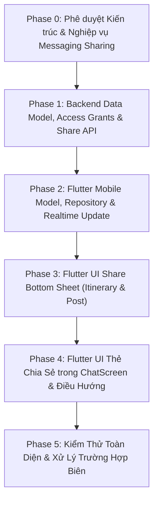

# Báo Cáo Audit Kiến Trúc: Tích Hợp Chia Sẻ Nội Dung Qua Hệ Thống Nhắn Tin (Messaging)

**Tài liệu tham chiếu:** `docs/plan/06-in-app-sharing-through-messaging-audit.md`  
**Vị trí lưu trữ:** `Travel_Planner/docs/plan/06-in-app-sharing-through-messaging-audit.md`  
**Ngày thực hiện audit:** 21/11/2026  
**Môi trường kiểm tra:** Git branch `develop`, working tree sạch hoàn toàn; đối chiếu trực tiếp mã nguồn Backend (Spring Boot 4.1.1, Java 22) và Mobile Client (Flutter 3.47.7, Dart 3.13.5).  
**Mục tiêu cốt lõi:** Đánh giá tính khả thi và lập kế hoạch kiến trúc chi tiết để tích hợp chức năng chia sẻ **Lịch trình (Itinerary)** và **Bài đăng cộng đồng (Post)** thông qua **Hệ thống nhắn tin 1-1 (Messaging System)** hiện có, mang lại trải nghiệm gửi thẻ nội dung giàu tương tác (Rich Content Card) ngay trong cuộc trò chuyện.  
**Ràng buộc giai đoạn:** **TUYỆT ĐỐI CHỈ AUDIT VÀ LẬP KẾ HOẠCH — KHÔNG SỬA SOURCE CODE, KHÔNG CHẠY MIGRATION, KHÔNG THAY ĐỔI DATABASE, KHÔNG COMMIT/PUSH.**

---

## 1. Executive Summary (Tóm tắt điều hành)

Hệ thống Travel Planner đã sở hữu một **module nhắn tin (Messaging Module) hoàn chỉnh và có kiến trúc rất tốt**:
- Backend đã có đầy đủ: quản lý cuộc trò chuyện 1-1 (`Conversation`), tin nhắn tuần tự (`Message`), trạng thái đọc (`ConversationReadState`), xử lý bất đồng bộ chống deadlock (`PESSIMISTIC_WRITE`), đẩy sự kiện thời gian thực qua STOMP WebSocket (`ChatEventListener`, `SimpMessagingTemplate`), và kiểm soát chặn/quyền riêng tư (`UserBlock`, `FriendshipService`).
- Mobile Flutter đã có: `ChatScreen` với giao diện bong bóng chat trực quan, tải lịch sử phân trang ngược (`beforeSequence`), đồng bộ realtime qua `MessagingRealtimeClient`, tìm kiếm người dùng với debounce 350ms (`UserSearchScreen`), và danh sách bạn bè (`FriendsScreen`).

Tuy nhiên, tin nhắn hiện tại **chỉ hỗ trợ văn bản thuần (`TEXT`)**. Để đáp ứng mong muốn chia sẻ Lịch trình và Bài đăng trực tiếp vào cuộc trò chuyện chat:
1. **Mở rộng Message Entity & DTO:** Bổ sung kiểu tin nhắn đa hình (`MessageType: TEXT, SHARE`) cùng các trường tham chiếu nội dung (`shareTargetType`, `shareTargetId`) và dữ liệu ảnh chụp nhanh (`shareMetadata`) ngay trên bảng `messages`. Giữ nguyên 100% tính tương thích ngược cho dữ liệu tin nhắn cũ.
2. **Cơ chế Phân quyền Truy cập (Access Grant):** Đối với lịch trình riêng tư (`PRIVATE`), việc chia sẻ qua tin nhắn cần cấp quyền xem **READ-ONLY** cho người nhận thông qua bảng ủy quyền nhẹ `itinerary_access_grants`. Chủ sở hữu có thể thu hồi quyền (`REVOKE`) bất cứ lúc nào. Đối với Bài đăng (`Post`), tuân thủ 100% quy tắc quyền riêng tư hiện có của bài viết (`PUBLIC`, `FRIENDS`, `PRIVATE`).
3. **Cơ chế Realtime & Trải nghiệm Chat:** Tận dụng 100% WebSocket STOMP hiện tại mà không cần sửa đổi giao thức; Flutter Mobile nhận tin nhắn `SHARE` và hiển thị một thẻ nội dung (`ShareMessageCard`) bắt mắt trong bong bóng chat. Người nhận nhấn thẻ sẽ mở trực tiếp `ItineraryDetailScreen` hoặc `PostDetailScreen`.
4. **Không cần tab "Được chia sẻ" rời rạc:** Việc tích hợp trực tiếp vào Messaging giúp loại bỏ sự cồng kềnh của một tab phụ trong Bộ sưu tập, biến cuộc hội thoại thành kênh tương tác xã hội tự nhiên nhất.

---

## 2. Hiện trạng Module Messaging trên Backend (Spring Boot)

### 2.1. Cấu trúc các thành phần cốt lõi

| Lớp kiến trúc | File nguồn thực tế | Vai trò và Trạng thái kiểm tra |
|---|---|---|
| **Controller** | `Travel_Planner/.../controller/ConversationController.java` | Khai báo 11 REST endpoints: mở hội thoại direct (`POST /api/conversations/direct`), đếm unread (`GET /api/conversations/unread-total`), tin nhắn yêu cầu (`/message-requests`), phân trang tin nhắn (`GET /{id}/messages`), gửi tin nhắn (`POST /{id}/messages`), đánh dấu đã đọc (`POST /{id}/read`), chấp nhận/từ chối request (`/accept`, `/decline`). |
| **Service Layer** | `Travel_Planner/.../service/MessagingService.java`<br>`Travel_Planner/.../service/impl/MessagingServiceImpl.java` | Triển khai logic nghiệp vụ: khóa tài nguyên chống xung đột (lines 58-59: `lockActiveUser`), kiểm tra quyền tiếp tục trò chuyện (line 62: `friendships.canContinueConversation`), đánh số thứ tự tuần tự tuyệt đối (lines 337-350: `nextSequence = lastMessageSequence + 1`), chống trùng lặp qua `clientMessageId` (line 297). |
| **Model JPA** | `Travel_Planner/.../model/Conversation.java`<br>`Travel_Planner/.../model/Message.java`<br>`Travel_Planner/.../model/ConversationReadState.java` | `Conversation`: lưu cặp `user_low_id`, `user_high_id`, `last_message_sequence`, `status` (`ACCEPTED`, `PENDING`, `DECLINED`).<br>`Message`: lưu `conversation_id`, `sequence_number`, `sender_user_id`, `client_message_id`, `content`, `recipient_visible`. |
| **Repository** | `Travel_Planner/.../repository/ConversationRepository.java`<br>`Travel_Planner/.../repository/MessageRepository.java` | Dùng `@Lock(LockModeType.PESSIMISTIC_WRITE)` tại `findByIdForUpdate` (line 19, 74) để cấp phát `sequence_number` an toàn tuyệt đối trong môi trường đa luồng. Hỗ trợ truy vấn tin nhắn theo khoảng `beforeSequence` / `afterSequence`. |
| **Realtime STOMP** | `Travel_Planner/.../config/ChatWebSocketConfig.java`<br>`Travel_Planner/.../config/ChatStompAuthInterceptor.java`<br>`Travel_Planner/.../service/ChatEventListener.java` | STOMP qua WebSocket tại endpoint `/ws/chat`. Xử lý sự kiện `@TransactionalEventListener(phase = TransactionPhase.AFTER_COMMIT)` (line 22 `ChatEventListener.java`), gửi thông báo tới đích danh người dùng `/user/queue/chat-events`. |

### 2.2. Kiểm tra chi tiết luồng gửi tin nhắn (`send`)
Trong `MessagingServiceImpl.java` (lines 293-359):
- Phương thức nhận `SendMessageRequest(clientMessageId, content)`.
- Kiểm tra tính duy nhất của `clientMessageId`: nếu client gửi lại cùng một UUID, hệ thống trả về bản ghi cũ (Idempotent, line 306).
- Kiểm tra rate limit (`rateLimiter.allow(actor.getUserId())`, line 331).
- Tăng sequence: `long nextSequence = conversation.getLastMessageSequence() + 1;` (line 337).
- Lưu `Message` và phát sự kiện `CommittedChatEvent` chứa `ChatEventResponse` (lines 354-357).
- **Điểm phát hiện cốt lõi:** Cột `content` trong bảng `messages` (line 37 `Message.java`) là `columnDefinition = "TEXT"`, và `SendMessageRequest.java` chỉ nhận một chuỗi `content` duy nhất (`@NotBlank`, `@Size(max = 4000)`). **Hệ thống chưa có khái niệm loại tin nhắn (`MessageType`) hay đối tượng đính kèm.**

---

## 3. Hiện trạng Module Messaging trên Flutter Mobile

### 3.1. Các màn hình và luồng giao diện hiện có
- `presentation/screens/messaging_inbox_screen.dart`: Danh sách các cuộc trò chuyện (Hộp thư chính).
- `presentation/screens/stranger_inbox_screen.dart`: Danh sách tin nhắn chờ từ người lạ (`PENDING`).
- `presentation/screens/chat_screen.dart`: Màn hình chat trực tiếp 1-1, có quản lý trạng thái kết nối realtime (`_realtimeStatus`), chặn người dùng, chấp nhận yêu cầu tin nhắn, và danh sách tin nhắn cuộn ngược.
- `presentation/screens/friends_screen.dart`: Danh sách bạn bè và lời mời kết bạn.
- `presentation/screens/user_search_screen.dart`: Tìm kiếm người dùng toàn cục có debounce 350ms.

### 3.2. Kiểm tra cơ chế hiển thị tin nhắn (`_buildMessageRow`)
Trong `chat_screen.dart` (lines 478-524):
- Giao diện bong bóng tin nhắn (bubble) hiện tại:
  ```dart
  final bubble = Container(
    padding: const EdgeInsets.symmetric(horizontal: 13, vertical: 9),
    decoration: BoxDecoration(
      color: own ? AppColors.primaryLight : AppColors.surfaceStrong,
      borderRadius: BorderRadius.circular(16),
    ),
    child: Column(
      crossAxisAlignment: CrossAxisAlignment.end,
      children: [
        Text(message.content), // Hiển thị chuỗi text thuần
        Padding(
          padding: const EdgeInsets.only(top: 4),
          child: Text(MessagingDateTime.format(message.createdAt)),
        ),
        // Trạng thái: Đang gửi, Đã gửi, Đã đọc
      ],
    ),
  );
  ```
- `ChatMessage.dart`: Model chỉ có `final String content;`.
- **Khả năng mở rộng:** `_buildMessageRow` hoàn toàn có thể phân nhánh:
  - Nếu `message.messageType == 'TEXT'`: giữ nguyên `Text(message.content)`.
  - Nếu `message.messageType == 'SHARE'`: render `ShareMessageCardWidget` bên trong bong bóng chat.

---

## 4. Database Schema hiện tại và Đánh giá mở rộng

### 4.1. Schema hiện tại liên quan đến Messaging

```sql
-- 1. Bảng cuộc trò chuyện 1-1
CREATE TABLE conversations (
    conversation_id BIGINT AUTO_INCREMENT PRIMARY KEY,
    user_low_id INT NOT NULL,
    user_high_id INT NOT NULL,
    last_message_sequence BIGINT NOT NULL DEFAULT 0,
    last_message_id BIGINT NULL,
    last_message_at DATETIME NULL,
    conversation_status VARCHAR(16) NULL, -- 'ACCEPTED', 'PENDING', 'DECLINED'
    requester_user_id INT NULL,
    request_recipient_user_id INT NULL,
    request_created_at DATETIME NULL,
    request_declined_at DATETIME NULL,
    created_at DATETIME NOT NULL,
    updated_at DATETIME NOT NULL,
    CONSTRAINT uk_conversations_user_pair UNIQUE (user_low_id, user_high_id),
    CONSTRAINT fk_conversations_user_low FOREIGN KEY (user_low_id) REFERENCES users(user_id),
    CONSTRAINT fk_conversations_user_high FOREIGN KEY (user_high_id) REFERENCES users(user_id)
);

-- 2. Bảng tin nhắn
CREATE TABLE messages (
    message_id BIGINT AUTO_INCREMENT PRIMARY KEY,
    conversation_id BIGINT NOT NULL,
    sequence_number BIGINT NOT NULL,
    sender_user_id INT NOT NULL,
    client_message_id VARCHAR(36) NOT NULL,
    content TEXT NOT NULL,
    created_at DATETIME NOT NULL,
    recipient_visible BOOLEAN DEFAULT TRUE,
    CONSTRAINT uk_messages_conversation_sequence UNIQUE (conversation_id, sequence_number),
    CONSTRAINT uk_messages_sender_client_id UNIQUE (sender_user_id, client_message_id),
    CONSTRAINT fk_messages_conversation FOREIGN KEY (conversation_id) REFERENCES conversations(conversation_id),
    CONSTRAINT fk_messages_sender FOREIGN KEY (sender_user_id) REFERENCES users(user_id)
);
```

### 4.2. Trả lời 7 câu hỏi kiến trúc cốt lõi từ Audit
1. **Hệ thống hiện tại có hỗ trợ nhiều loại Message hay chỉ hỗ trợ văn bản?**  
   *Trả lời:* Chỉ hỗ trợ duy nhất tin nhắn văn bản thuần (`TEXT`). Cột `content` lưu chuỗi string.
2. **Có thể mở rộng Message thành `TEXT` và `SHARE` hay không?**  
   *Trả lời:* **Hoàn toàn khả thi**. Thêm cột `message_type VARCHAR(16) NOT NULL DEFAULT 'TEXT'`. Toàn bộ dữ liệu tin nhắn cũ mặc định mang giá trị `'TEXT'`, không phát sinh bất kỳ xung đột nào.
3. **Nên lưu `targetType` và `targetId` trực tiếp trong Message hay sử dụng một cấu trúc riêng?**  
   *Trả lời:* **Lưu trực tiếp các trường cơ bản trên bảng `messages`**, bao gồm: `message_type`, `share_target_type`, `share_target_id`, và `share_metadata` (snapshot JSON/Text ngắn gọn).
4. **Có cần bổ sung bảng mới không?**  
   *Trả lời:* **Cần bổ sung duy nhất 1 bảng: `itinerary_access_grants`**. Bảng này chỉ phục vụ việc cấp và thu hồi quyền xem (Access Control) cho lịch trình riêng tư (`PRIVATE`). Bảng này không quản lý chat, giúp tách bạch ranh giới giữa giao tiếp xã hội và an toàn dữ liệu.
5. **Có thể tái sử dụng hoàn toàn Conversation và các API hiện tại ở mức nào?**  
   *Trả lời:* **Tái sử dụng 90%**:
   - `openDirect(recipientUserId, actorUsername)`: Tái sử dụng nguyên vẹn để tìm hoặc tạo Conversation 1-1.
   - `messages(conversationId, ...)`: Tái sử dụng nguyên vẹn để lấy lịch sử tin nhắn.
   - `markRead(conversationId, ...)`: Tái sử dụng nguyên vẹn để cập nhật trạng thái đọc.
   - Bổ sung 1 API chuyên biệt: `POST /api/conversations/shares` phục vụ chia sẻ hàng loạt (batch sharing) cho nhiều người nhận.
6. **Việc bổ sung loại tin nhắn mới có ảnh hưởng đến lịch sử tin nhắn cũ không?**  
   *Trả lời:* **Tuyệt đối không ảnh hưởng**. Nhờ giá trị mặc định `'TEXT'`, các tin nhắn cũ tiếp tục được parse và render chính xác như hiện tại.
7. **Có cần thay đổi WebSocket hoặc cơ chế đồng bộ tin nhắn hiện tại không?**  
   *Trả lời:* **Không cần thay đổi giao thức hay kênh WebSocket**. Gói tin `ChatEventResponse` bọc `MessageResponse`. Khi `MessageResponse` có thêm các trường share, WebSocket STOMP tự động tuần tự hóa sang JSON và đẩy thẳng về client.

---

## 5. Đánh giá & So sánh các phương án kiến trúc

### Bảng so sánh 3 phương án:

| Tiêu chí | Phương án A (Polymorphic Message Columns) | Phương án B (Secondary Table `message_shares`) | Phương án C (JSON Content Payload) |
|---|---|---|---|
| **Mô tả thiết kế** | Thêm 4 cột vào bảng `messages`: `message_type`, `share_target_type`, `share_target_id`, `share_metadata`. | Giữ `messages` tối giản, tạo bảng `message_shares` (1-1 với `messages`) chứa thông tin chia sẻ. | Không đổi DB. Nhét chuỗi JSON vào cột `content`: `{"type":"SHARE", "targetId":12, ...}`. |
| **Mức tái sử dụng code** | **Rất cao (95%)**. Dùng chung câu query phân trang tin nhắn hiện tại. | **Trung bình (70%)**. Phải sửa câu query JPA (JOIN bảng phụ hoặc EntityGraph). | **Cao (90%)**. Không cần đổi Repository. |
| **Độ phức tạp Backend** | **Thấp**. Thêm trường vào Entity, Service và DTOs. | **Cao**. Phải quản lý quan hệ OneToOne JPA, nguy cơ lỗi N+1 query. | **Trung bình**. Phải parse JSON thủ công trong Service. |
| **Độ phức tạp Flutter** | **Thấp**. Thêm trường vào `ChatMessage` model và render thẻ trong bubble. | **Thấp**. Tương tự phương án A. | **Cao**. Dễ lỗi runtime parse nếu người dùng gửi tin nhắn text có định dạng giống JSON. |
| **Khả năng tương thích dữ liệu cũ** | **100% hoàn hảo**. Dữ liệu cũ mang giá trị mặc định `TEXT`. | **100% hoàn hảo**. | **Kém/Rủi ro**. Dễ nhầm lẫn giữa tin nhắn text cũ và JSON mới. |
| **Hiệu năng truy vấn lịch sử** | **Tối ưu tuyệt đối (1 query)**. Không cần JOIN bảng. | **Kém hơn**. Cần LEFT JOIN `message_shares` trên mỗi trang 30 tin nhắn. | **Tối ưu**, nhưng tốn chi phí parse chuỗi trên Mobile. |
| **Khả năng Index & Truy vấn ngược** | **Tốt**. Có thể đánh index `(share_target_type, share_target_id)`. | **Tốt**. Đánh index trên bảng phụ. | **Không thể**. Không thể index trường bên trong chuỗi text JSON trên MySQL cũ. |

### Lựa chọn kiến trúc tối ưu:
> [!IMPORTANT]
> **Khuyến nghị lựa chọn: PHƯƠNG ÁN A kết hợp Bảng Quyền `itinerary_access_grants`**
> - **Phương án A** mang lại hiệu năng cao nhất, không làm chậm quá trình tải tin nhắn của ứng dụng chat, và dễ dàng map dữ liệu qua WebSocket.
> - Bảng `itinerary_access_grants` đảm nhiệm duy nhất bài toán: cho phép người nhận đọc lịch trình PRIVATE một cách hợp lệ và cho phép chủ sở hữu thu hồi quyền bất kỳ lúc nào.

---

## 6. Thiết kế Database Schema đề xuất

### 6.1. Mở rộng bảng `messages` (Dùng Hibernate `ddl-auto=update`)

```sql
-- Bổ sung các cột phục vụ chia sẻ nội dung trên bảng messages
ALTER TABLE messages
    ADD COLUMN message_type VARCHAR(16) NOT NULL DEFAULT 'TEXT',
    ADD COLUMN share_target_type VARCHAR(16) NULL, -- 'ITINERARY', 'POST'
    ADD COLUMN share_target_id BIGINT NULL,
    ADD COLUMN share_metadata TEXT NULL;           -- JSON snapshot: {title, coverImage, subtitle, authorName}

-- Tạo Index hỗ trợ tìm kiếm tin nhắn chia sẻ theo nội dung
CREATE INDEX idx_messages_share_target ON messages (share_target_type, share_target_id);
```

### 6.2. Tạo mới bảng `itinerary_access_grants` (Ủy quyền xem Lịch trình Private)

```sql
CREATE TABLE itinerary_access_grants (
    grant_id BIGINT AUTO_INCREMENT PRIMARY KEY,
    itinerary_id INT NOT NULL,
    grantee_user_id INT NOT NULL,       -- Người nhận quyền xem
    granted_by_user_id INT NOT NULL,    -- Chủ sở hữu cấp quyền
    status VARCHAR(16) NOT NULL DEFAULT 'ACTIVE', -- 'ACTIVE', 'REVOKED'
    created_at DATETIME NOT NULL DEFAULT CURRENT_TIMESTAMP,
    updated_at DATETIME NOT NULL DEFAULT CURRENT_TIMESTAMP ON UPDATE CURRENT_TIMESTAMP,

    CONSTRAINT fk_grants_itinerary FOREIGN KEY (itinerary_id) REFERENCES itineraries(itinerary_id) ON DELETE CASCADE,
    CONSTRAINT fk_grants_grantee FOREIGN KEY (grantee_user_id) REFERENCES users(user_id) ON DELETE CASCADE,
    CONSTRAINT fk_grants_granter FOREIGN KEY (granted_by_user_id) REFERENCES users(user_id) ON DELETE CASCADE,
    CONSTRAINT uk_grants_pair UNIQUE (itinerary_id, grantee_user_id)
);

CREATE INDEX idx_grants_lookup ON itinerary_access_grants (itinerary_id, grantee_user_id, status);
```

---

## 7. Logic Nghiệp vụ & Phân quyền Bảo mật (Authorization)

### 7.1. Chia sẻ Lịch trình (Itinerary Sharing)
1. **Kiểm tra quyền của Người gửi:**
   - Người gửi phải có quyền truy cập lịch trình:
     - Nếu lịch trình là `PUBLIC`: Bất kỳ người dùng hợp lệ nào cũng có thể chia sẻ cho bạn bè.
     - Nếu lịch trình là `PRIVATE`: **Chỉ duy nhất chủ sở hữu (`isOwner`)** mới có quyền chia sẻ. Người không phải chủ sở hữu cố chia sẻ lịch trình riêng tư sẽ bị Backend chặn bằng lỗi `403 ForbiddenException ("Chỉ chủ sở hữu mới có quyền chia sẻ lịch trình riêng tư")`.
2. **Cấp quyền truy cập cho Người nhận (Access Grant):**
   - Nếu lịch trình là `PRIVATE`, hệ thống tự động ghi nhận (upsert) một bản ghi `ItineraryAccessGrant(itineraryId, recipientUserId, ACTIVE)`.
   - Trong `ItineraryServiceImpl.java` (tại phương thức `getItineraryDetail`, line 418):
     ```java
     // Điều chỉnh điều kiện kiểm tra phân quyền xem lịch trình
     boolean hasAccessGrant = viewerId != null && accessGrantRepository.existsByItinerary_ItineraryIdAndGrantee_UserIdAndStatus(
         id, viewerId, GrantStatus.ACTIVE
     );
     
     if (itinerary.getVisibility() != Visibility.PUBLIC && !isOwner && !hasAccessGrant) {
         throw new ResourceNotFoundException("Lịch trình không tồn tại hoặc đã bị xóa");
     }
     ```
3. **Quyền hạn của Người nhận:**
   - **Quyền đọc (READ):** Xem đầy đủ tổng quan, các ngày (`days`), các hoạt động (`activities`), và xem lộ trình trên bản đồ.
   - **Không có quyền sửa/xóa:** Mọi thao tác sửa/xóa trong `ItineraryServiceImpl` vẫn duy trì kiểm tra `isOwner` nghiêm ngặt. Người nhận hoàn toàn không thể chỉnh sửa lịch trình gốc.
   - **Quyền sao chép (Clone):** Cho phép người nhận bấm "Sao chép lịch trình" (`cloneItinerary`) để nhân bản thành một bản sao cá nhân độc lập của họ.
4. **Thu hồi quyền chia sẻ (Revocation):**
   - Chủ sở hữu có thể vào quản lý chia sẻ hoặc từ menu tin nhắn chọn "Thu hồi quyền truy cập". Bản ghi `ItineraryAccessGrant` chuyển sang `REVOKED`. Lần kế tiếp người nhận nhấn vào thẻ lịch trình, Backend trả về `ResourceNotFoundException`.

### 7.2. Chia sẻ Bài đăng Cộng đồng (Post Sharing)
1. **Quy tắc bảo mật:**
   - Giữ nguyên 100% quy tắc hiển thị của bài đăng trong `PostServiceImpl.java` (lines 1165-1180):
     - Bài đăng `PUBLIC`: Người nhận xem được bình thường.
     - Bài đăng `FRIENDS`: Người nhận chỉ xem được nếu tại thời điểm xem, người nhận và tác giả vẫn đang là bạn bè (`FriendshipStatus.ACCEPTED`).
     - Bài đăng `PRIVATE`: Người nhận không thể xem.
2. **Khi bài đăng bị xóa hoặc ẩn:**
   - Khi người nhận nhấn thẻ bài đăng đã bị tác giả xóa hoặc bị quản trị viên gỡ (`status = DELETED` hoặc `HIDDEN`), API `GET /api/community/posts/{id}` trả về `ResourceNotFoundException`. Ứng dụng hiển thị thông báo: *"Bài viết không còn tồn tại hoặc đã bị gỡ bỏ"*.
3. **Tuân thủ quy tắc Chặn hai chiều (`BlockAccess`):**
   - Nếu Người gửi và Người nhận đã chặn nhau, tin nhắn chia sẻ hoàn toàn không thể gửi (được chặn ngay tại `friendships.canContinueConversation`).

### 7.3. Các trường hợp biên & Xử lý lỗi (Edge Cases)

| Tình huống biên | Cách xử lý chặt chẽ ở Backend & UI |
|---|---|
| **1. Chia sẻ cho chính mình** | Backend từ chối tại API chia sẻ: `400 BadRequestException ("Không thể gửi nội dung cho chính mình")`. UI tự động ẩn tài khoản hiện tại khỏi danh sách chọn người nhận. |
| **2. Người nhận đã chặn người gửi** | Backend kiểm tra `friendships.canContinueConversation(senderId, recipientId)`. Nếu có quan hệ chặn, bỏ qua hoặc trả về lỗi cụ thể `403 ForbiddenException`. |
| **3. Lịch trình bị xóa sau khi đã chia sẻ** | Tin nhắn trong chat vẫn hiển thị thẻ (nhờ dữ liệu snapshot), nhưng khi nhấn vào, API chi tiết trả về 404. UI hiển thị thông báo *"Lịch trình này đã bị chủ sở hữu xóa"*. |
| **4. Lịch trình chuyển từ PUBLIC sang PRIVATE** | Nếu người gửi là chủ sở hữu và đã chia sẻ qua tin nhắn, quyền Access Grant bảo đảm người nhận trong cuộc trò chuyện vẫn tiếp tục xem được bình thường. |
| **5. Chia sẻ trùng nhiều lần cho một người** | Hệ thống cho phép gửi lại như một tin nhắn mới trong đoạn chat (ví dụ nhắc bạn: *"Nhớ xem lịch trình này nhé"*). Bản ghi `ItineraryAccessGrant` thực hiện `UPSERT` (cập nhật trạng thái `ACTIVE`), không phát sinh trùng lặp khóa chính. |
| **6. Gửi hàng loạt cho nhiều người (Batch)** | Thực hiện trong một Transaction `@Transactional`. Mỗi người nhận sẽ có một tin nhắn độc lập gửi vào Conversation tương ứng. Nếu chưa có Conversation, hệ thống tự động khởi tạo. Giới hạn tối đa **10 người/lần** để chống spam. |

---

## 8. Đề xuất Danh sách REST API Backend

### 8.1. API Gửi chia sẻ nội dung hàng loạt (Batch Share via Messaging)

- **HTTP Method:** `POST`
- **Endpoint:** `/api/conversations/shares`
- **Quyền hạn:** Authenticated User
- **Request Body (`SendShareBatchRequest`):**
  ```json
  {
    "targetType": "ITINERARY", 
    "targetId": 15,
    "recipientUserIds": [3, 8],
    "note": "Lịch trình này tớ lên cho nhóm mình, cậu xem thử nhé!",
    "clientMessageIdPrefix": "550e8400-e29b-41d4-a716-446655440000"
  }
  ```
- **Validation:**
  - `targetType` thuộc `[ITINERARY, POST]`.
  - `targetId` phải tồn tại, đang hoạt động (`ACTIVE`).
  - `recipientUserIds`: mảng từ 1 đến 10 phần tử, không chứa `currentUserId`.
  - Kiểm tra quyền sở hữu nếu là lịch trình `PRIVATE`.
- **Xử lý Backend:**
  1. Trích xuất thông tin ảnh chụp nhanh (`ShareMetadata`): tiêu đề, ảnh bìa, địa điểm/tác giả.
  2. Lặp qua từng `recipientUserId`:
     - Kiểm tra quan hệ chặn (`isBlockedBetween`).
     - Lấy hoặc tạo cuộc trò chuyện 1-1 bằng `openDirect(recipientId, sender)`.
     - Tạo bản ghi `Message`:
       - `messageType = 'SHARE'`
       - `shareTargetType = targetType`
       - `shareTargetId = targetId`
       - `shareMetadata = JSON(snapshot)`
       - `content = note` (lời nhắn của người gửi)
     - Nếu `targetType == 'ITINERARY'` và là lịch trình `PRIVATE`: cấp quyền xem `ItineraryAccessGrant`.
     - Phát sự kiện WebSocket STOMP `CommittedChatEvent` tới cả 2 người dùng.
- **Response (`201 Created` - `ShareBatchResponse`):**
  ```json
  {
    "targetType": "ITINERARY",
    "targetId": 15,
    "successCount": 2,
    "failedCount": 0,
    "deliveredMessages": [
      {
        "recipientUserId": 3,
        "conversationId": 42,
        "messageId": 1058,
        "sequenceNumber": 12
      },
      {
        "recipientUserId": 8,
        "conversationId": 79,
        "messageId": 1059,
        "sequenceNumber": 5
      }
    ]
  }
  ```

### 8.2. Cập nhật DTO `MessageResponse` (Tương thích ngược)
Bổ sung các trường vào `MessageResponse.java` (trả về trong các API lấy tin nhắn và qua WebSocket):
```json
{
  "messageId": 1058,
  "conversationId": 42,
  "sequenceNumber": 12,
  "senderUserId": 1,
  "senderName": "Nguyễn Văn A",
  "clientMessageId": "uuid-xxx",
  "content": "Lịch trình này tớ lên cho nhóm mình...",
  "createdAt": "2026-11-21T19:30:00",
  "messageType": "SHARE",
  "shareTargetType": "ITINERARY",
  "shareTargetId": 15,
  "shareMetadata": {
    "title": "Chuyến đi Đà Lạt 3N2Đ",
    "coverImage": "https://res.cloudinary.com/.../dalat.jpg",
    "subtitle": "3 ngày • Lâm Đồng",
    "authorName": "Nguyễn Văn A"
  }
}
```

### 8.3. API Thu hồi quyền xem lịch trình chia sẻ (Revoke Itinerary Access)
- **HTTP Method:** `DELETE`
- **Endpoint:** `/api/itineraries/{id}/access-grants/{granteeUserId}`
- **Quyền hạn:** Chủ sở hữu lịch trình (`isOwner = true`).
- **Response:** `204 No Content`.

---

## 9. Đề xuất Thiết kế UI/UX trên Flutter Mobile

### 9.1. Vị trí nút Share trên giao diện
1. **Chi tiết lịch trình (`ItineraryDetailScreen`):**
   - Đặt icon button `Icons.share_outlined` tại `AppBar.actions` (ngay cạnh nút Lưu và Sao chép).
2. **Thẻ bài viết cộng đồng (`post_card_widget.dart`):**
   - Đặt nút **[Chia sẻ]** ở hàng nút hành động dưới cùng bên cạnh `[Thích]` và `[Bình luận]`.

### 9.2. Giao diện Share Bottom Sheet (Modal Bottom Sheet)
Khi người dùng nhấn nút Share, mở một Modal Bottom Sheet Material 3 gồm:
1. **Header:** Tiêu đề "Chia sẻ lịch trình" / "Chia sẻ bài viết" và nút đóng.
2. **Thẻ tóm tắt nội dung thu nhỏ:**
   - Ảnh thumbnail (56x56 dp, bo góc 8dp).
   - Tiêu đề lịch trình hoặc nội dung bài viết rút gọn.
   - Badge hiển thị loại nội dung ("Lịch trình" hoặc "Bài viết").
3. **Ô nhập lời nhắn kèm theo:** TextField cho phép người gửi gõ ghi chú (tối đa 250 ký tự, placeholder: *"Nhập lời nhắn gửi kèm (tùy chọn)..."*).
4. **Thanh tìm kiếm người nhận:**
   - Tự động hiển thị danh sách **Bạn bè** (`Friends`) lên đầu tiên để người dùng chọn nhanh chỉ với 1 chạm.
   - Hỗ trợ gõ tên/handle để tìm kiếm người dùng khác trong hệ thống (dùng lại debounced search từ `UserSearchScreen`).
   - Tích chọn nhiều người (Checkbox / Check mark, hiển thị avatar + tên đầy đủ + handle).
5. **Nút hành động:**
   - `FilledButton`: *"Gửi chia sẻ (X)"* (với X là số người đã chọn, tối đa 10 người).
   - Khi bấm: hiển thị spinner loading -> gọi API `/api/conversations/shares` -> hiển thị thông báo thành công: *"Đã gửi chia sẻ vào tin nhắn"*.

### 9.3. Hiển thị thẻ chia sẻ trong cuộc trò chuyện (`ChatScreen`)

Bên trong `_buildMessageRow` của `chat_screen.dart`, nếu `message.messageType == 'SHARE'`, bong bóng chat sẽ hiển thị widget `ShareMessageCard`:

```
+--------------------------------------------------------+
|  [ITINERARY] LỊCH TRÌNH DU LỊCH                        |
|  +--------------------------------------------------+  |
|  | [Ảnh bìa lịch trình 16:9 bo góc]                 |  |
|  +--------------------------------------------------+  |
|  Đà Lạt Mộng Mơ 3N2Đ                                   |
|  3 ngày • Lâm Đồng • Tác giả: Minh Thảo                |
|  ----------------------------------------------------  |
|  "Cậu xem thử lịch trình này nhé, có cần chỉnh gì ko?" |
|  ----------------------------------------------------  |
|  [ Nhấn để xem chi tiết lịch trình  -> ]               |
|                                         19:35 • Đã gửi |
+--------------------------------------------------------+
```

#### Xử lý tương tác khi Người nhận chạm vào thẻ:
- **Nếu `shareTargetType == 'ITINERARY'`:**
  Gọi `Navigator.push` mở `ItineraryDetailScreen(itineraryId: message.shareTargetId)`.
  - Nếu lịch trình còn tồn tại và người nhận có quyền: mở màn hình chi tiết mượt mà.
  - Nếu lịch trình đã bị xóa hoặc quyền truy cập đã bị thu hồi: `ItineraryDetailScreen` tự động bắt mã lỗi 404 và hiển thị Snackbar hoặc màn hình thông báo: *"Lịch trình này không còn khả dụng hoặc bạn không có quyền truy cập"*.
- **Nếu `shareTargetType == 'POST'`:**
  Gọi `Navigator.push` mở `PostDetailScreen(postId: message.shareTargetId)`.
  - Nếu bài viết đã bị xóa/ẩn hoặc không đủ quyền xem: hiển thị thông báo thân thiện.

---

## 10. Cơ chế Snapshot vs Live Data & Hiệu năng hệ thống

1. **Lưu trữ Snapshot tại thời điểm chia sẻ:**
   - Khi tạo tin nhắn chia sẻ, Backend lưu lại một bản snapshot tối giản vào trường `share_metadata` (gồm: `title`, `coverImage`, `subtitle`, `authorName`).
   - **Lợi ích vượt trội về hiệu năng:** Khi mở `ChatScreen` và tải danh sách 30 tin nhắn, Mobile không cần phải thực hiện 30 request riêng biệt lên server để lấy thông tin hiển thị của các thẻ chia sẻ. Cuộc trò chuyện cuộn cực kỳ mượt mà 60fps!
2. **Kiểm tra Live Data và Quyền thực tế khi nhấn mở (Just-in-time Access Control):**
   - Chỉ khi người dùng thực sự chạm tay vào thẻ để mở xem chi tiết, ứng dụng mới gọi API `GET /api/itineraries/{id}` hoặc `GET /api/community/posts/{id}`.
   - Tại thời điểm này, toàn bộ phân quyền động, trạng thái xóa, hay trạng thái thu hồi được Backend kiểm tra thời gian thực. Điều này ngăn chặn hoàn toàn việc rò rỉ dữ liệu nhạy cảm.

---

## 11. Lộ trình Triển khai Đề xuất theo từng Phase



### Phase 0: Phê duyệt Kiến trúc (Hiện tại)
- **Mục tiêu:** Thống nhất phương án kỹ thuật tích hợp chia sẻ trực tiếp vào hệ thống Messaging.
- **Sản phẩm:** Tài liệu `docs/plan/06-in-app-sharing-through-messaging-audit.md` được chủ dự án thông qua.

### Phase 1: Backend Data Model, Access Grants & Share API
- **Mục tiêu:** Xây dựng nền tảng dữ liệu và API gửi chia sẻ trên Spring Boot.
- **Nhiệm vụ cụ thể:**
  - Cập nhật `Message.java`: thêm `messageType`, `shareTargetType`, `shareTargetId`, `shareMetadata`.
  - Tạo Enum `MessageType` (`TEXT`, `SHARE`) và `ShareTargetType` (`ITINERARY`, `POST`).
  - Tạo Entity `ItineraryAccessGrant.java` và `ItineraryAccessGrantRepository.java`.
  - Cập nhật logic phân quyền trong `ItineraryServiceImpl.java` (cho phép người có Access Grant đọc lịch trình PRIVATE).
  - Triển khai phương thức `shareContent` trong `MessagingServiceImpl.java`.
  - Thêm endpoint `POST /api/conversations/shares` trong `ConversationController.java`.
  - Cập nhật `MessageResponse.java` và `ChatEventResponse.java`.
- **Kiểm thử:** Viết Unit Test và Integration Test cho Share API (gửi lịch trình công khai, riêng tư, kiểm tra phân quyền, chống tự gửi cho chính mình).
- **Tiêu chí nghiệm thu:** `mvnw.cmd test` xanh 100%, không làm ảnh hưởng đến các test chat hiện có.

### Phase 2: Flutter Mobile Model, Repository & Realtime Update
- **Mục tiêu:** Cập nhật tầng dữ liệu trên Flutter để hiểu loại tin nhắn chia sẻ.
- **Nhiệm vụ cụ thể:**
  - Cập nhật `ChatMessage.dart`: thêm các trường `messageType`, `shareTargetType`, `shareTargetId`, `shareMetadata`.
  - Cập nhật `MessagingRepository.dart`: thêm hàm `sendShare(...)` gọi tới `/api/conversations/shares`.
  - Kiểm tra `MessagingRealtimeClient`: bảo đảm sự kiện `MESSAGE_CREATED` nhận diện và cập nhật tin nhắn share vào danh sách hiển thị thời gian thực.
- **Tiêu chí nghiệm thu:** Viết unit test cho serialization của `ChatMessage` có `messageType: SHARE`.

### Phase 3: Flutter UI — Share Bottom Sheet
- **Mục tiêu:** Xây dựng giao diện chọn người nhận và gửi chia sẻ.
- **Nhiệm vụ cụ thể:**
  - Tạo widget `ShareBottomSheet.dart`:
    - Thẻ xem trước nội dung thu nhỏ.
    - Danh sách gợi ý bạn bè (`repository.friends(...)`).
    - Tìm kiếm người dùng có debounce (`repository.searchUsers(...)`).
    - Cho phép chọn nhiều người nhận (tối đa 10).
    - Ô nhập lời nhắn tùy chọn.
    - Nút gửi chia sẻ với trạng thái xoay loading.
  - Tích hợp nút icon Share trên thanh AppBar của `ItineraryDetailScreen.dart`.
  - Tích hợp nút Share trên hàng nút tương tác của `post_card_widget.dart`.
- **Tiêu chí nghiệm thu:** Bấm Share trên màn hình chi tiết lịch trình, chọn 2 bạn bè và gửi thành công.

### Phase 4: Flutter UI — Thẻ Chia Sẻ trong ChatScreen & Điều Hướng
- **Mục tiêu:** Hiển thị thẻ nội dung đẹp mắt trong bong bóng chat và điều hướng khi nhấn.
- **Nhiệm vụ cụ thể:**
  - Tạo widget `ShareMessageCard.dart`:
    - Hiển thị ảnh bìa, badge loại nội dung, tiêu đề, tóm tắt.
    - Hiển thị lời nhắn của người gửi.
  - Tích hợp `ShareMessageCard` vào `_buildMessageRow` trong `chat_screen.dart`.
  - Xử lý sự kiện nhấn vào thẻ:
    - Nếu là `ITINERARY`: Điều hướng mở `ItineraryDetailScreen`.
    - Nếu là `POST`: Tạo màn hình nhẹ `PostDetailScreen.dart` để mở đúng bài viết đó.
- **Tiêu chí nghiệm thu:** Người nhận mở cuộc trò chuyện, thấy thẻ lịch trình, nhấn vào mở ra màn hình chi tiết lịch trình chính xác.

### Phase 5: Kiểm Thử Toàn Diện & Xử Lý Trường Hợp Biên
- **Mục tiêu:** Đảm bảo tính ổn định cao nhất, không phát sinh lỗi hồi quy.
- **Nhiệm vụ cụ thể:**
  - Kiểm thử đầy đủ 14 test cases nghiệp vụ và biên (chi tiết tại Mục 13).
  - Kiểm tra tính tương thích của lịch sử chat cũ (các tin nhắn văn bản thuần).
  - Chạy toàn bộ test suites của Backend và Mobile.
- **Tiêu chí nghiệm thu:** 100% test suites tự động của cả Backend và Mobile đều PASS.

---

## 12. Danh sách File / Module dự kiến sẽ thay đổi khi triển khai

### Backend (Spring Boot):
1. `backend/.../model/enums/MessageType.java` *(Tạo mới)*
2. `backend/.../model/enums/ShareTargetType.java` *(Tạo mới)*
3. `backend/.../model/enums/GrantStatus.java` *(Tạo mới)*
4. `backend/.../model/Message.java` *(Bổ sung 4 cột: messageType, shareTargetType, shareTargetId, shareMetadata)*
5. `backend/.../model/ItineraryAccessGrant.java` *(Tạo mới)*
6. `backend/.../repository/ItineraryAccessGrantRepository.java` *(Tạo mới)*
7. `backend/.../dto/request/SendShareBatchRequest.java` *(Tạo mới)*
8. `backend/.../dto/response/ShareBatchResponse.java` *(Tạo mới)*
9. `backend/.../dto/response/ShareMetadataDto.java` *(Tạo mới)*
10. `backend/.../dto/response/MessageResponse.java` *(Bổ sung các trường share)*
11. `backend/.../service/MessagingService.java` & `MessagingServiceImpl.java` *(Thêm phương thức shareContent)*
12. `backend/.../service/impl/ItineraryServiceImpl.java` *(Bổ sung kiểm tra access grant tại getItineraryDetail)*
13. `backend/.../controller/ConversationController.java` *(Thêm endpoint POST /api/conversations/shares)*
14. `backend/src/test/java/.../MessagingShareTest.java` *(Tạo mới bộ test kiểm thử)*

### Mobile Client (Flutter):
1. `frontend/mobile/lib/features/messaging/data/models/chat_message.dart` *(Bổ sung các trường share và parse JSON)*
2. `frontend/mobile/lib/features/messaging/data/messaging_repository.dart` *(Thêm hàm sendShare)*
3. `frontend/mobile/lib/features/messaging/presentation/screens/chat_screen.dart` *(Cập nhật _buildMessageRow render Share Card)*
4. `frontend/mobile/lib/features/messaging/presentation/widgets/share_message_card.dart` *(Tạo mới)*
5. `frontend/mobile/lib/features/itinerary/presentation/widgets/share_bottom_sheet.dart` *(Tạo mới)*
6. `frontend/mobile/lib/features/itinerary/presentation/screens/itinerary_detail_screen.dart` *(Thêm icon Share)*
7. `frontend/mobile/lib/features/social/presentation/widgets/post_card_widget.dart` *(Thêm nút Share)*
8. `frontend/mobile/lib/features/social/presentation/screens/post_detail_screen.dart` *(Tạo mới màn hình chi tiết bài viết đơn)*
9. `frontend/mobile/test/features/messaging/chat_message_share_test.dart` *(Tạo mới test kiểm thử)*

---

## 13. Danh sách Test Cases Nghiệp Vụ & An Toàn

| Mã Test | Mô tả trường hợp kiểm thử | Kết quả mong đợi |
|---|---|---|
| **TC-01** | Gửi chia sẻ Lịch trình `PUBLIC` cho 1 người bạn trong đoạn chat đã có. | Nhận được tin nhắn `SHARE` trong chat; người nhận nhấn thẻ mở đúng lịch trình. |
| **TC-02** | Gửi chia sẻ Lịch trình `PUBLIC` cho người chưa từng nhắn tin trước đó. | Tự động khởi tạo Conversation mới, gửi tin nhắn share thành công. |
| **TC-03** | Chủ sở hữu gửi chia sẻ Lịch trình `PRIVATE` cho bạn bè. | Người nhận nhận được tin nhắn; bản ghi `ItineraryAccessGrant` được tạo; người nhận xem được chi tiết lịch trình bình thường (READ-ONLY). |
| **TC-04** | Người không phải chủ sở hữu cố chia sẻ Lịch trình `PRIVATE`. | Backend chặn bằng lỗi `403 ForbiddenException`. |
| **TC-05** | Người nhận lịch trình `PRIVATE` cố tình gọi API chỉnh sửa ngày/hoạt động. | Backend từ chối `403 ForbiddenException` vì không phải `isOwner`. |
| **TC-06** | Người nhận lịch trình `PRIVATE` nhấn nút "Sao chép lịch trình" (Clone). | Nhân bản thành công một lịch trình mới thuộc quyền sở hữu của người nhận. |
| **TC-07** | Chủ sở hữu thu hồi quyền xem lịch trình `PRIVATE`. | Bản ghi Grant chuyển thành `REVOKED`. Người nhận nhấn vào thẻ trong chat nhận được thông báo 404 *"Lịch trình không tồn tại hoặc đã bị xóa"*. |
| **TC-08** | Lịch trình bị chủ sở hữu xóa (`status = DELETED`). | Thẻ trong chat vẫn hiển thị snapshot, nhưng khi nhấn vào mở ra báo lỗi lịch trình đã bị xóa. |
| **TC-09** | Gửi chia sẻ Bài đăng `PUBLIC`. | Người nhận nhấn thẻ mở đúng màn hình chi tiết bài viết. |
| **TC-10** | Gửi chia sẻ Bài đăng chế độ `FRIENDS`. | Người nhận là bạn bè xem được; người không phải bạn bè bị chặn 403. |
| **TC-11** | Gửi chia sẻ cho nhiều người cùng lúc (Batch: 3 người). | Cả 3 người nhận đều nhận được tin nhắn trong cuộc trò chuyện riêng tương ứng. |
| **TC-12** | Cố tình chia sẻ cho chính mình (`recipientId == senderId`). | Backend từ chối với lỗi `400 BadRequestException`. |
| **TC-13** | Cố tình chia sẻ cho người đã chặn mình hoặc mình đã chặn. | Backend chặn gửi tin nhắn với lỗi `403 ForbiddenException`. |
| **TC-14** | Tải lại các tin nhắn văn bản thuần (`TEXT`) cũ. | Hiển thị bình thường 100%, không gặp bất kỳ lỗi format hay crash app. |

---

## 14. Các Quyết định cần Chủ dự án Phê duyệt

Trước khi bắt đầu thực hiện Phase 1, kính đề nghị chủ dự án xác nhận các điểm sau:

1. **Phê duyệt Phương án Tích hợp:**  
   Chủ dự án có duyệt phương án **tích hợp chia sẻ trực tiếp thành một loại tin nhắn (`SHARE`) trong hệ thống Messaging** thay vì tạo một tab chia sẻ độc lập trong Bộ sưu tập không?  
   *(Khuyến nghị: Phê duyệt — phương án này tận dụng 100% hệ thống chat và WebSocket realtime hiện có, tối ưu trải nghiệm người dùng).*
2. **Quyền Clone đối với Lịch trình PRIVATE được chia sẻ:**  
   Khi một người bạn nhận được lịch trình riêng tư qua tin nhắn, họ có được phép bấm nút "Sao chép lịch trình" (Clone) thành bản của riêng họ không?  
   *(Khuyến nghị: Cho phép Clone — vì việc clone chỉ tạo ra bản sao mới, không ảnh hưởng đến dữ liệu gốc của người gửi).*
3. **Màn hình chi tiết bài viết (Post Detail Screen):**  
   Mobile hiện tại chỉ có `CommunityFeedScreen` (hiển thị danh sách cuộn), chưa có màn hình chi tiết cho 1 bài viết đơn lẻ (`PostDetailScreen`). Chủ dự án có duyệt việc tạo một màn hình nhẹ `PostDetailScreen` (tái sử dụng lại `PostCardWidget`) để khi người nhận nhấn vào thẻ bài viết trong chat sẽ mở trực tiếp bài viết đó không?  
   *(Khuyến nghị: Phê duyệt).*
4. **Giới hạn người nhận trong một lần chia sẻ:**  
   Thống nhất giới hạn tối đa **10 người nhận/lần** gửi để bảo đảm hiệu năng và chống spam?

---
*Báo cáo được hoàn thành, dẫn chứng mã nguồn thực tế và bảo toàn nguyên vẹn toàn bộ mã nguồn cùng trạng thái Git theo đúng yêu cầu audit.*
