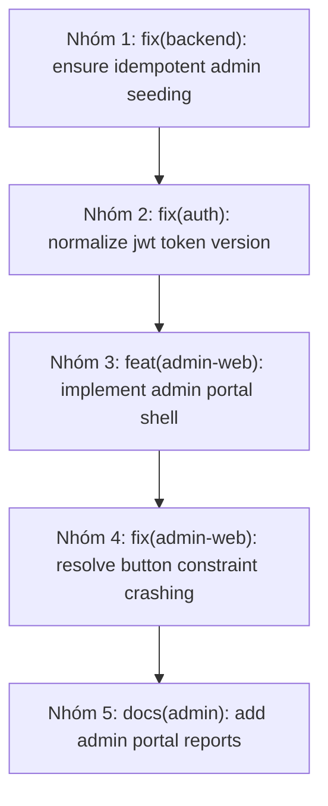

# Git Review & Logical Commit Grouping Report

**Date:** 2026-11-23  
**Current Branch:** `feature/admin-moderation-integration`  
**Working Tree Status:** 13 modified files, 15 untracked files (Total: 28 files + this report = 29 files)  
**Safety Status:** No credentials, tokens, or personal secrets detected  

---

## 1. Overview & Git Status

A thorough audit of the working directory was conducted to inspect all staged, unstaged, and untracked changes across Backend, Flutter Web Admin, automated tests, and engineering documentation.

```
On branch feature/admin-moderation-integration
Your branch is up to date with 'origin/feature/admin-moderation-integration'.

Changes not staged for commit (13 files):
  modified:   Travel_Planner/backend/src/main/java/Travel_Planner/Travel_Planner/model/User.java
  modified:   Travel_Planner/backend/src/main/java/Travel_Planner/Travel_Planner/security/JwtAuthenticationFilter.java
  modified:   Travel_Planner/backend/src/main/java/Travel_Planner/Travel_Planner/security/JwtTokenProvider.java
  modified:   Travel_Planner/backend/src/main/java/Travel_Planner/Travel_Planner/security/UserDetailsServiceImpl.java
  modified:   Travel_Planner/backend/src/main/java/Travel_Planner/Travel_Planner/seeder/DataSeeder.java
  modified:   Travel_Planner/backend/src/test/java/Travel_Planner/Travel_Planner/DataSeederTest.java
  modified:   Travel_Planner/backend/src/test/java/Travel_Planner/Travel_Planner/PostServiceJpaIntegrationTest.java
  modified:   Travel_Planner/docs/ai/09-development-log.md
  modified:   Travel_Planner/frontend/web/lib/core/theme/app_theme.dart
  modified:   Travel_Planner/frontend/web/lib/features/locations/presentation/screens/admin_places_screen.dart
  modified:   Travel_Planner/frontend/web/lib/features/moderation/presentation/screens/admin_moderation_screen.dart
  modified:   Travel_Planner/frontend/web/lib/features/profile/presentation/screens/profile_screen.dart
  modified:   Travel_Planner/frontend/web/lib/main.dart

Untracked files (15 files + this report):
  Travel_Planner/backend/src/test/java/Travel_Planner/Travel_Planner/AdminSeedIdempotencyTest.java
  Travel_Planner/docs/plan/16-admin-portal-ui-refactor-report.md
  Travel_Planner/docs/plan/17-admin-login-regression-fix-report.md
  Travel_Planner/docs/plan/18-admin-seed-startup-fix-report.md
  Travel_Planner/docs/plan/19-admin-auth-session-redirect-fix-report.md
  Travel_Planner/docs/plan/20-git-commit-grouping-report.md
  Travel_Planner/frontend/web/lib/features/dashboard/.gitkeep
  Travel_Planner/frontend/web/lib/features/dashboard/data/dashboard_repository.dart
  Travel_Planner/frontend/web/lib/features/dashboard/presentation/screens/admin_dashboard_screen.dart
  Travel_Planner/frontend/web/lib/features/layout/domain/admin_tab.dart
  Travel_Planner/frontend/web/lib/features/layout/presentation/screens/admin_shell.dart
  Travel_Planner/frontend/web/lib/features/layout/presentation/widgets/admin_header.dart
  Travel_Planner/frontend/web/lib/features/layout/presentation/widgets/admin_sidebar.dart
  Travel_Planner/frontend/web/lib/features/layout/presentation/widgets/placeholder_feature_view.dart
  Travel_Planner/frontend/web/test/admin_portal_layout_test.dart
  Travel_Planner/frontend/web/test/login_flow_integration_test.dart
```

---

## 2. Commit Grouping Architecture

To maintain a clean, atomic Git history compliant with Conventional Commits, the 29 files are organized into **5 distinct, self-contained groups**:

| Nhóm | Phạm vi (Scope) | Số file | Commit Message Đề xuất |
|:---:|---|:---:|---|
| **1** | Backend Database Seeder & Test Determinism | 4 | `fix(backend): ensure idempotent admin seeding and test isolation` |
| **2** | Backend JWT & Session Revocation Normalization | 4 | `fix(auth): normalize jwt token version to preserve active sessions` |
| **3** | Flutter Web Admin Portal Layout & Dashboard | 13 | `feat(admin-web): implement admin portal shell, navigation, and dashboard` |
| **4** | Flutter Web UI Regressions & Login Testing | 2 | `fix(admin-web): resolve button constraint crashing and tab bar overflow` |
| **5** | Engineering Documentation & Audit Reports | 6 | `docs(admin): add admin portal refactor, seed fix, and auth reports` |

---

## 3. Chi tiết từng nhóm Commit

### Nhóm 1: Backend Seeder & Test Determinism
- **Mục đích:** Sửa lỗi `Duplicate entry 'nam.admin'` khi khởi động backend, bảo đảm tính idempotent cho `DataSeeder`, hỗ trợ alias `admin_master` ↔ `admin`, bổ sung distributed advisory lock MySQL `GET_LOCK`, sửa lỗi dọn dẹp khóa ngoại trong `DataSeederTest` và `AdminSeedIdempotencyTest`, và ổn định thứ tự test trong `PostServiceJpaIntegrationTest`.
- **Files (4 files):**
  - `Travel_Planner/backend/src/main/java/Travel_Planner/Travel_Planner/seeder/DataSeeder.java`
  - `Travel_Planner/backend/src/test/java/Travel_Planner/Travel_Planner/AdminSeedIdempotencyTest.java`
  - `Travel_Planner/backend/src/test/java/Travel_Planner/Travel_Planner/DataSeederTest.java`
  - `Travel_Planner/backend/src/test/java/Travel_Planner/Travel_Planner/PostServiceJpaIntegrationTest.java`
- **Commit Message đề xuất:**
  ```text
  fix(backend): ensure idempotent admin seeding and test isolation

  - Implement multi-constraint uniqueness checks (username, email, handle) in DataSeeder.
  - Add admin alias resolution (admin_master <-> admin) to prevent duplicate key collisions.
  - Acquire MySQL advisory lock GET_LOCK('travel_planner_data_seed_lock', 15) for multi-instance safety.
  - Disable and re-enable session foreign key checks during test database teardown.
  - Implement deterministic user provisioning in PostServiceJpaIntegrationTest.
  - Add comprehensive 4-scenario AdminSeedIdempotencyTest suite.
  ```

---

### Nhóm 2: Backend JWT & Session Revocation Normalization
- **Mục đích:** Khắc phục lỗi `401 Unauthorized` ngay sau khi đăng nhập do các tài khoản cũ trong database có `token_version = 0`. Chuẩn hóa giá trị `tokenVersion` trong JWT claim, `CustomUserDetails`, `JwtAuthenticationFilter`, và `User` entity luôn là số nguyên dương `>= 1`.
- **Files (4 files):**
  - `Travel_Planner/backend/src/main/java/Travel_Planner/Travel_Planner/model/User.java`
  - `Travel_Planner/backend/src/main/java/Travel_Planner/Travel_Planner/security/JwtTokenProvider.java`
  - `Travel_Planner/backend/src/main/java/Travel_Planner/Travel_Planner/security/UserDetailsServiceImpl.java`
  - `Travel_Planner/backend/src/main/java/Travel_Planner/Travel_Planner/security/JwtAuthenticationFilter.java`
- **Commit Message đề xuất:**
  ```text
  fix(auth): normalize jwt token version to preserve active sessions

  - Normalize tokenVersion claim in JwtTokenProvider to default to 1 when value is <= 0 or null.
  - Update UserDetailsServiceImpl to load positive effective token version for CustomUserDetails.
  - Guard database token_version comparison in JwtAuthenticationFilter against zero/null values.
  - Enforce positive tokenVersion default in User constructor and @PrePersist lifecycle hook.
  - Prevent premature 401 Unauthorized cascade and session purge on Flutter Web Admin.
  ```

---

### Nhóm 3: Flutter Web Admin Portal Layout & Dashboard (Core Feature)
- **Mục đích:** Triển khai kiến trúc Admin Portal chuẩn: Sidebar điều hướng có thể thu gọn, Header hiển thị breadcrumb và trạng thái hệ thống, Dashboard thống kê với số liệu thực tế từ backend, placeholder view cho các tính năng tương lai, chuyển đổi các màn hình (`AdminPlacesScreen`, `AdminModerationScreen`, `ProfileScreen`) sang chế độ `embedded`, và cập nhật routing trong `main.dart`.
- **Files (13 files):**
  - `Travel_Planner/frontend/web/lib/features/layout/domain/admin_tab.dart`
  - `Travel_Planner/frontend/web/lib/features/layout/presentation/widgets/admin_sidebar.dart`
  - `Travel_Planner/frontend/web/lib/features/layout/presentation/widgets/admin_header.dart`
  - `Travel_Planner/frontend/web/lib/features/layout/presentation/widgets/placeholder_feature_view.dart`
  - `Travel_Planner/frontend/web/lib/features/layout/presentation/screens/admin_shell.dart`
  - `Travel_Planner/frontend/web/lib/features/dashboard/.gitkeep`
  - `Travel_Planner/frontend/web/lib/features/dashboard/data/dashboard_repository.dart`
  - `Travel_Planner/frontend/web/lib/features/dashboard/presentation/screens/admin_dashboard_screen.dart`
  - `Travel_Planner/frontend/web/lib/features/locations/presentation/screens/admin_places_screen.dart`
  - `Travel_Planner/frontend/web/lib/features/moderation/presentation/screens/admin_moderation_screen.dart`
  - `Travel_Planner/frontend/web/lib/features/profile/presentation/screens/profile_screen.dart`
  - `Travel_Planner/frontend/web/lib/main.dart`
  - `Travel_Planner/frontend/web/test/admin_portal_layout_test.dart`
- **Commit Message đề xuất:**
  ```text
  feat(admin-web): implement admin portal shell, navigation, and dashboard

  - Create unified AdminShell with responsive collapsible AdminSidebar and AdminHeader.
  - Implement AdminDashboardScreen and DashboardRepository fetching live backend metrics.
  - Add AdminTab domain enum and PlaceholderFeatureView for roadmap modules.
  - Add embedded parameter to AdminPlacesScreen, AdminModerationScreen, and ProfileScreen.
  - Update main.dart routing to host AdminShell for authenticated ADMIN accounts.
  - Add admin_portal_layout_test.dart covering shell rendering, metrics, and tab navigation.
  ```

---

### Nhóm 4: Flutter Web UI Regressions & Login Testing
- **Mục đích:** Sửa lỗi hồi quy giao diện gây crash `BoxConstraints forces an infinite width` do `Size.fromHeight(48)` trong button theme, và bổ sung bộ kiểm thử tích hợp luồng đăng nhập `login_flow_integration_test.dart`.
- **Files (2 files):**
  - `Travel_Planner/frontend/web/lib/core/theme/app_theme.dart`
  - `Travel_Planner/frontend/web/test/login_flow_integration_test.dart`
- **Commit Message đề xuất:**
  ```text
  fix(admin-web): resolve button constraint crashing and tab bar overflow

  - Replace unbounded Size.fromHeight(48) with Size(64, 48) in elevated and outlined button themes.
  - Eliminate BoxConstraints infinite width assertion error inside unconstrained Row layouts.
  - Add login_flow_integration_test.dart verifying validation, ADMIN transition, and RBAC guards.
  ```

---

### Nhóm 5: Engineering Documentation & Audit Reports
- **Mục đích:** Cập nhật nhật ký phát triển tổng thể (`09-development-log.md`) và bổ sung 5 báo cáo kỹ thuật hoàn chỉnh ghi nhận quá trình audit, refactor giao diện Admin, chẩn đoán lỗi đăng nhập, sửa seed backend và kiểm tra phiên xác thực.
- **Files (6 files):**
  - `Travel_Planner/docs/plan/16-admin-portal-ui-refactor-report.md`
  - `Travel_Planner/docs/plan/17-admin-login-regression-fix-report.md`
  - `Travel_Planner/docs/plan/18-admin-seed-startup-fix-report.md`
  - `Travel_Planner/docs/plan/19-admin-auth-session-redirect-fix-report.md`
  - `Travel_Planner/docs/plan/20-git-commit-grouping-report.md`
  - `Travel_Planner/docs/ai/09-development-log.md`
- **Commit Message đề xuất:**
  ```text
  docs(admin): add admin portal refactor, seed fix, and auth reports

  - Document Admin Portal layout refactoring and dashboard integration (Report 16).
  - Document rendering regression root-cause diagnosis and theme fix (Report 17).
  - Document duplicate handle startup exception fix and distributed seeder lock (Report 18).
  - Document JWT tokenVersion session persistence resolution (Report 19).
  - Add Git commit grouping and review report (Report 20).
  - Append Session 98-101 logs to 09-development-log.md.
  ```

---

## 4. Thứ tự Commit đề xuất & Lý do

Thứ tự commit được sắp xếp theo quan hệ phụ thuộc kỹ thuật từ thấp lên cao:



1. **Nhóm 1 (Backend Seeder):** Cần commit trước để bảo đảm Backend có thể khởi động sạch từ cơ sở dữ liệu mới và vượt qua toàn bộ test suite.
2. **Nhóm 2 (Backend Auth / JWT):** Cần commit ngay sau Nhóm 1 để đảm bảo token cấp cho phiên Admin hợp lệ và không bị bộ lọc từ chối.
3. **Nhóm 3 (Admin Portal Web Core):** Đưa toàn bộ cấu trúc Admin Portal, Sidebar, Header và Dashboard vào frontend.
4. **Nhóm 4 (Admin Web Theme Fix & Login Test):** Khắc phục lỗi bố cục button và bổ sung test tích hợp cho form đăng nhập.
5. **Nhóm 5 (Documentation):** Tài liệu tổng kết toàn bộ các thay đổi ở 4 nhóm trên.

---

## 5. Danh sách lệnh Git đề xuất để người dùng thực hiện

Người dùng có thể lần lượt copy và chạy các lệnh dưới đây khi sẵn sàng commit:

### Bước 1: Commit Nhóm 1 (Backend Seeder)
```bash
git add \
  Travel_Planner/backend/src/main/java/Travel_Planner/Travel_Planner/seeder/DataSeeder.java \
  Travel_Planner/backend/src/test/java/Travel_Planner/Travel_Planner/AdminSeedIdempotencyTest.java \
  Travel_Planner/backend/src/test/java/Travel_Planner/Travel_Planner/DataSeederTest.java \
  Travel_Planner/backend/src/test/java/Travel_Planner/Travel_Planner/PostServiceJpaIntegrationTest.java

git commit -m "fix(backend): ensure idempotent admin seeding and test isolation"
```

### Bước 2: Commit Nhóm 2 (Backend Auth / JWT)
```bash
git add \
  Travel_Planner/backend/src/main/java/Travel_Planner/Travel_Planner/model/User.java \
  Travel_Planner/backend/src/main/java/Travel_Planner/Travel_Planner/security/JwtAuthenticationFilter.java \
  Travel_Planner/backend/src/main/java/Travel_Planner/Travel_Planner/security/JwtTokenProvider.java \
  Travel_Planner/backend/src/main/java/Travel_Planner/Travel_Planner/security/UserDetailsServiceImpl.java

git commit -m "fix(auth): normalize jwt token version to preserve active sessions"
```

### Bước 3: Commit Nhóm 3 (Admin Portal Web Core)
```bash
git add \
  Travel_Planner/frontend/web/lib/features/layout/ \
  Travel_Planner/frontend/web/lib/features/dashboard/ \
  Travel_Planner/frontend/web/lib/features/locations/presentation/screens/admin_places_screen.dart \
  Travel_Planner/frontend/web/lib/features/moderation/presentation/screens/admin_moderation_screen.dart \
  Travel_Planner/frontend/web/lib/features/profile/presentation/screens/profile_screen.dart \
  Travel_Planner/frontend/web/lib/main.dart \
  Travel_Planner/frontend/web/test/admin_portal_layout_test.dart

git commit -m "feat(admin-web): implement admin portal shell, navigation, and dashboard"
```

### Bước 4: Commit Nhóm 4 (Admin Web Theme Fix & Login Test)
```bash
git add \
  Travel_Planner/frontend/web/lib/core/theme/app_theme.dart \
  Travel_Planner/frontend/web/test/login_flow_integration_test.dart

git commit -m "fix(admin-web): resolve button constraint crashing and tab bar overflow"
```

### Bước 5: Commit Nhóm 5 (Documentation)
```bash
git add \
  Travel_Planner/docs/plan/16-admin-portal-ui-refactor-report.md \
  Travel_Planner/docs/plan/17-admin-login-regression-fix-report.md \
  Travel_Planner/docs/plan/18-admin-seed-startup-fix-report.md \
  Travel_Planner/docs/plan/19-admin-auth-session-redirect-fix-report.md \
  Travel_Planner/docs/plan/20-git-commit-grouping-report.md \
  Travel_Planner/docs/ai/09-development-log.md

git commit -m "docs(admin): add admin portal refactor, seed fix, and auth reports"
```
