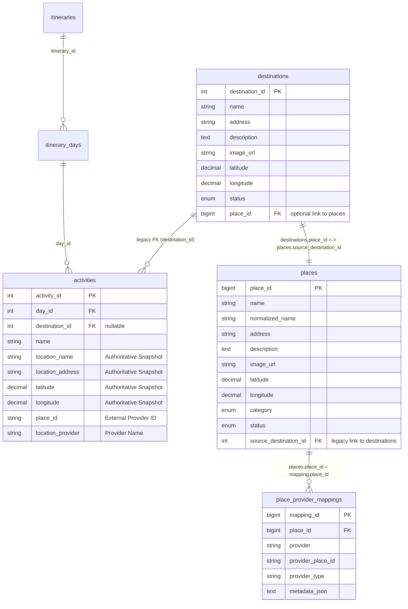
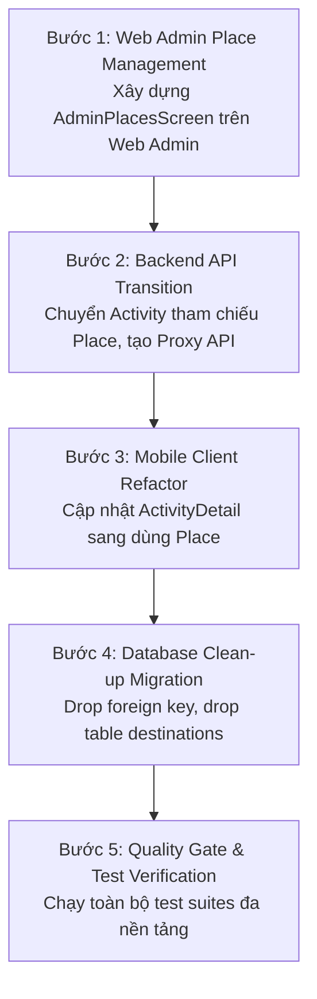

# AUDIT TOÀN DIỆN KIẾN TRÚC DỮ LIỆU & NGHIỆP VỤ: PLACE, DESTINATION & ACTIVITY

> **Tài liệu:** Báo cáo Audit Kiến trúc Dữ liệu & Khả năng Hợp nhất Destination vào Place  
> **Dự án:** Travel Planner  
> **Ngày thực hiện:** 2026-11-11  
> **Người thực hiện:** Senior Software Architect / AI Technical Lead  
> **Phạm vi kiểm tra:** Database MySQL 8.0 thực tế, Spring Boot Backend, Flutter Mobile, Flutter Web Admin  
> **Trạng thái Git:** Branch `develop` (HEAD: `968db5b` — `feat(place): implement canonical place catalog`)  
> **Nguyên tắc audit:** **CHỈ AUDIT — TUYỆT ĐỐI KHÔNG SỬA CODE, KHÔNG SỬA SCHEMA, KHÔNG SỬA DỮ LIỆU**

---

## MỤC LỤC
1. [A. Executive Summary (Tóm tắt điều hành)](#a-executive-summary)
2. [B. Current Architecture (Hiện trạng kiến trúc 3 thành phần)](#b-current-architecture)
3. [C. Database Audit (Kiểm tra Schema & Dữ liệu MySQL thực tế)](#c-database-audit)
4. [D. Backend Audit (Kiểm tra mã nguồn Backend Spring Boot)](#d-backend-audit)
5. [E. Frontend Audit (Kiểm tra Flutter Mobile & Flutter Web)](#e-frontend-audit)
6. [F. Redundancy Analysis (Phân tích mức độ trùng lặp dữ liệu & logic)](#f-redundancy-analysis)
7. [G. Architecture Alternatives (Đánh giá 3 phương án kiến trúc A/B/C)](#g-architecture-alternatives)
8. [H. Migration Strategy (Kế hoạch chuyển đổi nếu loại bỏ Destination)](#h-migration-strategy)
9. [I. Roadmap Recommendation (Khuyến nghị thời điểm triển khai theo Roadmap)](#i-roadmap-recommendation)
10. [J. Implementation Plan (Kế hoạch thực thi chi tiết)](#j-implementation-plan)
11. [K. Unresolved Questions (Những câu hỏi còn để ngỏ cần quyết định)](#k-unresolved-questions)

---

## A. EXECUTIVE SUMMARY

### 1. Kết luận cốt lõi: Bảng `destinations` có còn cần thiết không?
**KẾT LUẬN: BẢNG `destinations` HIỆN TẠI ĐÃ HOÀN TOÀN DƯ THỪA (100% REDUNDANT).**

Bằng chứng thực tế qua phân tích toàn diện mã nguồn và cơ sở dữ liệu:
1. **Dữ liệu trùng lặp 100%:** Toàn bộ 24 bản ghi trong bảng `destinations` đã được di chuyển và nhân bản nguyên vẹn (từ tên, địa chỉ, mô tả, ảnh, tọa độ, đến trạng thái) sang bảng `places`. Không có bất kỳ trường dữ liệu nào của Destination mà Place không sở hữu.
2. **Khả năng bao hàm của `places` vượt trội hơn `destinations`:** Bảng `places` sở hữu toàn bộ các trường của `destinations`, đồng thời bổ sung:
   - `category`: Phân loại chuẩn hóa (`ATTRACTION`, `RESTAURANT`, `CAFE`, `HOTEL`, `ENTERTAINMENT`, `SHOPPING`, `OTHER`).
   - `normalized_name`: Chuẩn hóa không dấu cho tìm kiếm tăng tốc.
   - `place_provider_mappings`: Quan hệ 1-nhiều hỗ trợ liên kết đa nguồn (LocationIQ, TomTom, HERE).
   - Dịch vụ tìm kiếm theo bán kính không gian (Haversine bounding box).
3. **Nghiệp vụ thực tế đã không còn phụ thuộc vào `destinations`:**
   - **Tuyến đường (Routing):** `RouteServiceImpl` trích xuất tọa độ trực tiếp từ snapshot của `Activity`, **hoàn toàn không tham chiếu tới `Destination`**.
   - **Tìm kiếm lịch trình (Explore):** `ItinerarySpecification` lọc theo chuỗi `itineraries.location` (chuỗi vùng miền), **hoàn toàn không JOIN với `destinations`**.
   - **Tạo hoạt động trên Mobile:** Người dùng hiện tại tạo hoạt động thông qua **Map Picker** trực tuyến (LocationIQ/TomTom/Pin thủ công). Đã có 10 hoạt động trong cơ sở dữ liệu mang `destination_id = NULL` và hoạt động hoàn hảo.
   - **API `getDestinations()` trên Mobile:** Phương thức `getDestinations()` trong `ItineraryCrudRepository` của Flutter Mobile **không hề được gọi bởi bất kỳ màn hình nào** trong ứng dụng thực tế.
4. **Màn hình duy nhất còn tương tác với `destinations`:** Là `AdminDestinationsScreen` trên Flutter Web Admin. Bản chất của màn hình này chính là một giao diện CRUD địa điểm chuẩn hóa, và hoàn toàn có thể chuyển hướng sang gọi `/api/admin/places` một cách dễ dàng chỉ bằng việc bổ sung trường chọn `category`.

### 2. Phương án được đề xuất
**PHƯƠNG ÁN B: LOẠI BỎ BẢNG `destinations`, SỬ DỤNG `places` LÀM TRUNG TÂM QUẢN LÝ ĐỊA ĐIỂM DUY NHẤT.**

Hợp nhất toàn bộ vai trò của Destination vào Place. `Place` vừa đóng vai trò danh mục địa điểm vật lý chuẩn hóa thế giới thực, vừa đóng vai trò nội dung giới thiệu/khám phá do Admin biên tập (`description`, `image_url`, `status`). `Activity` tiếp tục giữ nguyên Authoritative Location Snapshot độc lập 100%.

### 3. Rủi ro lớn nhất & Biện pháp kiểm soát
- **Rủi ro 1 — Phá vỡ quan hệ khóa ngoại `activities.destination_id`:** Bảng `activities` có 111 bản ghi đang mang giá trị `destination_id`.  
  *Kiểm soát:* Vì tất cả 121 activities đều đã có snapshot vị trí đầy đủ (`location_name`, `location_address`, `latitude`, `longitude`, `place_id`, `location_provider`), việc xóa bỏ cột `destination_id` hoặc thay thế bằng `place_id` (tham chiếu sang `places.place_id`) sẽ bảo đảm an toàn dữ liệu 100%.
- **Rủi ro 2 — Gián đoạn giao diện Web Admin:** Web Admin đang dùng `AdminDestinationsScreen` gọi `/api/admin/destinations`.  
  *Kiểm soát:* Chuyển đổi Web Admin sang `AdminPlacesScreen` trước khi drop API cũ, hoặc duy trì API `/api/admin/destinations` như một controller proxy chuyển tiếp sang `PlaceService` trong giai đoạn chuyển tiếp.
- **Rủi ro 3 — Làm loãng vai trò của Place Catalog khi nhận kết quả tìm kiếm rác từ bên thứ 3:**  
  *Kiểm soát:* Duy trì nghiêm ngặt **Place Persistence Policy**: Kết quả tìm kiếm trên Mobile Map Picker tiếp tục là kết quả tạm thời (*transient*). Bảng `places` chỉ lưu trữ các địa điểm do Admin tạo, được thăng cấp chính thức, hoặc đã migrate từ danh mục ban đầu.

---

## B. CURRENT ARCHITECTURE (HIỆN TRẠNG KIẾN TRÚC)

### 1. Sơ đồ thực thể hiện tại (Entity Relationship Diagram)



### 2. Vai trò của từng bảng trong kiến trúc hiện tại
- **`destinations` (Legacy Catalog):** Được xây dựng từ giai đoạn đầu dự án làm kho điểm đến mẫu do Admin quản lý. Dữ liệu gồm 24 địa danh danh lam thắng cảnh Việt Nam.
- **`places` (Canonical Place Catalog - Giai đoạn 2):** Được xây dựng để làm trung tâm định danh địa điểm thực tế trong thế giới thực, độc lập với các bên thứ 3 (LocationIQ, TomTom, HERE). Hỗ trợ chuẩn hóa tên không dấu (`normalized_name`), danh mục (`category`), và khử trùng lặp.
- **`place_provider_mappings` (Multi-provider Links):** Bảng phụ trợ 1-nhiều của `places`, lưu trữ cặp `(provider, provider_place_id)` (LocationIQ OSM ID, TomTom POI ID, hoặc `DESTINATION_CATALOG`).
- **`activities` (Authoritative Snapshot):** Lưu trữ lịch trình chi tiết của người dùng. Áp dụng kiến trúc Authoritative Location Snapshot từ Phase 1 & 1.1: tự lưu snapshot vị trí độc lập (`location_name`, `location_address`, `latitude`, `longitude`, `place_id`, `location_provider`).

### 3. Luồng dữ liệu thực tế (Data Flow)
1. **Luồng tạo Activity từ Mobile Map Picker:**
   `Mobile Map Picker` $\rightarrow$ Gọi `/api/locations/search` (LocationIQ/TomTom API) $\rightarrow$ Người dùng ghim vị trí $\rightarrow$ Gửi `CreateActivityRequest` với tọa độ, tên, địa chỉ, `destinationId = null` $\rightarrow$ `ItineraryServiceImpl.applyLocation` ghi snapshot trực tiếp vào `Activity`. **Hoàn toàn không chạm đến `destinations` hay `places`**.
2. **Luồng tính toán Route (Chỉ đường):**
   `RouteServiceImpl` đọc danh sách `Activity` trong ngày $\rightarrow$ Lấy trực tiếp `activity.latitude` và `activity.longitude` $\rightarrow$ Gửi sang OpenRouteService/Haversine. **Hoàn toàn không đọc từ `destinations`**.
3. **Luồng Web Admin quản lý:**
   `AdminDestinationsScreen` trên Web $\rightarrow$ Gọi `/api/admin/destinations` $\rightarrow$ `DestinationServiceImpl` CRUD bảng `destinations`. Sau đó, `PlaceCatalogMigrationRunner` (hoặc admin manual sync) phải đồng bộ sang bảng `places`.
4. **Luồng Explore trên Mobile:**
   `ExploreScreen` $\rightarrow$ Gọi `/api/itineraries` $\rightarrow$ Lọc theo `itineraries.location` (chuỗi văn bản người dùng nhập). **Hoàn toàn không truy vấn bảng `destinations`**.

---

## C. DATABASE AUDIT (SCHEMA & DỮ LIỆU MYSQL THỰC TẾ)

*(Bằng chứng: Thực thi trực tiếp các câu lệnh SQL chỉ đọc trên cơ sở dữ liệu `travel_planner` trên MySQL 8.0)*

### 1. Schema & Ràng buộc toàn vẹn

#### Bảng `places`
```sql
CREATE TABLE `places` (
  `place_id` bigint NOT NULL AUTO_INCREMENT,
  `address` varchar(255) COLLATE utf8mb4_unicode_ci NOT NULL,
  `category` enum('ATTRACTION','CAFE','ENTERTAINMENT','HOTEL','OTHER','RESTAURANT','SHOPPING') COLLATE utf8mb4_unicode_ci NOT NULL,
  `created_at` datetime(6) NOT NULL,
  `description` text COLLATE utf8mb4_unicode_ci,
  `image_url` varchar(500) COLLATE utf8mb4_unicode_ci DEFAULT NULL,
  `latitude` decimal(10,7) NOT NULL,
  `longitude` decimal(10,7) NOT NULL,
  `name` varchar(150) COLLATE utf8mb4_unicode_ci NOT NULL,
  `normalized_name` varchar(150) COLLATE utf8mb4_unicode_ci NOT NULL,
  `source_destination_id` int DEFAULT NULL,
  `status` enum('ACTIVE','HIDDEN') COLLATE utf8mb4_unicode_ci NOT NULL,
  `updated_at` datetime(6) NOT NULL,
  PRIMARY KEY (`place_id`),
  KEY `idx_places_normalized_name` (`normalized_name`),
  KEY `idx_places_category` (`category`),
  KEY `idx_places_status` (`status`),
  KEY `idx_places_coords` (`latitude`,`longitude`),
  KEY `idx_places_source_dest` (`source_destination_id`)
) ENGINE=InnoDB DEFAULT CHARSET=utf8mb4 COLLATE=utf8mb4_unicode_ci;
```

#### Bảng `destinations`
```sql
CREATE TABLE `destinations` (
  `destination_id` int NOT NULL AUTO_INCREMENT,
  `address` varchar(255) COLLATE utf8mb4_unicode_ci NOT NULL,
  `created_at` datetime(6) NOT NULL,
  `description` text COLLATE utf8mb4_unicode_ci,
  `image_url` varchar(500) COLLATE utf8mb4_unicode_ci DEFAULT NULL,
  `latitude` decimal(10,7) DEFAULT NULL,
  `longitude` decimal(10,7) DEFAULT NULL,
  `name` varchar(150) COLLATE utf8mb4_unicode_ci NOT NULL,
  `status` enum('ACTIVE','HIDDEN') COLLATE utf8mb4_unicode_ci NOT NULL,
  `updated_at` datetime(6) NOT NULL,
  `place_id` bigint DEFAULT NULL,
  PRIMARY KEY (`destination_id`)
) ENGINE=InnoDB DEFAULT CHARSET=utf8mb4 COLLATE=utf8mb4_unicode_ci;
```

### 2. Kết quả 15 chỉ số kiểm tra dữ liệu thực tế

| STT | Chỉ số kiểm tra | Kết quả SQL thực tế | Đánh giá kiến trúc |
|:---:|:---|:---:|:---|
| 1 | Tổng số Place và Destination | `places`: **24**<br>`destinations`: **24** | Hai bảng đang có quy mô bản ghi ngang bằng tuyệt đối (1:1). |
| 2 | Số lượng Place theo Status | `ACTIVE`: **23**<br>`HIDDEN`: **1** | Khớp trạng thái. |
| 3 | Số lượng Destination theo Status | `ACTIVE`: **23**<br>`HIDDEN`: **1** | Bản ghi HIDDEN là ID 20 ("Khu bảo tồn... Đang Cải Tạo"). |
| 4 | Destination có `place_id` NULL | **0** | 100% Destinations đã được liên kết với Place. |
| 5 | Destination có `place_id` không tồn tại | **0** | Không có khóa ngoại mồ côi từ Destination sang Place. |
| 6 | Place có `source_destination_id` NULL | **0** | Hiện tại 100% Place đều bắt nguồn từ Destination ban đầu. |
| 7 | Place có `source_destination_id` không tồn tại | **0** | Không có khóa ngoại mồ côi từ Place sang Destination. |
| 8 | Số cặp Place–Destination không khớp hai chiều | **0** | Liên kết song ánh 1-1 hoàn hảo giữa `destination_id` và `place_id`. |
| 9 | Số Place trùng tên chuẩn hóa | **0** | Không có địa điểm trùng tên trong danh mục. |
| 10 | Số Place có tọa độ không hợp lệ | **0** | 100% tọa độ nằm trong khoảng $[-90, 90]$ và $[-180, 180]$. |
| 11 | Số Destination thiếu tọa độ | **0** | 100% Destination đều có đầy đủ vĩ độ và kinh độ. |
| 12 | Số Activity đang có `destination_id` | **111 / 121** | 111 activities ban đầu do seeder tạo liên kết với destination; **10 activities do người dùng tạo có `destination_id = NULL`**. |
| 13 | Activity tham chiếu Destination không tồn tại / HIDDEN | **0** | Không có activity nào trỏ tới Destination bị ẩn hoặc không tồn tại. |
| 14 | Activity có snapshot vị trí không đầy đủ | **0** | **121 / 121 (100%)** activities có đầy đủ snapshot `location_name`, `location_address`, `latitude`, `longitude`. |
| 15 | Provider Mapping bị orphan hoặc trùng lặp | `orphan`: **0**<br>`duplicate`: **0** | 24 mapping với `provider = 'DESTINATION_CATALOG'` toàn vẹn. |

### 3. Phân định ngữ nghĩa và dữ liệu thực tế của các trường định danh

| Tên trường | Bảng | Kiểu dữ liệu | Ý nghĩa nghiệp vụ thực tế |
|:---|:---|:---|:---|
| `places.place_id` | `places` | `BIGINT AUTO_INCREMENT` | **Khóa chính nội bộ** duy nhất đại diện cho địa điểm vật lý chuẩn hóa trong Travel Planner. |
| `destinations.place_id` | `destinations` | `BIGINT NULL` | **Khóa tham chiếu tùy chọn** trỏ đến `places.place_id`. |
| `places.source_destination_id` | `places` | `INT NULL` | **Khóa tham chiếu ngược legacy** trỏ đến `destinations.destination_id`. |
| `activities.destination_id` | `activities` | `INT NULL` | **Khóa ngoại legacy** trỏ tới `destinations.destination_id` (được sinh ra từ thời kỳ chưa có Place Catalog và chưa có Map Picker). |
| `activities.place_id` | `activities` | `VARCHAR(100) NULL` | **Mã định danh phía nhà cung cấp bản đồ** (ví dụ OSM ID `"osm_node_10580766242"`, TomTom POI ID `"pois:-GCWtuzIDHbfEeoBfrXwHA"`, hoặc `"dest_1"`). **KHÔNG PHẢI LÀ `places.place_id`**. |
| `activities.location_provider` | `activities` | `VARCHAR(30) NULL` | **Tên nhà cung cấp bản đồ** tương ứng với `activities.place_id` (ví dụ `"LOCATION_IQ"`, `"TOMTOM"`, `"MANUAL_PIN"`, `"DESTINATION_CATALOG"`). |

---

## D. BACKEND AUDIT

*(Bằng chứng: Đối chiếu toàn bộ các file Java trong `Travel_Planner/backend`)*

### 1. Thành phần liên quan đến Destination
- **Entity & Enums:** [`Destination.java`](file:///d:/CODE/HCMUTE/TLCN/Travel-planner-community/Travel_Planner/backend/src/main/java/Travel_Planner/Travel_Planner/model/Destination.java), [`DestinationStatus.java`](file:///d:/CODE/HCMUTE/TLCN/Travel-planner-community/Travel_Planner/backend/src/main/java/Travel_Planner/Travel_Planner/model/enums/DestinationStatus.java).
- **Repository:** [`DestinationRepository.java`](file:///d:/CODE/HCMUTE/TLCN/Travel-planner-community/Travel_Planner/backend/src/main/java/Travel_Planner/Travel_Planner/repository/DestinationRepository.java) (chứa các phương thức tìm kiếm theo keyword và status).
- **DTOs:** [`CreateDestinationRequest.java`](file:///d:/CODE/HCMUTE/TLCN/Travel-planner-community/Travel_Planner/backend/src/main/java/Travel_Planner/Travel_Planner/dto/request/CreateDestinationRequest.java), [`UpdateDestinationRequest.java`](file:///d:/CODE/HCMUTE/TLCN/Travel-planner-community/Travel_Planner/backend/src/main/java/Travel_Planner/Travel_Planner/dto/request/UpdateDestinationRequest.java), [`DestinationResponse.java`](file:///d:/CODE/HCMUTE/TLCN/Travel-planner-community/Travel_Planner/backend/src/main/java/Travel_Planner/Travel_Planner/dto/response/DestinationResponse.java).
- **Service:** [`DestinationService.java`](file:///d:/CODE/HCMUTE/TLCN/Travel-planner-community/Travel_Planner/backend/src/main/java/Travel_Planner/Travel_Planner/service/DestinationService.java), [`DestinationServiceImpl.java`](file:///d:/CODE/HCMUTE/TLCN/Travel-planner-community/Travel_Planner/backend/src/main/java/Travel_Planner/Travel_Planner/service/impl/DestinationServiceImpl.java).
- **Controllers:**
  - Public: [`DestinationController.java`](file:///d:/CODE/HCMUTE/TLCN/Travel-planner-community/Travel_Planner/backend/src/main/java/Travel_Planner/Travel_Planner/controller/DestinationController.java) (`GET /api/destinations`, `GET /api/destinations/{id}`).
  - Admin: [`AdminDestinationController.java`](file:///d:/CODE/HCMUTE/TLCN/Travel-planner-community/Travel_Planner/backend/src/main/java/Travel_Planner/Travel_Planner/controller/AdminDestinationController.java) (`GET /api/admin/destinations`, `POST /api/admin/destinations`, `PUT /api/admin/destinations/{id}`, `DELETE /api/admin/destinations/{id}`).
- **Các nơi phụ thuộc vào `DestinationRepository`:**
  1. `DestinationServiceImpl`: Logic CRUD cho Destination.
  2. `DataSeeder`: Seed 24 bản ghi ban đầu.
  3. `PlaceCatalogMigrationRunner`: Đọc 24 bản ghi để migrate sang `places`.
  4. `ItineraryServiceImpl`: Chỉ xuất hiện ở 2 vị trí:
     - Dòng 936–950: Khi map ra `ActivityResponse`, nếu `activity.getDestination() != null` thì build kèm `DestinationResponse`.
     - Dòng 1063 & 1096: Trong hàm `applyLocation`, nếu request có gửi lên `destinationId != null`, nó tìm Destination để gán vào `activity.setDestination(dest)` và copy tên, địa chỉ, tọa độ vào snapshot.

### 2. Thành phần liên quan đến Place
- **Entity & Enums:** [`Place.java`](file:///d:/CODE/HCMUTE/TLCN/Travel-planner-community/Travel_Planner/backend/src/main/java/Travel_Planner/Travel_Planner/model/Place.java), [`PlaceProviderMapping.java`](file:///d:/CODE/HCMUTE/TLCN/Travel-planner-community/Travel_Planner/backend/src/main/java/Travel_Planner/Travel_Planner/model/PlaceProviderMapping.java), [`PlaceCategory.java`](file:///d:/CODE/HCMUTE/TLCN/Travel-planner-community/Travel_Planner/backend/src/main/java/Travel_Planner/Travel_Planner/model/enums/PlaceCategory.java), [`PlaceStatus.java`](file:///d:/CODE/HCMUTE/TLCN/Travel-planner-community/Travel_Planner/backend/src/main/java/Travel_Planner/Travel_Planner/model/enums/PlaceStatus.java).
- **Repository:** [`PlaceRepository.java`](file:///d:/CODE/HCMUTE/TLCN/Travel-planner-community/Travel_Planner/backend/src/main/java/Travel_Planner/Travel_Planner/repository/PlaceRepository.java), [`PlaceProviderMappingRepository.java`](file:///d:/CODE/HCMUTE/TLCN/Travel-planner-community/Travel_Planner/backend/src/main/java/Travel_Planner/Travel_Planner/repository/PlaceProviderMappingRepository.java).
- **DTOs:** [`PlaceResponse.java`](file:///d:/CODE/HCMUTE/TLCN/Travel-planner-community/Travel_Planner/backend/src/main/java/Travel_Planner/Travel_Planner/dto/response/PlaceResponse.java), [`PlaceDetailResponse.java`](file:///d:/CODE/HCMUTE/TLCN/Travel-planner-community/Travel_Planner/backend/src/main/java/Travel_Planner/Travel_Planner/dto/response/PlaceDetailResponse.java), [`PlaceProviderMappingResponse.java`](file:///d:/CODE/HCMUTE/TLCN/Travel-planner-community/Travel_Planner/backend/src/main/java/Travel_Planner/Travel_Planner/dto/response/PlaceProviderMappingResponse.java), [`CreatePlaceRequest.java`](file:///d:/CODE/HCMUTE/TLCN/Travel-planner-community/Travel_Planner/backend/src/main/java/Travel_Planner/Travel_Planner/dto/request/CreatePlaceRequest.java), [`UpdatePlaceRequest.java`](file:///d:/CODE/HCMUTE/TLCN/Travel-planner-community/Travel_Planner/backend/src/main/java/Travel_Planner/Travel_Planner/dto/request/UpdatePlaceRequest.java).
- **Service:** [`PlaceService.java`](file:///d:/CODE/HCMUTE/TLCN/Travel-planner-community/Travel_Planner/backend/src/main/java/Travel_Planner/Travel_Planner/service/PlaceService.java), [`PlaceServiceImpl.java`](file:///d:/CODE/HCMUTE/TLCN/Travel-planner-community/Travel_Planner/backend/src/main/java/Travel_Planner/Travel_Planner/service/impl/PlaceServiceImpl.java), [`PlaceNormalizationService.java`](file:///d:/CODE/HCMUTE/TLCN/Travel-planner-community/Travel_Planner/backend/src/main/java/Travel_Planner/Travel_Planner/service/PlaceNormalizationService.java), [`PlaceNormalizationServiceImpl.java`](file:///d:/CODE/HCMUTE/TLCN/Travel-planner-community/Travel_Planner/backend/src/main/java/Travel_Planner/Travel_Planner/service/impl/PlaceNormalizationServiceImpl.java).
- **Controllers:**
  - Public: [`PlaceController.java`](file:///d:/CODE/HCMUTE/TLCN/Travel-planner-community/Travel_Planner/backend/src/main/java/Travel_Planner/Travel_Planner/controller/PlaceController.java) (`GET /api/places`, `GET /api/places/{id}`).
  - Admin: [`AdminPlaceController.java`](file:///d:/CODE/HCMUTE/TLCN/Travel-planner-community/Travel_Planner/backend/src/main/java/Travel_Planner/Travel_Planner/controller/AdminPlaceController.java) (`GET /api/admin/places`, `GET /api/admin/places/{id}`, `POST /api/admin/places`, `PUT /api/admin/places/{id}`, `DELETE /api/admin/places/{id}`).

**Đánh giá:** Hệ thống API và Service của `Place` hiện tại đã bao phủ 100% chức năng của `DestinationService` và `DestinationController`, đồng thời bổ sung tìm kiếm nâng cao theo bán kính Haversine, phân trang, lọc theo Category, và khử trùng lặp.

---

## E. FRONTEND AUDIT (MOBILE & WEB ADMIN)

*(Bằng chứng: Đối chiếu toàn bộ các file Dart trong `frontend/mobile` và `frontend/web`)*

### 1. Flutter Mobile
- **Mô hình DTO:** [`destination_summary.dart`](file:///d:/CODE/HCMUTE/TLCN/Travel-planner-community/Travel_Planner/frontend/mobile/lib/features/itinerary/data/models/destination_summary.dart) chứa model `DestinationSummary`. Model này chỉ được nhúng bên trong [`ActivityDetail`](file:///d:/CODE/HCMUTE/TLCN/Travel-planner-community/Travel_Planner/frontend/mobile/lib/features/itinerary/data/models/activity_detail.dart) dưới dạng `final DestinationSummary? destination;`.
- **Màn hình hiển thị chi tiết hoạt động ([`activity_detail_screen.dart`](file:///d:/CODE/HCMUTE/TLCN/Travel-planner-community/Travel_Planner/frontend/mobile/lib/features/itinerary/presentation/screens/activity_detail_screen.dart)):**
  - Tọa độ, địa chỉ, tên địa điểm được lấy từ `effectiveLocationName`, `effectiveAddress`, `latitude`, `longitude` của Activity snapshot.
  - `destination` chỉ dùng làm fallback hiển thị ảnh (nếu `activity.imageUrl` bị null thì lấy `act.destination?.imageUrl`) và hiển thị khối ghi chú phụ ("Catalog Destination Extra Information" hiển thị `act.destination.description`).
- **Màn hình Timeline ([`activity_timeline_item.dart`](file:///d:/CODE/HCMUTE/TLCN/Travel-planner-community/Travel_Planner/frontend/mobile/lib/features/itinerary/presentation/widgets/activity_timeline_item.dart)):**
  - Sử dụng tương tự: fallback ảnh `activity.imageUrl ?? activity.destination?.imageUrl` và hiển thị icon placeholder.
- **Form thêm/sửa hoạt động ([`activity_form_dialog.dart`](file:///d:/CODE/HCMUTE/TLCN/Travel-planner-community/Travel_Planner/frontend/mobile/lib/features/itinerary/presentation/widgets/activity_form_dialog.dart)):**
  - Sử dụng `Map Picker` (`showLocationPickerModal`). Khi người dùng chọn một địa điểm bất kỳ trên bản đồ hoặc tìm kiếm trực tuyến, code gán:
    ```dart
    _destinationId = null; // Tách rời khỏi Destination catalog
    ```
  - Biến `_destinationId` chỉ được giữ lại nếu người dùng chỉnh sửa một hoạt động cũ đã liên kết Destination từ trước mà không chạm vào vị trí.
- **API `getDestinations()`:** Có trong `itinerary_crud_repository.dart` nhưng **không có màn hình nào gọi**.
- **Màn hình Khám phá (`ExploreScreen`):** Gọi `getPublicItineraries()` từ `/api/itineraries`, **không gọi Destination**.

### 2. Flutter Web Admin
- **Màn hình Quản trị Điểm đến ([`admin_destinations_screen.dart`](file:///d:/CODE/HCMUTE/TLCN/Travel-planner-community/Travel_Planner/frontend/web/lib/features/locations/presentation/screens/admin_destinations_screen.dart)):**
  - Quản lý danh sách Destination qua [`DestinationRepository`](file:///d:/CODE/HCMUTE/TLCN/Travel-planner-community/Travel_Planner/frontend/web/lib/features/locations/data/destination_repository.dart) gọi `/api/admin/destinations`.
  - Hỗ trợ xem danh sách, lọc từ khóa, lọc status (`ACTIVE`/`HIDDEN`), xem chi tiết trên bản đồ, thêm mới qua [`destination_form_dialog.dart`](file:///d:/CODE/HCMUTE/TLCN/Travel-planner-community/Travel_Planner/frontend/web/lib/features/locations/presentation/widgets/destination_form_dialog.dart), sửa và ẩn qua [`hide_destination_dialog.dart`](file:///d:/CODE/HCMUTE/TLCN/Travel-planner-community/Travel_Planner/frontend/web/lib/features/locations/presentation/widgets/hide_destination_dialog.dart).
- **Giao diện Quản trị Place:**
  - Đã khai báo hằng số API: `ApiConstants.places = '/api/places'`, `ApiConstants.adminPlaces = '/api/admin/places'`.
  - Chưa xây dựng màn hình `AdminPlacesScreen`.

---

## F. REDUNDANCY ANALYSIS (PHÂN TÍCH MỨC ĐỘ TRÙNG LẶP)

### 1. Bảng đối chiếu trách nhiệm và trùng lặp trường dữ liệu

| Trường dữ liệu | Bảng `destinations` | Bảng `places` | Bảng `activities` | Đánh giá trùng lặp & Trách nhiệm |
|:---|:---|:---|:---|:---|
| **Name** | `name` (150) | `name` (150) | `location_name` (150) | **Trùng lặp giữa Destination và Place:** Cả 24 bản ghi có tên giống nhau 100%. `Activity.location_name` là snapshot độc lập của người dùng tại thời điểm tạo hoạt động. |
| **Address** | `address` (255) | `address` (255) | `location_address` (255) | **Trùng lặp giữa Destination và Place:** Giống nhau 100%. Activity lưu snapshot độc lập. |
| **Coordinates** | `latitude`, `longitude` (10,7) | `latitude`, `longitude` (10,7) | `latitude`, `longitude` (10,7) | **Trùng lặp giữa Destination và Place:** Giống nhau 100%. Activity lưu tọa độ độc lập phục vụ định tuyến. |
| **Description** | `description` (TEXT) | `description` (TEXT) | `description` (TEXT) | **Trùng lặp:** Place đã lưu mô tả đầy đủ của Destination. `Activity.description` là ghi chú riêng của chuyến đi ("Ăn sáng quán này ngon", "Mua vé trước"). |
| **Image URL** | `image_url` (500) | `image_url` (500) | `image_url` (500) | **Trùng lặp:** Place đã lưu ảnh đại diện địa điểm. `Activity.image_url` là ảnh check-in thực tế của người dùng. |
| **Category** | *Không có* | `category` (ENUM) | *Không có* | **Place vượt trội:** Place phân loại rõ `ATTRACTION`, `RESTAURANT`, `CAFE`, v.v. |
| **Status** | `status` (ACTIVE/HIDDEN) | `status` (ACTIVE/HIDDEN) | *Không có* | **Trùng lặp 100%:** Quản lý trạng thái hiển thị công khai hay tạm ẩn. |

### 2. Trùng lặp quan hệ & Logic
- **Quan hệ trùng lặp:** `destinations.place_id` $\leftrightarrow$ `places.source_destination_id` là một quan hệ song ánh giả tạo nhằm giữ hai bảng đồng bộ với nhau.
- **Logic trùng lặp:** Hệ thống đang phải duy trì hai bộ Controller, Service, DTO, Repository giống nhau đến 90%, đồng thời phải duy trì `PlaceCatalogMigrationRunner` với MySQL advisory lock chỉ để đảm bảo khi Admin sửa/thêm Destination thì Place cũng có dữ liệu tương ứng.
- **Phần cần giữ:**
  1. Authoritative Location Snapshot của `Activity` (tuyệt đối không bỏ).
  2. Toàn bộ thông tin địa danh, mô tả, ảnh, tọa độ hiện có (đã có sẵn trong `places`).
  3. Phân loại danh mục và khả năng ánh xạ đa nguồn (`place_provider_mappings`).
- **Phần có thể loại bỏ:**
  1. Toàn bộ bảng `destinations`.
  2. Các controller và service riêng của Destination.
  3. Cơ chế runner đồng bộ dữ liệu giữa 2 bảng (`PlaceCatalogMigrationRunner`).
  4. Cột `source_destination_id` trong `places`.

---

## G. ARCHITECTURE ALTERNATIVES (ĐÁNH GIÁ 3 PHƯƠNG ÁN KIẾN TRÚC)

### 1. Phân tích chi tiết từng phương án

#### Phương án A — Giữ nguyên cả Destination và Place (Hiện trạng)
- **Cơ chế:** `Place` quản lý danh mục địa điểm vật lý kỹ thuật, `Destination` quản lý nội dung biên tập hiển thị cho Explore, hai bảng liên kết qua `place_id`.
- **Ưu điểm:** Không cần thay đổi schema database hiện có; không cần sửa Web Admin ngay lập tức.
- **Nhược điểm:** Trùng lặp dữ liệu nghiêm trọng (nhân đôi 24 bản ghi); chi phí bảo trì gấp đôi (sửa điểm đến phải sửa ở hai nơi); nợ kỹ thuật ngày càng phình to khi sang Phase 3 (phải liên kết cả Destination lẫn Place vào `administrative_areas`).

#### Phương án B — Loại bỏ Destination, dùng Place làm trung tâm duy nhất (Đề xuất tối ưu)
- **Cơ chế:** `Place` vừa là danh mục địa lý chuẩn hóa, vừa chứa nội dung biên tập (`description`, `image_url`, `category`, `status`). Web Admin chuyển sang quản trị `Place`. Explore và Activity tham chiếu trực tiếp đến `Place` khi cần. Activity tiếp tục giữ snapshot độc lập.
- **Ưu điểm:**
  - Xóa bỏ hoàn toàn trùng lặp dữ liệu và mã nguồn thừa.
  - Schema tinh gọn, mạch lạc, dễ hiểu.
  - Khi triển khai Phase 3 (Administrative Areas) và Phase 4 (Saved Places), chỉ cần gắn quan hệ duy nhất vào bảng `places`.
  - Phù hợp 100% với thực tế nghiệp vụ hiện tại.
- **Nhược điểm:** Cần cập nhật giao diện Web Admin sang `AdminPlacesScreen` (chủ yếu bổ sung dropdown chọn `category`), và cập nhật nhỏ ở Mobile (thay thế tham chiếu `destination` bằng `place`).

#### Phương án C — Place làm lõi, tách nội dung thành bảng riêng (`PlaceContent`)
- **Cơ chế:** Tách `places` thành `places` (chỉ lưu tọa độ, tên chuẩn hóa) và `place_contents` (lưu bài viết, ảnh, mô tả, đa ngôn ngữ, trạng thái xuất bản).
- **Ưu điểm:** Phù hợp cho các hệ thống CMS du lịch quy mô khổng lồ với đội ngũ biên tập viên chuyên sâu, nhiều phiên bản nội dung theo thời gian hoặc đa ngôn ngữ.
- **Nhược điểm:** Phức tạp hóa không cần thiết (*over-engineering*) đối với quy mô và yêu cầu hiện tại của dự án Travel Planner. Tạo thêm bảng và tăng số lượng câu lệnh JOIN không đem lại giá trị thực tế.

---

### 2. Bảng so sánh bắt buộc giữa 3 phương án

| Tiêu chí | Phương án A (Giữ cả hai) | Phương án B (Place duy nhất - Đề xuất) | Phương án C (Tách PlaceContent) |
|:---|:---:|:---:|:---:|
| **1. Độ phức tạp** | Cao (duy trì 2 bảng song song + đồng bộ) | **Thấp nhất (1 thực thể duy nhất, luồng rõ ràng)** | Rất cao (thêm bảng trung gian, quan hệ 1-1/1-n) |
| **2. Trùng lặp dữ liệu** | Rất cao (nhân đôi 100% dữ liệu) | **Không có (Zero Redundancy)** | Thấp (tách trường nội dung) |
| **3. Quản lý Explore** | Phân mảnh giữa Destination và Place | **Tập trung tại Place (dễ dàng lọc theo category, vùng miền)** | Linh hoạt nhất (hỗ trợ đa ngôn ngữ, bài viết dài) |
| **4. Quản trị Admin** | Rối rắm (Admin quản lý Destination, hệ thống sync sang Place) | **Mạch lạc (Admin quản lý trực tiếp Place Catalog)** | Phức tạp (quản trị metadata tách rời content) |
| **5. Tìm kiếm địa điểm** | Phân mảnh (tìm kiếm Destination khác tìm kiếm Place) | **Thống nhất (tìm kiếm không dấu, bán kính Haversine, category)** | Thống nhất |
| **6. Provider Mapping** | Chỉ có ở Place, Destination không có | **Đầy đủ tại Place (hỗ trợ LocationIQ, TomTom, HERE)** | Đầy đủ tại Place |
| **7. Activity independence** | Bảo toàn (nhờ snapshot) | **Bảo toàn 100% (nhờ snapshot độc lập)** | Bảo toàn (nhờ snapshot) |
| **8. Khả năng mở rộng (Phase 3, 4)** | Kém (phải link cả 2 bảng vào Administrative Areas) | **Xuất sắc (gắn trực tiếp `administrative_area_id` vào `places`)** | Tốt nhưng phức tạp |
| **9. Chi phí migration** | Không tốn ngay, nhưng nợ kỹ thuật tăng theo thời gian | **Thấp (dữ liệu đã có sẵn 100% trong `places`, chỉ cần refactor)** | Rất cao (tách bảng, viết lại toàn bộ API) |
| **10. Khả năng bảo trì** | Kém (dễ lệch dữ liệu giữa 2 bảng) | **Rất cao (codebase gọn gàng, giảm ~1,200 dòng code thừa)** | Trung bình |

### 3. Kết luận lựa chọn: PHƯƠNG ÁN B
Phương án B là phương án tối ưu tuyệt đối về mặt kiến trúc, kỹ thuật và chi phí vận hành. Nó giải quyết triệt để vấn đề "hai nguồn chân lý" (*Split Brain Data*), chuẩn bị một nền tảng dữ liệu sạch sẽ, vững chắc cho **Phase 3 (Administrative Areas)** và **Phase 4 (User Saved Places)**.

---

## H. MIGRATION STRATEGY (KẾ HOẠCH CHUYỂN ĐỔI CHI TIẾT)

Nếu quyết định thực hiện loại bỏ `destinations` theo Phương án B, kế hoạch chuyển đổi được xây dựng cụ thể như sau:

### 1. Phân tích 15 hạng mục tác động
1. **Database Schema:**
   - Xóa bỏ foreign key constraint `FK2oooqkhm3kxy3yijondygnl9x` trên `activities(destination_id)`.
   - Bổ sung cột `place_id BIGINT NULL` trên bảng `activities` (có index và foreign key trỏ tới `places.place_id`).
   - Xóa bỏ cột `destination_id` trên bảng `activities`.
   - Xóa bỏ cột `source_destination_id` trên bảng `places`.
   - Xóa bỏ bảng `destinations`.
2. **Dữ liệu Destination hiện có:**
   - Đã được đồng bộ 100% sang `places` (24/24 bản ghi). Không có nguy cơ mất dữ liệu.
3. **Cột `places.source_destination_id`:** Xóa bỏ sau khi hoàn tất chuyển đổi.
4. **Cột `destinations.place_id`:** Tự động mất khi drop bảng `destinations`.
5. **Cột `activities.destination_id`:**
   - Chuyển đổi dữ liệu: Với 111 activities đang có `destination_id`, cập nhật:
     ```sql
     UPDATE activities a
     JOIN destinations d ON a.destination_id = d.destination_id
     SET a.place_id_canonical = d.place_id;
     ```
   - Sau đó chuyển tham chiếu sang `place_id` của `places`.
6. **Backend Entity & Repository:**
   - Xóa `Destination.java`, `DestinationStatus.java`, `DestinationRepository.java`.
   - Cập nhật `Activity.java`: thay thế `@ManyToOne Destination destination` bằng `@ManyToOne Place place` (nullable).
7. **Backend DTOs, Service & Controller:**
   - Cập nhật `ActivityResponse`: Thay trường `DestinationResponse destination` bằng `PlaceResponse place`.
   - Cập nhật `CreateActivityRequest` và `UpdateActivityRequest`: Thay thế `destinationId` bằng `placeId` (`Long`).
   - Xóa `DestinationService`, `DestinationServiceImpl`, `DestinationController`, `AdminDestinationController`.
   - Bổ sung API alias hoặc redirection nếu cần hỗ trợ backward compatibility.
8. **Security & Phân quyền:**
   - Bỏ cấu hình `/api/destinations/**` trong `SecurityConfig.java`. Cấu hình `/api/places/**` và `/api/admin/places/**` đã có sẵn.
9. **Flutter Web Admin:**
   - Đổi tên và tái cấu trúc `admin_destinations_screen.dart` thành `admin_places_screen.dart`.
   - Cập nhật `destination_form_dialog.dart` thành `place_form_dialog.dart` (bổ sung dropdown chọn `category`: `ATTRACTION`, `RESTAURANT`, `CAFE`, v.v.).
   - Trỏ repository sang gọi `ApiConstants.adminPlaces`.
10. **Flutter Mobile:**
    - Cập nhật `ActivityDetail`: thay `destination` bằng `place` (thuộc model `PlaceResponse`).
    - Cập nhật `activity_detail_screen.dart` và `activity_timeline_item.dart`: đọc fallback ảnh từ `activity.imageUrl ?? activity.place?.imageUrl`.
    - Xóa bỏ `getDestinations()` thừa trong `itinerary_crud_repository.dart`.
11. **Màn hình Explore:**
    - Không bị ảnh hưởng ngay lập tức (vì Explore hiện lọc theo lịch trình). Đến Phase 6, Explore sẽ truy vấn trực tiếp `/api/places`.
12. **Image Upload:**
    - Sử dụng chung Cloudinary image upload service hiện có cho Place images.
13. **Migration Runner:**
    - Xóa bỏ `PlaceCatalogMigrationRunner.java` (không còn cần runner đồng bộ giữa 2 bảng).
14. **Tests:**
    - Xóa `DestinationControllerTest`, `AdminDestinationControllerTest`.
    - Cập nhật các mock trong `ItineraryServiceImplTest` và `ActivityLocationModelTest`.
15. **Documentation:**
    - Cập nhật tài liệu Function Specification và Development Log.

### 2. Kế hoạch Rollback (Kế hoạch dự phòng)
- Trước khi thực hiện DDL trên môi trường production/staging: Tạo bản sao lưu đầy đủ (*Full Dump*) của cơ sở dữ liệu `travel_planner`.
- Script chuyển đổi phải chia làm 2 giai đoạn:
  - *Giai đoạn Soft Transition:* Giữ bảng `destinations` ở chế độ Read-only, cập nhật code chuyển sang dùng `places`.
  - *Giai đoạn Hard Drop:* Chỉ thực hiện `DROP TABLE destinations` sau khi toàn bộ hệ thống Web Admin và Mobile đã chạy ổn định ít nhất 1 chu kỳ release.

---

## I. ROADMAP RECOMMENDATION (THỜI ĐIỂM TRIỂN KHAI TỐI ƯU)

### Đối chiếu với Roadmap tổng thể:
- Phase 1 & 1.1: Activity Location Architecture & Hardening — **COMPLETED** ✅
- Phase 2: Place Catalog — **COMPLETED** ✅
- **Phase 3: Administrative Areas — KẾ TIẾP** ⏳
- Phase 4: User Saved Places — ⏳
- Phase 5: Clone & Personalize Itinerary — ⏳
- Phase 6: Explore-to-Itinerary Integration — ⏳

### Đánh giá thời điểm thực hiện:
| Thời điểm | Đánh giá tác động | Khuyến nghị |
|:---|:---|:---:|
| **Lựa chọn 1: Thực hiện NGAY BÂY GIỜ (Giai đoạn chuyển tiếp 2.1 — trước khi bước vào Phase 3)** | **TỐI ƯU NHẤT.** Loại bỏ sạch sẽ nợ kỹ thuật ngay tại thời điểm dữ liệu còn nhỏ gọn (24 bản ghi). Toàn bộ Phase 3 sau đó chỉ cần thiết kế quan hệ `administrative_areas` với duy nhất bảng `places`, không bị phân tâm bởi Destination. | ⭐⭐⭐⭐⭐ **(Khuyên dùng)** |
| **Lựa chọn 2: Kết hợp làm chung trong Phase 3** | Khả thi, nhưng làm tăng độ phức tạp và phạm vi công việc của Phase 3, dễ dẫn đến lỗi chéo giữa việc chuẩn hóa đơn vị hành chính và việc xóa bảng Destination. | ⭐⭐⭐ |
| **Lựa chọn 3: Để lại đến Phase 6** | **RẤT XẤU.** Nợ kỹ thuật sẽ tích tụ qua Phase 3, Phase 4, Phase 5. Đến Phase 6 khi lượng quan hệ đã nhân lên nhiều lần, chi phí refactor sẽ tốn gấp 5–10 lần so với hiện tại. | ❌ **(Tránh)** |

---

## J. IMPLEMENTATION PLAN (CÁC BƯỚC THỰC HIỆN CHI TIẾT)

Nếu người dùng phê duyệt thực hiện chuyển đổi theo Phương án B trước khi bước vào Phase 3, lộ trình chia nhỏ gồm 5 bước an toàn:



### Bước 1: Xây dựng giao diện Quản trị Place trên Flutter Web Admin (Web Admin Place Management)
- Tái sử dụng thiết kế của `AdminDestinationsScreen` để tạo `AdminPlacesScreen`.
- Bổ sung trường chọn `PlaceCategory` trong form thêm/sửa địa điểm.
- Trỏ các thao tác CRUD sang `/api/admin/places`.
- **Tiêu chí hoàn thành:** Admin có thể tạo, sửa, tìm kiếm và ẩn địa điểm trực tiếp trên `places` thông qua giao diện Web.

### Bước 2: Chuyển đổi tham chiếu Activity trên Backend (Backend Reference Transition)
- Cập nhật entity `Activity.java`: Bổ sung `@ManyToOne Place place` (nullable).
- Viết migration chuyển đổi giá trị: gán `activity.place_id = destination.place_id` cho 111 activities hiện có.
- Cập nhật `ActivityResponse` trả về `PlaceResponse` thay cho `DestinationResponse`.
- Duy trì tạm thời `/api/destinations` như một proxy redirect về `/api/places` để bảo đảm tính tương thích ngược tuyệt đối.
- **Tiêu chí hoàn thành:** Toàn bộ test Backend và các flow tạo/sửa Activity tiếp tục pass 100%.

### Bước 3: Cập nhật Flutter Mobile (Mobile Client Refactor)
- Cập nhật `ActivityDetail` và `DestinationSummary` trong Mobile: thay thế mô hình tham chiếu sang `PlaceResponse`.
- Cập nhật fallback hiển thị ảnh trong `activity_detail_screen.dart` và `activity_timeline_item.dart` sang đọc từ `activity.place?.imageUrl`.
- **Tiêu chí hoàn thành:** Ứng dụng Mobile biên dịch sạch sẽ, hiển thị đúng thông tin địa điểm và ảnh đại diện.

### Bước 4: Làm sạch Cơ sở dữ liệu (Database Clean-up Migration)
- Chạy script migration:
  1. `ALTER TABLE activities DROP FOREIGN KEY FK2oooqkhm3kxy3yijondygnl9x;`
  2. `ALTER TABLE activities DROP COLUMN destination_id;`
  3. `ALTER TABLE places DROP COLUMN source_destination_id;`
  4. `DROP TABLE destinations;`
- Xóa bỏ class `Destination.java`, `DestinationRepository.java`, `DestinationService.java`, `PlaceCatalogMigrationRunner.java`.
- **Tiêu chí hoàn thành:** Cơ sở dữ liệu hoàn toàn sạch sẽ, không còn bảng `destinations`, không còn code thừa.

### Bước 5: Chạy Quality Gate & Nghiệm thu toàn dự án (Full Test Suite Verification)
- Chạy toàn bộ test suites:
  - Backend: `mvnw.cmd test`
  - Mobile: `flutter test` & `flutter analyze`
  - Web: `flutter test` & `flutter analyze`
- Cập nhật tài liệu đặc tả chức năng và nhật ký phát triển.

---

## K. UNRESOLVED QUESTIONS (NHỮNG VẤN ĐỀ CẦN QUYẾT ĐỊNH)

Trước khi tiến hành triển khai Phương án B, cần xác nhận các điểm sau:

1. **Về việc phân loại hiển thị trên Trang chủ Khám phá (Featured/Curated Places):**
   - Bảng `destinations` trước đây đóng vai trò là danh mục "các điểm đến nổi bật do admin chọn".
   - Khi hợp nhất vào `places` (nơi có thể chứa hàng nghìn địa điểm ăn uống, khách sạn, điểm tham quan sau này), chúng ta có nên bổ sung một cờ boolean `is_featured` hoặc `is_curated` trong bảng `places` để đánh dấu các địa điểm đặc sắc đưa lên banner/trang chủ khám phá hay không?
2. **Về khả năng hỗ trợ phiên bản Mobile cũ (Backward Compatibility):**
   - Hiện tại dự án đang trong giai đoạn phát triển nội bộ hay đã có phiên bản Mobile nào xuất bản ra môi trường production thực tế của người dùng cuối?
   - Nếu đang trong giai đoạn phát triển nội bộ: Chúng ta có thể dọn dẹp triệt để các endpoint `/api/destinations` mà không cần duy trì các lớp proxy chuyển tiếp phức tạp.
3. **Phê duyệt thời điểm thực hiện:**
   - Bạn có đồng ý thực hiện chuyển đổi hợp nhất Destination vào Place ngay bây giờ (Giai đoạn chuyển tiếp 2.1 — trước khi bắt đầu Phase 3 Administrative Areas) để có một nền tảng cơ sở dữ liệu tinh gọn và chuẩn hóa nhất hay không?

---
*Báo cáo được lập trên cơ sở kiểm tra mã nguồn thực tế và dữ liệu live trên MySQL. Không có bất kỳ dòng code hoặc cấu trúc database nào bị thay đổi trong quá trình thực hiện audit này.*

