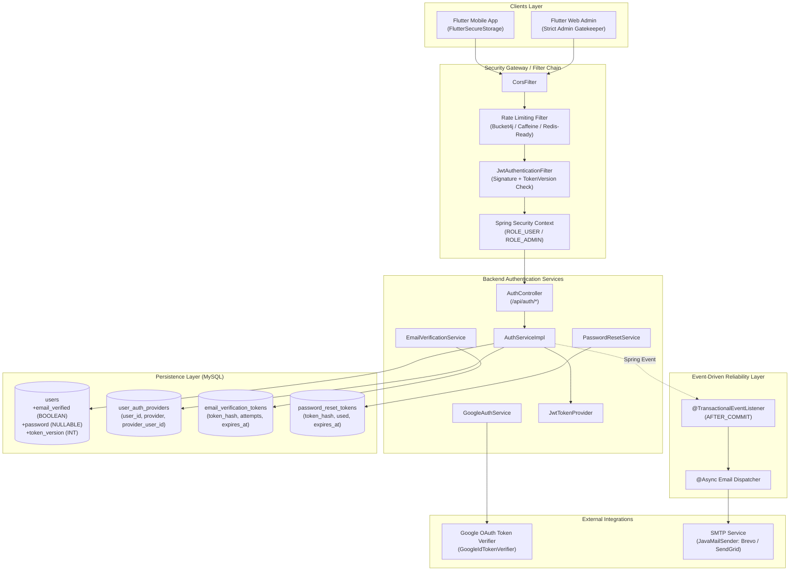
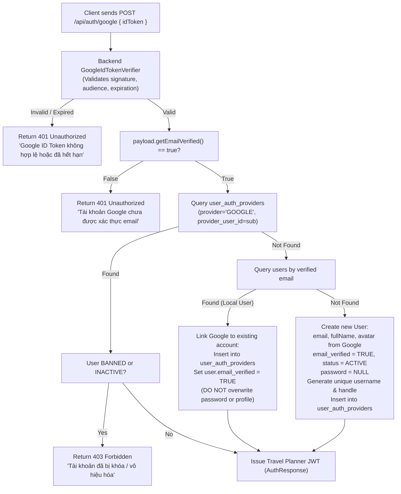

# Comprehensive Authentication Enhancement Plan (Refined)

**Document ID:** `docs/plan/02-authentication-enhancement-plan.md`  
**System:** Travel Planner Community Platform  
**Target Modules:** Spring Boot Backend, Flutter Mobile Client, Flutter Web Admin Client, MySQL Database  
**Date:** 2026-11-17 (Refined)  
**Status:** Architecture Specification & Enhancement Blueprint

---

## 1. Target Architecture Overview

The target authentication architecture preserves the proven single-backend REST paradigm while introducing defense-in-depth, cryptographic identity verification for Google OAuth, transactional event-driven onboarding (Email Verification), privacy-preserving recovery (Forgot Password), normalized multi-provider support, and proactive token lifecycle management.



### Architectural Principles
1. **Single Source of Truth**: Spring Boot backend remains the authoritative enforcement point for all authentication, registration, password hashing, and token issuance logic.
2. **Strict Separation of Account Status & Email Verification**: Account status (`UserStatus`: `ACTIVE`, `INACTIVE`, `BANNED`) is decoupled from email verification (`email_verified` boolean). `UserStatus` is NOT overloaded with pending states.
3. **Zero Plaintext Sensitive Tokens at Rest**:
   - 6-digit numeric OTPs are hashed using **HMAC-SHA256 with a server-side pepper/secret** to completely neutralize rainbow table attacks against small 1,000,000-state spaces.
   - 256-bit high-entropy link tokens are hashed using standard SHA-256.
   - Raw OTPs and reset tokens are NEVER stored in the database or written to server logs.
4. **Transaction-Safe Asynchronous Email Dispatch**: Email transmission is triggered exclusively **after transaction commit** (`@TransactionalEventListener(phase = TransactionPhase.AFTER_COMMIT)`). Database transactions never wait on external SMTP connections, and rollbacks never send phantom emails.
5. **Anti-Enumeration by Default**: Password reset and verification resend endpoints return identical generic 200 OK responses to prevent account discovery.
6. **Stateless JWT Contract Preservation**: The baseline contract returns `token`, `tokenType: "Bearer"`, and `user`. Refresh tokens remain an isolated Phase 4 capability that does not break Phase 0–3 API compatibility.

---

## 2. Advanced Feature Specifications & Workflows

### 2.1. Feature 1: Google Sign-In & Normalized Multi-Provider Linking

#### Architectural Decision: Normalized `user_auth_providers` Table
Rather than adding single-provider columns (e.g. `google_id`) directly to the `users` table, a normalized table `user_auth_providers` is introduced. This provides:
- Clean support for multiple authentication methods per traveler (e.g., Local password + Google, or Apple in the future).
- Zero schema modifications when adding new OAuth identity providers.
- Explicit tracking of provider metadata (`provider_user_id`, `email`, `linked_at`).

```sql
CREATE TABLE user_auth_providers (
    provider_id BIGINT AUTO_INCREMENT PRIMARY KEY,
    user_id INT NOT NULL,
    provider VARCHAR(20) NOT NULL, -- 'GOOGLE', 'APPLE', etc.
    provider_user_id VARCHAR(100) NOT NULL, -- Google 'sub' claim
    email VARCHAR(100) NOT NULL, -- Verified email from provider
    linked_at DATETIME NOT NULL,
    CONSTRAINT fk_uap_user FOREIGN KEY (user_id) REFERENCES users (user_id) ON DELETE CASCADE,
    UNIQUE KEY uq_provider_uid (provider, provider_user_id),
    UNIQUE KEY uq_user_provider (user_id, provider),
    INDEX idx_uap_email (email)
) ENGINE=InnoDB DEFAULT CHARSET=utf8mb4 COLLATE=utf8mb4_unicode_ci;
```

#### Detailed Behavior for 7 Google Authentication Scenarios



1. **Scenario 1: Existing Google-Linked Account**:
   - Backend verifies Google ID token. Finds existing mapping in `user_auth_providers` by `(provider='GOOGLE', provider_user_id=sub)`.
   - Checks `user.getStatus()`. If `ACTIVE`, generates Travel Planner JWT and returns standard `AuthResponse`.
2. **Scenario 2: Existing LOCAL Account with Matching Verified Email**:
   - User previously registered via email/password. Now taps "Tiếp tục với Google".
   - Backend verifies ID token and confirms `payload.getEmailVerified() == true`.
   - Finds matching local user by email.
   - Inserts record into `user_auth_providers` linking Google `sub` to the user.
   - Sets `user.setEmailVerified(true)` if not already verified.
   - **Crucial Rule**: Does NOT overwrite the user's existing BCrypt password, custom bio, phone, address, or custom avatar unless the user explicitly requests an update.
   - Returns standard `AuthResponse`.
3. **Scenario 3: New Google Registration**:
   - Neither Google ID nor email exists in system.
   - Generates unique username and handle (derived from Google name/email with random suffix).
   - Creates new `User` record: `email = googleEmail`, `fullName = googleName`, `avatar = googlePicture`, `email_verified = true`, `status = UserStatus.ACTIVE`, `password = NULL`.
   - Inserts into `user_auth_providers`.
   - Returns standard `AuthResponse`.
4. **Scenario 4: Google ID Already Linked to Another Account**:
   - When an authenticated user calls `POST /api/auth/providers/google/link`, if the Google `sub` is already bound to a different `user_id`, reject with HTTP 409 Conflict: `"Tài khoản Google này đã được liên kết với một tài khoản khác"`.
5. **Scenario 5: Banned or Inactive Accounts**:
   - If the linked user has `status == UserStatus.BANNED` -> return HTTP 403 Forbidden (`"Tài khoản của bạn đã bị khóa do vi phạm chính sách"`).
   - If `status == UserStatus.INACTIVE` -> return HTTP 403 Forbidden (`"Tài khoản của bạn đang bị vô hiệu hóa"`).
6. **Scenario 6: Linking Google from Authenticated Settings**:
   - Endpoint: `POST /api/auth/providers/google/link` (Bearer JWT required).
   - Verifies Google token. Checks for conflict. Inserts into `user_auth_providers`.
   - Marks `email_verified = true`.
7. **Scenario 7: Unlinking Google Provider**:
   - Endpoint: `POST /api/auth/providers/google/unlink` (Bearer JWT required).
   - **Account Lockout Safeguard**: Backend checks if the user has a local password set (`user.getPassword() != null`) OR another linked auth provider.
   - If Google is the SOLE login method and no password exists, unlinking is REJECTED with HTTP 400 Bad Request: `"Bạn cần thiết lập mật khẩu trước khi hủy liên kết tài khoản Google để tránh mất quyền truy cập tài khoản"`.
   - If a password exists, the provider row is deleted from `user_auth_providers`.

---

### 2.2. Feature 2: Email Verification During Registration

#### Cryptographic Security Design: OTP vs. Link Token
To satisfy both high security and mobile UX, a dual-mode verification architecture is implemented with separated cryptographic designs:

| Dimension | Short Numeric OTP (Mobile Focus) | High-Entropy Verification Link (Web Focus) |
| :--- | :--- | :--- |
| **Format** | 6-digit decimal string (`000000`–`999999`) | 32-byte cryptographic random URL-safe base64 string |
| **Entropy** | Low (~20 bits / 1,000,000 possibilities) | Extremely High (256 bits) |
| **Generation** | `java.security.SecureRandom.nextInt(1000000)` | `SecureRandom.nextBytes(byte[32])` |
| **Hashing at Rest** | **HMAC-SHA256 with Server-Side Secret Key (Pepper)** | Standard SHA-256 (`MessageDigest.getInstance("SHA-256")`) |
| **Why HMAC?** | Defends against offline rainbow tables if DB leaks | 256-bit random tokens cannot be precomputed; SHA-256 is sufficient |
| **Lifespan** | **15 minutes** | **24 hours** |
| **Max Attempts** | **5 failed attempts** -> burns token immediately | N/A (unguessable space) |
| **Invalidation** | Issuing a new OTP **instantly deletes all previous OTPs** | Issuing a new link invalidates prior links |

#### Dual-Mode Verification Storage Schema
```sql
CREATE TABLE email_verification_tokens (
    token_id BIGINT AUTO_INCREMENT PRIMARY KEY,
    user_id INT NOT NULL,
    token_hash VARCHAR(64) NOT NULL, -- HMAC-SHA256 for OTP, SHA-256 for LINK
    token_type VARCHAR(20) NOT NULL, -- 'OTP' or 'LINK'
    attempts INT NOT NULL DEFAULT 0,
    expires_at DATETIME NOT NULL,
    created_at DATETIME NOT NULL,
    CONSTRAINT fk_evt_user FOREIGN KEY (user_id) REFERENCES users (user_id) ON DELETE CASCADE,
    INDEX idx_evt_hash (token_hash),
    INDEX idx_evt_user_expires (user_id, expires_at)
) ENGINE=InnoDB DEFAULT CHARSET=utf8mb4 COLLATE=utf8mb4_unicode_ci;
```

#### Registration & Verification Execution Sequence
1. **Registration Request**: Traveler calls `POST /api/auth/register`.
2. **Entity Persistence**:
   - `user.email_verified = false`.
   - `user.status = UserStatus.ACTIVE`. (Status remains ACTIVE; verification is guarded by the `email_verified` boolean).
   - Transaction commits to MySQL.
3. **Token Generation & Transaction-Bound Dispatch**:
   - Generates 6-digit OTP via `SecureRandom`.
   - Generates 32-byte Link Token via `SecureRandom`.
   - Invalidate any existing verification tokens for this `user_id`.
   - Inserts HMAC-SHA256(OTP, pepper) and SHA-256(Link Token) into `email_verification_tokens`.
   - Emits `UserRegistrationCompleteEvent`.
   - Spring `@TransactionalEventListener(phase = TransactionPhase.AFTER_COMMIT)` receives event and passes payload to `@Async EmailService`.
4. **Client Response**:
   - HTTP 201 Created: `{ "message": "Đăng ký thành công. Vui lòng kiểm tra email để nhận mã xác thực.", "email": "...", "requiresVerification": true }`.
   - **No JWT is issued**.
5. **Verification Execution (`POST /api/auth/verify-email`)**:
   - Request provides `{ "email": "...", "code": "123456" }` or `{ "token": "..." }`.
   - If OTP: Backend computes HMAC-SHA256(code, pepper) and queries `email_verification_tokens`.
   - If invalid: Increment `attempts`. If `attempts >= 5`, delete token. Return HTTP 400 Bad Request.
   - If valid and `expires_at > NOW()`:
     - Update `user.setEmailVerified(true)`.
     - Delete consumed token.
     - Issue Travel Planner JWT and return standard `AuthResponse`.
6. **Resend Endpoint (`POST /api/auth/resend-verification`)**:
   - Rate limit: 60-second cooldown per email/IP; maximum 3 resends per hour.
   - **Anti-Enumeration Response**: Always returns HTTP 200 OK: `{ "message": "Nếu email tồn tại và chưa xác thực, mã xác thực mới đã được gửi.", "cooldownSeconds": 60 }`.

---

### 2.3. Feature 3: Forgot Password & Password Recovery

#### Workflow & Security Safeguards
1. **Request (`POST /api/auth/forgot-password`)**:
   - Traveler submits `{ "email": "traveler@example.com" }`.
   - **Anti-Enumeration**: Backend ALWAYS returns HTTP 200 OK:
     ```json
     {
       "message": "Nếu địa chỉ email tồn tại trên hệ thống, hướng dẫn đặt lại mật khẩu đã được gửi đến hộp thư của bạn."
     }
     ```
   - If user exists:
     - Generates 32-byte cryptographic random reset token.
     - Stores SHA-256(token) in `password_reset_tokens` with 15-minute expiration.
     - Invalidates previous active reset tokens for that user.
     - Asynchronously dispatches email after transaction commit.
2. **Reset Execution (`POST /api/auth/reset-password`)**:
   - Request submits `{ "email": "...", "token": "...", "newPassword": "..." }`.
   - Checks SHA-256(token) against `password_reset_tokens` (`used = false`, `expires_at > NOW()`).
   - Validates new password complexity (`@Pattern` requiring upper, lower, digit, 8+ chars).
   - Encodes password via `BCryptPasswordEncoder`.
   - Updates `user.password`.
   - **Session Invalidation**: Increments `user.token_version = user.token_version + 1`.
   - Marks reset token `used = true`.
   - Returns HTTP 200 OK.
3. **Session Invalidation via `token_version`**:
   - Current JWT tokens carry claim: `"tokenVersion": user.getTokenVersion()`.
   - In `JwtAuthenticationFilter`: compares JWT claim against fresh user entity from DB.
   - Bumping `token_version` on password change immediately causes all existing JWTs across all mobile and web devices to be rejected with HTTP 401 Unauthorized.

```sql
CREATE TABLE password_reset_tokens (
    reset_id BIGINT AUTO_INCREMENT PRIMARY KEY,
    user_id INT NOT NULL,
    token_hash VARCHAR(64) NOT NULL,
    used BOOLEAN NOT NULL DEFAULT FALSE,
    expires_at DATETIME NOT NULL,
    created_at DATETIME NOT NULL,
    CONSTRAINT fk_prt_user FOREIGN KEY (user_id) REFERENCES users (user_id) ON DELETE CASCADE,
    INDEX idx_prt_hash (token_hash),
    INDEX idx_prt_user_expires (user_id, expires_at)
) ENGINE=InnoDB DEFAULT CHARSET=utf8mb4 COLLATE=utf8mb4_unicode_ci;
```

---

### 2.4. Feature 4: Additional Authentication Security & Session Management

#### A. Change Password for Authenticated Users (`POST /api/auth/change-password`)
- Authentication: Bearer JWT required.
- Verifies current password matches `user.password` via `passwordEncoder.matches()`.
- Validates new password differs from old password and meets complexity rules.
- Increments `token_version` so old sessions on other devices are terminated.

#### B. Rate Limiting Strategy per Endpoint
Bucket4j rate limiting is applied across four progressive tiers:
- **Phase 0 Endpoints**:
  - `POST /api/auth/login`: 5 requests / IP / minute.
  - `POST /api/auth/register`: 3 registrations / IP / 10 minutes.
- **Phase 1 Endpoints**:
  - `POST /api/auth/verify-email`: 10 attempts / IP / minute; max 5 failed attempts per OTP code.
  - `POST /api/auth/resend-verification`: 1 request / 60 seconds / email; 3 requests / IP / hour.
- **Phase 2 Endpoints**:
  - `POST /api/auth/forgot-password`: 3 requests / IP / 15 minutes.
  - `POST /api/auth/reset-password`: 5 attempts / IP / 15 minutes.
- **Phase 3 Endpoints**:
  - `POST /api/auth/google`: 10 requests / IP / minute.

**Clustering & Multi-Instance Architecture**:
- For single-instance dev/staging: In-memory Bucket4j backed by Caffeine cache.
- For multi-instance production: Configured to support Bucket4j with Redis backend (`bucket4j-redis`) without application code refactoring.

#### C. Account Lockout Protection
- After 5 consecutive invalid password submissions for a specific account, set `user.locked_until = NOW() + 15 minutes`.
- Subsequent logins within the 15-minute window immediately return HTTP 403 Forbidden without BCrypt calculation: `"Tài khoản tạm thời bị khóa 15 phút do nhập sai mật khẩu nhiều lần"`.

#### D. Refresh Token Rotation (Phase 4 Optional Enhancement)
- Access token lifespan: 30 minutes.
- Refresh token lifespan: 7 days.
- Rotated upon every refresh: using an old refresh token triggers automatic replay-attack revocation of all tokens for that user.

---

## 3. Database Schema Changes & Migration Strategy

### 3.1. Entity Alterations (`users` table)

```sql
-- Step 1: Add new columns with safe defaults
ALTER TABLE users 
    ADD COLUMN email_verified BOOLEAN NOT NULL DEFAULT FALSE AFTER email,
    ADD COLUMN token_version INT NOT NULL DEFAULT 1 AFTER role,
    ADD COLUMN failed_login_attempts INT NOT NULL DEFAULT 0 AFTER token_version,
    ADD COLUMN locked_until DATETIME NULL AFTER failed_login_attempts;

-- Step 2: Make password nullable to safely support pure OAuth accounts
ALTER TABLE users MODIFY COLUMN password VARCHAR(255) NULL;

-- Step 3: One-time backward-compatible migration for existing accounts
-- Ensures existing travelers are NOT locked out upon rollout!
UPDATE users SET email_verified = TRUE WHERE email_verified = FALSE;
```

### 3.2. New Relational Tables
1. `user_auth_providers` (Normalized OAuth providers).
2. `email_verification_tokens` (Dual-mode OTP and link tokens).
3. `password_reset_tokens` (Secure password reset tokens).
4. `refresh_tokens` (Phase 4 session rotation).

### 3.3. Migration Ordering & Rollback Plan
- **Ordering**:
  1. Run `ALTER TABLE users ...` (adds columns with default false/1).
  2. Run `UPDATE users SET email_verified = TRUE;` (preserves existing users).
  3. Create `user_auth_providers`, `email_verification_tokens`, `password_reset_tokens`.
- **Rollback**:
  - Drop child tables `DROP TABLE IF EXISTS password_reset_tokens, email_verification_tokens, user_auth_providers;`.
  - Revert user columns `ALTER TABLE users DROP COLUMN locked_until, DROP COLUMN failed_login_attempts, DROP COLUMN token_version, DROP COLUMN email_verified;`.

---

## 4. Email Delivery Reliability Architecture

### 4.1. Transaction-Bound Event Architecture
To prevent holding open database connections or dispatching emails for rolled-back transactions:

```java
@Service
public class AuthServiceImpl implements AuthService {
    private final ApplicationEventPublisher eventPublisher;

    @Transactional
    public void register(RegisterRequest request) {
        User user = saveUserAndTokens(request);
        // Fire event; do NOT call SMTP inside transaction!
        eventPublisher.publishEvent(new UserRegisteredEvent(user.getUserId(), user.getEmail(), otpCode));
    }
}

@Component
public class EmailNotificationListener {
    private final EmailService emailService;

    @Async
    @TransactionalEventListener(phase = TransactionPhase.AFTER_COMMIT)
    public void handleRegistration(UserRegisteredEvent event) {
        emailService.sendVerificationEmail(event.getEmail(), event.getOtpCode());
    }
}
```

### 4.2. SMTP Failure & Reliability Policy
- External SMTP latencies or network blips will not fail the user's registration HTTP response.
- `EmailService` catches `MailException`, logs error details with context.
- Travelers who do not receive the email can click "Gửi lại mã" after the 60-second cooldown expires.
- **Production Non-Negotiable Rule**: Verification is NEVER automatically disabled in production due to an SMTP outage. If email cannot be delivered, the service alerts administrators via metrics and travelers are informed to retry.

---

## 5. Web Admin Authentication Hardening

1. **Role Gatekeeper Enforcement**:
   - In `frontend/web/lib/features/auth/presentation/auth_notifier.dart`:
     ```dart
     if (user['role']?.toString().toUpperCase() != 'ADMIN') {
       await _storage.clear();
       _token = null;
       _currentUser = null;
       _status = AuthStatus.error;
       _errorMessage = 'Tài khoản không có quyền truy cập trang quản trị';
       notifyListeners();
       return false;
     }
     ```
2. **Safe Removal of Public Registration**:
   - Public registration links in Web Admin `login_screen.dart` are removed.
   - `register_screen.dart` in web is removed after verifying no other internal widgets depend on it.
3. **Separation of Web XSS Concern**:
   - Storing JWTs in Web LocalStorage is a known browser single-page app trade-off. Mitigating this via HttpOnly cookies and CSRF tokens is recognized as a separate architectural milestone and tracked independently.

---

## 6. Testing Strategy & Isolation Solutions

### 6.1. Correcting `AuthControllerTest.java` Setup Failure
- **Root Cause**: `AuthControllerTest` runs against a shared development database where child records in `media_assets` or `community_posts` reference users. Calling `userRepository.deleteAll()` in `@BeforeEach` violates foreign keys.
- **Isolation Fix**:
  - Add `@Transactional` to `AuthControllerTest` so all test mutations rollback automatically at transaction boundary.
  - In addition, enforce deterministic hierarchical cleanup order in `@BeforeEach` for test methods that manage transactions manually:
    1. `mediaAssetRepository.deleteAll()`
    2. `communityPostRepository.deleteAll()`
    3. `ratingRepository.deleteAll()`
    4. `itineraryRepository.deleteAll()`
    5. `userRepository.deleteAll()`
