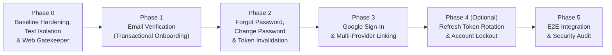

# Phased Implementation Roadmap: Authentication Enhancement (Refined)

**Document ID:** `docs/plan/03-authentication-phase-roadmap.md`  
**System:** Travel Planner Community Platform  
**Target Modules:** Spring Boot Backend, Flutter Mobile Client, Flutter Web Admin Client, MySQL Database  
**Date:** 2026-11-17 (Refined)  
**Status:** Implementation Blueprint & Phased Roadmap

---

## 1. Executive Implementation Strategy & Roadmap Overview

To deliver high-impact security and functionality while preserving codebase stability, the authentication enhancements are structured into six self-contained, sequential phases. Each phase can be implemented, tested, and verified independently without breaking existing features. Rate limiting is introduced progressively alongside each public endpoint.



### Recommended Implementation Order & Justification
1. **Phase 0 (Baseline Hardening, Test Isolation & Web Gatekeeper)**: Must be executed first. Fixes the `AuthControllerTest.java` foreign key teardown bug so automated tests can run reliably in CI. Introduces baseline database columns (`token_version`, `email_verified`) with safe migration defaults. Eliminates the login timing attack side-channel. Enforces the Web Admin role gatekeeper. Implements baseline rate limiting on login and register.
2. **Phase 1 (Email Verification During Registration)**: Ensures that all newly registered accounts are tied to verified emails before password recovery is launched, preventing account creation on squatted or fake inboxes.
3. **Phase 2 (Forgot Password, Change Password & Token Invalidation)**: Reuses the email dispatch infrastructure built in Phase 1. Introduces anti-enumeration recovery and immediate session invalidation via `token_version`.
4. **Phase 3 (Google Sign-In & Normalized Multi-Provider Linking)**: Built on top of the verified email framework from Phases 1 & 2. Uses the normalized `user_auth_providers` table. Prevents malicious actors from hijacking accounts using unverified Google emails.
5. **Phase 4 (Advanced Account Security & Session Management — Optional Enhancement)**: Adds consecutive failure account lockout, short-lived access tokens, and refresh token rotation once core authentication flows are mature.
6. **Phase 5 (E2E Integration & Security Testing)**: Multi-platform regression verification, automated penetration tests, and audit sign-off.

---

## 2. Detailed Phase Specifications

### Phase 0: Baseline Hardening, Test Isolation, Database Preparation & Web Gatekeeper

#### 1. Objectives
- Fix the existing `AuthControllerTest.java` foreign key teardown failure through test isolation and hierarchical cleanup.
- Add baseline database columns (`email_verified`, `token_version`) with safe backward-compatible defaults.
- Eliminate the login timing attack side-channel by evaluating dummy BCrypt hashes when users are not found.
- Enforce the Web Admin role gatekeeper to reject non-ADMIN logins.
- Introduce baseline Bucket4j rate limiting on `POST /api/auth/login` and `POST /api/auth/register`.

#### 2. Scope
- Backend test isolation (`@Transactional` and hierarchical teardown order).
- Database migration script for `users` table.
- Constant-time password verification in `AuthServiceImpl.login()`.
- Rate limiting filter for login (5/min/IP) and registration (3/10min/IP).
- Web Admin gatekeeper in `web/lib/features/auth/presentation/auth_notifier.dart`.
- Safe removal of public registration links from Web Admin login screen.

#### 3. Backend Files Affected
- `backend/src/test/java/Travel_Planner/Travel_Planner/AuthControllerTest.java`: Add `@Transactional` and hierarchical teardown to ensure test isolation.
- `backend/src/main/java/Travel_Planner/Travel_Planner/model/User.java`: Add `emailVerified` (boolean) and `tokenVersion` (int).
- `backend/src/main/java/Travel_Planner/Travel_Planner/service/impl/AuthServiceImpl.java`: Add constant-time BCrypt execution on missing users.
- `backend/src/main/java/Travel_Planner/Travel_Planner/security/RateLimitingFilter.java`: Bucket4j filter for login and register.
- `backend/src/main/java/Travel_Planner/Travel_Planner/security/SecurityConfig.java`: Register rate limiting filter before `JwtAuthenticationFilter`.

#### 4. Mobile Files Affected
- None (baseline changes are 100% backward compatible).

#### 5. Web Admin Files Affected
- `frontend/web/lib/features/auth/presentation/auth_notifier.dart`: Verify `user['role'] == 'ADMIN'`; if not, immediately clear credentials, set status to error, and display `"Tài khoản không có quyền truy cập trang quản trị"`.
- `frontend/web/lib/features/auth/presentation/screens/login_screen.dart`: Remove "Đăng ký ngay" link.

#### 6. Database Changes
```sql
ALTER TABLE users 
    ADD COLUMN email_verified BOOLEAN NOT NULL DEFAULT FALSE AFTER email,
    ADD COLUMN token_version INT NOT NULL DEFAULT 1 AFTER role;

-- Backward-compatibility: Ensure existing development/production users remain active
UPDATE users SET email_verified = TRUE WHERE email_verified = FALSE;
```

#### 7. API Contracts
- Existing contracts for `POST /api/auth/login`, `POST /api/auth/register`, and `GET /api/auth/me` preserved without breaking changes.

#### 8. Dependencies
- Bucket4j (already present in `backend/pom.xml`).

#### 9. Security Considerations
- Constant-time verification prevents username enumeration via response latency measurement.
- Web Admin gatekeeper prevents standard travelers from observing administrative UI components.
- Rate limiting prevents basic automated brute force on login and registration.

#### 10. Test Cases & Acceptance Criteria
- `AuthControllerTest` passes **100% (zero foreign key errors)**.
- Attempting to log into Web Admin with a standard `USER` role account returns an explicit error and clears session.
- Response time variance between existing and non-existing accounts on `/api/auth/login` is less than 20ms.
- 6th login attempt in 1 minute from the same IP returns HTTP 429 Too Many Requests.

#### 11. Risks & Rollback Strategy
- Risk: Schema alteration in production without running the update script locks out existing users.
- Rollback: Revert column additions via `ALTER TABLE users DROP COLUMN token_version, DROP COLUMN email_verified;`.

#### 12. Dependencies on Previous Phases
- None (Foundational phase).

---

### Phase 1: Email Verification During Registration

#### 1. Objectives
- Require proof of email ownership before activating new accounts.
- Implement dual-mode verification: 6-digit numeric OTP (Mobile) and high-entropy link token (Web).
- Hash 6-digit OTP using **HMAC-SHA256 with server-side pepper** to neutralize rainbow table precomputation.
- Ensure transaction-bound email dispatch (`@TransactionalEventListener(phase = AFTER_COMMIT)`).
- Implement rate limiting on verification and resend endpoints.

#### 2. Scope
- New database table: `email_verification_tokens`.
- Integration of Spring Boot Starter Mail (`JavaMailSender`).
- Responsive HTML email templates via Thymeleaf (`email-verification.html`).
- Event-driven asynchronous email service (`EmailService`).
- Endpoints: `POST /api/auth/verify-email` and `POST /api/auth/resend-verification`.
- Invalidation logic: issuing a new OTP or token immediately revokes all prior active tokens for that user.
- Mobile `EmailVerificationScreen` with 6-digit pin input, auto-submit, and 60-second cooldown timer.
- Rate limiting: max 5 failed attempts per OTP code; 60s cooldown and max 3 resends/hour.

#### 3. Backend Files Affected
- `backend/pom.xml`: Add `spring-boot-starter-mail`.
- `backend/src/main/resources/application.properties`: Add SMTP settings and verification pepper property (`auth.otp.pepper`).
- `backend/src/main/resources/templates/mail/email-verification.html`: Thymeleaf HTML email template.
- `backend/src/main/java/Travel_Planner/Travel_Planner/model/EmailVerificationToken.java`: Entity mapping.
- `backend/src/main/java/Travel_Planner/Travel_Planner/repository/EmailVerificationTokenRepository.java`: Repository.
- `backend/src/main/java/Travel_Planner/Travel_Planner/service/EmailService.java` & `impl/EmailServiceImpl.java`: Async email service.
- `backend/src/main/java/Travel_Planner/Travel_Planner/service/EmailVerificationService.java` & `impl/EmailVerificationServiceImpl.java`: OTP generation, HMAC-SHA256 hashing, rate limiting, and verification.
- `backend/src/main/java/Travel_Planner/Travel_Planner/controller/AuthController.java`: Add `/verify-email` and `/resend-verification`.
- `backend/src/main/java/Travel_Planner/Travel_Planner/security/SecurityConfig.java`: Add `/api/auth/verify-email` and `/api/auth/resend-verification` to `permitAll()`.

#### 4. Mobile Files Affected
- `frontend/mobile/lib/core/constants/api_constants.dart`: Add `verifyEmailEndpoint` and `resendVerificationEndpoint`.
- `frontend/mobile/lib/features/auth/data/auth_repository.dart`: Add `verifyEmail()` and `resendVerification()`.
- `frontend/mobile/lib/features/auth/presentation/auth_notifier.dart`: Add `verifyEmail()` and `resendVerification()`.
- `frontend/mobile/lib/features/auth/presentation/screens/email_verification_screen.dart`: New 6-digit OTP entry screen with countdown timer and resend button.
- `frontend/mobile/lib/features/auth/presentation/screens/register_screen.dart`: Navigate to `EmailVerificationScreen` upon receiving HTTP 201 response.

#### 5. Web Admin Files Affected
- None (Admin accounts are provisioned securely by system operators).

#### 6. Database Changes
```sql
CREATE TABLE email_verification_tokens (
    token_id BIGINT AUTO_INCREMENT PRIMARY KEY,
    user_id INT NOT NULL,
    token_hash VARCHAR(64) NOT NULL,
    token_type VARCHAR(20) NOT NULL, -- 'OTP' or 'LINK'
    attempts INT NOT NULL DEFAULT 0,
    expires_at DATETIME NOT NULL,
    created_at DATETIME NOT NULL,
    CONSTRAINT fk_evt_user FOREIGN KEY (user_id) REFERENCES users (user_id) ON DELETE CASCADE,
    INDEX idx_evt_hash (token_hash),
    INDEX idx_evt_user_expires (user_id, expires_at)
) ENGINE=InnoDB DEFAULT CHARSET=utf8mb4 COLLATE=utf8mb4_unicode_ci;
```

#### 7. API Contracts
- `POST /api/auth/register`: Returns HTTP 201 Created with `{ "message": "...", "email": "...", "requiresVerification": true }`. Does NOT return a JWT.
- `POST /api/auth/verify-email`: Accepts `{ "email": "...", "code": "..." }`, returns standard `AuthResponse` (token, Bearer, user).
- `POST /api/auth/resend-verification`: Accepts `{ "email": "..." }`, returns generic 200 OK `{ "message": "Nếu email tồn tại và chưa xác thực, mã xác thực mới đã được gửi.", "cooldownSeconds": 60 }`.

#### 8. Dependencies
- SMTP Service credentials (Brevo free tier / SendGrid / local mock SMTP).

#### 9. Security Considerations
- HMAC-SHA256 with server pepper prevents precomputed rainbow table attacks against 6-digit OTPs.
- 5-attempt ceiling defeats online brute-force guessing (5 / 1,000,000 = 0.0005% attack probability).
- Single-use and automatic revocation of previous OTPs on resend.
- Email dispatch strictly bound to post-commit event listener.

#### 10. Test Cases & Acceptance Criteria
- Registration commits user with `email_verified = false` and dispatches email asynchronously.
- Logging in before verifying returns HTTP 403 Forbidden: `"Tài khoản chưa được kích hoạt. Vui lòng kiểm tra email xác thực."`.
- Correct 6-digit OTP activates user, deletes token, and returns valid JWT.
- 5 consecutive invalid OTP submissions permanently invalidates the token.
- Resend within 60 seconds returns HTTP 429 Too Many Requests.
- Resend for non-existent email returns generic 200 OK without disclosing user absence.

#### 11. Risks & Rollback Strategy
- Risk: SMTP provider outage delays verification.
- Mitigation: Dedicated health check and retry; verification is NEVER silently bypassed in production.
- Rollback: Drop `email_verification_tokens` table and revert `AuthController` routes.

#### 12. Dependencies on Previous Phases
- Requires Phase 0.

---

### Phase 2: Forgot Password, Change Password & Token Invalidation

#### 1. Objectives
- Enable secure self-service password recovery without account enumeration.
- Implement immediate session invalidation for all active JWTs when a password changes.
- Provide authenticated password change functionality.
- Apply rate limiting on password recovery endpoints.

#### 2. Scope
- New database table: `password_reset_tokens`.
- Endpoints: `POST /api/auth/forgot-password` (anti-enumeration 200 OK), `POST /api/auth/reset-password`, and `POST /api/auth/change-password` (authenticated).
- Token invalidation via `token_version` claim verification in `JwtAuthenticationFilter`.
- Mobile screens: `ForgotPasswordScreen` and `ResetPasswordScreen`.
- Rate limiting: max 3 requests / IP / 15 minutes on forgot-password; max 5 attempts on reset-password.

#### 3. Backend Files Affected
- `backend/src/main/resources/templates/mail/password-reset.html`: HTML template for reset email.
- `backend/src/main/java/Travel_Planner/Travel_Planner/model/PasswordResetToken.java`: Entity mapping.
- `backend/src/main/java/Travel_Planner/Travel_Planner/repository/PasswordResetTokenRepository.java`: Repository.
- `backend/src/main/java/Travel_Planner/Travel_Planner/service/PasswordResetService.java`: Reset service.
- `backend/src/main/java/Travel_Planner/Travel_Planner/security/JwtAuthenticationFilter.java`: Add check comparing JWT claim `tokenVersion` with `user.getTokenVersion()`.
- `backend/src/main/java/Travel_Planner/Travel_Planner/security/JwtTokenProvider.java`: Include `.claim("tokenVersion", user.getTokenVersion())` in generated tokens.
- `backend/src/main/java/Travel_Planner/Travel_Planner/controller/AuthController.java`: Add `/forgot-password`, `/reset-password`, and `/change-password`.
- `backend/src/main/java/Travel_Planner/Travel_Planner/security/SecurityConfig.java`: Add `/forgot-password` and `/reset-password` to `permitAll()`.

#### 4. Mobile Files Affected
- `frontend/mobile/lib/core/constants/api_constants.dart`: Add `forgotPasswordEndpoint`, `resetPasswordEndpoint`, `changePasswordEndpoint`.
- `frontend/mobile/lib/features/auth/data/auth_repository.dart`: Add recovery methods.
- `frontend/mobile/lib/features/auth/presentation/auth_notifier.dart`: Add recovery methods.
- `frontend/mobile/lib/features/auth/presentation/screens/forgot_password_screen.dart`: Email entry screen.
- `frontend/mobile/lib/features/auth/presentation/screens/reset_password_screen.dart`: Token + new password entry screen.
- `frontend/mobile/lib/features/auth/presentation/screens/login_screen.dart`: Add "Quên mật khẩu?" link.

#### 5. Web Admin Files Affected
- None (Admins reset credentials via standard security protocols).

#### 6. Database Changes
```sql
CREATE TABLE password_reset_tokens (
    reset_id BIGINT AUTO_INCREMENT PRIMARY KEY,
    user_id INT NOT NULL,
    token_hash VARCHAR(64) NOT NULL,
    used BOOLEAN NOT NULL DEFAULT FALSE,
    expires_at DATETIME NOT NULL,
    created_at DATETIME NOT NULL,
    CONSTRAINT fk_prt_user FOREIGN KEY (user_id) REFERENCES users (user_id) ON DELETE CASCADE,
    INDEX idx_prt_hash (token_hash),
    INDEX idx_prt_user_expires (user_id, expires_at)
) ENGINE=InnoDB DEFAULT CHARSET=utf8mb4 COLLATE=utf8mb4_unicode_ci;
```

#### 7. API Contracts
- `POST /api/auth/forgot-password`: Accepts `{ "email": "..." }`, returns 200 OK `{ "message": "Nếu địa chỉ email tồn tại trên hệ thống, hướng dẫn đặt lại mật khẩu đã được gửi đến hộp thư của bạn." }`.
- `POST /api/auth/reset-password`: Accepts `{ "email": "...", "token": "...", "newPassword": "..." }`, returns 200 OK `{ "message": "Mật khẩu đã được đặt lại thành công..." }`.
- `POST /api/auth/change-password`: Accepts `{ "currentPassword": "...", "newPassword": "..." }`, requires Bearer JWT, returns 200 OK.

#### 8. Dependencies
- Requires Phase 1 (EmailService).

#### 9. Security Considerations
- Generic 200 OK response prevents email enumeration.
- SHA-256 token hashing at rest protects reset tokens in database.
- Bumping `token_version` on password change immediately revokes all existing JWTs across all devices.
- Password complexity enforcement on new passwords.

#### 10. Test Cases & Acceptance Criteria
- Calling forgot-password for non-existent email returns generic 200 OK and sends no email.
- Calling forgot-password for existing email returns generic 200 OK and sends email with 15-minute token.
- Resetting password updates BCrypt hash and increments `token_version`.
- A JWT issued before password reset returns HTTP 401 Unauthorized on subsequent protected API requests.
- Re-using a consumed reset token returns HTTP 400 Bad Request.

#### 11. Risks & Rollback Strategy
- Risk: Token clock skew or timezone mismatch.
- Mitigation: Use UTC timestamps across database and application.
- Rollback: Drop `password_reset_tokens` table and revert controller endpoints.

#### 12. Dependencies on Previous Phases
- Requires Phases 0 and 1.

---

### Phase 3: Google Sign-In & Normalized Multi-Provider Linking

#### 1. Objectives
- Provide one-tap Google authentication for mobile and web.
- Implement the normalized `user_auth_providers` table supporting multiple identity providers.
- Cryptographically verify Google ID tokens via `GoogleIdTokenVerifier`.
- Safely link Google accounts to existing verified email accounts without overwriting credentials.
- Allow nullable passwords for pure OAuth accounts while preventing account lockout on unlinking.
- Apply rate limiting on Google authentication (10/min/IP).

#### 2. Scope
- Dependency `com.google.api-client:google-api-client:2.7.0`.
- Database table: `user_auth_providers`.
- Alter `users.password` to be nullable (`VARCHAR(255) NULL`).
- Backend Google verification service (`GoogleAuthService`).
- Endpoint: `POST /api/auth/google`.
- Endpoints: `POST /api/auth/providers/google/link` and `POST /api/auth/providers/google/unlink`.
- Mobile plugin `google_sign_in: ^6.2.2`.
- Mobile UI: Branded "Tiếp tục với Google" buttons on login and register screens.
- Unlinking protection: Reject unlinking if Google is the sole login method and `password == null`.

#### 3. Backend Files Affected
- `backend/pom.xml`: Add Google API Client dependency.
- `backend/src/main/resources/application.properties`: Add Google Client IDs.
- `backend/src/main/java/Travel_Planner/Travel_Planner/model/UserAuthProvider.java`: Entity mapping.
- `backend/src/main/java/Travel_Planner/Travel_Planner/repository/UserAuthProviderRepository.java`: Repository.
- `backend/src/main/java/Travel_Planner/Travel_Planner/service/GoogleAuthService.java`: GoogleIdTokenVerifier wrapper.
- `backend/src/main/java/Travel_Planner/Travel_Planner/service/impl/AuthServiceImpl.java`: Google login, auto-registration, and account linking logic.
- `backend/src/main/java/Travel_Planner/Travel_Planner/controller/AuthController.java`: Add `/google`, `/providers/google/link`, `/providers/google/unlink`.
- `backend/src/main/java/Travel_Planner/Travel_Planner/security/SecurityConfig.java`: Add `/api/auth/google` to `permitAll()`.

#### 4. Mobile Files Affected
- `frontend/mobile/pubspec.yaml`: Add `google_sign_in: ^6.2.2`.
- `frontend/mobile/android/app/build.gradle`: Configure SHA-1 fingerprint.
- `frontend/mobile/lib/core/constants/api_constants.dart`: Add `googleLoginEndpoint`.
- `frontend/mobile/lib/features/auth/data/auth_repository.dart`: Add `loginWithGoogle()`.
- `frontend/mobile/lib/features/auth/presentation/auth_notifier.dart`: Add `loginWithGoogle()`.
- `frontend/mobile/lib/features/auth/presentation/screens/login_screen.dart`: Add Google Sign-In button.
- `frontend/mobile/lib/features/auth/presentation/screens/register_screen.dart`: Add Google Sign-Up button.

#### 5. Web Admin Files Affected
- Optional: Restrict Google login on Web Admin to existing users with `role = ADMIN`.

#### 6. Database Changes
```sql
ALTER TABLE users MODIFY COLUMN password VARCHAR(255) NULL;

CREATE TABLE user_auth_providers (
    provider_id BIGINT AUTO_INCREMENT PRIMARY KEY,
    user_id INT NOT NULL,
    provider VARCHAR(20) NOT NULL,
    provider_user_id VARCHAR(100) NOT NULL,
    email VARCHAR(100) NOT NULL,
    linked_at DATETIME NOT NULL,
    CONSTRAINT fk_uap_user FOREIGN KEY (user_id) REFERENCES users (user_id) ON DELETE CASCADE,
    UNIQUE KEY uq_provider_uid (provider, provider_user_id),
    UNIQUE KEY uq_user_provider (user_id, provider),
    INDEX idx_uap_email (email)
) ENGINE=InnoDB DEFAULT CHARSET=utf8mb4 COLLATE=utf8mb4_unicode_ci;
```

#### 7. API Contracts
- `POST /api/auth/google`: Accepts `{ "idToken": "..." }`, returns standard `AuthResponse` (token, Bearer, user).
- `POST /api/auth/providers/google/link`: Authenticated, accepts `{ "idToken": "..." }`, returns 200 OK.
- `POST /api/auth/providers/google/unlink`: Authenticated, returns 200 OK (or 400 if no password set).

#### 8. Dependencies
- Google Cloud Console OAuth 2.0 Client IDs (Android Client ID + Web Client ID).

#### 9. Security Considerations
- Never trust client-supplied email or user profile; only use cryptographically verified claims from Google.
- Require `payload.getEmailVerified() == true`.
- Unlink protection prevents travelers from permanently losing account access.

#### 10. Test Cases & Acceptance Criteria
- Valid Google ID token for new user creates user with `password = null` and returns JWT.
- Valid Google ID token for existing LOCAL user links Google provider without altering password.
- Tampered or expired Google token returns HTTP 401 Unauthorized.
- Unlinking Google when no password is set returns HTTP 400 Bad Request with password creation prompt.

#### 11. Risks & Rollback Strategy
- Risk: Google Play SHA-1 fingerprint mismatch on Android.
- Mitigation: Local email/password login remains available as primary fallback.
- Rollback: Drop `user_auth_providers` table and revert `password` column nullability if desired.

#### 12. Dependencies on Previous Phases
- Requires Phases 0 and 1.

---

### Phase 4: Advanced Account Security & Session Management (Optional Enhancement)

#### 1. Objectives
- Mitigate automated credential stuffing with account lockout.
- Introduce short-lived access tokens (30 minutes) and refresh token rotation (7 days).
- Provide explicit server-side session revocation (`POST /api/auth/logout`).

#### 2. Scope
- New database table: `refresh_tokens`.
- Column additions to `users`: `failed_login_attempts`, `locked_until`.
- Endpoints: `POST /api/auth/refresh` and `POST /api/auth/logout`.
- Access token lifespan reduced from 24h to 30m; refresh token set to 7d.
- Client automatic background token refresh before expiry.

#### 3. Database Changes
```sql
ALTER TABLE users 
    ADD COLUMN failed_login_attempts INT NOT NULL DEFAULT 0 AFTER token_version,
    ADD COLUMN locked_until DATETIME NULL AFTER failed_login_attempts;

CREATE TABLE refresh_tokens (
    refresh_id BIGINT AUTO_INCREMENT PRIMARY KEY,
    user_id INT NOT NULL,
    token_hash VARCHAR(64) NOT NULL UNIQUE,
    device_info VARCHAR(255) NULL,
    revoked BOOLEAN NOT NULL DEFAULT FALSE,
    expires_at DATETIME NOT NULL,
    created_at DATETIME NOT NULL,
    CONSTRAINT fk_rt_user FOREIGN KEY (user_id) REFERENCES users (user_id) ON DELETE CASCADE,
    INDEX idx_rt_hash (token_hash)
) ENGINE=InnoDB DEFAULT CHARSET=utf8mb4 COLLATE=utf8mb4_unicode_ci;
```

#### 4. API Contracts
- `POST /api/auth/refresh`: Accepts `{ "refreshToken": "..." }`, returns `{ "token": "...", "refreshToken": "..." }`.
- `POST /api/auth/logout`: Accepts `{ "refreshToken": "..." }`, revokes token in database.

#### 5. Dependencies on Previous Phases
- Requires Phases 0, 1, 2, 3.

---

### Phase 5: End-to-End Integration, Penetration Testing & Final Audit

#### 1. Objectives
- Execute full regression test suites across Mobile, Web Admin, and Backend.
- Verify zero regression on itineraries, community, places, ratings, and maps.
- Conduct simulated penetration tests (brute-force, timing side-channels, token replay).

#### 2. Acceptance Criteria
- All backend tests pass (`mvn test`).
- All Flutter mobile tests pass (`flutter test`).
- All Flutter web tests pass (`flutter test`).
- Full audit report updated and signed off.
