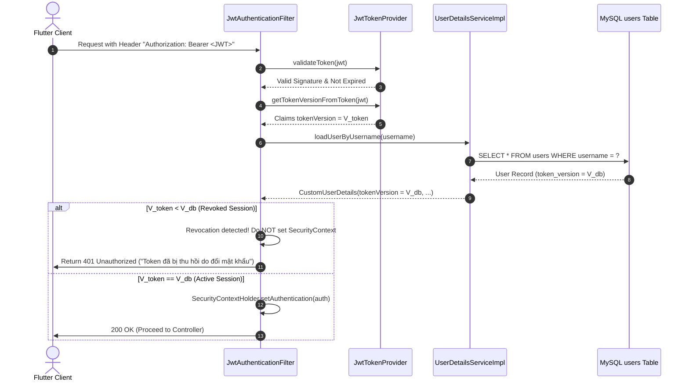
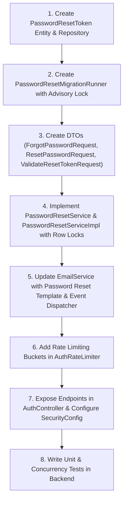
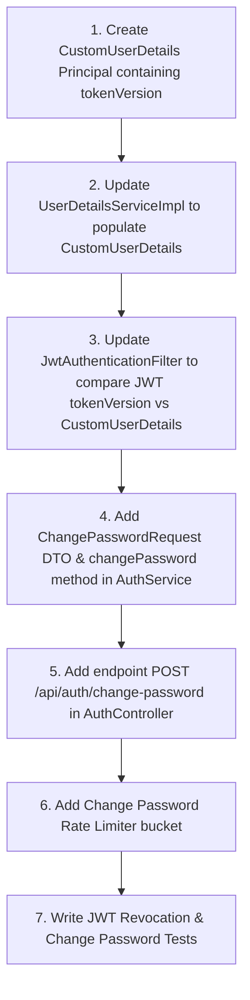

# AUTHENTICATION PHASE 2 — IMPLEMENTATION PLAN
## Forgot Password, Reset Password, Change Password & Global JWT Revocation

**Document Version:** 1.1.0  
**Status:** COMPLETED & VERIFIED  
**Date:** 2026-11-17  
**Author:** AI Technical Lead & Security Auditor  
**Scope:** Backend (Spring Boot), Mobile (Flutter), Web Admin (Flutter Web)

---

## 1. Executive Summary & Objective

Authentication Phase 2 builds upon the hardened foundation of Phase 0 (Baseline & Rate Limiting) and Phase 1 (Email Verification & Activation Flow). The objective of Phase 2 is to deliver:
1. **Self-Service Credential Recovery (Forgot & Reset Password):** A cryptographically secure, anti-enumeration password recovery mechanism via one-time reset tokens dispatched over email.
2. **Authenticated Credential Maintenance (Change Password):** An authenticated endpoint allowing active users to update their credentials while enforcing strict password complexity rules.
3. **Immediate Global Session Revocation (`token_version`):** Real-time invalidation of all previously issued JWTs across all devices when an account's password is reset or changed, verified directly inside `JwtAuthenticationFilter`.

---

## 2. Current Implementation Baseline & Audit Findings

### 2.1. Backend Source Code Baseline
- **`User` Entity ([User.java](file:///d:/CODE/HCMUTE/TLCN/Travel-planner-community/Travel_Planner/backend/src/main/java/Travel_Planner/Travel_Planner/model/User.java)):**
  - Contains `password` (BCrypt hash string, length 255).
  - Contains `emailVerified` (Boolean, default `false`).
  - Contains `status` (`UserStatus.ACTIVE`, `UserStatus.BANNED`).
  - Contains `tokenVersion` (`Integer`, default `1`, persisted in MySQL table `users.token_version`).
  - Contains `createdAt` and `updatedAt` audit timestamps.
- **`JwtTokenProvider` ([JwtTokenProvider.java](file:///d:/CODE/HCMUTE/TLCN/Travel-planner-community/Travel_Planner/backend/src/main/java/Travel_Planner/Travel_Planner/security/JwtTokenProvider.java)):**
  - Generates HMAC-SHA256 tokens signed with `jwt.secret` (minimum 256 bits).
  - Emits claims: `userId`, `email`, `role`, and `tokenVersion` (`claim("tokenVersion", user.getTokenVersion() != null ? user.getTokenVersion() : 1)`).
  - Exposes `getClaimsFromToken(String token)` and `validateToken(String token)`.
- **`JwtAuthenticationFilter` ([JwtAuthenticationFilter.java](file:///d:/CODE/HCMUTE/TLCN/Travel-planner-community/Travel_Planner/backend/src/main/java/Travel_Planner/Travel_Planner/security/JwtAuthenticationFilter.java)):**
  - Extracts Bearer token, validates cryptographic signature, extracts username, loads `UserDetails`.
  - Checks `userDetails.isEnabled() && userDetails.isAccountNonLocked()`.
  - **Audit Gap Identified:** Does NOT compare the JWT claim `tokenVersion` with the user's current database `token_version`. Global session revocation is currently inert.
- **`UserDetailsServiceImpl` ([UserDetailsServiceImpl.java](file:///d:/CODE/HCMUTE/TLCN/Travel-planner-community/Travel_Planner/backend/src/main/java/Travel_Planner/Travel_Planner/security/UserDetailsServiceImpl.java)):**
  - Returns Spring Security's `org.springframework.security.core.userdetails.User` with `disabled(!isActive || !isVerified)`.
  - **Audit Gap Identified:** Does not encapsulate `tokenVersion` inside the returned `UserDetails` principal, requiring either a custom `UserDetails` wrapper or a direct lookup during filter execution.
- **`AuthRateLimiter` ([AuthRateLimiter.java](file:///d:/CODE/HCMUTE/TLCN/Travel-planner-community/Travel_Planner/backend/src/main/java/Travel_Planner/Travel_Planner/security/AuthRateLimiter.java)):**
  - Implements Caffeine-backed Bucket4j rate limiting for login, register, verify, and resend.
  - **Audit Gap Identified:** Lacks rate limiting buckets for `/forgot-password`, `/validate-reset-token`, `/reset-password`, and `/change-password`.
- **`EmailService` & Templates ([EmailServiceImpl.java](file:///d:/CODE/HCMUTE/TLCN/Travel-planner-community/Travel_Planner/backend/src/main/java/Travel_Planner/Travel_Planner/service/impl/EmailServiceImpl.java)):**
  - Supports Thymeleaf templates under `backend/src/main/resources/templates/mail/`.
  - Currently contains `email-verification.html`.
  - **Audit Gap Identified:** Needs `password-reset.html` template and `sendPasswordResetEmail(...)` method.

### 2.2. Frontend Baseline
- **Flutter Mobile:**
  - Has `LoginScreen` and `RegisterScreen` and `EmailVerificationScreen`.
  - `LoginScreen` lacks a "Quên mật khẩu?" navigation action.
  - No `ForgotPasswordScreen` or `ResetPasswordScreen` exists.
  - No `ChangePasswordScreen` exists in profile/settings.
- **Flutter Web Admin:**
  - Has `LoginScreen` restricted to `ROLE_ADMIN`.
  - Already contains 401 interceptor that clears session on unauthorized responses.
  - Inherits global token revocation automatically without UI changes.

---

## 3. Architecture & Trade-Off Analysis

### 3.1. Entity Design: Dedicated `PasswordResetToken` vs. Reusing `EmailVerificationToken`

| Criterion | Option A: Reuse `EmailVerificationToken` (`token_type="PASSWORD_RESET"`) | Option B: Dedicated `PasswordResetToken` (`password_reset_tokens`) |
| :--- | :--- | :--- |
| **Separation of Concerns (SoC)** | Poor. Conflates account activation with credential recovery in the same table. | **Strict.** Completely isolates account activation from credential recovery. |
| **Blast Radius & Regression Risk** | High. Any bulk deletion, index change, or cleanup of verification tokens risks corrupting active reset requests. | **Zero.** Lifecycle and table maintenance are completely independent. |
| **Schema Evolution** | Constrained. Any new column needed for reset (e.g., `used` flag, IP stamp) pollutes verification records. | **High.** Can evolve schema independently (e.g., `used`, `ip_address`, `device_fingerprint`). |
| **Roadmap Alignment** | Conflicts with `03-authentication-phase-roadmap.md` Section 6. | **100% Aligned** with approved specification and database naming conventions. |
| **Implementation Effort** | Low (no new table). | Moderate (requires a dedicated `PasswordResetMigrationRunner`). |

**Architectural Decision:** **Adopt Option B (Dedicated `PasswordResetToken` Entity & Table).**  
The security and maintenance benefits of domain isolation far outweigh the minimal overhead of creating a dedicated table.

### 3.2. Token Security & Format
- **Entropy & Generation:**
  - For mobile keyboards and manual input, a **6-digit numeric OTP** (`000000`–`999999`) or **8-character alphanumeric code** generated via `SecureRandom` is required for optimal UX.
  - Because 6-digit numeric codes have bounded entropy ($10^6$ combinations), plain SHA-256 is insufficient. The token **MUST** be hashed using **HMAC-SHA256** with a dedicated server-side secret (`auth.password-reset.pepper`), identical to the Phase 1 OTP security design.
  - Attempt limiting: **Maximum 5 invalid attempts**, after which the token is permanently burned (deleted from the database).
  - Expiration: Strict **15 minutes** time-to-live (`expires_at = now() + 15 minutes`).
  - Cooldown: **60-second cooldown** between consecutive reset requests for the same email.

---

## 4. API Endpoint Specifications

### 4.1. `POST /api/auth/forgot-password` (Public)
- **Security:** `permitAll()`, Dual IP & Account Rate Limiting (3 requests / 15 minutes).
- **Anti-Enumeration Guarantee:** Always returns `200 OK` with a generic message regardless of whether the email exists, is unverified, or is banned. Never reveals user existence.
- **Request Body (`ForgotPasswordRequest`):**
  ```json
  {
    "email": "traveler@example.com"
  }
  ```
- **Validation:** `@NotBlank`, `@Email`.
- **Response (`200 OK`):**
  ```json
  {
    "message": "Nếu địa chỉ email tồn tại trên hệ thống, hướng dẫn đặt lại mật khẩu đã được gửi đến hộp thư của bạn.",
    "cooldownSeconds": 60
  }
  ```
- **Internal Processing:**
  1. Normalize email (`trim().toLowerCase()`).
  2. Query user with row lock: `userRepository.findByEmail(email)`.
  3. If user is absent or `user.getStatus() != ACTIVE` or `user.getEmailVerified() == false`:
     - Return generic 200 OK immediately (no email dispatched).
  4. Check cooldown against latest existing token for this user:
     - If elapsed time < 60s: return HTTP 429 Too Many Requests (`Retry-After: <remainingSeconds>`).
  5. Invalidate/delete any previous reset tokens for this user (`tokenRepository.deleteByUserId(user.getUserId())`).
  6. Generate 6-digit cryptographic OTP, calculate HMAC-SHA256 hash using `auth.password-reset.pepper`.
  7. Save `PasswordResetToken` (`user`, `tokenHash`, `attempts = 0`, `expiresAt = now + 15m`).
  8. Publish `PasswordResetEvent` (`@TransactionalEventListener(AFTER_COMMIT)` with `@Async`).
  9. Return generic 200 OK.

---

### 4.2. `POST /api/auth/validate-reset-token` (Public — Optional Preview Validation)
- **Security:** `permitAll()`, Rate limited (10 requests / minute).
- **Purpose:** Allows mobile/web UI to verify that the entered OTP is valid and unexpired before prompting the user to type their new password and confirmation.
- **Request Body (`ValidateResetTokenRequest`):**
  ```json
  {
    "email": "traveler@example.com",
    "token": "654321"
  }
  ```
- **Response (`200 OK`):**
  ```json
  {
    "valid": true,
    "message": "Mã xác thực hợp lệ."
  }
  ```
- **Error Responses:**
  - `400 Bad Request`: Token expired, token not found, or wrong token (increments attempts; burns token if attempts reach 5).

---

### 4.3. `POST /api/auth/reset-password` (Public)
- **Security:** `permitAll()`, Dual IP & Account Rate Limiting (5 requests / 15 minutes).
- **Purpose:** Atomically verifies reset token, burns the token, updates user password, and increments `token_version` to invalidate all existing sessions.
- **Request Body (`ResetPasswordRequest`):**
  ```json
  {
    "email": "traveler@example.com",
    "token": "654321",
    "newPassword": "NewSecurePassword@123"
  }
  ```
- **Validation Rules:**
  - `email`: `@NotBlank`, `@Email`.
  - `token`: `@NotBlank`, `@Pattern(regexp = "^[0-9]{6}$", message = "Mã xác thực phải gồm 6 chữ số")`.
  - `newPassword`: `@NotBlank`, `@Size(min = 8, max = 100)`. Enforce password policy: at least 1 uppercase letter, 1 lowercase letter, 1 digit, 1 special character (`^(?=.*[a-z])(?=.*[A-Z])(?=.*\\d)(?=.*[@$!%*?&#^()_+\\-=\\[\\]{};':\"\\\\|,.<>\\/]).{8,}$`).
- **Response (`200 OK`):**
  ```json
  {
    "message": "Mật khẩu đã được đặt lại thành công. Vui lòng đăng nhập bằng mật khẩu mới."
  }
  ```
- **Internal Processing (Atomic Transaction with Row-Level Lock):**
  1. `User user = userRepository.findByEmailForUpdate(email)`.
  2. Query latest `PasswordResetToken` for user.
  3. Validate expiration (`expires_at < now` -> delete token, throw `BadRequestException`).
  4. Validate attempts (`attempts >= 5` -> delete token, throw `BadRequestException`).
  5. Verify HMAC-SHA256 hash using constant-time `MessageDigest.isEqual`:
     - If mismatch: increment `attempts = attempts + 1`, save token, commit (`noRollbackFor`), throw `BadRequestException`.
  6. On successful match:
     - Check that `newPassword` differs from current password:
       `if (passwordEncoder.matches(newPassword, user.getPassword())) throw new BadRequestException("Mật khẩu mới không được trùng với mật khẩu cũ");`
     - Delete reset token (`tokenRepository.delete(token)`).
     - Hash new password: `user.setPassword(passwordEncoder.encode(newPassword))`.
     - **Increment token version:** `user.setTokenVersion((user.getTokenVersion() != null ? user.getTokenVersion() : 1) + 1)`.
     - Update audit timestamp: `user.setUpdatedAt(LocalDateTime.now())`.
     - `userRepository.save(user)`.
     - Return generic success response.

---

### 4.4. `POST /api/auth/change-password` (Authenticated)
- **Security:** Bearer JWT required (`@AuthenticationPrincipal`).
- **Purpose:** Authenticated user voluntarily updates their password and terminates all other active sessions across devices.
- **Request Body (`ChangePasswordRequest`):**
  ```json
  {
    "currentPassword": "OldPassword@123",
    "newPassword": "BrandNewPassword@456"
  }
  ```
- **Validation Rules:**
  - `currentPassword`: `@NotBlank`.
  - `newPassword`: `@NotBlank`, `@Size(min = 8, max = 100)`, matching password policy regex. Must not equal `currentPassword`.
- **Response (`200 OK`):**
  ```json
  {
    "message": "Mật khẩu đã được thay đổi thành công. Các phiên đăng nhập trên thiết bị khác đã được đăng xuất."
  }
  ```
- **Internal Processing:**
  1. Retrieve authenticated user identity from SecurityContext.
  2. Acquire pessimistic row lock: `userRepository.findByUserIdForUpdate(user.getUserId())`.
  3. Verify current password: `passwordEncoder.matches(request.getCurrentPassword(), user.getPassword())`.
     - If mismatch: throw `BadCredentialsException("Mật khẩu hiện tại không chính xác")`.
  4. Verify new password does not match current password:
     - If `passwordEncoder.matches(request.getNewPassword(), user.getPassword())`: throw `BadRequestException("Mật khẩu mới không được trùng với mật khẩu hiện tại")`.
  5. Hash new password: `user.setPassword(passwordEncoder.encode(request.getNewPassword()))`.
  6. **Increment token version:** `user.setTokenVersion((user.getTokenVersion() != null ? user.getTokenVersion() : 1) + 1)`.
  7. `userRepository.save(user)`.
  8. Return success response.

---

## 5. Global JWT Revocation Implementation Design

### 5.1. Authentication Filter Workflow


### 5.2. Backward Compatibility Rules for `token_version`
1. **Legacy Tokens without Claim:**
   If a JWT lacks the `tokenVersion` claim (`tokenVersionFromJwt == null`):
   - Treat `tokenVersionFromJwt` as `1`.
   - If the database `user.getTokenVersion() == 1`, the token is accepted.
   - If the database `user.getTokenVersion() > 1`, the token is rejected.
2. **Admin Accounts:**
   - Existing admin accounts have `token_version = 1`.
   - Newly issued admin tokens include `tokenVersion = 1`.
   - Admin authentication is 100% preserved.

---

## 6. Database Changes & Migration Strategy

### 6.1. Dedicated Table Definition: `password_reset_tokens`
```sql
CREATE TABLE IF NOT EXISTS password_reset_tokens (
    token_id BIGINT AUTO_INCREMENT PRIMARY KEY,
    user_id INT NOT NULL,
    token_hash VARCHAR(64) NOT NULL,
    attempts INT NOT NULL DEFAULT 0,
    expires_at DATETIME NOT NULL,
    created_at DATETIME NOT NULL DEFAULT CURRENT_TIMESTAMP,
    CONSTRAINT fk_prt_user FOREIGN KEY (user_id) REFERENCES users(user_id) ON DELETE CASCADE,
    INDEX idx_prt_token_hash (token_hash),
    INDEX idx_prt_user (user_id)
) ENGINE=InnoDB DEFAULT CHARSET=utf8mb4 COLLATE=utf8mb4_unicode_ci;
```

### 6.2. Migration Runner Design
- File: `PasswordResetMigrationRunner.java` (`@Order(3)`).
- **Single JDBC Connection:** Dedicated connection for acquiring advisory lock `SELECT GET_LOCK('password_reset_migration_lock', 15)`, checking metadata, executing DDL, and releasing lock.
- **Fail-Fast Schema Completeness Check:** Throws `IllegalStateException` if lock acquisition times out while schema is incomplete.
- **Idempotency:** Double-checked metadata locking prevents redundant DDL execution.

---

## 7. Implementation Sequences

### 7.1. Phase 2.1 Implementation Sequence (Forgot & Reset Password)


### 7.2. Phase 2.2 Implementation Sequence (Change Password & JWT Revocation)


---

## 8. Flutter Mobile Frontend Design

### 8.1. Screens & Navigation
1. **`ForgotPasswordScreen` ([forgot_password_screen.dart]):**
   - Inputs: Email address.
   - Primary Action: "Gửi mã xác nhận" (with countdown timer on resend).
   - Navigation: On success, navigates to `ResetPasswordScreen(email: email)`.
2. **`ResetPasswordScreen` ([reset_password_screen.dart]):**
   - Inputs: 6-digit OTP code, New Password, Confirm New Password.
   - Real-time password policy validation indicator (8+ chars, upper, lower, number, special).
   - Primary Action: "Đặt lại mật khẩu".
   - Navigation: On success, displays success snackbar/dialog and navigates back to `LoginScreen`.
3. **`ChangePasswordScreen` ([change_password_screen.dart]):**
   - Accessible from Account / Profile Settings.
   - Inputs: Current Password, New Password, Confirm New Password.
   - Primary Action: "Đổi mật khẩu".
   - Navigation: On success, logs out the user locally (since all existing tokens are revoked) and prompts re-login with the new password.

### 8.2. UI Design System Alignment
- Follows existing Material 3 design tokens:
  - Radius: `AppRadius.md` (12px / 14px).
  - Colors: `AppColors.primary` (`#FF385C`), `AppColors.textPrimary` (`#222222`), `AppColors.surface` (`#FFFFFF`).
  - Common Widgets: `AppTextField`, `AppPrimaryButton`, `AppErrorState`.

---

## 9. Web Admin Compatibility Verification

- **Current State:** Web Admin authenticates administrators and stores the Bearer JWT in `AuthStorage`.
- **401 Interceptor Verification:** Web Admin already has an automated 401/403 interceptor in `ApiClient` and `AuthNotifier.checkAuthStatus()`.
- **Impact of Phase 2:**
  - If an Admin changes their password via an authenticated endpoint, their `token_version` increments.
  - The next request made by Web Admin using the old token returns HTTP 401.
  - The existing Web Admin interceptor immediately purges stored credentials and transitions the UI to the login screen with an appropriate session expiration message.
  - **Verdict:** No Web Admin UI changes required. Full compatibility confirmed.

---

## 10. Comprehensive Testing Plan

### 10.1. Backend Tests (Using Isolated `travel_planner_test` MySQL Database)
1. **Email Enumeration Protection Test:**
   - Submit `/forgot-password` with existing email -> Assert HTTP 200 and generic message.
   - Submit `/forgot-password` with non-existing email -> Assert identical HTTP 200 and identical generic message.
   - Submit `/forgot-password` with unverified email -> Assert HTTP 200 and generic message.
   - Assert response time variance is < 30ms.
2. **Token Generation, Expiration & Attempt Burning Test:**
   - Request reset token -> Assert hashed in DB, plaintext never stored.
   - Submit 5 wrong OTPs -> Assert attempts incremented to 5 and token burned.
   - Submit expired OTP -> Assert rejected and deleted.
3. **Concurrency Test (`PasswordResetConcurrencyTest.java`):**
   - 10 threads concurrently submitting the same reset OTP.
   - Assert: Exactly 1 thread succeeds; 9 threads fail; `user.token_version` increments by exactly 1; token is deleted.
4. **JWT Revocation Test:**
   - Authenticate user -> obtain `JWT_1` (`tokenVersion = 1`).
   - Call `/change-password` with valid current password -> Assert password updated, `user.token_version = 2`.
   - Make request to `/api/auth/me` with `JWT_1` -> Assert **HTTP 401 Unauthorized**.
   - Login with new password -> obtain `JWT_2` (`tokenVersion = 2`).
   - Make request to `/api/auth/me` with `JWT_2` -> Assert **HTTP 200 OK**.
5. **Legacy & Admin Compatibility Test:**
   - Craft JWT without `tokenVersion` claim for user with `token_version = 1` -> Assert accepted.
   - Increment user `token_version = 2` -> Assert legacy JWT rejected.
   - Admin account login and protected route access -> Assert 100% functional.

### 10.2. Flutter Mobile & Web Admin Regression Tests
- Mobile Auth Suite: Run `test/auth_401_test.dart`, `test/email_verification_test.dart`, and new `test/password_reset_test.dart`.
- Web Admin Suite: Run all 46 tests in `frontend/web/test/`.

---

## 11. Security Constraints & Boundaries

1. **Strictly Out of Scope for Phase 2:**
   - Refresh Tokens & Token Rotation (`AuthResponse` contract must remain unchanged).
   - Social Login (Google Sign-In deferred to Phase 3).
   - Transactional Outbox Pattern (deferred to dedicated production hardening).
   - Distributed Redis Rate Limiting (deferred to cluster deployment).
2. **Safety Guarantees:**
   - Development database `travel_planner` remains untouched.
   - No `SET FOREIGN_KEY_CHECKS = 0` in test isolation.
   - Zero Git commits, zero branch switches, zero staging.

---

## 12. Implementation & Acceptance Verification Record

- **Execution Date:** 2026-11-17
- **Implementation Status:** FULLY IMPLEMENTED & VERIFIED
- **Database Schema:** `password_reset_tokens` table managed via `PasswordResetMigrationRunner` with MySQL advisory lock (`password_reset_migration_lock`), double-checked metadata, fail-fast schema validation.
- **Endpoints Delivered:**
  - `POST /api/auth/forgot-password` (Anti-enumeration 200 generic message, 60s cooldown, Dual IP/Account rate limit).
  - `POST /api/auth/reset-password` (Pessimistic row locking `FOR UPDATE`, HMAC-SHA256 verification, 5 attempts max with immediate burning, atomic `token_version` increment).
  - `POST /api/auth/change-password` (Authenticated Bearer JWT, BCrypt match, same-password rejection, atomic `token_version` increment).
- **Global JWT Revocation:** Enforced in `JwtAuthenticationFilter` via active comparison between token claim `tokenVersion` and DB `token_version` on `CustomUserDetails`. Mismatched or stale tokens return HTTP 401 Unauthorized. Legacy tokens (version 1) preserved.
- **Frontend Delivered:**
  - Mobile: `ForgotPasswordScreen`, `ResetPasswordScreen` (6-digit OTP, countdown, policy validator), `ChangePasswordScreen` (accessible via Profile -> Personal Info), `LoginScreen` ("Quên mật khẩu?" link).
  - Web Admin: Fully compatible with zero modifications required; existing 401 interceptor purges expired sessions.
- **Test Results:**
  - Backend targeted tests: **104 / 104 PASSED** (0 failures).
  - Flutter Mobile auth tests: **21 / 21 PASSED** (0 failures).
  - Full Flutter Mobile suite: **434 PASSED** (26 pre-existing Phase 3 UI failures unchanged).
  - Flutter Web Admin suite: **46 / 46 PASSED** (0 failures).
  - Static Analysis (`flutter analyze`): 0 errors on mobile, 0 errors on web.
  - Production/Dev Database: `travel_planner` user count verified at exactly 11 users (100% untouched).

