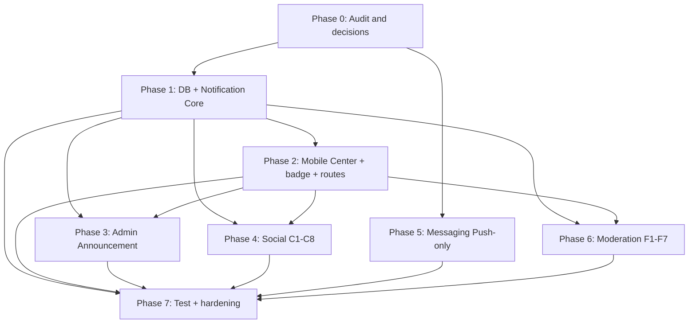

# Implementation Dependency Map

## Dependency graph

## Required gates

| Gate | Must be true before next phase |
|---|---|
| G0 product/platform | Flutter Web is confirmed; announcement audience and Like/D2/D3 policies are decided. F2/F4 do not have source actions; F7 wording/availability remains unresolved |
| G0 environment | Identify safe MySQL target/backup/DDL strategy; inspect existing Android `google-services.json` without exposing key, verify plugin/SDK, Firebase project ownership, iOS bundle/APNs, backend secret delivery, staging devices |
| G1 schema/API | DDL diff reviewed; source-to-live schema confirmed; principal-bound API and cursor/read semantics fixed; tests on disposable MySQL |
| G2 navigation | single Center UI/state and exact target routes verified; badge sources explicitly separated; local `AppSyncBus` reuse defined |
| G3 announcement | content lifecycle, audience, read receipt, expiry, async delivery and admin audit integrated |
| G4 social | exact recipient and source transition identified for every C event; transaction/idempotency tests |
| G5 push | D-25 state matrix, token lifecycle, no per-message persistence, collapse/retry and foreground suppression contract tested |
| G6 moderation | actual action mapping/recipient and sanitized user-visible copy approved |
| G7 release | tests/build/analysis, MySQL query plans, two-account/two-device evidence, rollback and operations notes |

## Sequencing notes

- Phase 0 is not “read README and proceed”: it captures source audit and unresolved choices. Source is audited in this revision for key modules, but production DB/Firebase/deployment remain CHƯA XÁC MINH.
- Phase 1 precedes all Center record producers; it does not gate push-only Messaging except shared token/provider infrastructure.
- Phase 2 and Phase 3 interface planning should happen together because merged personal+announcement pagination affects cursor/API and badge total. Implementation can sequence Phase 2 first after contract freeze.
- Phase 4 and 6 both call core service after existing transitions; they may be split into small PRs but should not change unrelated domain workflow.
- Phase 5 can be isolated and deployed after mobile Firebase support/backend token APIs; notifications Center schema is not its persistence dependency.
- Phase 7 is a gate across all previous deliverables, not a substitute for per-phase tests.

## Suggested rollout ordering

1. Review decisions and identify Firebase/MySQL staging.
2. Deploy additive schema/API core backward-compatibly; verify notification data permissions.
3. Ship Mobile Center; bell badge refreshes from API, with empty state fallback.
4. Ship Admin Announcement and user shared-feed query; start with push disabled until staging verified.
5. Enable social event hooks gradually, monitoring duplicate/recipient errors.
6. Enable FCM Messaging push-only after policy, multi-device, privacy and physical-device tests; no notification row migration.
7. Enable moderation templates only for verified action types.
8. Complete release acceptance and update CODEBASE_GUIDE/DB_INFO/API/development log.

## Rollback boundaries

- Schema is additive; rollback must preserve newly-created data or disable code path first. Never drop tables automatically during rollback.
- Disable FCM dispatch via environment/config kill switch if provider fails; existing Messaging stays REST/WS-based.
- Disable Center read/write UI/API only with compatibility path that does not alter domain actions; keep records during incident.
- Unpublish/cancel Announcement is a domain status change audited by admin; do not mass-delete read receipts.
- Social/Moderation event hook can be feature-disabled without reverting Friendship/Post/Comment/Moderation state transitions.

## Execution progress — 2026-11-26

- Phase 0 source audit completed sufficiently to start the first backend phase; production DB/deployment remain unverified. Firebase Android project ownership for `travel-planner-54f53` is owner-confirmed.
- Phase 1 Notification Core backend is implemented and verified on the owner-approved MySQL test database. See `02_PHASE_1_NOTIFICATION_CORE.md` for files, API contract and test evidence.
- Phase 1 C4 grouped Like semantics are resolved and implemented: UTC-day bucket, remove actor only while unread, preserve read history. Additive SQL remains unapplied outside the isolated test DB; follow the schema-review/backup gate.
- Phase 2 Mobile Center now has a personal-feed implementation using the Phase 1 API: typed DTO/repository, cursor paging, read-one/read-all, empty/loading/error states, a shared unread-count notifier/badge, and resume/sync refresh. Focused Flutter tests pass; details are in `03_PHASE_2_MOBILE_NOTIFICATION_CENTER.md`.
- Phase 2 remains **in progress**: the user announcement feed/read contract is not implemented (Phase 3), and ACTIVITY/COMMENT/REPORT targets lack verified route descriptors. Phase 3 may start only after the announcement product/API/schema decisions are explicitly frozen; its user-feed work must then return to Phase 2 for integration before Phase 4 producers.

### Follow-up after owner decisions — 2026-11-26

- Owner approved announcement visibility for all ACTIVE accounts, including later signups, while PUBLISHED and unexpired; only explicit open records a receipt.
- Owner approved parent-route resolution for Activity/comment notifications and safe unavailability for REPORT without a destination.
- Phase 3 code is now in place: Admin Web authoring/lifecycle, strict audit entries, shared content/read tables, Mobile composite feed and source-aware cursor. Focused tests: 19 backend and 10 Mobile; Web analyze/build pass.
- Phase 4 C1–C8 Center hooks are implemented and focused-tested. Phase 5 Android FID registration/API, Admin SDK adapter and D1–D3 post-commit policy are implemented; provider credentials and physical-device verification remain gates. No push history or Center row is created for messages. Existing Admin status/role/session, post moderation/purge and report resolution operations now create `SYSTEM` notification records with action types. Warning operations do not exist in source and were not invented.
