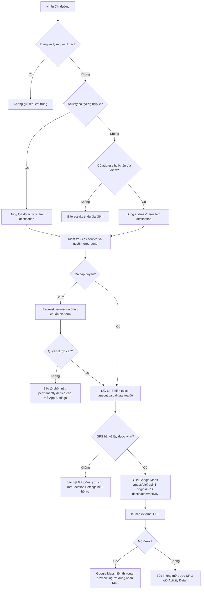

# Visit Tracking và Google Maps Navigation — Implementation Plan

> Trạng thái: **Đã triển khai; đang rà soát và kiểm chứng điều chỉnh nghiệp vụ ngày 2026-11-23**. Plan giữ nguyên ba Phase ban đầu; nội dung bên dưới là quy tắc mới nhất.

## 1. Tổng quan

### Mục tiêu

1. Cho phép người dùng đã đăng nhập đánh dấu một hoạt động là đã ghé/chưa ghé bằng thao tác vuốt trên card hoạt động.
2. Giữ thứ tự số hiện tại của marker; thay phần số bằng dấu ✓ khi hoạt động đã ghé và cập nhật trên bản đồ sau khi trạng thái lưu thành công.
3. Từ Activity Detail, mở URL chỉ đường Google Maps có origin là GPS hiện tại và destination là đúng hoạt động đang xem.

### Vấn đề hiện tại đã xác minh

- `Activity` không có trường visited; `ActivityResponse` không có trạng thái visited và không có bảng tracking.
- `ItineraryDayCard` render `ActivityTimelineItem` trong `ListView.builder`; chỉ có `ReorderableListView` trong chế độ sắp xếp. Card hiện nhận callbacks riêng cho mở chi tiết, sửa, xóa, bình luận và lưu Place.
- Marker activity đi qua `ItineraryMapHelper.buildActivityMarkers` rồi `MapMarkerBuilder.buildStopMarker`; số thứ tự là index trong danh sách activity của ngày, không phải một numbering service riêng.
- `ActivityDetailScreen._launchDirections` tạo URL từ một điểm duy nhất. `NavigationLauncherHelper` chuyển một stop thành `/maps/search/`, vì vậy không có origin GPS hoặc tuyến đường.
- Mobile đã có `url_launcher`, `flutter_map`, `latlong2`; chưa có geolocation package/service, manifest Android hiện chỉ khai INTERNET và iOS Info.plist chưa khai báo quyền vị trí.
- Backend dùng Spring Data JPA/MySQL và `ddl-auto=update`; không dùng Flyway/Liquibase. JWT và quyền truy cập itinerary được kiểm tra ở Security + service.
- Repository hiện tại không có `docs/plan/start-trip-google-maps/START_TRIP_GOOGLE_MAPS_PLAN.md`; plan này là nguồn yêu cầu riêng cho hai chức năng nêu trên.

### Phạm vi

- Backend lưu trạng thái visit cho chủ itinerary; người xem lịch trình người khác chỉ đọc bản đồ và không nhìn thấy tiến độ đã ghé.
- Mobile swipe action, optimistic update/rollback, marker ✓ và điều hướng GPS đến activity đang mở.
- Test Backend, Flutter model/repository/widget/helper; cập nhật tài liệu API, CODEBASE_GUIDE, development log và plan này.

### Ngoài phạm vi

- Chạy navigation liên tục trong Travel Planner, vẽ GPS/user marker trên bản đồ itinerary, background location, tự động đánh dấu khi vào geofence, tracking lịch sử/timestamp ghé thăm.
- Sửa thuật toán tuyến đường itinerary hiện tại, đổi nhà cung cấp tile/geocoding/routing, hoặc thêm Google Maps SDK/API key.
- Đồng bộ visited cho nhóm người dùng/cộng tác lịch trình.

## 2. Phân tích codebase hiện tại

### Backend

- Package root: `Travel_Planner.Travel_Planner`; entity ở `model`, request/response ở `dto`, API ở `controller`, nghiệp vụ ở `service`/`service.impl`, truy cập dữ liệu qua Spring Data repositories.
- `Activity` ánh xạ `activities`; có FK tới `ItineraryDay`, snapshot vị trí (`locationName`, `locationAddress`, latitude/longitude, provider `placeId`) và tùy chọn canonical `Place`. Không có visited state.
- `ItineraryController` nhận `@AuthenticationPrincipal UserDetails` và chuyển username vào `ItineraryService`. Các route ghi hoạt động hiện kiểm tra chủ sở hữu qua `findOwnedItinerary`.
- `ItineraryServiceImpl.getItineraryDetail` trả các ngày/hoạt động theo thứ tự; activity responses được map trong service. Quyền xem detail đã xét trạng thái/visibility, chủ sở hữu, `ItineraryAccessGrant` và block.
- `SecurityConfig` yêu cầu xác thực mặc định, chỉ mở một số GET công khai; route PUT mới mặc định cần Bearer JWT.
- Schema dùng Hibernate update và startup runners hiện có. Không thêm runner migration hoặc xóa dữ liệu cho feature này.

### Flutter

- Pipeline: `ItineraryDetailScreen` → `ItineraryDetailNotifier` → `ItineraryRepository`/`ItineraryCrudRepository` → `ApiClient` → JSON model → widgets.
- `ActivityDetail` là model immutable; `ItineraryDetail` có `copyWith`, `ItineraryDayDetail` và `ActivityDetail` hiện chưa có `copyWith`.
- `ItineraryDayCard` sở hữu reorder state; `ActivityTimelineItem` chịu trách nhiệm card và action hiện có. Chỉ áp dụng swipe ở danh sách thường, không trong reorder mode.
- `ItineraryMapPreviewCard` và `ItineraryMapScreen` cùng sử dụng `ItineraryMapHelper`; helper lọc tọa độ hợp lệ, giữ sequence theo thứ tự danh sách activity và dùng chung `MapMarkerBuilder`.
- Activity Detail hiện stateless; nút điều hướng nằm trong phần địa điểm và chỉ hiển thị khi có tọa độ. `NavigationLauncherHelper` đã chuẩn hóa URL và launch external app, nhưng 1 stop là search URL.
- Chưa có `DeviceLocationService`, plugin GPS, quyền coarse/fine Android hoặc NSLocationWhenInUseUsageDescription iOS. `url_launcher` đã có sẵn.

### Dữ liệu và các quyết định nghiệp vụ

| Câu hỏi | Quyết định | Lý do |
|---|---|---|
| Visit thuộc activity hay ngày/lịch trình? | Thuộc cặp người dùng + activity trong bảng liên kết `activity_visits`. | Một người có thể ghé cùng activity của nhiều itinerary; activity snapshot không bị biến thành trạng thái tham quan. |
| Trạng thái chung hay riêng? | Riêng từng tài khoản; viewer không nhìn thấy trạng thái của người khác. | Activity/trip được chia sẻ hiện là nội dung đọc chung, không có collaboration state; trạng thái toàn cục sẽ công bố việc ghé của chủ itinerary cho mọi viewer và gây ghi đè lẫn nhau. |
| Ai cập nhật được? | Chỉ chủ sở hữu itinerary ACTIVE và tài khoản ACTIVE đã đăng nhập. Backend kiểm tra owner và đúng itinerary/day/activity. | Tiến độ đánh dấu là trạng thái itinerary theo nghiệp vụ hiện tại; người xem không được sửa lịch trình gốc hay tiến độ marker của lịch trình đó. |
| Dữ liệu cũ? | Không có row nghĩa là `visited=false`; không backfill hoạt động cũ. | Giữ nguyên 100% activity cũ, không migration dữ liệu phá hủy. |
| API response cho ai không phải owner? | `visited=false` cho khách và mọi viewer không phải owner, kể cả khi dữ liệu lịch sử còn visit row. Endpoint ghi cần JWT và owner. | Marker của itinerary chia sẻ luôn chỉ hiển thị thứ tự, không làm lộ hoặc mô phỏng tiến độ của người khác. |
| Place ID cho Maps? | Dùng tọa độ activity làm destination chính xác; chỉ dùng Place ID khi xác định được đó là **Google Place ID**. `Activity.placeId` là provider ID và `canonicalPlaceId` là ID catalog nội bộ, nên không gửi chúng vào `destination_place_id`. | Tránh điều hướng sai khi nhầm provider/canonical ID với Google Place ID. |
| Address-only destination? | Dùng địa chỉ activity (ưu tiên address, rồi locationName/name) trong tham số `destination` của URL directions; vẫn có origin GPS. Nếu không có tọa độ lẫn chuỗi địa điểm hợp lệ thì báo lỗi, không mở tìm kiếm chung. | Cho phép fallback có ngữ nghĩa nhưng không giả vờ tọa độ được xác minh. |
| Google Maps chưa cài? | Dùng Google Maps HTTPS URL qua `url_launcher`; hệ điều hành có thể mở Maps hoặc browser tương thích. Nếu launch thất bại, giữ nguyên màn hình và báo lỗi. | Không thêm Google SDK/key; universal directions URL miễn phí. |
| Schema update? | Entity mới được tạo bằng cơ chế Hibernate `ddl-auto=update` hiện tại; không thêm migration runner. | Tuân theo convention source/schema của repo. |

### API contract dự kiến

- `PUT /api/itineraries/{itineraryId}/days/{dayId}/activities/{activityId}/visit-status`
- Auth: Bearer JWT; request `{"visited": true|false}`; response `{"activityId": 123, "visited": true|false, "updatedAt": "..."}`.
- Thao tác idempotent: PUT cùng giá trị nhiều lần vẫn cho cùng trạng thái. Thiếu/false row đều biểu diễn chưa ghé.
- `ActivityResponse` thêm `visited` của chủ itinerary; false cho guest/non-owner và khi chưa có row. Field additive để tương thích client cũ.
- Lỗi theo convention hiện tại: 400 invalid ID/body; 401 chưa đăng nhập; 403 tài khoản không hoạt động; 404 itinerary/day/activity không tồn tại, không được phép xem hoặc quan hệ path không khớp (không tiết lộ tài nguyên riêng).

## 3. Luồng xử lý

### Visit tracking

```mermaid
sequenceDiagram
 participant U as Người dùng
 participant W as Activity visit swipe
 participant N as ItineraryDetailNotifier
 participant R as ItineraryCrudRepository
 participant C as ItineraryController
 participant S as ItineraryServiceImpl
 participant DB as MySQL
 U->>W: Vuốt sang phải, chạm action
 W->>N: setVisited(activity, target)
 N->>N: Optimistic copyWith cho activity trong ngày
 N->>R: PUT visit-status + JWT
 R->>C: JSON {visited}
 C->>S: IDs + username + trạng thái
 S->>S: kiểm tra user, itinerary visibility/grant, day/activity scope
 S->>DB: upsert (user_id, activity_id)
 DB-->>S: trạng thái đã lưu
 S-->>R: ActivityVisitResponse
 R-->>N: trạng thái xác nhận
 N-->>W: giữ UI; lỗi thì rollback snapshot cũ
 Note over N: Cùng model được gửi qua itinerary detail tới map preview/full-screen
```

Mở map cho ngày cụ thể vẫn lọc activity như hiện tại; số thứ tự vẫn dựa theo vị trí trong danh sách activity; marker completed đổi glyph số sang ✓, giữ pin/day badge/màu/geometry/camera/route và tap handler hiện tại.

### Google Maps navigation



Request position có timeout giới hạn; không dùng tọa độ cũ hoặc tọa độ activity làm origin khi GPS lỗi. Với tọa độ activity, URL destination chỉ chứa tọa độ, không ghép tên vào query nhằm tránh biến thành tìm kiếm mơ hồ.

## 4. Files dự kiến thay đổi

| Phase | File | Hiện trạng | Thay đổi dự kiến | Lý do |
|---|---|---|---|---|
| 1 | `backend/.../model/ActivityVisit.java` (mới) | Chưa có entity visit | Bảng `activity_visits`, FK user/activity, unique pair, timestamp | Trạng thái riêng từng tài khoản |
| 1 | `backend/.../repository/ActivityVisitRepository.java` (mới) | Chưa có truy vấn visit | Idempotent upsert + batch query các activity đã ghé theo user | Lưu trạng thái và tránh N+1 |
| 1 | `backend/.../dto/request/UpdateActivityVisitRequest.java` (mới) | Chưa có request | Validate `visited` bắt buộc | Hợp đồng PUT |
| 1 | `backend/.../dto/response/ActivityVisitResponse.java` (mới) | Chưa có response | Trả activityId/visited/updatedAt | Kết quả ghi |
| 1 | `backend/.../dto/response/ActivityResponse.java` | Không có `visited` | Thêm field owner-scoped | GET chỉ trả tiến độ cho chủ itinerary |
| 1 | `backend/.../service/ItineraryService.java`, `service/impl/ItineraryServiceImpl.java` | CRUD + owner authorization; map activity response | API method, owner check, batch visit lookup chỉ cho owner, upsert; giữ kiểm tra scope IDs | Nghiệp vụ/truy vấn ở service |
| 1 | `backend/.../controller/ItineraryController.java` | Routes CRUD activities | Thêm authenticated PUT visit-status | API boundary |
| 1 | `backend/src/test/.../ActivityLocationTest.java` hoặc test mới `ActivityVisitTest.java` | Test itinerary/activity integration | Test auth, access, isolation user, path mismatch, persistence, GET response | Regression/backend acceptance |
| 2 | `frontend/mobile/lib/features/itinerary/data/models/activity_detail.dart` | immutable model chưa có visited/copyWith | Parse `visited` mặc định false; copyWith | API data + optimistic state |
| 2 | `.../itinerary_day_detail.dart` | immutable list model chưa copyWith | Thêm copyWith cho nested replacement | Rebuild immutable detail |
| 2 | `.../itinerary_crud_repository.dart` | CRUD endpoints | PUT visit-status parse response | Tách HTTP khỏi widget |
| 2 | `.../presentation/itinerary_detail_notifier.dart` | fetch detail; không update visit | Optimistic update/rollback theo IDs; reuse CRUD repo | State management hiện có |
| 2 | `.../presentation/widgets/activity_visit_swipe_action.dart` (mới) | Chưa có reveal-style swipe | Reusable reveal action; tap action riêng; khóa khi đang lưu | `Dismissible` sẽ xóa item khỏi list, không phù hợp reveal behavior |
| 2 | `.../presentation/widgets/itinerary_day_card.dart` | ListView thường + reorder mode | Wrap normal timeline item bằng swipe widget khi callback cho phép; không trong reorder | Không phá reorder/control hiện có |
| 2 | `.../presentation/screens/itinerary_detail_screen.dart` | truyền callbacks cho card; holds notifier | Cấp callback theo auth; update state, snackbar/rollback | Kết nối state/API |
| 2 | `.../presentation/widgets/itinerary_map_helper.dart` | marker sequence luôn số | Truyền visited về marker builder; giữ sequence metadata | Dùng chung map renderer |
| 2 | `frontend/mobile/lib/shared/widgets/map_marker_builder.dart` | stop marker render sequence/icon | Optional completed/check glyph; semantic label đúng | Reuse marker primitive |
| 2 | `frontend/mobile/test/itinerary_activity_management_test.dart`, `itinerary_map_test.dart`, `activity_location_model_test.dart` và test mới nếu cần | Existing card/map/model tests | Cover reveal, request outcome/rollback, legacy defaults, marker glyph | Flutter acceptance |
| 3 | `frontend/mobile/lib/shared/services/device_location_service.dart` (mới) | Chưa có service GPS | Permission, service-enabled, timeout, coordinate validation, typed failure | Logic platform location ngoài widget |
| 3 | `.../presentation/widgets/navigation_launcher_helper.dart` | Single stop tạo search URL | Directions builder có `origin`, exact coordinate/address destination; reuse external launcher | Không tạo URL riêng cạnh helper |
| 3 | `.../presentation/screens/activity_detail_screen.dart` | Stateless; chỉ destination search URL khi coords tồn tại | Stateful busy guard; lấy GPS, address fallback, lỗi permission/GPS/launch; hiển thị direction cả khi chỉ có address | Thực hiện B1–B3 |
| 3 | `frontend/mobile/pubspec.yaml`, `pubspec.lock` | Chưa có geolocation plugin | Thêm `geolocator` stable tương thích SDK hiện tại nếu cần; không thêm Google SDK | Native GPS + runtime permission |
| 3 | `frontend/mobile/android/app/src/main/AndroidManifest.xml` | Chỉ INTERNET | Coarse + fine permission foreground; không background | Android permission |
| 3 | `frontend/mobile/ios/Runner/Info.plist` | Chưa có location usage text | NSLocationWhenInUse usage description tiếng Việt | iOS permission |
| 3 | `frontend/mobile/test/itinerary_route_test.dart`, `activity_detail_screen_test.dart` và test service mới nếu cần | URL/route và detail tests hiện có | Test directions URI exact origin/destination, address fallback, busy/errors/permission | Regression navigation |
| Docs | `docs/ai/03-api-contract.md`, `CODEBASE_GUIDE/07C-LICH-TRINH-ACTIVITY-MAP.md`, `CODEBASE_GUIDE/13-LUONG-XU-LY-CHUC-NANG.md`, `docs/ai/09-development-log.md` | Chưa mô tả feature | Đồng bộ contract, luồng, quyết định và test thực chạy | Source-of-truth docs |

## 5. Phase 1 — Backend & Database: Visit Status

### Task 1.1 — Persist per-user state

- **Mục tiêu:** Lưu một boolean trạng thái hiện tại (không history) cho từng user/activity.
- **Files:** entity mới, repository mới.
- **Logic:** unique `(user_id, activity_id)`, FK theo quan hệ JPA, `visited`, `updatedAt`; PUT dùng database upsert để hai request đồng thời không tạo bản ghi trùng. Batch query các `activityId` đã visited cho một user.
- **Schema:** Hibernate `ddl-auto=update` thêm bảng; absence row đại diện `false`; không DDL thủ tay hoặc backfill.
- **Tests:** unique/idempotent state, true→false, user A không ảnh hưởng B, FK/access constraints.
- **Acceptance:** restart/load lại vẫn giữ trạng thái; không có dữ liệu cũ bị sửa/xóa.
- **Rủi ro:** database local chưa được Hibernate cập nhật nếu backend process đang chạy liên tục; xác nhận test context dùng `travel_planner_test` và backend phải restart sau khi build mới.

### Task 1.2 — Secure API and owner-scoped response

- **Files:** request/response DTO mới; `ActivityResponse`, `ItineraryService`, `ItineraryServiceImpl`, `ItineraryController`; backend test.
- **Logic:** PUT xác thực user ACTIVE; chỉ owner được cập nhật; xác minh đúng itinerary → day → activity; giữ các kiểm tra itinerary/activity khả dụng và block. Các viewer khác vẫn đọc itinerary theo quyền hiện có nhưng response luôn `visited=false`, kể cả còn visit row được tạo bởi phiên bản cũ. Không dùng route sửa activity vì endpoint đó chỉ dành owner.
- **API:** contract nêu trên; validate JSON boolean; request lặp idempotent.
- **Tests:** anonymous 401; owner mark/unmark và đọc lại; public viewer bị từ chối ghi; viewer không thấy visit row lịch sử; private grant chỉ cho đọc, không cho ghi tiến độ owner; revoked grant; hidden/deleted; IDs mismatch; invalid/unknown; clone ownership/visit isolation; old activity no row -> false; no N+1 status select.
- **Acceptance:** quyền kiểm tra ở backend; mobile/web DTO cũ tiếp tục đọc được field thêm vào.
- **Rủi ro:** lịch trình grant có scope đọc, không tự suy ra quyền edit activity; tracking là dữ liệu riêng nên không thay permission của CRUD.

### Task 1.3 — Phase 1 verification

- Re-read Phase 1 plan/checklist; `.\mvnw.cmd -Dtest=ActivityVisitTest test` hoặc test suite đã chọn; `.\mvnw.cmd test-compile`.
- Đối chiếu JSON/API, xem test SQL/schema chỉ vào test database, cập nhật checklist và kết quả thực tế bên dưới trước khi sang Phase 2.

## 6. Phase 2 — Flutter: Swipe Action & Map Marker

### Task 2.1 — API/model/state

- **Files:** `ActivityDetail`, `ItineraryDayDetail`, `ItineraryCrudRepository`, `ItineraryDetailNotifier`.
- Parse `visited` kiểu bool; missing/null legacy value là false. PUT gửi boolean JSON và token. Notifier tìm activity/day trong `itineraryDetail`, optimistic-copy duy nhất activity tương ứng, rollback snapshot nếu API lỗi, không re-fetch toàn bộ itinerary khi thành công.
- **Tests:** model true/false/missing/null; repository path/method/body/token/response; notifier success/rollback và không đổi activity khác/ngày khác.
- **Acceptance:** trạng thái response sau tải detail là nguồn bền vững; local update có thông báo lỗi và rollback.

### Task 2.2 — Reveal gesture without card regression

- **Files:** widget swipe mới; `ItineraryDayCard`; `ItineraryDetailScreen`; activity management widget tests.
- Vùng action nằm phía sau foreground có nền đục, không xuyên qua nội dung timeline. Chưa ghé thì vuốt phải để lộ `Đã ghé thăm` bên trái; đã ghé thì vuốt trái để lộ `Chưa ghé thăm` bên phải. Kéo chưa đủ ngưỡng tự khép; ngưỡng đạt thì snap tới action. Vuốt ngược đóng vùng đã mở. Chỉ gửi request khi action được chạm; action bị disable/spinner khi pending. Thành công đóng action; lỗi giữ trạng thái server/optimistic rollback và giữ action mở để thử lại.
- Trạng thái đã ghé có badge nhỏ `Đã ghé` trong hàng metadata đầu card; badge nằm trong layout, không phủ nội dung. Không thêm nút lớn thứ hai vì action swipe hiện có vẫn có thể chạm xác nhận.
- Chỉ wrap activity list thường và chỉ khi người dùng authenticated/callback tồn tại; reorder mode không có gesture. Gesture horizontal dùng recognizer riêng để scroll dọc tiếp tục hoạt động; card tap, menu, comments, save place không bị thay handler.
- **Animation:** Level 1 Subtle, `TweenAnimationBuilder` với `Transform.translate` khoảng 180 ms cho snap/reveal. Gesture tần suất cao không có animation trang trí; tôn trọng `MediaQuery.disableAnimations` bằng duration zero. Không có controller phải dispose.
- **Tests:** right swipe reveal, left swipe unmark reveal, opposite-direction close, short swipe snap-back, tap action, loading lock, callback fail/rollback, opaque foreground, guest/no callback, vertical scroll, reorder mode, taps vào card buttons và layout màn hình hẹp.
- **Acceptance:** thao tác rõ ràng; không dismiss/mất card; trạng thái server/local đồng nhất.

### Task 2.3 — Marker completed state

- **Files:** `ItineraryMapHelper`, shared `MapMarkerBuilder`, `itinerary_map_test.dart` và map preview/fullscreen tests nếu cần.
- Truyền `activity.visited`; khi true thay center sequence text bằng ✓, giữ màu ngày, badge `D#`, pin shape, coordinate offset, thứ tự sequence logic, `onTap`, zoom, route/polyline và day filter.
- **Tests:** visited false hiển thị sequence; visited true có check thay số; đổi state cập nhật marker đúng một activity; ngày khác vẫn đúng; missing coordinates không tạo marker; existing multi-day colors/coordinates preserved.
- **Acceptance:** hai map UI tiếp tục dùng một `ItineraryMapHelper`; không sinh marker builder riêng.

### Task 2.4 — Phase 2 verification

- `dart format` trên file thay đổi; `flutter analyze` mục tiêu; test model/repository/notifier/activity-card/map. Review API response của Phase 1 trước khi sang Phase 3.

## 7. Phase 3 — Google Maps Navigation & Integration Testing

### Task 3.1 — Device location

- **Files:** service mới; `pubspec.yaml`/lock; Android Manifest; iOS Info.plist; service tests.
- Dùng package Flutter geolocation hiện hành khi audit xác nhận không có API GPS built-in; yêu cầu chỉ foreground while-in-use. Kiểm tra location services bật, check/request coarse+fine permission (Android approximate cũng đủ origin), denied/deniedForever, lấy current fix với timeout, validate finite/range.
- Không xin background permission; không gửi GPS lên backend; không cache vị trí thành origin; không log tọa độ cá nhân.
- Nếu deniedForever, cung cấp action mở app settings; GPS disabled cung cấp action mở location settings nếu platform hỗ trợ. Lỗi plugin/timeouts có loại riêng để UI trình bày phù hợp.
- **Tests:** service enabled/disabled, granted, prompt then granted/denied, deniedForever, timeout/plugin error, invalid coordinate; test inject platform/provider thay vì gọi GPS thật.
- **Acceptance:** không mở route nếu không lấy được GPS hợp lệ.

### Task 3.2 — Directions URL and screen state

- **Files:** `NavigationLauncherHelper`, `ActivityDetailScreen`, `itinerary_route_test.dart`, `activity_detail_screen_test.dart`.
- Tạo `https://www.google.com/maps/dir/?api=1&origin=<current lat,lng>&destination=<activity lat,lng>&travelmode=driving`. Destination coordinate không kèm tên để URL không biến thành query search. Nếu không có tọa độ, dùng address/name được encode đúng; không truyền `canonicalPlaceId` hoặc provider `placeId` như Google Place ID. Có Google Place ID thực sự trong tương lai mới dùng `destination_place_id` cùng destination.
- Activity Detail hiển thị action nếu có tọa độ hoặc chuỗi destination có nghĩa. Chuyển sang loading state/guard để chặn double tap, lấy GPS sau tap, rồi gọi helper đang có để open external app. Nếu ứng dụng Google Maps chưa cài, universal URL có thể mở web; nếu URL launch lỗi/false thì báo lỗi và giữ nguyên màn hình.
- **Tests:** origin là tọa độ injected của GPS, destination là đúng activity đang xem; không dùng activity đầu itinerary/coordinate mặc định; destination address-only fallback; invalid/missing destination; launch false/exception; tap lặp; action visibility với address-only; URI encode special chars.
- **Acceptance:** maps preview mở route từ vị trí hiện tại đến activity đích và user phải xác nhận Start; không còn Search URL ở Activity Detail.

### Task 3.3 — End-to-end/regression verification

- `flutter analyze`; tests route, GPS service, ActivityDetail, map/helper, activity swipe. Backend Phase 1 integration test đã pass.
- Thiết bị/emulator thật: cần người chạy/build environment có Android emulator hoặc handset, permission dialog, GPS sensor/mock current position và app Google Maps/browser. Tự động tests không khẳng định được UX handoff lên app đã cài.
- Regression: activity CRUD/order/comments, route itinerary multi-stop, markers by day, map preview/fullscreen, guest itinerary, shared/private grant, no location/permission denial.

## 8. Dependencies và thứ tự

```text
Phase 1 Backend/API/response -> Phase 2 repository/model/state/swipe/markers -> Phase 3 navigation + full regression
```

Phase 3 không phụ thuộc visit persistence; được chạy sau Phase 2 theo thứ tự yêu cầu. Dùng geolocator chỉ là dependency bổ sung có lý do: audit xác minh không có plugin/service nào trong app trả current GPS; không thêm Google Maps SDK/paid API.

## 9. Test Plan tổng thể

| Lớp | Case bắt buộc |
|---|---|
| Backend unit/integration | auth 401; owner-only write; public/granted viewer denied write; visibility/revoked; IDs parent-child khớp; upsert idempotent; owner progress hidden from non-owner including legacy rows; false/true reload; guest defaults false; clone independence; legacy activities; response and DB constraints |
| Flutter model/API | visited parse true/false/missing/null; method/path/body/token; response parsing; error mapping |
| Flutter state/UI | optimistic mark/unmark, rollback on API error, no stale neighboring activity, guest hidden/disabled behavior, opaque foreground, both swipe directions, short-swipe snap-back, action tap, tap actions unchanged, reorder mode isolated, no list item dismissal, narrow screens |
| Map | marker number vs ✓; visit update rerender; selected day/all days; same-coordinate offset; sequence/day badge/tap/polyline preserved |
| GPS | location service disabled; permission prompt/deny/permanent deny; granted position; timeout and malformed coordinates; repeated press |
| Navigation | exact origin=current GPS; exact target activity coords; address-only fallback; no route when no destination; google URL encoding; failed launcher; target isn't first activity |
| Regression/manual | owner and public/grant viewers; app restart/reload persistence; map preview/full-screen; itinerary sort/reorder; detail comments and CRUD; clone and saved-place-to-activity flow; Android/iOS permission UX; Google Maps installed and browser fallback |

## 10. Acceptance Criteria

- [ ] Persisted visit state survives app/backend restart; only itinerary owner can change or receive it, and public/granted viewers always see numbered markers without progress state.
- [ ] Backend accepts owner updates only; rejects anonymous/non-owner updates and mismatched itinerary/day/activity IDs.
- [ ] Old activity JSON without `visited` remains compatible and maps to false.
- [ ] Authenticated user can reveal action by right swipe, mark/unmark, see immediate state, and gets rollback on server error; card remains in list.
- [ ] Existing activity tap/edit/delete/comment/save and reorder behavior remains intact.
- [ ] Map uses same marker pipeline; visited uses ✓ instead of sequence, unvisited keeps original number; selected date/day is correct.
- [ ] Activity Detail uses current GPS origin, targets current activity coordinates, requests only foreground permission and handles every listed unavailable state.
- [ ] Address-only activity opens a directions URL with encoded destination text and GPS origin; no usable destination means no external navigation.
- [ ] URL is a directions route, not a search results URL; no Maps SDK/API key/new route provider is added.
- [ ] Relevant backend tests, Flutter tests and analyze executed; tests/manual checks reported separately and honestly.
- [ ] Plan, API contract, guide and English development log reflect actual implementation and verification.

## 11. Rủi ro và giảm thiểu

- **Schema chưa update runtime:** Hibernate `ddl-auto=update` runs on startup; restart backend after entity addition. Verify database target/profile first; do not run destructive DDL.
- **Permission decline/GPS off:** typed errors + optional settings actions; do not silently use a fabricated/default origin.
- **Owner-only itinerary progress:** store status under the owner/activity relation; shared viewers cannot update it and always receive `visited=false`.
- **Gesture conflicts:** apply only to horizontal recognizer in normal timeline; retain reorder mode unchanged and verify vertical scroll/button gestures.
- **Provider Place ID mismatch:** existing external `placeId` is not confirmed Google; route by coordinates/address.
- **External app behavior:** OS may dispatch the universal URL to browser instead of Maps; report actual device manual validation separately.
- **Android approximate location:** approximate is valid for an origin; request both coarse/fine. Activity target remains exact snapshot coordinate.
- **Historical plans/source drift:** no start-trip plan file was found in current tracked file list; this plan is based on verified current source, not prior history.

## 12. Implementation Checklist and status

### Phase 1 — Backend & Database
- [x] 1.1 Entity, unique pair, repository/upsert/batch query
- [x] 1.2 DTO, owner-only API, owner-scoped response mapping (revised 2026-11-23)
- [x] 1.3 Backend tests/build and API documentation
- Result: implemented and verified; targeted integration tests passed.
- Actual files: `ActivityVisit`, `ActivityVisitRepository`, visit request/response DTOs, `ActivityResponse`, `ItineraryService`, `ItineraryServiceImpl`, `ItineraryController`, `ActivityLocationTest`, `TestDatabaseCleaner`.
- Verification after revision: `backend/.\mvnw.cmd -Dtest=ActivityLocationTest test` — 30 tests passed, 0 failures/errors. Coverage includes owner mark/unmark; public/granted non-owner write denial; old non-owner visit row hidden; non-owner activity add/update/delete denied; clone and saved-place-created activity visit independence; mismatched parent IDs. JPA `ddl-auto=update` creates the table on backend startup; no migration runner added.

### Phase 2 — Flutter swipe & marker
- [x] 2.1 Model/repository/notifier optimistic state and rollback
- [x] 2.2 Swipe reveal action without disrupting card/reorder/scroll actions
- [x] 2.3 Shared marker check rendering and selected-day behavior
- [x] 2.4 Formatting/analyze/focused tests
- Result: implemented and focused automated checks passed.
- Actual files: `ActivityDetail`, `ItineraryDayDetail`, `ItineraryCrudRepository`, `ItineraryDetailNotifier`, `ActivityVisitSwipeAction`, `ItineraryDayCard`, `ItineraryDetailScreen`, `ActivityTimelineItem`, `MapMarkerBuilder`, `ItineraryMapHelper`, `activity_visit_tracking_test.dart`, `itinerary_activity_management_test.dart`, `itinerary_map_test.dart`.
- Actual tests/issues: the existing activity-management and map integration tests assumed the screen started on the Activities tab although default is Overview; tests now explicitly start on the tab they assert. Also made the long saved-place popup label ellipsize to avoid a narrow menu overflow. In this ownership review, `flutter test test/itinerary_activity_management_test.dart` passed 32 tests, including owner/non-owner swipe-action visibility; `flutter test test/features/itinerary/activity_visit_tracking_test.dart` passed 9 tests; scoped analyze over the changed screen and test passed with no issues.

### Phase 3 — GPS & Google Maps
- [x] 3.1 Foreground location service, dependency and native permission descriptions
- [x] 3.2 Exact directions URL, address fallback, loading/error handling
- [x] 3.3 Automated regression; manual device validation recorded separately
- Result: implementation and automated verification passed; physical-device handoff not tested in this environment.
- Actual files: `DeviceLocationService`, `ActivityDetailScreen`, `NavigationLauncherHelper`, `pubspec.yaml`/lock, Android Manifest, iOS Info.plist, `activity_visit_tracking_test.dart`.
- Actual tests/issues: `flutter build apk --debug` succeeded; focused suite of 120 Flutter tests passed, including coordinate/address destinations, injected current GPS, and duplicate-tap guard. Android emulator/physical-device permission prompts, live GPS and Maps/browser handoff remain unverified manual items.

## 13. Quy tắc cập nhật plan khi code khác dự kiến

Trong mỗi phase, đối chiếu plan với code thật trước khi sửa. Nếu thiết kế cần đổi, cập nhật mục quyết định/files/test/acceptance và ghi lý do cùng bằng chứng trước hoặc cùng patch. Không thêm scope mới. Mỗi phase chỉ được chuyển sang phase sau khi test trọng tâm chạy và checklist ghi đúng trạng thái. Không đánh dấu kiểm thử thiết bị là hoàn thành nếu chưa trực tiếp thực hiện.

## 14. Implementation log

### 2026-11-23 — Rà soát nghiệp vụ owner-only

| Hạng mục | Kế hoạch/code trước rà soát | Nghiệp vụ mới | Kết luận và điều chỉnh |
|---|---|---|---|
| Quyền đánh dấu | Backend và Flutter cho phép viewer đã đăng nhập có quyền xem tự ghi tiến độ | Chỉ chủ itinerary được đánh dấu/bỏ đánh dấu; viewer chỉ xem | Chưa phù hợp; backend trả 403 cho non-owner, Flutter chỉ gắn swipe callback khi owner |
| Marker lịch trình người khác | `visited` lấy theo viewer, có thể hiện check nếu người xem từng ghi trạng thái | Marker chỉ là thứ tự, không hiển thị tiến độ nào | Chưa phù hợp; detail API chỉ batch-load visit của owner; response non-owner luôn false, kể cả row cũ |
| CRUD hoạt động | API tạo/sửa/xóa đã dùng `findOwnedItinerary`; Flutter chỉ truyền callback chỉnh sửa cho owner | Non-owner không được thêm/sửa/xóa | Đã phù hợp, giữ nguyên; test hiện có xác nhận API từ chối non-owner khi tạo, các thao tác sửa/xóa cùng dùng owner guard |
| Sao chép itinerary | Clone tạo itinerary thuộc cloner và deep-copy ngày/hoạt động với ID mới | Bản sao của người dùng là itinerary của họ; visit độc lập | Đã phù hợp nhờ ID activity mới; bổ sung kiểm thử owner và trạng thái độc lập |
| Lưu địa điểm | `ItineraryPlace` là association tới canonical Place, không phải Activity; chọn Place trong form tạo Activity mới | Địa điểm được lưu/thêm vào itinerary của mình không sửa itinerary nguồn | Đã phù hợp; không đổi cơ chế saved-place hay schema |
| Google Maps/GPS | Flutter lấy vị trí hiện tại và mở directions URL tới Activity | Cho phép chỉ đường đến hoạt động của itinerary công khai | Đã phù hợp; giữ nguyên, không thêm API backend |

- Thay đổi schema/API shape: không có. `activity_visits` vẫn là bảng `(user_id, activity_id)` hiện hữu; ý nghĩa runtime được giới hạn owner theo chính sách mới. Visit row non-owner lịch sử không bị xóa, nhưng không thể ghi mới và luôn bị ẩn khi xem itinerary nguồn.
- Không sao chép visit row khi clone: activity mới có ID mới. Saved Place chỉ là liên kết catalog; khi dùng để tạo Activity, backend tạo Activity mới dưới day/itinerary đích.
- Kiểm tra sau patch: `ActivityLocationTest` — 30 passed; Flutter activity management — 32 passed; visit tracking — 9 passed; scoped analyze — no issues; `git diff --check` — passed.

### 2026-11-22 — Plan creation

- Audit confirmed no GPS plugin/service/permissions in current mobile source; existing NavigationLauncherHelper opens `/maps/search/` when passed a single stop.
- Chosen visit scope is `(user, activity)`, stored in a new association table; no existing activity rows are backfilled.
- Chosen destination source is activity snapshot coordinates; provider/catalog IDs are not treated as Google Place IDs.
- No implementation tasks completed yet at plan creation.

### 2026-11-22 — Three-phase implementation

- Initially added viewer-scoped `activity_visits` persistence with an idempotent MySQL upsert, grouped state reads, access checks, and an additive `visited` activity response field. The 2026-11-23 owner-only revision above supersedes the viewer-write/read policy; visit rows are removed before their activity is hard-deleted.
- Added optimistic Flutter visit toggling with failure rollback and a horizontal reveal action on the normal activity list; reorder behavior remains separate. Shared itinerary map markers now render a check for visited activities.
- Added foreground GPS permissions/service and opens a keyless Google Maps directions URL from current GPS to the activity coordinates, with address/name fallback. No Google Maps API key is used.
- `geolocator` 14.1.2 conflicted with the existing secure-storage Windows dependency constraints; selected compatible `geolocator` 14.0.2 and `flutter pub get` succeeded.
- Backend focused integration tests passed (26). The 120-test Flutter regression selection passed, the Android debug APK built, and scoped analyzer over changed Dart files found no issues. Whole-project `flutter analyze` still exits nonzero on two existing deprecation infos in `report_post_dialog.dart`; live device permission/GPS/Google Maps handoff is not verified here.
