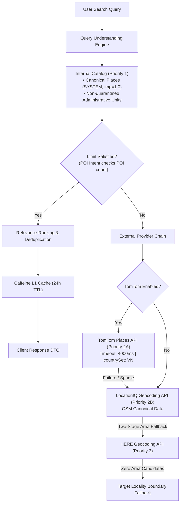

# Phase 3.3.1 — Document 05: External Provider Reliability & Fallback Audit

## 1. Provider Ecosystem Architecture

The Travel Planner location search ecosystem employs a layered multi-provider architecture ensuring maximum availability, query precision, and zero service interruption when external providers experience downtime.



---

## 2. Configuration & Parameter Verification

Inspection of `application.properties` and `MapProperties.java`:
```properties
# TomTom Places Configuration
travel-planner.maps.tomtom.enabled=${TOMTOM_ENABLED:false}
travel-planner.maps.tomtom.api-key=${TOMTOM_API_KEY:}
travel-planner.maps.tomtom.timeout-ms=${TOMTOM_TIMEOUT_MS:4000}
travel-planner.maps.tomtom.country-set=VN

# LocationIQ & HERE Configuration
travel-planner.maps.locationiq.api-key=${LOCATIONIQ_API_KEY:}
travel-planner.maps.here.api-key=${HERE_API_KEY:}
```

### Key Reliability Settings:
1. **Default Disabled Safeguard:** TomTom provider defaults to disabled unless explicitly enabled via environment variable, preventing initialization failures in air-gapped or test environments.
2. **Timeout Enforcement (4,000 ms):** Prevents slow HTTP socket responses from exhausting Tomcat request threads.
3. **Geographic Scoping (`countrySet=VN`):** Eliminates out-of-country false positives from external results.

---

## 3. Resilience & Error Handling Audit

### 3.1 HTTP Client Resilience in `TomTomPlacesProvider.java`
Inspection of `suggest`, `discover`, and `getDetails`:
- Validates query strings (min 2, max 100 characters).
- Clamps limit to `MAX_LIMIT` (20).
- Encapsulates `RestClient` invocations in targeted `try-catch` blocks catching `RestClientResponseException` and general `Exception`.
- On HTTP 4xx, 5xx, or network timeouts, logs diagnostic warnings with HTTP status codes and returns `Collections.emptyList()` or `null`.
- **Zero-Crash Guarantee:** An external upstream outage will never cause an uncaught HTTP 500 error on `/api/locations/search`.

### 3.2 Two-Stage Area Search Resilience in `LocationServiceImpl.java`
During structured queries (e.g. `cơm tấm Long Xuyên`):
- Stage B.1: Primary search bounded inside target area bounding box.
- Stage B.2: Root keyword fallback (e.g. `cơm`) if candidate list is sparse.
- Stage B.3: Generic food category fallback (`"quán ăn"`) if candidate count is < 2.
- Stage B.4: Combined query search biased to target coordinates.
- Stage B.5: HERE provider secondary search inside bounding box.
- Stage B.6: Strict geographic boundary filtering discarding out-of-bounds candidates.
- Safe Locality Fallback: If all candidates fail, returns target locality bounding box so map camera centers on the requested region without throwing errors.

---

## 4. Provider Audit Verdict

| Provider Component | Role in Hierarchy | Health & Error Handling | Verification Status |
| :--- | :--- | :--- | :--- |
| **Internal Catalog** | Priority 1 (Authoritative) | In-memory + MySQL indexed | **VERIFIED** |
| **TomTom Provider** | Priority 2A (External Places) | 4000ms timeout, RestClient resilient | **VERIFIED** |
| **LocationIQ Provider**| Priority 2B (Primary Geocoding)| Fallback provider, cached | **VERIFIED** |
| **HERE Provider** | Priority 3 (Secondary Area Search)| Auxiliary provider with area bounding | **VERIFIED** |
| **Locality Fallback** | Ultimate Safety Net | Deterministic bounding box return | **VERIFIED** |

