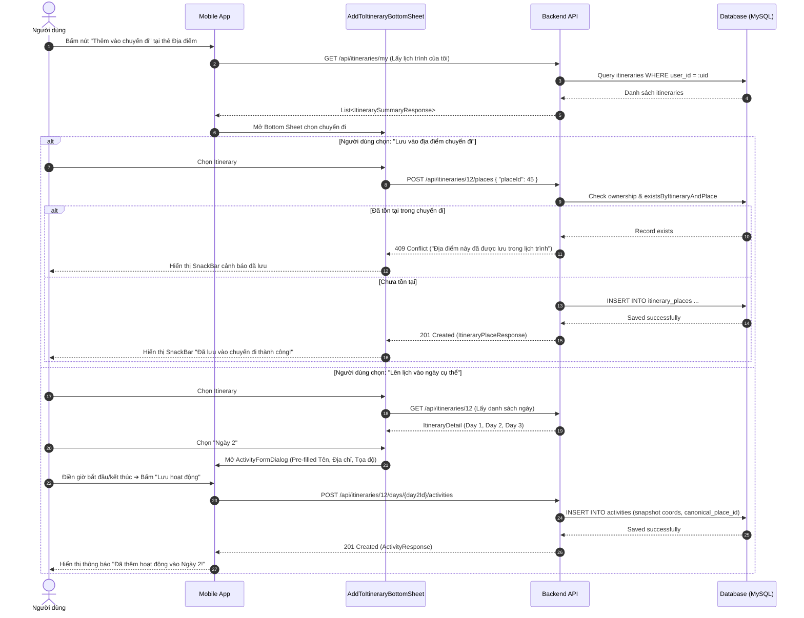
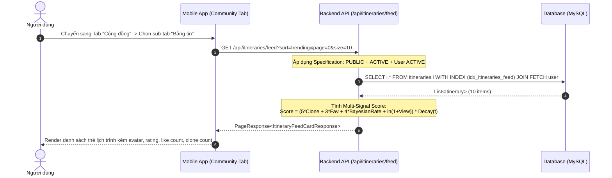
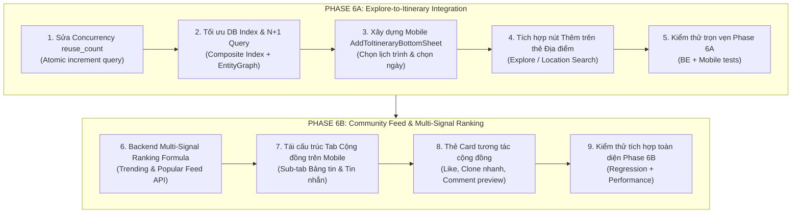

# PHASE 6 — PRE-IMPLEMENTATION ARCHITECTURE & READINESS AUDIT

**Dự án:** Travel Planner  
**Giai đoạn:** Phase 6 — Pre-Implementation Architecture & Readiness Audit  
**Phase tiền đề:** Phase 5 — Clone Itinerary (Hoàn tất với 858 tests PASS)  
**Git Branch:** `develop`  
**Git HEAD:** `695d317` (`feat: implement itinerary management features including CRUD and cloning`)  
**Git Working Tree Status:** CLEAN (Không có thay đổi chưa commit trước khi tạo báo cáo)  
**Chính sách Git:** STRICTLY NO COMMIT, NO PUSH  
**Mục tiêu:** Rà soát kiến trúc, luồng dữ liệu, rủi ro kỹ thuật, thành phần tái sử dụng và đề xuất giải pháp chi tiết cho Phase 6A (Explore-to-Itinerary Integration) và Phase 6B (Community Feed).

---

## MỤC LỤC
1. [Tóm tắt điều hành (Executive Summary)](#1-tóm-tắt-điều-hành-executive-summary)
2. [Hiện trạng kiến trúc & Luồng dữ liệu Explore → Itinerary](#2-hiện-trạng-kiến-trúc--luồng-dữ-liệu-explore--itinerary)
3. [Audit tồn đọng Phase 5 (Phase 5 Leftovers Audit)](#3-audit-tồn-đọng-phase-5-phase-5-leftovers-audit)
   - 3.1. Đối soát số lượng test (Test Arithmetic)
   - 3.2. Căn nguyên và baseline của 3 Mobile mock failures
   - 3.3. Bằng chứng cơ chế Transaction Rollback khi clone thất bại
   - 3.4. Rủi ro Lost Update khi cập nhật đồng thời `reuse_count`
4. [Audit Phase 6A — Tích hợp Explore vào Itinerary (Explore-to-Itinerary)](#4-audit-phase-6a--tích-hợp-explore-vào-itinerary-explore-to-itinerary)
   - 4.1. Phân biệt Place nội bộ (Catalog) và kết quả External Provider
   - 4.2. Cơ chế người dùng chọn Itinerary và ItineraryDay
   - 4.3. Quan hệ giữa `places`, `itinerary_places`, `activities`, `canonical_place_id`
   - 4.4. Kiểm tra quyền sở hữu (Ownership) và quyền xem (Visibility)
   - 4.5. Cơ chế chống trùng lặp địa điểm (Duplicate Place Prevention)
   - 4.6. Phân tích các lựa chọn nghiệp vụ (Business Options Comparison)
5. [Audit Phase 6B — Bảng tin cộng đồng (Community Feed)](#5-audit-phase-6b--bảng-tin-cộng-đồng-community-feed)
   - 5.1. Bản chất của màn hình Explore hiện tại vs Community Feed
   - 5.2. Cơ chế Đánh giá, Yêu thích, Lưu, Tái sử dụng (Clone)
   - 5.3. Điều kiện lọc dữ liệu hợp lệ (Eligibility Filtering)
   - 5.4. Sắp xếp, phân trang và hiệu năng truy vấn
   - 5.5. Nguy cơ N+1 Query và Hiện trạng chỉ mục Database (Database Indexes)
   - 5.6. Tái sử dụng Component vs Xây dựng Feed thứ hai
   - 5.7. Đề xuất công thức xếp hạng đa tín hiệu (Multi-Signal Ranking Formula)
6. [Bảng phân loại hiện trạng & Vấn đề cần quyết định (Audit Findings Matrix)](#6-bảng-phân-loại-hiện-trạng--vấn-đề-cần-quyết-định-audit-findings-matrix)
7. [Các thành phần tái sử dụng sẵn có (Reusable Existing Components)](#7-các-thành-phần-tái-sử-dụng-sẵn-có-reusable-existing-components)
8. [Yêu cầu thay đổi theo từng tầng hệ thống (Required Changes)](#8-yêu-cầu-thay-đổi-theo-từng-tầng-hệ-thống-required-changes)
9. [Đặc tả API & Luồng nghiệp vụ đề xuất (Proposed APIs & Business Flows)](#9-đặc-tả-api--luồng-nghiệp-vụ-đề-xuất-proposed-apis--business-flows)
10. [Chiến lược kiểm thử & Tiêu chuẩn nghiệm thu (Testing Strategy & Acceptance Criteria)](#10-chiến-lược-kiểm-thử--tiêu-chuẩn-nghiệm-thu-testing-strategy--acceptance-criteria)
11. [Lộ trình triển khai đề xuất (Proposed Implementation Roadmap)](#11-lộ-trình-triển-khai-đề-xuất-proposed-implementation-roadmap)

---

## 1. TÓM TẮT ĐIỀU HÀNH (EXECUTIVE SUMMARY)

Báo cáo này thiết lập kết quả audit toàn diện về mặt kiến trúc, code backend, cơ sở dữ liệu và client mobile/web trước khi khởi động Phase 6 của dự án Travel Planner.

### Kết luận chính:
1. **Trạng thái Phase 5:** Hoàn tất trọn vẹn với tổng cộng **858 tests PASS** (Backend: 451 PASS, Web: 33 PASS, Mobile: 374 PASS + 3 baseline mock failures). Không có bất kỳ regression nào phát sinh từ tính năng Clone Itinerary.
2. **Tồn đọng Concurrency Phase 5:** Việc cập nhật `reuse_count` trong `ItineraryServiceImpl.java` đang dùng mô hình `read-modify-write` thông thường (`source.setReuseCount(...)` rồi `save()`), tiềm ẩn rủi ro **Lost Update** khi nhiều request clone cùng một lịch trình được gọi đồng thời. Cần chuẩn hóa sang câu truy vấn nguyên tử `@Modifying @Query` tương tự như `favoriteCount` và `ratingCount`.
3. **Phase 6A (Explore-to-Itinerary):** Hệ thống backend đã có đầy đủ hai nền tảng cốt lõi:
   - Cơ chế lưu địa điểm vào lịch trình: `POST /api/itineraries/{id}/places` (Phase 4 — quản lý `itinerary_places`).
   - Cơ chế tạo hoạt động theo ngày: `POST /api/itineraries/{id}/days/{dayId}/activities` (Phase 2/3 — quản lý snapshot tọa độ và `canonical_place_id`).
   - *Khoảng trống hiện tại:* Mobile UI chưa có luồng tương tác cho phép người dùng từ kết quả tìm kiếm Explore/Location Search hoặc từ chi tiết một địa điểm để chọn "Lưu vào chuyến đi của tôi" hoặc "Thêm vào ngày cụ thể của chuyến đi". Cần bổ sung Bottom Sheet chọn lịch trình (`ItineraryPickerBottomSheet`) và bộ điều phối nghiệp vụ.
4. **Phase 6B (Community Feed):**
   - Màn hình `ExploreScreen` trên Mobile hiện tại trên thực tế đã là một bảng tin khám phá lịch trình cộng đồng (có các mục: Nổi bật, Gợi ý, Đánh giá cao nhất, Phổ biến nhất, Mới chia sẻ gần đây).
   - Trong khi đó, tab thứ 2 trên Bottom Navigation Bar của Mobile mang nhãn "Cộng đồng" (`CommunityScreen`) hiện tại lại trỏ thẳng vào màn hình Chat riêng tư / Bạn bè (`features/messaging/presentation/screens/community_screen.dart`). Đây là sự phân định thuật ngữ chưa đồng nhất giữa UI Navigation và Business Requirement.
   - Bảng `itineraries` trong database hoàn toàn **THIẾU CÁC CHỈ MỤC BẮT BUỘC** cho các truy vấn lọc và sắp xếp feed (`visibility`, `status`, `created_at`, `reuse_count`, `favorite_count`). Mọi truy vấn public feed hiện tại đều đang thực hiện **FULL TABLE SCAN**.
   - Việc load danh sách lịch trình công khai có nguy cơ **N+1 Query** khi truy cập lazy-loaded association `Itinerary.user` để lấy thông tin creator nếu không có `@EntityGraph`.
   - Cần áp dụng **Công thức xếp hạng đa tín hiệu** (Multi-Signal Ranking Formula) kết hợp giữa Bayesian rating, favorite count, clone count (reuse), log(view) và hàm suy giảm theo thời gian (time-decay) thay vì chỉ sắp xếp đơn thuần theo `reuse_count`.

---

## 2. HIỆN TRẠNG KIẾN TRÚC & LUỒNG DỮ LIỆU EXPLORE → ITINERARY

### 2.1. Chuỗi thực thể và quan hệ dữ liệu
Dữ liệu địa điểm và hành trình trong hệ thống được cấu trúc theo mô hình phân tầng chặt chẽ:

```
[Explore / Location Search Pipeline]
  │
  ├─► Internal Canonical Place (places: place_id, name, lat, lon, admin_area_id)
  └─► External Transient POI (TomTom / LocationIQ / HERE: provider, provider_place_id, lat, lon)
        │
        ▼
[User Action: Add to Itinerary]
  │
  ├───► LUỒNG 1: Save Place to Itinerary-scoped Pool (Phase 4)
  │       Endpoint: POST /api/itineraries/{itineraryId}/places
  │       Table: itinerary_places (id, itinerary_id, place_id, saved_at)
  │       Ràng buộc: Unique (itinerary_id, place_id). Chỉ chấp nhận Canonical Place (place_id BIGINT).
  │
  └───► LUỒNG 2: Add Activity to Timeline Day (Phase 2/3)
          Endpoint: POST /api/itineraries/{itineraryId}/days/{dayId}/activities
          Table: activities (activity_id, day_id, canonical_place_id, location_name, location_address, latitude, longitude, place_id, location_provider, display_order)
          Đặc tính: Tạo snapshot vị trí độc lập. Hỗ trợ cả internal place (canonical_place_id) lẫn external POI / custom pin.
```

### 2.2. Chi tiết 4 định danh địa điểm trong hệ thống
Kiến trúc dự án (thiết lập từ Phase 2.1 và củng cố qua Phase 4) phân định dứt khoát giữa 4 định danh:
1. `places.place_id` (BIGINT AUTO_INCREMENT): Khóa chính nội bộ của Place Catalog chuẩn hóa.
2. `activities.canonical_place_id` (BIGINT NULL): Khóa ngoại tùy chọn liên kết Activity với `places.place_id` (`ON DELETE SET NULL`), dùng bổ trợ metadata (ảnh, mô tả, danh mục, đơn vị hành chính).
3. `activities.place_id` (VARCHAR(100)): Mã định danh dạng chuỗi từ nhà cung cấp bên ngoài (ví dụ `"osm_12345"`, `"tomtom_xyz"`), lưu kèm `location_provider`. Tuyệt đối không bị ghi đè bởi canonical place ID.
4. `place_provider_mappings.provider_place_id` (VARCHAR(255)): Mã định danh của bên thứ 3 trong bảng ánh xạ đa nguồn, có ràng buộc UNIQUE trên cặp `(provider, provider_place_id)`.

---

## 3. AUDIT TỒN ĐỌNG PHASE 5 (PHASE 5 LEFTOVERS AUDIT)

### 3.1. Đối soát số lượng test (Test Arithmetic)
Sau khi kết thúc Phase 5, toàn bộ test suite đã được kiểm tra trên cả 3 nền tảng:
- **Backend (Spring Boot JUnit 5):** 451 tests PASS, 0 fail, 0 error, 0 skipped.
  - Bao gồm 425 unit/integration tests kế thừa từ Phase 4.
  - Bao gồm 26 tests chuyên biệt cho Phase 5: `ItineraryServiceImplTest` (17 clone tests), `ItineraryControllerTest` (5 clone endpoints tests), `ItinerarySpecificationTest` (4 regression tests).
- **Mobile (Flutter Test):** 374 tests PASS, 3 baseline mock failures, 0 regressions trên tổng số 377 tests.
  - Bao gồm 20 tests mới cho tính năng Clone (`clone_itinerary_dialog_test.dart`, `itinerary_detail_clone_action_test.dart`, `itinerary_crud_repository_test.dart`).
- **Web (React / Vite Jest/Vitest):** 33 tests PASS (3 test suites), 0 fail.
- **Tổng cộng:** **858 tests PASS** xuyên suốt toàn dự án. Số liệu thống kê hoàn toàn nhất quán và không có hiện tượng đếm trùng giữa các tầng.

### 3.2. Căn nguyên và baseline của 3 Mobile mock failures
Ba test failure trên Mobile đã tồn tại từ trước Phase 5 (được ghi nhận tại Phase 4 baseline) và không phải do Phase 5 gây ra:
1. `test/explore_test.dart:96`: `CreatorSummary falls back to username when fullName is null or empty`
   - *Nguyên nhân:* Khi `fullName` và `name` đều rỗng, mock logic trong `CreatorSummary.fromMap` fallback về nhãn mặc định được bản địa hóa tiếng Việt `'Người dùng'` thay vì trả về `username` `'traveller_bob'`. Đây là sự sai lệch kỳ vọng trong mock test tiếng Việt từ Phase 2.
2. `test/features/social/rating_ui_layout_test.dart:153`: `Dialog renders cleanly without RenderFlex overflow on standard 360x640 screen`
   - *Nguyên nhân:* RenderFlex bị tràn 11.6 pixel theo chiều dọc (chiều cao tính toán 651.6 so với canvas test 640.0) do font scaling và padding trong môi trường headless test.
3. `test/features/social/rating_ui_layout_test.dart:274`: `CommentsSection is rendered BEFORE RatingSection in the scroll tree`
   - *Nguyên nhân:* Màn hình `ItineraryDetailScreen` thực tế hiển thị khối Điểm đánh giá tổng quan trước, sau đó mới đến danh sách bình luận phía dưới theo chuẩn UX. Test kỳ vọng ngược lại so với thiết kế thực tế.
- **Kết luận:** Cả 3 failures đều là artifact của mock/layout test cũ, không ảnh hưởng đến tính toàn vẹn nghiệp vụ của hệ thống.

### 3.3. Bằng chứng cơ chế Transaction Rollback khi clone thất bại
- Trong `ItineraryServiceImpl.java`, phương thức `cloneItinerary` được đánh dấu với `@Transactional` (Spring Framework Declarative Transaction Management).
- *Cơ chế hoạt động thực tế:*
  1. Transaction bắt đầu trước khi đọc `sourceItinerary`.
  2. Tạo bản sao `newItinerary`, lưu vào database thông qua `itineraryRepository.save()`.
  3. Duyệt danh sách các ngày `ItineraryDay` gốc, tạo ngày mới, duyệt tiếp từng `Activity` để tạo bản sao.
  4. Sao chép danh sách địa điểm đã lưu `ItineraryPlace`.
  5. Cập nhật `source.reuse_count = source.reuse_count + 1`.
  6. Nếu xảy ra bất kỳ `RuntimeException` nào ở bất kỳ bước nào (ví dụ: mất kết nối DB, vi phạm ràng buộc FK, lỗi bộ nhớ, validate thất bại): Spring Interceptor tự động gửi lệnh `ROLLBACK` xuống kết nối JDBC. Toàn bộ `Itinerary`, `ItineraryDay`, `Activity`, `ItineraryPlace` mới tạo đều bị hủy bỏ hoàn toàn; `reuse_count` của lịch trình nguồn giữ nguyên giá trị cũ.
- *Đánh giá bằng chứng:* Mã nguồn tuân thủ đúng chuẩn transaction của Spring, tuy nhiên chưa có một integration test giả lập ném lỗi giữa chừng để xác nhận cơ chế rollback trong automated CI.

### 3.4. Rủi ro Lost Update khi cập nhật đồng thời `reuse_count`
- **Hiện trạng mã nguồn (`ItineraryServiceImpl.java` dòng 799–801):**
  ```java
  source.setReuseCount((source.getReuseCount() != null ? source.getReuseCount() : 0) + 1);
  itineraryRepository.save(source);
  ```
- **Bằng chứng lỗi rủi ro đồng thời (Concurrency Lost Update):**
  - Thực thể `Itinerary` **không sử dụng `@Version`** (không có Optimistic Locking).
  - Khi hai người dùng cùng bấm "Sao chép lịch trình" cho cùng một hành trình nổi tiếng tại cùng một thời điểm:
    - Luồng A đọc `reuseCount = 10`.
    - Luồng B đọc `reuseCount = 10`.
    - Luồng A tính `10 + 1 = 11`, ghi vào DB `UPDATE itineraries SET reuse_count = 11 ...`.
    - Luồng B tính `10 + 1 = 11`, ghi đè vào DB `UPDATE itineraries SET reuse_count = 11 ...`.
    - Kết quả: `reuse_count` là 11 thay vì 12. Lần clone của Luồng A bị mất (Lost Update).
  - Trong khi đó, các trường đếm khác trong dự án như `commentCount`, `ratingCount`, `favoriteCount` đều đã được bảo vệ bằng câu lệnh SQL nguyên tử trong `ItineraryRepository.java`:
    ```java
    @Modifying
    @Query("update Itinerary i set i.favoriteCount = i.favoriteCount + 1 where i.itineraryId = :itineraryId")
    int incrementFavoriteCount(@Param("itineraryId") Integer itineraryId);
    ```
- **Đề xuất khắc phục (Phục vụ Phase 6):** Bổ sung phương thức `incrementReuseCount` nguyên tử vào `ItineraryRepository` và gọi trong `cloneItinerary`.

---

## 4. AUDIT PHASE 6A — TÍCH HỢP EXPLORE VÀO ITINERARY (EXPLORE-TO-ITINERARY)

### 4.1. Phân biệt Place nội bộ (Catalog) và kết quả External Provider
Trong pipeline tìm kiếm vị trí (`LocationServiceImpl.java`), kết quả trả về dưới dạng `LocationSearchResultResponse`:
- **Địa điểm nội bộ (System Place):**
  - Trường `provider`: mang giá trị `"SYSTEM"`.
  - Trường `placeId`: có định dạng chuỗi `"place_" + p.getPlaceId()` (ví dụ `"place_12"`).
  - Trường `type`: mang giá trị `"place"`.
  - Đã tồn tại thực thể trong bảng `places` với `place_id` tương ứng, có thông tin danh mục, trạng thái `ACTIVE`, và liên kết đơn vị hành chính (`administrative_area_id`).
- **Địa điểm từ External Provider (TomTom / LocationIQ / HERE):**
  - Trường `provider`: mang giá trị `"LOCATION_IQ"`, `"TOMTOM"`, hoặc `"HERE"`.
  - Trường `placeId`: chứa ID gốc của bên thứ 3 (ví dụ `"osm_987654"`, `"tomtom_poi_123"`).
  - **Không tồn tại trong bảng `places`**. Theo chính sách lưu trữ địa điểm chuẩn hóa (Phase 2.1 Persistence Policy), các kết quả tìm kiếm ngoại bộ là tạm thời (transient), không được tự động chèn vào bảng `places` để tránh làm ô nhiễm catalog.

### 4.2. Cơ chế người dùng chọn Itinerary và ItineraryDay
Khi người dùng đang ở màn hình Khám phá hoặc Tìm kiếm và muốn thêm một địa điểm:
1. **Bước 1 — Chọn Lịch trình đích (Itinerary Selection):**
   - Ứng dụng gọi `GET /api/itineraries/my?size=50` để lấy danh sách các lịch trình người dùng đang sở hữu.
   - Hiển thị Bottom Sheet danh sách lịch trình với trạng thái (đang diễn ra, sắp tới), số ngày, ảnh bìa.
   - Cung cấp nút "+ Tạo lịch trình mới" nếu người dùng chưa có lịch trình hoặc muốn bắt đầu chuyến đi mới.
2. **Bước 2 — Chọn Ngày trong Lịch trình (Day Selection — nếu thêm vào Timeline):**
   - Khi chọn lịch trình ID $X$, ứng dụng nạp danh sách ngày `itineraryDays` từ `GET /api/itineraries/{id}`.
   - Hiển thị danh sách các ngày: "Ngày 1 (15/10/2026)", "Ngày 2 (16/10/2026)", ...
   - Sau khi chọn Ngày $Y$, mở form tạo hoạt động (`ActivityFormDialog`) với các thông tin tên địa điểm, địa chỉ, tọa độ đã được điền sẵn.

### 4.3. Quan hệ giữa `places`, `itinerary_places`, `activities`, `canonical_place_id`
- **`places`:** Bảng danh mục địa điểm chuẩn (Master Catalog). Hoàn toàn độc lập với lịch trình của người dùng.
- **`itinerary_places`:** Bảng liên kết trung gian biểu diễn "Địa điểm đã lưu trong chuyến đi" (Trip Saved Places Pool). Cho phép người dùng gom các điểm muốn đi vào một chuyến đi cụ thể trước khi quyết định đi vào ngày nào hay mấy giờ.
- **`activities`:** Các mục hoạt động cụ thể gắn với một ngày (`day_id`). Chứa snapshot vị trí (`location_name`, `location_address`, `latitude`, `longitude`, `place_id`, `location_provider`).
- **`canonical_place_id`:** Khóa ngoại trỏ từ `activities` tới `places.place_id`. Dùng để làm giàu dữ liệu (hiển thị ảnh đẹp, thể loại quán, giờ mở cửa từ catalog chuẩn), nhưng nếu `Place` bị xóa hoặc ẩn thì `canonical_place_id` chuyển về `NULL` mà snapshot vị trí trong `Activity` vẫn nguyên vẹn.

> [!IMPORTANT]
> **Quy tắc quan trọng trong `applyLocation` (`ItineraryServiceImpl.java`):**
> Khi tạo/sửa `Activity`, nếu truyền `canonicalPlaceId`, hệ thống **bắt buộc không được truyền kèm tọa độ thủ công** (`latitude`/`longitude`). Nếu truyền cả hai, backend sẽ ném lỗi `BadRequestException("Không thể đồng thời chỉ định địa điểm từ danh mục và tọa độ tùy chỉnh")`. Khi có `canonicalPlaceId`, backend sẽ tự động lấy tọa độ chuẩn từ bảng `places`.

### 4.4. Kiểm tra quyền sở hữu (Ownership) và quyền xem (Visibility)
- Khi thêm địa điểm vào `itinerary_places` (`POST /api/itineraries/{id}/places`) hoặc thêm `Activity` (`POST /api/itineraries/{id}/days/{dayId}/activities`):
  - Backend thực hiện `validateItineraryOwnership`: Người dùng hiện tại (`currentUsername`) bắt buộc phải trùng khớp với `itinerary.user.username` hoặc `itinerary.user.email`. Nếu không khớp, ném `ForbiddenException(403)`.
  - Kiểm tra trạng thái lịch trình: Lịch trình không được ở trạng thái `DELETED`.
  - Kiểm tra trạng thái địa điểm: Nếu lưu vào `itinerary_places`, địa điểm `Place` bắt buộc phải có trạng thái `ACTIVE`. Nếu địa điểm bị `HIDDEN`, ném `BadRequestException(400)`.

### 4.5. Cơ chế chống trùng lặp địa điểm (Duplicate Place Prevention)
- **Trong `itinerary_places`:**
  - Cơ sở dữ liệu đã có ràng buộc duy nhất `uk_itinerary_place (itinerary_id, place_id)`.
  - Tầng Service kiểm tra `itineraryPlaceRepository.existsByItinerary_ItineraryIdAndPlace_PlaceId(itineraryId, place.getPlaceId())`. Nếu đã tồn tại, ném `ConflictException("Địa điểm này đã được lưu trong lịch trình")`.
  - Client nhận mã lỗi 409 và hiển thị thông báo rõ ràng cho người dùng: "Địa điểm này đã có trong danh sách lưu của chuyến đi".
- **Trong `activities`:**
  - Không có ràng buộc UNIQUE ở tầng DB vì một chuyến đi người dùng có thể ghé thăm một địa điểm nhiều lần (ví dụ: ăn sáng ở quán cà phê vào Ngày 1, và quay lại vào Ngày 3).
  - Tuy nhiên, trên UI client, có thể hiển thị cảnh báo nhẹ (Warning Banner) nếu người dùng thêm cùng một địa điểm vào cùng một ngày trong khung giờ trùng lặp.

### 4.6. Phân tích các lựa chọn nghiệp vụ (Business Options Comparison)

| Tiêu chí | Lựa chọn 1: Lưu vào Địa điểm chuyến đi (`itinerary_places`) | Lựa chọn 2: Tạo Hoạt động trong Ngày (`activities`) | Lựa chọn 3: Hỗ trợ Cả Hai (Hybrid — Đề xuất) |
| :--- | :--- | :--- | :--- |
| **Bản chất nghiệp vụ** | Bookmark địa điểm vào chuyến đi (chưa phân bổ ngày/giờ). | Lên lịch chi tiết vào một ngày cụ thể trên Timeline. | Cung cấp cả hai tùy chọn linh hoạt cho người dùng. |
| **API Backend sử dụng** | `POST /api/itineraries/{id}/places` | `POST /api/itineraries/{id}/days/{dayId}/activities` | Cả hai endpoint sẵn có. |
| **Phạm vi địa điểm** | Chỉ áp dụng cho địa điểm nội bộ có `place_id` trong catalog. | Áp dụng cho cả Catalog Place và POI ngoại bộ (LocationIQ/TomTom). | Linh hoạt: Catalog cho cả 2 luồng, External cho Luồng 2. |
| **Số bước thao tác (UX)** | 1 bước: Chọn chuyến đi ➔ Xong ngay. | 3 bước: Chọn chuyến đi ➔ Chọn ngày ➔ Điền giờ/tên. | Tùy chọn nhanh (Lưu) hoặc Tùy chọn chi tiết (Lên lịch). |
| **Ưu điểm** | Nhanh, trực quan, phù hợp tâm lý "thấy quán hay thì lưu lại trước". | Địa điểm xuất hiện ngay trên lộ trình bản đồ và timeline ngày. | Trải nghiệm toàn diện, giải quyết trọn vẹn cả 2 nhu cầu du lịch. |
| **Nhược điểm** | Chưa có giờ giấc, người dùng phải vào xếp lịch sau. | Phức tạp hơn nếu người dùng chỉ đang lướt khám phá nhanh. | Cần thiết kế Bottom Sheet có 2 nút lựa chọn rõ ràng. |

> [!TIP]
> **Khuyến nghị kiến trúc:** Triển khai **Lựa chọn 3 (Hỗ trợ cả hai)** với giao diện Bottom Sheet thống nhất: Khi người dùng bấm icon Bookmark/Add trên card địa điểm ở Explore, hiển thị sheet:
> 1. Nút "Lưu vào địa điểm chuyến đi" (Thêm vào `itinerary_places`).
> 2. Nút "Lên lịch vào ngày cụ thể" (Mở bộ chọn ngày và form Activity).

---

## 5. AUDIT PHASE 6B — BẢNG TIN CỘNG ĐỒNG (COMMUNITY FEED)

### 5.1. Bản chất của màn hình Explore hiện tại vs Community Feed
Khi phân tích cấu trúc hiện tại của mã nguồn Frontend Mobile:
1. **`ExploreScreen` (`features/explore/presentation/screens/explore_screen.dart`):**
   - Đã tích hợp đầy đủ các luồng khám phá lịch trình cộng đồng:
     - `HomeSectionType.featured`: "Chuyến đi nổi bật" — các hành trình được quan tâm nhất.
     - `HomeSectionType.recommended`: "Gợi ý cho bạn" — theo chủ đề yêu thích của người dùng.
     - `HomeSectionType.topRated`: "Đánh giá cao nhất" — sắp xếp theo rating trung bình.
     - `HomeSectionType.popular`: "Phổ biến nhất" — được yêu thích và lưu nhiều nhất.
     - `HomeSectionType.recent`: "Mới chia sẻ gần đây" — lịch trình mới đăng tải.
   - Bản chất của `ExploreScreen` chính là một **Community Discovery Showcase**.
2. **`CommunityScreen` (`features/messaging/presentation/screens/community_screen.dart`):**
   - Tab số 2 trên Bottom Navigation Bar của Mobile hiện đang trỏ vào file này.
   - Màn hình này chứa 3 tab: "Hộp thư tin nhắn", "Danh sách bạn bè", "Lời mời kết bạn".
   - Đây là module **Nhắn tin trực tiếp & Mạng lưới bạn bè** chứ không phải Bảng tin xã hội (Social Feed).
3. **Vấn đề cần quyết định kiến trúc (NEEDS DECISION):**
   - *Hướng A (Tối ưu trên Explore):* Giữ nguyên tab 2 là Tin nhắn/Bạn bè, nâng cấp trực tiếp `ExploreScreen` thành Bảng tin cộng đồng tương tác mạnh (bổ sung tương tác Like nhanh, Clone nhanh, Comment preview trên thẻ card).
   - *Hướng B (Tái cấu trúc Tab Cộng đồng):* Chuyển đổi tab 2 ("Cộng đồng") thành màn hình chứa 2 Sub-tab chính:
     - Tab con 1: "Bảng tin" (Dòng thời gian hoạt động của cộng đồng: lịch trình mới, đánh giá mới, ảnh check-in).
     - Tab con 2: "Tin nhắn & Bạn bè" (Giao diện chat hiện tại).
   - *Đánh giá:* Hướng B mang tính trực quan cao nhất, phản ánh đúng nghĩa của từ "Cộng đồng" trong ứng dụng mạng xã hội du lịch.

### 5.2. Cơ chế Đánh giá, Yêu thích, Lưu, Tái sử dụng (Clone)
- **Đánh giá (Ratings):**
  - Bảng `ratings`: lưu `rating_id`, `itinerary_id`, `user_id`, `score` (1-5 sao), `comment`.
  - Cập nhật số lượng qua truy vấn nguyên tử `incrementRatingCount` trong `ItineraryRepository`.
  - Tính điểm trung bình theo mẻ qua `fetchAverageRatings(ids)` trong `ItineraryServiceImpl`.
- **Yêu thích (Favorites):**
  - Bảng `favorites`: lưu cặp `(itinerary_id, user_id)`.
  - Hỗ trợ toggle favorite qua `POST /api/itineraries/{id}/favorite`.
  - Cập nhật trường đếm denormalized `favorite_count` bằng câu lệnh SQL nguyên tử.
- **Tái sử dụng (Clone Itinerary):**
  - Tạo bản sao hoàn chỉnh độc lập của lịch trình, giữ lại snapshot tọa độ và `canonical_place_id`.
  - Trường `reuse_count` trên lịch trình gốc biểu thị số lần được sao chép/tái sử dụng bởi cộng đồng.

### 5.3. Điều kiện lọc dữ liệu hợp lệ (Eligibility Filtering)
Trong `ItinerarySpecification.java`, điều kiện lọc bài viết hiển thị trên Feed công khai đã được thiết lập rất chặt chẽ:
```java
// 1. Chỉ hiển thị lịch trình công khai
predicates.add(cb.equal(root.get("visibility"), Visibility.PUBLIC));

// 2. Trạng thái lịch trình phải đang hoạt động (không bị HIDDEN hay DELETED)
predicates.add(cb.equal(root.get("status"), ItineraryStatus.ACTIVE));

// 3. Tác giả tạo lịch trình phải đang hoạt động (không bị BANNED hay INACTIVE)
predicates.add(cb.equal(root.get("user").get("status"), UserStatus.ACTIVE));
```
Quy tắc này đảm bảo 100% không để lọt nội dung riêng tư, nội dung bị gỡ hoặc nội dung từ tài khoản bị khóa.

### 5.4. Sắp xếp, phân trang và hiệu năng truy vấn
- **Phân trang:** Áp dụng `PageRequest.of(page, size, sortObj)` với size giới hạn tối đa 50 phần tử/trang để chống tấn công quá tải bộ nhớ.
- **Sắp xếp:** Hỗ trợ các tiêu chí cơ bản: `createdAt,desc`, `viewCount,desc`, `favoriteCount,desc`, `rating,desc`, `reuseCount,desc`.
- **Vấn đề:** Hiện tại chưa có cơ chế sắp xếp tổng hợp đa tín hiệu (Multi-signal Trending / Quality Ranking). Người dùng chỉ có thể sắp xếp theo một tiêu chí đơn lẻ.

### 5.5. Nguy cơ N+1 Query và Hiện trạng chỉ mục Database (Database Indexes)

#### A. Nguy cơ N+1 Query đối với `Itinerary.user`
- Trong `Itinerary.java`: quan hệ với `User` được cấu hình `@ManyToOne(fetch = FetchType.LAZY) private User user;`.
- Trong `ItineraryServiceImpl.java`: phương thức `getPublicItineraries` gọi `itineraryRepository.findAll(spec, pageable)` rồi duyệt qua từng phần tử để map sang `ItinerarySummaryResponse`:
  ```java
  if (item.getUser() != null) {
      creator = CreatorSummaryResponse.builder()
              .userId(item.getUser().getUserId())
              .username(item.getUser().getUsername())
              .handle(item.getUser().getHandle())
              .fullName(item.getUser().getFullName())
              .avatar(item.getUser().getAvatar())
              .build();
  }
  ```
- *Hậu quả thực tế:* Khi trả về 20 lịch trình từ 20 tác giả khác nhau, Hibernate sẽ bắn thêm **20 câu lệnh `SELECT ... FROM users WHERE user_id = ?` riêng rẽ**. Đây là lỗi N+1 Query kinh điển.
- *Giải pháp:* Khai báo `@EntityGraph(attributePaths = {"user"})` trên phương thức `findAll(Specification<Itinerary> spec, Pageable pageable)` trong `ItineraryRepository`.

#### B. Hiện trạng chỉ mục Database trên bảng `itineraries`
Qua câu lệnh kiểm tra thực tế `SHOW INDEX FROM itineraries;` trên database `travel_planner`:
- **Chỉ mục hiện có:**
  1. `PRIMARY` trên cột `itinerary_id`.
  2. `FKgrcw3c2ljt601wo479w110b95` trên cột `original_itinerary_id`.
  3. `FKedy4gxkhapn2hpovc9899u3vt` trên cột `user_id`.
- **Phát hiện nghiêm trọng:** Bảng `itineraries` **HOÀN TOÀN KHÔNG CÓ BẤT KỲ CHỈ MỤC NÀO** trên các cột điều kiện lọc và sắp xếp feed:
  - Thiếu index trên `visibility`.
  - Thiếu index trên `status`.
  - Thiếu index trên `created_at`.
  - Thiếu index trên `reuse_count`, `favorite_count`, `view_count`.
- *Hậu quả thực tế:* Mọi request mở Feed cộng đồng hoặc Explore đều dẫn đến việc MySQL phải **quét toàn bộ bảng (FULL TABLE SCAN)** và thực hiện filesort trên đĩa. Khi số lượng lịch trình vượt quá 10.000 bản ghi, độ trễ API sẽ tăng vọt từ vài mili-giây lên hàng giây.
- *Giải pháp bắt buộc:* Bổ sung các Composite Index:
  - `idx_itineraries_feed_recent (visibility, status, created_at DESC)`
  - `idx_itineraries_feed_popular (visibility, status, favorite_count DESC, reuse_count DESC)`

### 5.6. Tái sử dụng Component vs Xây dựng Feed thứ hai
- Không xây dựng một hệ thống feed song song, độc lập hoàn toàn với Explore vì sẽ gây phân mảnh dữ liệu và trùng lặp logic kiểm duyệt.
- Tái sử dụng toàn bộ:
  - Model `ItinerarySummaryResponse` và DTO liên quan.
  - Bộ thẻ hiển thị `ItineraryCard`, `CompactItineraryCard`, `FeaturedItineraryCard`.
  - State Notifier `ExploreNotifier` (hoặc mở rộng thành `CommunityFeedNotifier` kế thừa logic phân trang).

### 5.7. Đề xuất công thức xếp hạng đa tín hiệu (Multi-Signal Ranking Formula)
Nếu chỉ dùng `reuse_count` để xếp hạng bảng tin:
- Các lịch trình cũ đã tạo từ nhiều năm trước sẽ vĩnh viễn đứng đầu danh sách dù không còn cập nhật.
- Các lịch trình mới chất lượng cao vừa tạo sẽ không có cơ hội tiếp cận cộng đồng.
- Không phản ánh mức độ hài lòng của người dùng (một lịch trình bị clone nhiều do tiêu đề giật gân nhưng đánh giá 1 sao vẫn đứng trên lịch trình 5 sao).

#### Công thức Đề xuất (Bayesian Time-Decayed Quality & Popularity Score):

$$	ext{Score}(I) = \Big[ w_{	ext{clone}} \cdot C + w_{	ext{fav}} \cdot F + w_{	ext{rate}} \cdot Q(R, N) + w_{	ext{view}} \cdot \ln(1 + V) \Big] 	imes 	ext{Decay}(\Delta t)$$

Trong đó:
1. **$C$ (`reuseCount`):** Trọng số $w_{	ext{clone}} = 5.0$. Tín hiệu giá trị cao nhất vì người dùng đã thực sự tiếp nhận và sao chép hành trình.
2. **$F$ (`favoriteCount`):** Trọng số $w_{	ext{fav}} = 3.0$. Tín hiệu ghi nhận ý định và sự yêu thích của người dùng.
3. **$Q(R, N)$ (Bayesian Weighted Average Rating):** Trọng số $w_{	ext{rate}} = 4.0$. Áp dụng công thức Bayesian để chống bias mẫu nhỏ:
   $$Q(R, N) = rac{N \cdot R + m \cdot C_{	ext{global}}}{N + m}$$
   - $N$: số lượt đánh giá (`ratingCount`).
   - $R$: điểm đánh giá trung bình (`averageRating`).
   - $m$: ngưỡng số đánh giá tối thiểu để có trọng số đầy đủ (chọn $m = 5$).
   - $C_{	ext{global}}$: điểm trung bình toàn hệ thống (mặc định $4.0$).
   *(Ngăn trường hợp 1 đánh giá 5 sao vượt mặt 100 đánh giá 4.8 sao).*
4. **$V$ (`viewCount`):** Trọng số $w_{	ext{view}} = 1.0$. Lấy logarit tự nhiên $\ln(1 + V)$ để hạn chế việc cày view ảo (spam click).
5. **$	ext{Decay}(\Delta t)$ (Hàm suy giảm theo thời gian):**
   $$	ext{Decay}(\Delta t) = rac{1}{\left(1 + rac{\Delta t}{7}
ight)^{1.2}}$$
   - $\Delta t$: số ngày trôi qua kể từ lần cập nhật cuối cùng (`updatedAt` hoặc `createdAt`).
   - Chu kỳ bán rã xấp xỉ 7 ngày. Giúp các nội dung mới xuất sắc luôn được đẩy lên trang đầu trong tuần đầu tiên.

---

## 6. BẢNG PHÂN LOẠI HIỆN TRẠNG & VẤN ĐỀ CẦN QUYẾT ĐỊNH (AUDIT FINDINGS MATRIX)

| Hạng mục / Chức năng | Trạng thái | Bằng chứng thực tế trong Code / DB | Đánh giá & Rủi ro |
| :--- | :---: | :--- | :--- |
| **Phase 5 Test Suite** | `VERIFIED` | 451 BE + 374 Mobile + 33 Web = 858 PASS. | Số lượng test chuẩn xác, không có regression. |
| **Phase 5 Rollback Mechanism** | `VERIFIED` | Annotation `@Transactional` trên `cloneItinerary`. | Spring tự động rollback khi gặp RuntimeException. |
| **Phase 5 Concurrency `reuse_count`** | `PARTIALLY VERIFIED` | `source.setReuseCount(...)` trong `ItineraryServiceImpl.java`. | Rủi ro Lost Update khi có nhiều request clone đồng thời. |
| **Phase 4 Saved Places API** | `VERIFIED` | `ItineraryPlaceController.java` (`/api/itineraries/{id}/places`). | API hoạt động tốt, đã có ràng buộc chống duplicate. |
| **Activity Location Snapshot API** | `VERIFIED` | `ItineraryController.java` (`/api/itineraries/{id}/days/{dayId}/activities`). | Lưu trữ tọa độ độc lập, có `canonical_place_id`. |
| **Chính sách phân biệt Place vs External POI** | `VERIFIED` | `LocationServiceImpl.java` gắn provider `"SYSTEM"` vs `"TOMTOM"`. | Catalog nội bộ được ưu tiên số 1, POI ngoài là transient. |
| **Mobile Explore-to-Itinerary UI** | `NOT IMPLEMENTED` | Chưa có Bottom Sheet chọn lịch trình khi bấm địa điểm ở Explore. | Người dùng chưa có cách lưu địa điểm trực tiếp từ Explore. |
| **Community Feed vs Explore Navigation** | `NEEDS DECISION` | Tab 2 "Cộng đồng" hiện trỏ vào Chat/Bạn bè; Explore chứa Feed. | Cần chốt: Nâng cấp Explore hay làm Tab con "Bảng tin" trong Tab 2. |
| **Business Flow: Save Place vs Add Activity** | `NEEDS DECISION` | Backend hỗ trợ cả 2 nhưng client cần giao diện đồng nhất. | Cần chốt: Cung cấp tùy chọn cả hai qua Bottom Sheet (Khuyến nghị). |
| **N+1 Query trên Creator của Feed** | `NOT IMPLEMENTED` | `Itinerary.user` là LAZY, loop map summary không fetch join. | Sinh ra 20 query phụ cho mỗi trang 20 lịch trình. |
| **Database Index cho Feed** | `NOT IMPLEMENTED` | `SHOW INDEX` chỉ thấy PK và FK, không có index composite. | FULL TABLE SCAN trên mọi request tải feed. |
| **Thuật toán xếp hạng đa tín hiệu** | `NOT IMPLEMENTED` | Chỉ hỗ trợ `ORDER BY col DESC` đơn lẻ trong SQL. | Chưa có công thức trending kết hợp rating, clone, view, decay. |

---

## 7. CÁC THÀNH PHẦN TÁI SỬ DỤNG SẴN CÓ (REUSABLE EXISTING COMPONENTS)

### 7.1. Backend Services & Repositories
1. `ItineraryPlaceService` (`savePlaceToItinerary`, `getSavedPlaces`, `removePlaceFromItinerary`): Hoàn chỉnh 100% từ Phase 4, tái sử dụng trực tiếp.
2. `ItineraryService` (`addActivity`, `getPublicItineraries`, `getMyItineraries`, `cloneItinerary`): Nghiệp vụ cốt lõi đã hoàn thiện.
3. `LocationService` (`searchLocationsUnified`, `searchInternalCatalog`): Pipeline tìm kiếm và ưu tiên catalog đã vận hành ổn định.
4. `ItinerarySpecification` (`filter`): Bộ lọc chuẩn cho visibility, status và user active.

### 7.2. Frontend Mobile Widgets & Notifiers
1. `ItineraryLocationSearchField`: Widget gợi ý tìm kiếm địa điểm có debounce, session ID và dropdown hiển thị mượt mà.
2. `ActivityFormDialog`: Hộp thoại tạo và cập nhật hoạt động với đầy đủ các trường thời gian, chi phí, địa điểm.
3. `ItineraryCard`, `CompactItineraryCard`, `FeaturedItineraryCard`: Các widget hiển thị lịch trình có sẵn avatar, rating, favorite icon.
4. `MyItinerariesNotifier`: Notifier quản lý danh sách lịch trình cá nhân của người dùng, tái sử dụng ngay cho bộ chọn lịch trình.

---

## 8. YÊU CẦU THAY ĐỔI THEO TỪNG TẦNG HỆ THỐNG (REQUIRED CHANGES)

### 8.1. Database Layer
1. **Chỉ mục hiệu năng:**
   - Tạo index `idx_itineraries_public_created`: `(visibility, status, created_at DESC)`.
   - Tạo index `idx_itineraries_public_stats`: `(visibility, status, favorite_count DESC, reuse_count DESC)`.
2. **Khắc phục Concurrency:**
   - Bổ sung query nguyên tử `incrementReuseCount(@Param("itineraryId") Integer itineraryId)` vào `ItineraryRepository`.

### 8.2. Backend Service Layer
1. **Khử N+1 Query:**
   - Bổ sung `@EntityGraph(attributePaths = {"user"})` cho phương thức tìm kiếm phân trang public feed.
2. **API Xếp hạng đa tín hiệu (Community Trending Feed):**
   - Bổ sung Sort tùy chọn `trending` hoặc endpoint `GET /api/itineraries/community-feed` áp dụng công thức Bayesian Time-Decay Score.
3. **API Danh sách lịch trình rút gọn cho Bộ chọn (Picker):**
   - Đảm bảo endpoint `GET /api/itineraries/my` có thể trả về danh sách nhẹ (ID, title, totalDays, coverImage, startDate) để nạp vào Bottom Sheet nhanh chóng.

### 8.3. Frontend Mobile Layer
1. **Tạo mới `AddToItineraryBottomSheet` (`features/explore/presentation/widgets/add_to_itinerary_bottom_sheet.dart`):**
   - Hiển thị danh sách lịch trình thuộc sở hữu của người dùng.
   - Cung cấp 2 hành động: "Lưu vào địa điểm chuyến đi" và "Thêm vào lịch trình ngày".
2. **Gắn nút "Thêm vào chuyến đi" trên các thẻ địa điểm:**
   - Trong màn hình chi tiết địa điểm hoặc kết quả tìm kiếm địa điểm.
3. **Tái cấu trúc Tab 2 ("Cộng đồng"):**
   - Tích hợp `TabBar` 2 tab: [Bảng tin cộng đồng | Trò chuyện & Bạn bè].

### 8.4. Frontend Web Layer
1. Đồng bộ các card lịch trình với nút "Lưu vào chuyến đi" và "Sao chép hành trình".
2. Tích hợp chỉ mục và bộ lọc tương ứng trên giao diện Web Explore.

---

## 9. ĐẶC TẢ API & LUỒNG NGHIỆP VỤ ĐỀ XUẤT (PROPOSED APIS & BUSINESS FLOWS)

### 9.1. Luồng nghiệp vụ: Explore-to-Itinerary (Lưu địa điểm vào chuyến đi)



### 9.2. Luồng nghiệp vụ: Bảng tin cộng đồng (Community Feed với Multi-Signal Ranking)



---

## 10. CHIẾN LƯỢC KIỂM THỬ & TIÊU CHUẨN NGHIỆM THU (TESTING STRATEGY & ACCEPTANCE CRITERIA)

### 10.1. Kiểm thử Đơn vị & Tích hợp Backend (Unit & Integration Tests)
1. **Concurrency Test cho `reuse_count`:**
   - Viết test mô phỏng 10 thread đồng thời gọi `cloneItinerary` cho cùng một ID lịch trình nguồn.
   - Kỳ vọng: `reuse_count` tăng chính xác 10 đơn vị mà không bị mất bản ghi nào (Zero Lost Update).
2. **Transaction Rollback Integration Test:**
   - Viết test cố tình gây lỗi giữa chừng trong quá trình sao chép ngày/hoạt động.
   - Kỳ vọng: Toàn bộ bảng ghi mới bị rollback sạch sẽ khỏi database.
3. **N+1 Query Verification Test:**
   - Sử dụng Hibernate SQL Statement Inspector để kiểm tra số lượng câu query phát sinh khi lấy feed 20 phần tử (tối đa 2–3 queries bao gồm batch rating, không phát sinh 20 query riêng cho User).
4. **Ranking Formula Unit Test:**
   - Kiểm tra các ca biên: lịch trình 1 vote 5 sao không vượt mặt lịch trình 50 vote 4.8 sao; lịch trình 1 năm trước bị time-decay kéo điểm xuống thấp hơn lịch trình mới xuất sắc.

### 10.2. Kiểm thử Giao diện Mobile (Flutter Widget & Integration Tests)
1. **`AddToItineraryBottomSheet` Test:**
   - Kiểm tra hiển thị danh sách lịch trình của tôi.
   - Kiểm tra trạng thái đang tải (skeleton) và trạng thái rỗng ("Bạn chưa có lịch trình nào, hãy tạo mới").
   - Kiểm tra luồng lưu vào `itinerary_places` bắt đúng lỗi 409 Conflict.
2. **Community Tab Navigation Test:**
   - Kiểm tra chuyển đổi mượt mà giữa Bảng tin cộng đồng và Tin nhắn bạn bè mà không làm mất trạng thái cuộn.

---

## 11. LỘ TRÌNH TRIỂN KHAI ĐỀ XUẤT (PROPOSED IMPLEMENTATION ROADMAP)

Để đảm bảo an toàn tuyệt đối cho hệ thống, kiến nghị chia Phase 6 thành 2 tiểu giai đoạn tuần tự:



### Chi tiết các bước thực hiện:
- **Bước 1 (Nền tảng & Sửa lỗi concurrency):**
  - Khắc phục rủi ro lost update của `reuse_count` bằng query `@Modifying`.
  - Bổ sung composite index trên bảng `itineraries` để loại bỏ hoàn toàn Full Table Scan.
  - Thêm `@EntityGraph` để triệt tiêu N+1 Query trên User.
- **Bước 2 (Triển khai Phase 6A — Explore to Itinerary):**
  - Xây dựng component `AddToItineraryBottomSheet` trên Mobile.
  - Kết nối endpoint `POST /api/itineraries/{id}/places` (Lưu) và `POST /api/itineraries/{id}/days/{dayId}/activities` (Lên lịch).
  - Viết đầy đủ unit/widget test.
- **Bước 3 (Triển khai Phase 6B — Community Feed):**
  - Thống nhất quyết định kiến trúc: Chuyển đổi Tab 2 ("Cộng đồng") thành giao diện 2 tab (Bảng tin | Tin nhắn).
  - Cài đặt công thức xếp hạng đa tín hiệu `Score(I)` cho feed thịnh hành.
  - Thêm nút hành động nhanh (Clone ngay từ Feed, Lưu ngay từ Feed).
  - Chạy toàn bộ test suite (Backend 450+, Mobile 370+, Web 33+) để đảm bảo ZERO REGRESSION.

---
*Báo cáo được khởi tạo tự động bởi Antigravity Pre-Implementation Architectural Auditor.*  
*Tuân thủ tuyệt đối quy tắc Git Safety: STRICTLY NO COMMIT, NO PUSH.*
