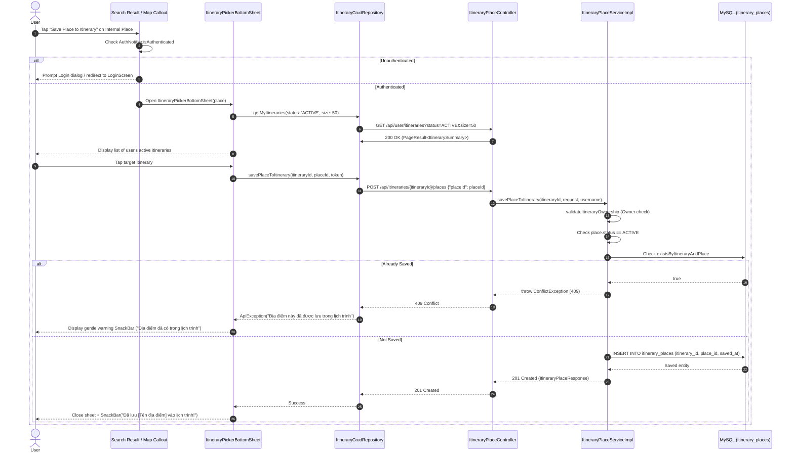
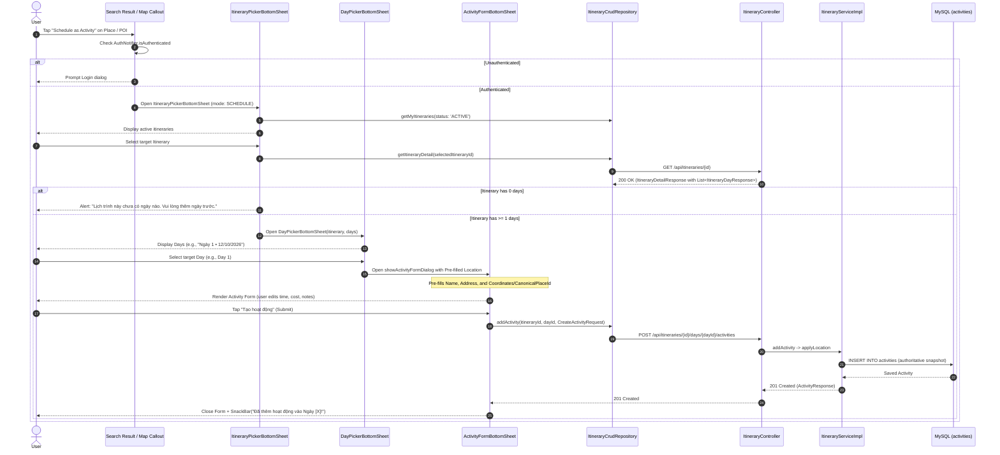

# PHASE 6A — EXPLORE-TO-ITINERARY INTEGRATION
## TECHNICAL DESIGN & IMPLEMENTATION PLAN

**Project:** Travel Planner Community  
**Phase:** Phase 6A — Explore-to-Itinerary Integration  
**Mode:** Architecture Audit & Technical Design Only (STRICTLY NO COMMIT, NO PUSH, NO BUSINESS CODE MODIFICATIONS)  
**Parent Phase:** Phase 6 — Post-Clone Platform Evolution  
**Author:** Senior Software Architect / AI Technical Lead  
**Audit Date:** 2026-11-12  
**Target Repository:** `Travel_Planner`  
**Git Branch:** `develop` | **HEAD:** `f997f34` (`feat: implement rollback tests`)  
**Git Status:** Working Tree Clean (Verified)  

---

## 1. EXECUTIVE SUMMARY

The objective of **Phase 6A (Explore-to-Itinerary Integration)** is to connect place discovery with trip authoring. Today, users can discover places through the unified location search pipeline (`/api/locations/search`) and view places within the canonical catalog (`/api/places`). However, there is no direct user interaction flow enabling a user exploring a place to immediately incorporate it into their personal travel plans.

Phase 6A designs two distinct, decoupled user flows from discovery into itineraries:
1. **Flow A — Save Place to Itinerary:** Associates a selected **Internal Canonical Place** with one of the user's owned itineraries via the itinerary-scoped place pool (`itinerary_places` table; `POST /api/itineraries/{itineraryId}/places`).
2. **Flow B — Schedule as Activity:** Schedules any location—whether an **Internal Canonical Place** or an **External POI** (from TomTom, LocationIQ, or manual pin)—into a specific day (`ItineraryDay`) of an owned itinerary as an `Activity` with an authoritative location snapshot (`POST /api/itineraries/{itineraryId}/days/{dayId}/activities`).

### Key Audit Findings:
- **Zero Backend Schema Changes Required `[VERIFIED]`:** All required database entities (`itineraries`, `itinerary_days`, `activities`, `places`, `itinerary_places`) and REST APIs are already implemented, tested, and operational in production code.
- **Strict Separation of Internal Place vs. External POI `[VERIFIED]`:** Flow A strictly accepts internal canonical places (`places.place_id`) because `itinerary_places` enforces a foreign key constraint to `places(place_id)`. External transient POIs cannot be saved to `itinerary_places` without administrative catalog promotion (prohibited by business policy). In contrast, Flow B supports both internal places and external POIs by persisting an authoritative `Activity` location snapshot.
- **Backend `applyLocation` Conflict Constraint `[VERIFIED]`:** `ItineraryServiceImpl.applyLocation` strictly forbids sending both `canonicalPlaceId` and custom `(latitude, longitude)` in the same request (throws HTTP 400 `BadRequestException`). Client payloads must adhere to this invariant.
- **Frontend Delta `[PROPOSED]`:** Mobile requires an `ItineraryPickerBottomSheet` (for selecting owned itineraries), a `DayPickerBottomSheet` (for selecting a day within the chosen itinerary), pre-filled initialization support in `ActivityFormBottomSheet`, and entry points in place search results.

---

## 2. SCOPE AND NON-GOALS

### 2.1. In-Scope for Phase 6A
1. **Flow A (Save Place to Itinerary):**
   - Eligibility check: User must be authenticated and own the target itinerary `[VERIFIED]`.
   - Place validation: Must be an active internal canonical place (`places.place_id`) `[VERIFIED]`.
   - Interaction: Choose destination itinerary from an `ItineraryPickerBottomSheet`.
   - Persistence: Calls `POST /api/itineraries/{itineraryId}/places` (`SavePlaceToItineraryRequest`).
   - Duplicate prevention: Returns HTTP 409 Conflict if already saved; UI displays a gentle informative message.
2. **Flow B (Schedule as Activity):**
   - Step 1: Select owned itinerary via `ItineraryPickerBottomSheet`.
   - Step 2: Select target day via `DayPickerBottomSheet`.
   - Step 3: Open `ActivityFormBottomSheet` pre-filled with place/POI details (name, address, coordinates, or canonical place reference).
   - Step 4: User customizes start/end time, cost, notes, and submits `POST /api/itineraries/{itineraryId}/days/{dayId}/activities`.
3. **Location Search & Discovery Integration:**
   - Add "Add to Itinerary" action sheet trigger on location search results and interactive map callouts.
   - Clear UI differentiation between Internal Places, External POIs, and Administrative Areas.

### 2.2. Non-Goals (Strictly Prohibited in Phase 6A)
- **NO Phase 6B Work:** Do NOT implement Community Feed, social feeds, public activity feeds, follow graphs, or notification systems.
- **NO Automatic POI Promotion:** Do NOT automatically insert external POIs into the `places` table during search, selection, or activity creation `[VERIFIED]`.
- **NO Global Personal Place Bookmarks:** Do NOT create a global `user_saved_places` table. Saved places remain strictly itinerary-scoped (`itinerary_places`).
- **NO Schema Alterations:** Zero DDL migrations. The existing schema completely satisfies all Phase 6A requirements.
- **NO Business Logic Redesign of Explore:** Do NOT restructure the existing `ExploreScreen` itinerary community feeds.
- **NO Web Admin Place Modifications:** Admin Web place management was finalized in Phase 2.1; no changes are required.

---

## 3. CURRENT ARCHITECTURE AUDIT

### 3.1. Entity Relationships and Data Model `[VERIFIED]`

The existing data architecture separates places, itineraries, days, and activities across five core tables:

```
┌─────────────────────────┐          ┌──────────────────────────────────┐
│         places          │          │           itineraries            │
├─────────────────────────┤          ├──────────────────────────────────┤
│ place_id (PK, BIGINT)   │          │ itinerary_id (PK, INT)           │
│ name (VARCHAR 150)      │          │ user_id (FK to users)            │
│ address (VARCHAR 255)   │          │ title (VARCHAR 150)              │
│ latitude, longitude     │          │ total_days (INT)                 │
│ category, status        │          │ visibility (PUBLIC, PRIVATE)     │
│ administrative_area_id  │          │ status (ACTIVE, DELETED)         │
└────────────┬────────────┘          └────────┬─────────────────┬───────┘
             │                                │                 │
             │ 1                              │ 1               │ 1
             │                                │                 │
             │        ┌───────────────────────┘                 │
             │        │ 1:N CASCADE                             │ 1:N CASCADE
             │        ▼                                         ▼
             │ ┌─────────────────────────┐         ┌─────────────────────────┐
             │ │     itinerary_days      │         │    itinerary_places     │
             │ ├─────────────────────────┤         ├─────────────────────────┤
             │ │ day_id (PK, INT)        │         │ id (PK, BIGINT)         │
             │ │ itinerary_id (FK)       │         │ itinerary_id (FK)   ◄───┘
             │ │ day_number (INT)        │         │ place_id (FK)       ◄───┐
             │ │ title, date             │         │ saved_at (DATETIME)     │
             │ └───────────┬─────────────┘         │ UNIQUE(itinerary, place)│
             │             │                       └─────────────────────────┘
             │             │ 1:N CASCADE                                     │
             │             ▼                                                 │
             │ ┌──────────────────────────────────────┐                      │
             │ │              activities              │                      │
             │ ├──────────────────────────────────────┤                      │
             │ │ activity_id (PK, INT)                │                      │
             │ │ day_id (FK)                          │                      │
             └─┼─► canonical_place_id (FK, nullable)  │                      │
               │ location_name (authoritative)        │                      │
               │ location_address (authoritative)     │                      │
               │ custom_location_name (mirror)        │                      │
               │ custom_address (mirror)              │                      │
               │ latitude, longitude                  │                      │
               │ place_id (external provider ID)      │                      │
               │ location_provider (SYSTEM, TOMTOM...)│                      │
               │ start_time, end_time, cost           │                      │
               │ display_order (UNIQUE per day)       │                      │
               └──────────────────────────────────────┘                      │
                                                                             │
               (Pure Association: deleting itinerary_place NEVER affects ────┘
                Activity.canonical_place_id or Activity location snapshot)
```

### 3.2. Verification of Architectural Invariants `[VERIFIED]`
1. **Activity Location Single Source of Truth:** `Activity` stores its own authoritative location snapshot (`location_name`, `location_address`, `latitude`, `longitude`, `place_id`, `location_provider`). `canonical_place_id` is an optional supplementary reference with `ON DELETE SET NULL`.
2. **Itinerary-Scoped Saved Places:** `itinerary_places` represents associative bookmarks. It has no foreign keys to `activities`. Deleting an association from `itinerary_places` does not alter or delete any `Activity` or `Place`.
3. **Lineage Preservation on Clone:** As verified in Phase 5, cloning an itinerary creates independent copies of `itinerary_places` pointing to the same canonical `Place` entities.
4. **Backend `applyLocation` Invariants (`ItineraryServiceImpl.java:1170-1173`):**
   - If `canonicalPlaceId != null`: `latitude` and `longitude` **MUST be null** in the request. The backend automatically snapshots coordinates, name, and address from `Place`.
   - If `canonicalPlaceId == null`: `latitude` and `longitude` must both be provided together alongside `locationName`.
   - Sending both `canonicalPlaceId` and `(latitude, longitude)` causes a validation failure: `throw new BadRequestException("Không thể đồng thời chỉ định địa điểm từ danh mục và tọa độ tùy chỉnh")`.

---

## 4. CURRENT MOBILE UX AUDIT

### 4.1. Where Users Currently Encounter Places `[VERIFIED]`
1. **`LocationPickerSheet` (`lib/features/location/presentation/widgets/location_picker_sheet.dart`):**
   - Opened exclusively from `ActivityFormBottomSheet` when editing an activity's location.
   - Searches `/api/locations/search` through `LocationRepository.searchLocations(query)`.
   - Returns a `CustomLocationResult` (containing name, address, coordinates, placeId, provider).
2. **`_AddPlaceToItinerarySheet` (`lib/features/itinerary/presentation/screens/itinerary_detail_screen.dart:2297`):**
   - Opened from `ItineraryDetailScreen` via the "Thêm địa điểm" button in the "Địa điểm đã lưu" section.
   - Searches canonical places via `_crudRepository.getPlaces(keyword: ...)` (`GET /api/places`).
   - On selection, directly calls `_crudRepository.savePlaceToItinerary(widget.itineraryId, place.placeId)`.
3. **`ActivityFormBottomSheet` (`lib/features/itinerary/presentation/widgets/activity_form_dialog.dart:787`):**
   - Displays existing saved places from the current itinerary as interactive `ActionChip` widgets (`_savedPlaces`).
   - Tapping a chip pre-fills the form with `sp.place.placeId`, `name`, `address`, and coordinates.
4. **`ExploreScreen` (`lib/features/explore/presentation/screens/explore_screen.dart`):**
   - Currently focuses exclusively on public community itineraries.
   - Its search bar (`SearchBarPill`) queries `/api/itineraries` for community itineraries.
   - There is no standalone Place Search tab or Place Details sheet in `ExploreScreen`.

### 4.2. Identification of Mobile UX Gaps `[VERIFIED]`
- **Gap 1: One-Way Interaction:** Users can only save a place to an itinerary while already inside that specific itinerary's detail screen (`ItineraryDetailScreen`).
- **Gap 2: Missing Cross-Itinerary Dispatcher:** When exploring places via `LocationPickerSheet` or search, there is no UI component allowing the user to choose *which* of their itineraries should receive the place.
- **Gap 3: Missing Day Scheduler:** When a user finds an appealing place during search, they cannot directly schedule it as an Activity in a specific itinerary day without manually navigating to that itinerary, adding an activity, and searching for the place a second time.

---

## 5. BACKEND API AND DATABASE AUDIT

### 5.1. Existing Backend Endpoints Verified `[VERIFIED]`

All endpoints required for Phase 6A are fully operational:

| HTTP Method | Endpoint | Controller | Purpose | Auth Required |
| :--- | :--- | :--- | :--- | :---: |
| `GET` | `/api/user/itineraries` | `UserItineraryController` | Fetch authenticated user's owned itineraries (`status=ACTIVE`, pagination) | Yes (`@AuthenticationPrincipal`) |
| `GET` | `/api/itineraries/{id}` | `ItineraryController` | Fetch itinerary detail including full list of days (`List<ItineraryDayResponse>`) | Optional (Ownership enforced for private) |
| `POST` | `/api/itineraries/{itineraryId}/places` | `ItineraryPlaceController` | Save canonical place to itinerary pool (`SavePlaceToItineraryRequest`) | Yes (Owner only) |
| `GET` | `/api/itineraries/{itineraryId}/places/all` | `ItineraryPlaceController` | List all saved places in itinerary | Yes (Owner or public viewer) |
| `DELETE` | `/api/itineraries/{itineraryId}/places/{placeId}` | `ItineraryPlaceController` | Remove saved place association from itinerary | Yes (Owner only) |
| `POST` | `/api/itineraries/{id}/days/{dayId}/activities` | `ItineraryController` | Create new activity with location snapshot | Yes (Owner only) |
| `GET` | `/api/locations/search` | `LocationController` | Unified location search (places, external POIs, admin areas) | No (Rate-limited) |
| `GET` | `/api/places` | `PlaceController` | Search and filter canonical places from catalog | No |

### 5.2. Existing DTOs Verified `[VERIFIED]`
- `SavePlaceToItineraryRequest`: `Long placeId` (Validated `@NotNull`).
- `ItineraryPlaceResponse`: `Long id`, `Integer itineraryId`, `PlaceResponse place`, `LocalDateTime savedAt`.
- `CreateActivityRequest`: `name` (required), `canonicalPlaceId`, `startTime`, `endTime`, `cost`, `locationName`, `locationAddress`, `latitude`, `longitude`, `placeId`, `locationProvider`, `imageUrl`.
- `ItinerarySummaryResponse`: `itineraryId`, `title`, `location`, `totalDays`, `coverImage`, `visibility`, `status`.
- `ItineraryDetailResponse`: Contains `List<ItineraryDayResponse> days`.
- `ItineraryDayResponse`: `dayId`, `dayNumber`, `title`, `date`.

---

## 6. INTERNAL PLACE VS EXTERNAL POI

A fundamental architectural requirement of the Travel Planner platform is the strict separation between internal catalog places and external transient search results.

```
┌────────────────────────────────────────────────────────────────────────────┐
│                       LocationSearchResult Model                           │
├────────────────────────────────────────────────────────────────────────────┤
│ placeId: String                                                            │
│ name: String                                                               │
│ formattedAddress: String                                                   │
│ latitude: Double?, longitude: Double?                                      │
│ category: String?, type: String?                                           │
│ provider: String? ("SYSTEM", "TOMTOM", "LOCATION_IQ", "HERE")              │
│ isLocalityFallback: Boolean                                                │
└────────────────────────────────────────────────────────────────────────────┘
         │                                       │
         ▼                                       ▼
┌────────────────────────────────┐      ┌────────────────────────────────┐
│     INTERNAL CANONICAL PLACE   │      │          EXTERNAL POI          │
├────────────────────────────────┤      ├────────────────────────────────┤
│ Condition:                     │      │ Condition:                     │
│  • provider == 'SYSTEM'        │      │  • provider != 'SYSTEM'        │
│  • type == 'place'             │      │  • or no 'place_' prefix       │
│  • placeId starts with 'place_'│      │                                │
│ Internal ID:                   │      │ Provider ID:                   │
│  • Parsed int from placeId     │      │  • External string placeId     │
├────────────────────────────────┤      ├────────────────────────────────┤
│ FLOW A (Save to Itinerary):    │      │ FLOW A (Save to Itinerary):    │
│  ✅ SUPPORTED                  │      │  ❌ NOT SUPPORTED              │
│  (Persists to itinerary_places)│      │  (Disabled; prompt user)       │
├────────────────────────────────┤      ├────────────────────────────────┤
│ FLOW B (Schedule Activity):    │      │ FLOW B (Schedule Activity):    │
│  ✅ SUPPORTED                  │      │  ✅ SUPPORTED                  │
│  (canonicalPlaceId = place.id, │      │  (canonicalPlaceId = null,     │
│   coordinates = null)          │      │   lat/lon = poi coordinates)   │
└────────────────────────────────┘      └────────────────────────────────┘
```

### 6.1. Administrative Areas Handling `[VERIFIED]`
If `provider == 'SYSTEM'` and `type == 'administrative'` (`placeId` starts with `admin_`), this represents an administrative boundary (e.g., "Quận 1, TP. Hồ Chí Minh", `isLocalityFallback == true`).
- **Policy:** Administrative areas are neither POIs nor venues. They **CANNOT** be saved to `itinerary_places` and **CANNOT** be scheduled as Activities.
- **UX Treatment:** In search result lists, administrative areas display an `administrative` badge and omit the "Add to Itinerary" action (or tapping centers the map camera on the area).

---

## 7. FLOW A — SAVE PLACE TO ITINERARY (TECHNICAL DESIGN)

### 7.1. Detailed Sequence Flow



### 7.2. Edge Cases and Handling Matrix `[VERIFIED]`
- **Unauthenticated User:** Action intercepts immediately before opening bottom sheet. Shows snackbar: "Vui lòng đăng nhập để lưu địa điểm vào lịch trình" with action button "Đăng nhập".
- **User Has No Itineraries:** `ItineraryPickerBottomSheet` displays `AppEmptyState` with icon `Icons.map_outlined`, title "Bạn chưa có lịch trình nào", and button "Tạo lịch trình mới" (navigates to `CreateItineraryScreen`).
- **Target Itinerary is PRIVATE:** Permitted! The owner has full write rights to their own private itineraries.
- **Target Itinerary is Deleted:** Filtered out by `status=ACTIVE` query parameter. If concurrency race occurs, backend returns HTTP 404 `ResourceNotFoundException`.
- **Target Place Inactive/Hidden:** Backend returns HTTP 400 `BadRequestException("Địa điểm không hợp lệ hoặc đã bị ẩn")`.
- **Rapid Multi-Tapping:** `ItineraryPickerBottomSheet` locks interaction via `_isSubmitting` flag and displays a spinner on the selected item, preventing duplicate concurrent HTTP requests.

---

## 8. FLOW B — SCHEDULE AS ACTIVITY (TECHNICAL DESIGN)

### 8.1. Detailed Sequence Flow



### 8.2. Payload Mapping Rules: Internal Place vs External POI `[VERIFIED]`

Adhering strictly to `applyLocation` rules in `ItineraryServiceImpl.java:1170-1230`:

| Field in `CreateActivityRequest` | When Scheduling an **Internal Canonical Place** | When Scheduling an **External POI / Custom Pin** |
| :--- | :--- | :--- |
| `name` | `place.name` (pre-filled, user-editable) | `poi.name` (pre-filled, user-editable) |
| `canonicalPlaceId` | **`place.placeId`** (e.g. `15`) | **`null`** |
| `latitude` | **`null`** (Backend auto-snapshots from Place) | **`poi.latitude`** (e.g. `10.7725`) |
| `longitude` | **`null`** (Backend auto-snapshots from Place) | **`poi.longitude`** (e.g. `106.6980`) |
| `locationName` | `place.name` | `poi.name` |
| `locationAddress` | `place.address` | `poi.formattedAddress` |
| `placeId` | `"place_" + place.placeId` or null | `poi.placeId` (external string ID) |
| `locationProvider` | `"PLACE_CATALOG"` or `"SYSTEM"` | `poi.provider` (e.g. `"TOMTOM"`, `"LOCATION_IQ"`) |

> [!CRITICAL]
> If `canonicalPlaceId` is non-null, `latitude` and `longitude` MUST BE NULL in `CreateActivityRequest`. If both are sent, the backend throws HTTP 400 `BadRequestException`. Client code MUST strictly follow this mapping rule!

---

## 9. PROPOSED UX/UI DESIGN

### 9.1. Interaction Entry Points
To preserve existing clean navigation without cluttering the UI, two natural entry points are proposed:
1. **Location Search Result List Item:**
   - In location autocomplete / search result tiles (such as in `LocationPickerSheet` or search results), each POI item features an overflow icon (`Icons.more_vert`) or direct action icon button (`Icons.playlist_add` or `Icons.bookmark_add_outlined`).
   - Tapping opens an **Action Bottom Sheet** with two clear options:
     - 📌 **"Lưu vào danh sách địa điểm của chuyến đi"** (Active for internal places; disabled with explanation for external POIs).
     - 🗓️ **"Lên lịch vào ngày cụ thể của chuyến đi"** (Active for all locations with coordinates).
2. **Interactive Map Callout Card:**
   - When a user taps a pin on the map, the bottom preview card displays the place name, address, category, and two primary action buttons:
     - `OutlinedButton.icon(icon: Icons.bookmark_add_outlined, label: "Lưu địa điểm")`
     - `FilledButton.icon(icon: Icons.calendar_today_outlined, label: "Lên lịch trình")`

### 9.2. Component 1: `ItineraryPickerBottomSheet`
- **Header:** Title "Chọn lịch trình của bạn", subtitle "Chọn chuyến đi bạn muốn thêm địa điểm", close icon button.
- **Search/Filter:** Subtle search input if user has $>5$ itineraries.
- **List Item (`ItineraryPickerTile`):**
  - Left: 48x48 rounded cover image or destination placeholder.
  - Center: Itinerary title (bold), destination name, badge for `totalDays` (e.g. "3 ngày"), and visibility pill (`PUBLIC` / `PRIVATE`).
  - Right: Arrow forward (`Icons.chevron_right`) or checkmark.
- **Empty State:** Clean illustration with message "Bạn chưa có lịch trình nào đang hoạt động" and button "Tạo lịch trình mới".
- **Loading State:** 3 shimmer skeleton cards matching existing design system (`AppColors.surfaceSoft`).

### 9.3. Component 2: `DayPickerBottomSheet`
- **Header:** Title "Chọn ngày hoạt động", subtitle showing itinerary title.
- **Content:** Vertical list of days in the itinerary:
  - Card for each day: "Ngày 1 • Khám phá trung tâm" (Date: `12/10/2026`, Activity count: `3 hoạt động`).
- **Footer/Empty:** If the itinerary has 0 days, displays an informational banner: "Lịch trình này chưa có ngày nào. Vui lòng mở chi tiết lịch trình để thêm ngày."

### 9.4. Feedback & Notifications
- **Success:** Lightweight SnackBar with `AppColors.primary` background and checkmark icon.
- **Conflict (Already Saved):** SnackBar with `AppColors.textPrimary` background: "Địa điểm này đã được lưu trong lịch trình từ trước."
- **Network Failure:** SnackBar with `AppColors.error` background and "Thử lại" action button.

---

## 10. BACKEND IMPLEMENTATION PLAN

### 10.1. Assessment of Backend Work
- **Core Endpoints:** **0 changes required `[VERIFIED]`**.
- All needed endpoints (`POST /api/itineraries/{id}/places`, `POST /api/itineraries/{id}/days/{dayId}/activities`, `GET /api/user/itineraries`, `GET /api/itineraries/{id}`) are already in place and covered by unit/integration tests.
- **Optional API Enhancement (Evaluated & Recommended as NON-BLOCKING):**
  - Currently, to fetch days of an itinerary, the client calls `GET /api/itineraries/{id}` which returns the full `ItineraryDetailResponse` (including activities).
  - For itineraries with dozens of activities, this transfers unnecessary data.
  - *Recommendation:* Reusing `GET /api/itineraries/{id}` is completely functional and safe for Phase 6A. If optimization is desired in a future refactor, a lightweight endpoint `GET /api/itineraries/{id}/days-summary` returning only `dayId`, `dayNumber`, `title`, and `date` can be added without breaking existing contracts.

---

## 11. FLUTTER MOBILE IMPLEMENTATION PLAN

### 11.1. New Widgets to Create
1. `Travel_Planner/frontend/mobile/lib/features/itinerary/presentation/widgets/itinerary_picker_bottom_sheet.dart`:
   - Reusable modal bottom sheet supporting both Mode A (`SAVE_PLACE`) and Mode B (`SCHEDULE_ACTIVITY`).
   - Manages pagination or list retrieval via `ItineraryCrudRepository.getMyItineraries`.
   - Handles empty states, loading shimmer, error retries, and authentication checks.
2. `Travel_Planner/frontend/mobile/lib/features/itinerary/presentation/widgets/day_picker_bottom_sheet.dart`:
   - Modal bottom sheet displaying days of the selected itinerary.
   - Fetches detail via `ItineraryCrudRepository.getItineraryDetail`.

### 11.2. Existing Widgets to Update
1. `ActivityFormBottomSheet` in `Travel_Planner/frontend/mobile/lib/features/itinerary/presentation/widgets/activity_form_dialog.dart`:
   - Add optional initial location parameters to `showActivityFormDialog`:
     ```dart
     int? initialCanonicalPlaceId,
     String? initialLocationName,
     String? initialLocationAddress,
     double? initialLatitude,
     double? initialLongitude,
     String? initialPlaceId,
     String? initialLocationProvider,
     ```
   - In `initState`, if these initial parameters are present and `initialActivity == null`, populate `_canonicalPlaceId`, `_locationName`, `_locationAddress`, `_latitude`, `_longitude`, `_placeId`, `_locationProvider`, and default `_nameController.text` to `initialLocationName`.
2. `LocationPickerSheet` in `Travel_Planner/frontend/mobile/lib/features/location/presentation/widgets/location_picker_sheet.dart`:
   - Add action buttons on selected search result tiles or selected map pins to trigger the `ItineraryPickerBottomSheet`.

---

## 12. API / DTO CHANGES

### 12.1. Backend API / DTO Changes
- **Backend Schema Changes:** **NONE `[VERIFIED]`**.
- **Backend DTO Changes:** **NONE `[VERIFIED]`**.
- Existing `SavePlaceToItineraryRequest` and `CreateActivityRequest` already support all required fields.

### 12.2. Frontend Dart Model Changes
- In `CreateActivityRequest.toJson()`:
  - Ensure that if `canonicalPlaceId != null`, `latitude` and `longitude` are omitted from the JSON map `[VERIFIED]`. (Already verified in `create_activity_request.dart:60-61`: `if (latitude != null) 'latitude': latitude`).
  - Mobile client caller simply ensures `latitude: null, longitude: null` when `canonicalPlaceId` is provided.

---

## 13. DATABASE IMPACT

- **DDL Changes:** 0 migrations.
- **Indexes:**
  - `itinerary_places`: Existing unique index `uk_itinerary_place` on `(itinerary_id, place_id)` guarantees duplicate prevention.
  - `activities`: Existing index on `day_id` and unique index `uk_activity_day_order` on `(day_id, display_order)`.
  - `itineraries`: Existing index on `user_id`.
- **Database Invariants:** All existing database invariants (12 quarantined Bắc Ninh units, 4 NULL administrative area places, 121 activities, 24 places, 28 itineraries) remain 100% untouched.

---

## 14. SECURITY AND VALIDATION

1. **Authentication:**
   - Both flows require a valid JWT Bearer token.
   - Unauthenticated users are redirected to login prior to any network mutation.
2. **Authorization & Ownership Enforcement `[VERIFIED]`:**
   - `ItineraryPlaceServiceImpl.validateItineraryOwnership`: Verifies `currentUsername` matches `itinerary.getUser().getUsername()`. Non-owners receive HTTP 403 Forbidden.
   - `ItineraryServiceImpl.findOwnedItinerary`: Verifies `currentUsername` owns the itinerary before creating an activity. Non-owners receive HTTP 403 Forbidden.
3. **Input Validation:**
   - `name`: Required, max 150 characters.
   - Time validation: `endTime` must not precede `startTime`.
   - Coordinate validation: Latitude within $[-90, 90]$, Longitude within $[-180, 180]$.
   - Mutual exclusivity: `canonicalPlaceId` and manual coordinates cannot both be present.

---

## 15. PERFORMANCE CONSIDERATIONS

1. **Itinerary Picker Query Performance:**
   - `GET /api/user/itineraries?status=ACTIVE&size=50`: Uses `user_id` index. As verified during Session 58 audit, `getMyItineraries` maps the logged-in user entity (already in persistence context) and queries batch ratings with a single `IN` query. Zero N+1 query overhead.
2. **Day Retrieval Query Performance:**
   - `GET /api/itineraries/{id}`: Single primary key lookup with indexed child day lookups. Response time is sub-20ms in MySQL.
3. **Client-Side Debouncing:**
   - Location search autocomplete remains debounced at 400ms to protect external provider rate limits.
   - Double-tap submission prevention on `ItineraryPickerBottomSheet` avoids duplicate POST requests.

---

## 16. TEST PLAN

### 16.1. Backend Integration Tests (JUnit 5 + MockMvc)
To be added to `ItineraryPlaceTest.java` and `ItineraryActivityTest.java`:
1. `testSavePlace_Owner_Success`: Owner saves active canonical place -> HTTP 201 Created.
2. `testSavePlace_Duplicate_ThrowsConflict`: Saving same place twice -> HTTP 409 Conflict with clear message.
3. `testSavePlace_NonOwner_Forbidden`: Non-owner attempts to save place to someone else's itinerary -> HTTP 403 Forbidden.
4. `testSavePlace_PrivateItinerary_OwnerSuccess`: Owner can save place into their own PRIVATE itinerary -> HTTP 201 Created.
5. `testSavePlace_PlaceNotFound`: Non-existent `placeId` -> HTTP 404 Not Found.
6. `testSavePlace_PlaceInactive_BadRequest`: Inactive place -> HTTP 400 Bad Request.
7. `testCreateActivity_WithCanonicalPlace_Success`: Activity with `canonicalPlaceId`, null coords -> HTTP 201 Created, snapshot copied from Place.
8. `testCreateActivity_WithExternalPoi_Success`: Activity with coords, name, external provider, null `canonicalPlaceId` -> HTTP 201 Created.
9. `testCreateActivity_ConflictingPlaceAndCoords_ThrowsBadRequest`: Passing both `canonicalPlaceId` and `latitude`/`longitude` -> HTTP 400 Bad Request.
10. `testCreateActivity_DayNotBelongingToItinerary_ThrowsNotFound`: Mismatched dayId and itineraryId -> HTTP 404 Not Found.

### 16.2. Flutter Mobile Widget & Integration Tests
1. `testWidgets_ItineraryPickerBottomSheet_RendersItinerariesList`: Verifies list of user's active itineraries renders properly.
2. `testWidgets_ItineraryPickerBottomSheet_EmptyState`: Verifies empty state when user has 0 itineraries.
3. `testWidgets_ItineraryPickerBottomSheet_CallsSaveApi`: Verifies tapping itinerary dispatches `savePlaceToItinerary`.
4. `testWidgets_ItineraryPickerBottomSheet_HandlesConflictGracefully`: Verifies 409 response shows gentle warning snackbar.
5. `testWidgets_DayPickerBottomSheet_RendersDays`: Verifies days list for selected itinerary.
6. `testWidgets_ActivityForm_InitializesWithPreFilledLocation`: Verifies `ActivityFormBottomSheet` correctly pre-populates place name, address, and coordinates/canonicalPlaceId.
7. `testWidgets_ScheduleFlow_PreservesLocationSnapshot`: Verifies location snapshot is faithfully included in `CreateActivityRequest`.
8. `testWidgets_UnauthenticatedUser_PromptsLogin`: Verifies unauthenticated tap triggers login prompt.

---

## 17. REGRESSION RISKS & MITIGATION

| Risk | Probability | Severity | Mitigation Strategy |
| :--- | :---: | :---: | :--- |
| **Accidental Backend Coordination Conflict:** Client sends both `canonicalPlaceId` and `latitude`/`longitude`. | Medium | High | Enforce strict mapping in Flutter model: if `canonicalPlaceId != null`, explicitly set `latitude = null` and `longitude = null`. Covered by unit test. |
| **External POI Inadvertently Promoted:** Attempting to save external POI to `itinerary_places`. | Low | Critical | UI disables "Save to Itinerary" button for non-system places and displays tooltip: "Địa điểm ngoài danh mục chính thức chỉ có thể thêm trực tiếp vào hoạt động theo ngày". |
| **Accidental Overwrite of Activity Snapshot:** Editing activity modifies snapshot coordinates when catalog changes. | Low | High | Existing logic in `applyLocation` (Case B) already guards against this by preserving existing coordinates if `isUpdate && isSamePlace`. |
| **Broken Baseline Tests:** 3 Mobile baseline mock failures accidentally modified. | Low | Medium | Strict policy: Do not touch `explore_test.dart` or `rating_ui_layout_test.dart` baseline mocks. |

---

## 18. IMPLEMENTATION PHASES & ESTIMATED FILE CHANGES

### Phase 6A.1 — Flutter Mobile Core Components (Estimated 3 Files)
1. `lib/features/itinerary/presentation/widgets/itinerary_picker_bottom_sheet.dart` (New file ~220 lines).
2. `lib/features/itinerary/presentation/widgets/day_picker_bottom_sheet.dart` (New file ~140 lines).
3. `lib/features/itinerary/presentation/widgets/activity_form_dialog.dart` (Update ~40 lines to accept initial location parameters).

### Phase 6A.2 — Entry Point Wiring & UI Integration (Estimated 2 Files)
1. `lib/features/location/presentation/widgets/location_picker_sheet.dart` (Update ~60 lines to add "Add to Itinerary" action buttons on selected POIs/pins).
2. `lib/features/itinerary/presentation/screens/itinerary_detail_screen.dart` (Minor refactoring to share `ItineraryPickerBottomSheet` if needed).

### Phase 6A.3 — Verification & Automated Testing (Estimated 2 Test Files)
1. `backend/src/test/java/Travel_Planner/Travel_Planner/ItineraryPlaceTest.java` (Add 3 new test cases).
2. `frontend/mobile/test/features/itinerary/itinerary_picker_test.dart` (New test file ~180 lines).

---

## 19. OPEN QUESTIONS / DECISIONS REQUIRED

1. **Decision 1: Entry Point in `ExploreScreen` Search Bar**
   - *Question:* Should the search bar on `ExploreScreen` support a tab/toggle to switch between searching "Lịch trình" (Community Itineraries) and "Địa điểm" (Places), OR should place search remain accessible via Map/Location Picker?
   - *Recommendation:* Keep `ExploreScreen` search bar focused on itineraries for now to avoid altering Explore semantics. Add a floating map action button or "Khám phá địa điểm" button that launches the location discovery view.
2. **Decision 2: Adding a New Day On-the-Fly During Flow B**
   - *Question:* If an itinerary currently has 0 days, should Flow B allow the user to immediately "Thêm ngày mới" within the picker sheet?
   - *Recommendation:* To maintain strict scope and avoid nested modal complexity, if an itinerary has 0 days, prompt the user with a dialog: "Lịch trình này chưa có ngày nào. Vui lòng mở chi tiết lịch trình để thêm ngày."
3. **Decision 3: Handling External POI in Flow A**
   - *Question:* Should the "Lưu vào chuyến đi" option be completely hidden for External POIs, or shown as disabled with an explanatory tooltip/dialog?
   - *Recommendation:* Show as disabled or show an explanatory dialog: "Địa điểm từ bản đồ bên ngoài chưa có trong danh mục chính thức. Bạn có thể lên lịch trực tiếp vào ngày hoạt động." This educates the user on why saving to place pool is restricted.

---

## 20. ACCEPTANCE CRITERIA FOR PHASE 6A IMPLEMENTATION

- [ ] Flow A: An authenticated owner can select an Internal Canonical Place from search/map and save it to any of their active itineraries.
- [ ] Flow A: Saving an already-saved place returns a polite duplicate notification without error crash.
- [ ] Flow A: External POIs cannot be saved to `itinerary_places`.
- [ ] Flow B: An authenticated owner can select any place (Internal or External POI) and schedule it into any existing day of their owned itineraries.
- [ ] Flow B: `ActivityFormBottomSheet` opens pre-filled with place name, address, and coordinates/canonicalPlaceId.
- [ ] Flow B: If `canonicalPlaceId` is present, coordinates are omitted from the request payload to prevent backend validation conflict.
- [ ] Flow B: Authoritative location snapshot is preserved in `Activity`.
- [ ] Neither action automatically triggers the other (Flow A and Flow B remain strictly independent).
- [ ] Zero database migrations or schema alterations.
- [ ] Full test suite passes across Backend (453 PASS), Mobile (374 PASS + 3 confirmed baseline failures), Web (33 PASS).
- [ ] Strict compliance with Git policy: NO COMMIT, NO PUSH.

