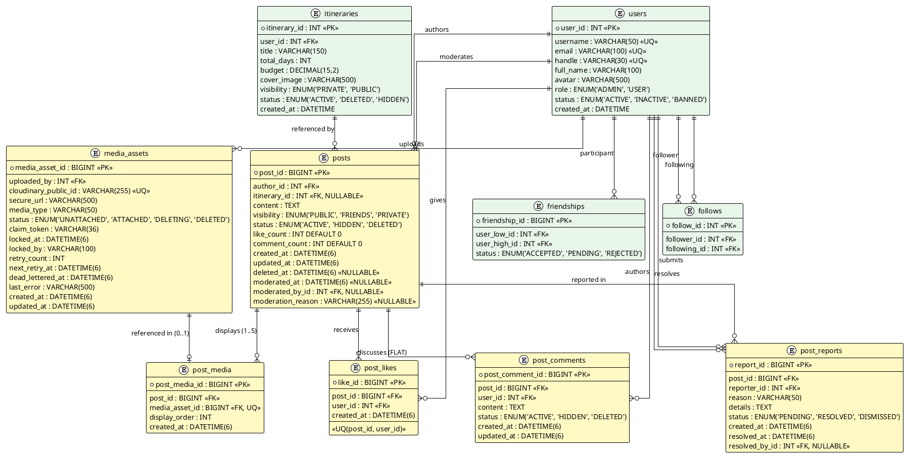

# PHASE 6B.0 — DELIVERABLE 03: COMMUNITY FEED DATA ARCHITECTURE (SESSION 71 PATCH)

**Project:** Travel Planner  
**Date:** 2026-11-12  
**Status:** FINAL REVISED SPECIFICATION — SKIP LOCKED CLAIM FLOW, LIFECYCLE VS LEASE STATE & PURGE INVARIANTS  
**Git Policy Compliance:** STRICTLY NO COMMIT, NO PUSH

---

## 1. Content Model Design: Independent `Post` Entity (ADR-6B-01)

A dedicated `posts` table models user social updates, decoupled from the itinerary catalog.

### 1.1. Post Lifecycle and State Transitions

```
                    ┌─────────────────────────┐
                    │      [Creation]         │
                    │   Author creates Post   │
                    └────────────┬────────────┘
                                 │
                                 ▼
                         ┌───────────────┐
         ┌───────────────┤    ACTIVE     ├───────────────┐
         │               └───────┬───────┘               │
         │                       │                       │
         ▼ (Owner Delete)        ▼ (Admin Moderation)    ▼ (Owner Update)
  ┌───────────────┐      ┌───────────────┐         [updated_at]
  │    DELETED    │      │    HIDDEN     │          State remains
  └───────────────┘      └───────┬───────┘             ACTIVE
         │                       │
         │ (Restore)             ▼ (Admin Restore)
         │               ┌───────────────┐
         └──────────────►│    ACTIVE     │
                         └───────────────┘
```

- **`ACTIVE`:** Normal state. Post is queryable by authorized viewers based on `visibility` and author status.
- **`HIDDEN`:** Moderated by admin due to community violation. Excluded from all public feeds. Direct access returns `404 Not Found` to regular users. Media assets remain `ATTACHED` to allow restoration.
- **`DELETED` (Soft Delete):** Soft-deleted by author or admin. Retained in DB with `deleted_at` timestamp for audit and restoration. Excluded from all feeds. Direct access returns `404 Not Found`. Media assets remain `ATTACHED`.
- **Audit Columns on `posts`:**
  - `created_at` (DATETIME(6) NOT NULL): Timestamp when post was first created.
  - `updated_at` (DATETIME(6) NOT NULL): Timestamp when author edited content or visibility.
  - `deleted_at` (DATETIME(6) NULLABLE): Set when author or admin soft-deletes post.
  - `moderated_at` (DATETIME(6) NULLABLE): Set when admin changes status to `HIDDEN` or restores to `ACTIVE`.
  - `moderated_by_id` (INT NULLABLE FK to `users.user_id`): Admin account performing moderation.
  - `moderation_reason` (VARCHAR(255) NULLABLE): Text rationale recorded by admin for audit.

---

## 2. Media Asset Architecture & Relational Model (Committed Design: Option B)

### 2.1. Architectural Selection: Option B (Association Table `post_media`)
To eliminate relational redundancy where both `media_assets.post_id` and `post_media.media_asset_id` existed, the system commits to **Option B (Association Table)**:
- **`media_assets` Table:** Pure media catalog recording upload ownership, Cloudinary storage details, claim tokens, retry state, and lease locks. Contains **ZERO** post foreign keys (`post_id` removed).
- **`post_media` Table:** Relational association entity binding a post to its media assets, managing display sequence (`display_order`), and enforcing attachment constraints.
- **Single Attachment Invariant:** A unique constraint on `post_media(media_asset_id)` guarantees the MVP invariant that each media asset can belong to at most **ONE** post (`1 asset = 1 post`).

```
┌─────────────────────────┐               ┌─────────────────────────┐               ┌─────────────────────────┐
│          posts          │ 1           * │       post_media        │ *           1 │      media_assets       │
├─────────────────────────┤───────────────┤─────────────────────────┤───────────────┤─────────────────────────┤
│ post_id (PK)            │               │ post_media_id (PK)      │               │ media_asset_id (PK)     │
│ author_id (FK)          │               │ post_id (FK)            │               │ uploaded_by (FK)        │
│ content                 │               │ media_asset_id (FK, UQ) │               │ cloudinary_public_id(UQ)│
│ visibility              │               │ display_order           │               │ secure_url              │
│ status                  │               │ created_at              │               │ status                  │
│ ...                     │               │                         │               │ claim_token, retry...   │
└─────────────────────────┘               └─────────────────────────┘               └─────────────────────────┘
```

### 2.2. DDL Specification

```sql
-- 1. Media Assets Catalog (Upload Tracking, Remote Lifecycle & Worker Lease Claims)
CREATE TABLE media_assets (
    media_asset_id BIGINT AUTO_INCREMENT PRIMARY KEY,
    uploaded_by INT NOT NULL,
    cloudinary_public_id VARCHAR(255) NOT NULL,
    secure_url VARCHAR(500) NOT NULL,
    media_type VARCHAR(50) NOT NULL DEFAULT 'IMAGE',
    status ENUM('UNATTACHED', 'ATTACHED', 'DELETING', 'DELETED') NOT NULL DEFAULT 'UNATTACHED',
    claim_token VARCHAR(36) NULL,
    locked_at DATETIME(6) NULL,
    locked_by VARCHAR(100) NULL,
    retry_count INT NOT NULL DEFAULT 0,
    next_retry_at DATETIME(6) NULL,
    dead_lettered_at DATETIME(6) NULL,
    last_error VARCHAR(500) NULL,
    created_at DATETIME(6) NOT NULL,
    updated_at DATETIME(6) NOT NULL,
    CONSTRAINT fk_media_assets_user FOREIGN KEY (uploaded_by) REFERENCES users(user_id),
    CONSTRAINT uk_media_assets_public_id UNIQUE (cloudinary_public_id),
    INDEX idx_media_assets_owner_status (uploaded_by, status, created_at),
    INDEX idx_media_assets_cleanup (status, dead_lettered_at, next_retry_at, locked_at)
) ENGINE=InnoDB DEFAULT CHARSET=utf8mb4 COLLATE=utf8mb4_unicode_ci;

-- 2. Post Media Association Table (Attachment & Display Ordering)
CREATE TABLE post_media (
    post_media_id BIGINT AUTO_INCREMENT PRIMARY KEY,
    post_id BIGINT NOT NULL,
    media_asset_id BIGINT NOT NULL,
    display_order INT NOT NULL DEFAULT 0,
    created_at DATETIME(6) NOT NULL,
    CONSTRAINT fk_post_media_post FOREIGN KEY (post_id) REFERENCES posts(post_id) ON DELETE CASCADE,
    CONSTRAINT fk_post_media_asset FOREIGN KEY (media_asset_id) REFERENCES media_assets(media_asset_id) ON DELETE RESTRICT,
    CONSTRAINT uk_post_media_asset UNIQUE (media_asset_id),
    INDEX idx_post_media_post_order (post_id, display_order ASC)
) ENGINE=InnoDB DEFAULT CHARSET=utf8mb4 COLLATE=utf8mb4_unicode_ci;
```

### 2.3. Rationale for Internal Identifiers (`mediaAssetIds`) over Raw URLs
The API strictly uses `mediaAssetIds: List<Long>` instead of raw URLs (`imageUrls`):
1. **B+Tree Clustered Primary Key Lookup:** Lookups by `media_asset_id` utilize MySQL InnoDB's clustered B+Tree index (traversing typically 3–4 tree levels, giving $O(\log n)$ disk/buffer pool lookup complexity). This avoids table scans or secondary B-Tree traversal across variable-length `VARCHAR(500)` URLs.
2. **Elimination of Canonicalization Vulnerabilities:** URLs are subject to protocol variance (`http` vs `https`), URL percent-encoding (`%20` vs `+`), query parameters, and CDN dynamic image transformations (`/w_500,q_auto/`). Relying on raw string equality causes subtle verification failures or cache mismatches.
3. **Prevention of URL Tampering & Injection:** Accepting internal IDs prevents malicious actors from submitting URLs belonging to third parties or arbitrary web resources.
4. **Distinction: Anti-Enumeration vs Authorization vs SQL Injection (Issue 6):**
   - *Anti-Enumeration:* Returning `404 Not Found` for unowned assets conceals resource existence, preventing ID harvesting.
   - *Authorization:* Server verifies that `ma.uploadedBy.userId == currentUserId`. Anti-enumeration is a resource concealment policy; it does NOT replace authorization.
   - *SQL Injection Defense:* Passing `mediaAssetIds` does NOT automatically prevent SQL injection by itself. SQL injection protection relies strictly on parameter binding (`PreparedStatement`, Spring Data `@Param`) and strong Java typing (`List<Long>`).
5. **Domain Decoupling:** Decouples domain entities and relational foreign keys from physical CDN paths.

---

## 3. Media Lifecycle, Concurrency & Side-Effect Boundaries

### 3.1. Phân biệt Rạch ròi giữa Asset Lifecycle State và Worker Claim/Lease State (Issue 2)
Trong kiến trúc quản lý media, hệ thống phân định rõ hai khái niệm hoàn toàn độc lập:

#### A. Asset Lifecycle State (Trạng thái Vòng đời Nghiệp vụ)
Biểu diễn vòng đời dữ liệu của một Media Asset, được lưu trữ trong cột enum `media_assets.status` với 4 trạng thái bất biến:
- **`UNATTACHED`:** Ảnh mới tải lên qua API `POST /api/media/images`, thuộc quyền sở hữu của uploader, chưa gắn vào bài viết nào.
- **`ATTACHED`:** Ảnh đã được gắn thành công vào một bài viết công đồng (`posts`) thông qua bảng liên kết `post_media`.
- **`DELETING`:** Ảnh đã được đánh dấu để xóa khỏi hệ thống (do orphan quá 24h hoặc do bài viết bị hard-purge).
- **`DELETED`:** Ảnh đã được xóa thành công trên dịch vụ Cloudinary từ xa (hoặc nhận kết quả idempotent "not found").

#### B. Worker Claim / Lease State (Metadata Quyền Xử lý và Vận hành)
Biểu diễn quyền sở hữu xử lý tạm thời của tiến trình Cleanup Worker, được quản lý qua các cột metadata vận hành trên bảng `media_assets`:
- `claim_token` (VARCHAR(36) NULL): UUID v4 duy nhất đại diện cho quyền xử lý của một batch worker cụ thể.
- `locked_at` (DATETIME(6) NULL): Thời điểm worker bắt đầu chiếm quyền xử lý (lease window = 10 phút).
- `locked_by` (VARCHAR(100) NULL): Định danh của instance worker đang giữ quyền xử lý.
- `next_retry_at` (DATETIME(6) NULL): Thời điểm sớm nhất cho phép worker thử lại sau lỗi tạm thời (exponential backoff).
- `retry_count` (INT NOT NULL DEFAULT 0): Số lần đã thử lại tự động khi gặp lỗi (tối đa 5 lần).
- `dead_lettered_at` (DATETIME(6) NULL): Thời điểm chuyển sang hàng đợi dead-letter khi kiệt sức retry hoặc gặp lỗi dữ liệu vĩnh viễn.
- `last_error` (VARCHAR(500) NULL): Chi tiết thông báo lỗi kỹ thuật gần nhất phục vụ kiểm tra vận hành.

> [!IMPORTANT]
> **Quy tắc Phân định Rạch ròi:**
> 1. `DELETING` **KHÔNG ĐỒNG NGHĨA** với việc asset đang được một worker cụ thể xử lý. Một asset mang `status = 'DELETING'` có thể:
>    - Mới chuyển trạng thái và đang chờ worker quét (`locked_at IS NULL`).
>    - Đang được một worker xử lý tích cực (`locked_at >= NOW() - INTERVAL 10 MINUTE`).
>    - Bị treo và hết hạn lease, đang chờ worker khác reclaim (`locked_at < NOW() - INTERVAL 10 MINUTE`).
>    - Đang chờ thời điểm thử lại (`next_retry_at > NOW()`).
>    - Đã bị chuyển sang dead-letter (`dead_lettered_at IS NOT NULL`).
> 2. **Dead-Letter không phải là một lifecycle enum mới:** Nó là trạng thái vận hành được đánh dấu qua cột `dead_lettered_at IS NOT NULL`.
> 3. **Quyền sở hữu batch token:** `claim_token` chỉ bảo vệ quyền cập nhật trạng thái trong database; nó không thể ngăn chặn yêu cầu mạng nếu gói tin HTTP đã gửi đi và không tự đảm bảo tính "exactly-once" khi gọi Cloudinary.

#### C. Bảng Chuyển Trạng thái Vòng đời Chuẩn hóa (Lifecycle Transitions)

| Chuyển Trạng thái | Ngữ cảnh Kích hoạt | Tác động lên Claim Metadata |
| :--- | :--- | :--- |
| **`UNATTACHED → ATTACHED`** | Người dùng tạo Post đính kèm ảnh thành công. | Giữ nguyên hoặc xóa metadata claim (nếu có). |
| **`UNATTACHED → DELETING`** | Orphan asset quá 24h được Cleanup Worker claim thành công. | Gán `claim_token`, `locked_at = NOW()`, `locked_by`. |
| **`DELETING → DELETED`** | Cloudinary xóa thành công (hoặc trả về `not found` idempotent). | Xóa `claim_token = NULL`, `locked_at = NULL`, `locked_by = NULL`. |
| **`DELETING → DELETING`** | Worker thử lại sau lỗi tạm thời hoặc worker khác reclaim sau khi hết hạn lease. | Cập nhật `claim_token` mới, `locked_at`, tăng `retry_count`, hoặc dời `next_retry_at`. |
| **`ATTACHED → DELETING`** | Bài viết liên kết bị Hard-Purge hợp lệ (vĩnh viễn) khỏi database. | Chuyển `status = 'DELETING'`, `locked_at = NULL` (chờ worker claim). |

> [!WARNING]
> **Cấm Chuyển đổi Trái luật:** Cleanup Worker tuyệt đối **KHÔNG ĐƯỢC PHÉP** chuyển một asset từ `ATTACHED` sang `DELETING` chỉ dựa vào thời gian tạo (`created_at`). Một khi asset đã gắn vào Post, nó không còn là orphan.

```
   [User Upload]
         │
         ▼
  ┌──────────────┐
  │  UNATTACHED  │
  └──────┬───────┘
         │
         ├──────────────────────────────────────────┐
         │ (Post Creation - Pessimistic Lock)       │ (Orphan Cleanup Cron > 24h via SKIP LOCKED)
         ▼                                          ▼
  ┌──────────────┐                           ┌──────────────┐
  │   ATTACHED   │                           │   DELETING   │
  └──────┬───────┘                           └──────┬───────┘
         │                                          │
         │ (Post Hard Purge)                        │ (Async Cloudinary Delete OK)
         ▼                                          ▼
  ┌──────────────┐                           ┌──────────────┐
  │   DELETING   │                           │   DELETED    │
  └──────┬───────┘                           └──────────────┘
         │
         ▼ (Async Cloudinary Delete OK)
  ┌──────────────┐
  │   DELETED    │
  └──────────────┘
```

### 3.2. Upload Phase & Cloudinary Compensating Action (Issue 2)
1. **Flow:** Authenticated user calls `POST /api/media/images`. File is uploaded to Cloudinary, returning `public_id` and `secure_url`.
2. **Compensating Action on Database Failure:**
   - If MySQL `media_assets` insert throws an exception, `ImageUploadService` immediately invokes `cloudinary.uploader().destroy(publicId)` in a `catch` block.
   - If the compensating call fails (network partition), a structured ERROR log (`EVENT=CLOUDINARY_ORPHAN_COMPENSATION_FAILED`) is recorded.
   - Remote folder convention `travel_planner/assets/{userId}/` allows a weekly maintenance script (Phase 6B.6) to detect and prune unreferenced Cloudinary files older than 7 days.

### 3.3. Post Creation Attachment — Concurrency, Locking Semantics & Error Mapping (Issue 1 & 6)
To prevent Time-of-Check to Time-of-Use (TOCTOU) race conditions during post creation, media attachment must be strictly synchronized and validated inside an atomic database transaction.

#### 3.3.1. Technical Evaluation of Locking Strategies (Issue 1)
Different synchronization strategies present distinct trade-offs between JPA object lifecycle management, engine lock acquisition, and deadlock exposure:

| Phương án Kỹ thuật | Cơ chế Hoạt động | Ưu điểm | Giới hạn & Đánh đổi |
| :--- | :--- | :--- | :--- |
| **Option A: Spring Data JPA `@Lock(PESSIMISTIC_WRITE)`** | Sinh `SELECT ... FOR UPDATE` qua Hibernate, nạp các thực thể `MediaAsset` vào Persistence Context với row lock. | Tích hợp tự nhiên với ORM; cho phép service kiểm tra chi tiết trạng thái từng thực thể để trả về mã lỗi HTTP chính xác (`400`, `404`, `409`). | Mệnh đề `IN (:ids)` trong SQL là tập hợp không thứ tự; việc sắp xếp ID ở tầng Java chỉ là biện pháp giảm thiểu, không đảm bảo hoàn toàn engine sẽ khóa theo thứ tự; cần xử lý retry deadlock. |
| **Option B: Native SQL `SELECT ... FOR UPDATE`** | Gọi native query có kèm cú pháp khóa bản ghi trực tiếp trên MySQL InnoDB. | Kiểm soát cú pháp SQL chính xác theo dialect MySQL 8. | Mất tính trừu tượng của JPA; kết quả trả về vẫn là tập hợp không thứ tự trong mệnh đề `IN`. |
| **Option C: MySQL 8 `FOR UPDATE SKIP LOCKED`** | Bỏ qua các dòng đang bị khóa bởi transaction khác mà không chờ. | Tối ưu tuyệt đối cho hàng đợi (job queues) và batch claim workers. | **Không phù hợp cho Attachment**: Người dùng cần đính kèm chính xác các ảnh cụ thể do họ chọn; nếu dùng `SKIP LOCKED`, hệ thống sẽ âm thầm bỏ sót ảnh mà không báo lỗi rõ ràng. |
| **Option D: Conditional Atomic `UPDATE`** | `UPDATE media_assets SET status = 'ATTACHED', updated_at = NOW() WHERE media_asset_id IN (:ids) AND uploaded_by = :userId AND status = 'UNATTACHED' AND claim_token IS NULL`. | Không giữ row lock đọc kéo dài; chuyển trạng thái nguyên tử. | Không phân biệt được nguyên nhân thất bại cụ thể (do unowned, do đã attached, hay do đang deleting) để trả về mã HTTP chuẩn REST (`404` vs `409`). |

**Quyết định Kiến trúc cho Luồng Attachment:**
- Áp dụng **Option A (Spring Data JPA `@Lock(LockModeType.PESSIMISTIC_WRITE)`)** kết hợp kiểm tra dữ liệu trong bộ nhớ để cung cấp thông báo lỗi chi tiết theo chuẩn RESTful.
- Phân định rõ ràng: Luồng **Attachment** sử dụng JPA Pessimistic Locking trong transaction tạo bài viết, còn Luồng **Cleanup Worker** sử dụng Batch-Level Atomic Claim (Option D + SKIP LOCKED) trong transaction độc lập. Hai luồng không dùng chung chiến lược khóa.

#### 3.3.2. Phân tích Bản chất Deadlock và Thứ tự Khóa (Issue 1)
- **Nhận định cần hiệu chỉnh từ Session 69:** Việc sắp xếp danh sách ID theo thứ tự tăng dần (`sortedIds`) trước khi truyền vào query là một biện pháp kỹ thuật nhằm giảm thiểu khả năng xảy ra đảo ngược thứ tự khóa (lock inversion) giữa hai transaction đồng thời.
- **Bản chất kỹ thuật của MySQL InnoDB & JPA:**
  - Mệnh đề `IN (:ids)` trong chuẩn SQL là một vị từ tập hợp không có thứ tự (unordered set predicate).
  - MySQL Query Optimizer duyệt và đặt row lock dựa trên thứ tự vật lý của clustered index (B+Tree PK) hoặc index range scan, chứ không phụ thuộc vào thứ tự các phần tử xuất hiện trong mảng tham số của client.
  - Ngay cả khi thêm `ORDER BY ma.mediaAssetId ASC`, mệnh đề `ORDER BY` chỉ quy định thứ tự các dòng trong **kết quả trả về (result set)** cho client/ORM, chứ không đồng nhất với thứ tự đặt row lock nội bộ của storage engine trong quá trình thực thi câu lệnh.
- **Quy tắc Xử lý Deadlock Bắt buộc:**
  - **Không tuyên bố loại bỏ hoàn toàn hoặc "triệt tiêu deadlock" chỉ nhờ sắp xếp ID.**
  - Cơ chế locking phải được kiểm chứng thực tế trên MySQL 8 và Hibernate dưới tải đồng thời cao (`PROPOSED DESIGN — RUNTIME VERIFICATION PENDING`).
  - Tầng Service phải bắt ngoại lệ deadlock của Spring (`CannotAcquireLockException`, `PessimisticLockingFailureException`, `DeadlockLoserDataAccessException`) và áp dụng chính sách thử lại có giới hạn (`@Retryable(maxAttempts = 3, backoff = @Backoff(delay = 100, multiplier = 2))`).

#### 3.3.3. Quy trình Validate & Ánh xạ Lỗi HTTP cho Attachment (Issue 6)
```java
@Lock(LockModeType.PESSIMISTIC_WRITE)
@Query("SELECT ma FROM MediaAsset ma WHERE ma.mediaAssetId IN :ids")
List<MediaAsset> findByIdsForUpdate(@Param("ids") List<Long> sortedIds);
```

1. **Pre-Validation:**
   - Duplicate IDs check: `Set<Long> uniqueIds = new HashSet<>(request.getMediaAssetIds());` $\rightarrow$ nếu trùng lặp $\rightarrow$ **`400 Bad Request`** (*"Danh sách ảnh chứa định danh trùng lặp"*).
   - Array length $\le 5$ check $\rightarrow$ nếu vượt quá $\rightarrow$ **`400 Bad Request`** (*"Vượt quá giới hạn tối đa 5 ảnh"*).
2. **Khóa và Kiểm tra Thực thể (Pessimistic Lock & Entity Validation):**
   - Danh sách ID được sắp xếp tăng dần: `List<Long> sortedIds = request.getMediaAssetIds().stream().sorted().toList();`
   - Gọi `findByIdsForUpdate(sortedIds)` trong transaction có rollback.
   - Non-existent IDs: `foundAssets.size() != sortedIds.size()` $\rightarrow$ **`404 Not Found`** (*"Tệp phương tiện không tồn tại"*).
   - Unowned IDs: nếu tồn tại bất kỳ asset nào có `uploaded_by != currentUserId` $\rightarrow$ **`404 Not Found`** (*"Tệp phương tiện không tồn tại hoặc bạn không có quyền truy cập"*).
     > **Anti-Enumeration Policy:** Trả về `404 Not Found` thay vì `403 Forbidden` nhằm che giấu sự tồn tại của tài nguyên thuộc người khác, ngăn chặn kẻ tấn công dò quét ID hợp lệ (ID enumeration oracle). Đây là chính sách phản hồi bảo mật (resource concealment), không thay thế cho kiểm tra phân quyền thực tế trên server (`ma.uploadedBy.userId == currentUserId`).
   - Already ATTACHED: nếu tồn tại asset có `status == ATTACHED` $\rightarrow$ **`409 Conflict`** (*"Tệp phương tiện đã được sử dụng trong bài viết khác"*).
   - DELETING / DELETED: nếu tồn tại asset có `status IN (DELETING, DELETED)` $\rightarrow$ **`409 Conflict`** (*"Tệp phương tiện đang được xóa hoặc không còn khả dụng"*).
3. **Thực thi Gắn kết (Attachment Execution):**
   - Cập nhật trạng thái từng asset: `ma.setStatus(MediaAssetStatus.ATTACHED); ma.setUpdatedAt(Instant.now());`
   - Thêm bản ghi vào `post_media` với `display_order` tuần tự từ 0.
   - Nếu có bất kỳ lỗi nào xảy ra trong quá trình tạo post, transaction rollback toàn bộ: zero posts được tạo, zero assets bị chuyển trạng thái.
   - Ràng buộc `CONSTRAINT uk_post_media_asset UNIQUE (media_asset_id)` bảo đảm tính đơn nhất ở tầng storage engine.

---

### 3.4. Attachment / Cleanup Worker Race Condition & Invariant Protection (Issue 3)
Phần này đặc tả toàn diện cơ chế kiểm soát đồng thời giữa luồng tạo bài viết của người dùng và luồng quét dọn orphan asset định kỳ của hệ thống.

#### 3.4.1. Tình huống Xung đột (The Race Condition Scenario)
Một Media Asset đã tồn tại ở trạng thái `UNATTACHED` quá 24 giờ kể từ thời điểm tải lên. Đúng thời điểm này, hai transaction cạnh tranh xảy ra đồng thời:
1. **Transaction A (Người dùng):** Người dùng bấm đăng bài viết, gửi danh sách `mediaAssetIds` chứa Asset này để chuyển sang `ATTACHED`.
2. **Transaction B (Cleanup Worker):** Cron job định kỳ quét các asset `UNATTACHED` quá 24 giờ để chuyển sang `DELETING` và xóa trên Cloudinary.

#### 3.4.2. Các Bất biến Bắt buộc (Core Invariants)
Hệ thống phải đảm bảo các bất biến sau trong mọi kịch bản đồng thời:
1. **Bất biến Chuyển trạng thái Đơn nhất (Single-Winner Transition):**
   Chỉ một trong hai chuyển trạng thái sau được phép thành công:
   $$\text{UNATTACHED} \rightarrow \text{ATTACHED} \quad \text{HOẶC} \quad \text{UNATTACHED} \rightarrow \text{DELETING}$$
2. **Cấm chuyển đổi Trái luật (Illegal Transition Prevention):**
   Tuyệt đối **KHÔNG CHO PHÉP** chuyển đổi $\text{ATTACHED} \rightarrow \text{DELETING}$ chỉ vì asset đã được tạo trước đó hơn 24 giờ. Một khi đã gắn vào Post, asset không còn là orphan.
3. **Không Tham chiếu Asset Đang Xóa (No Dangling Reference):**
   Post không bao giờ được phép tham chiếu đến một asset đang ở trạng thái `DELETING` hoặc `DELETED`.
4. **Không Xóa Nhầm Asset Hợp lệ (No False Purge):**
   Cleanup Worker không được phép gửi lệnh xóa Cloudinary đối với asset vừa gắn thành công vào Post.
5. **Tính Nguyên tử của Bài viết Nhiều Ảnh (Multi-Asset Attachment Atomicity):**
   Một Post có thể đính kèm tối đa 5 ảnh. Nếu bất kỳ một ảnh nào trong danh sách bị Cleanup Worker claim trước, không thuộc quyền sở hữu, hoặc không hợp lệ, **toàn bộ transaction tạo Post phải rollback**. Không bao giờ tạo một Post thiếu một phần ảnh ngoài ý muốn của tác giả. Rollback cơ sở dữ liệu hoàn nguyên mọi thay đổi trên DB, nhưng không thể hoàn tác một lệnh gọi Cloudinary đã gửi qua mạng.
6. **Đánh đổi khi Worker Crash (Worker Crash Trade-off):**
   Nếu Worker đã claim thành công một asset (chuyển sang `DELETING`) rồi bị crash, asset này sẽ **không thể attach được** trong suốt thời gian lease 10 phút còn hiệu lực. Đây là sự đánh đổi có chủ đích của kiến trúc nhằm bảo đảm an toàn dữ liệu, ngăn chặn tranh chấp hai bên cùng ghi. Sau khi lease hết hạn, worker mới sẽ reclaim và hoàn tất việc xóa theo quy trình.

#### 3.4.3. Ma trận Tình huống Xung đột Đồng thời Toàn diện (10-Scenario Race Condition Matrix)

> [!NOTE]
> **Quy tắc Phân định Thắng/Thua Đồng thời:**  
> Hai transaction cạnh tranh trên cùng một bản ghi `media_assets`. Kết quả hợp lệ được quyết định bởi transaction thực hiện thành công và commit chuyển trạng thái có điều kiện. Transaction còn lại phải đọc lại trạng thái mới nhất và xử lý tương ứng. Deadlock hoặc rollback có thể làm transaction lấy khóa trước không trở thành transaction hoàn tất.

| # | Tình huống Cạnh tranh | Hành động Attachment (User) | Hành động Cleanup (Worker) | Transaction Nào Commit / Rollback | Trạng thái DB Hợp lệ Cuối cùng | Hành vi Client / Worker |
| :-: | :--- | :--- | :--- | :--- | :--- | :--- |
| **1** | **Attach commit thành công trước Cleanup** | Khóa dòng, kiểm tra uploader, chuyển `ATTACHED`, tạo `post_media`, commit. | Quét tìm asset `UNATTACHED`; do status đã là `ATTACHED`, query bỏ qua. | **Attach commit.** Cleanup không claim. | `status = 'ATTACHED'` (thuộc `post_media`). | Client nhận `201 Created`. Worker tiếp tục quét asset khác. |
| **2** | **Cleanup chuyển `DELETING` trước Attach** | Khóa dòng, đọc thấy `status == 'DELETING'`, ném lỗi `409 Conflict`. | Claim thành công, chuyển `DELETING`, commit claim transaction. | **Cleanup commit.** Attach rollback. | `status = 'DELETING'` (mang `claim_token`). | Client nhận `409 Conflict` (*"Tệp phương tiện đang được xóa"*). Worker gọi Cloudinary xóa ảnh. |
| **3** | **Hai bên cạnh tranh đồng thời trên cùng asset** | Cạnh tranh row lock DB. | Cạnh tranh row lock DB. | Bên nào chiếm khóa và commit trước sẽ thắng. Bên sau đọc trạng thái mới và xử lý tương ứng. | Duy nhất một chuyển trạng thái thắng: `ATTACHED` hoặc `DELETING`. | Bên thắng hoàn thành; bên thua xử lý an toàn (Cleanup bỏ qua hoặc Attach trả 409). |
| **4** | **Attachment transaction rollback** | Bắt đầu attach nhưng gặp lỗi (dữ liệu bài viết lỗi, hoặc lỗi mạng DB) $\rightarrow$ rollback toàn bộ. | Quét ở chu kỳ tiếp theo sau đó. | **Attach rollback.** | `status = 'UNATTACHED'` (hoàn nguyên). | Client nhận mã lỗi tương ứng. Asset tiếp tục đủ điều kiện cho đợt quét cleanup tiếp theo nếu quá 24h. |
| **5** | **Cleanup claim thành công nhưng Worker crash** | Thử attach trong thời gian lease 10 phút còn hiệu lực. | Claim thành công, chuyển `DELETING`, commit claim, nhưng node crash trước khi gọi Cloudinary. | Claim đã commit. **Attach đọc `DELETING` $\rightarrow$ rollback (409).** | `status = 'DELETING'` (lease đếm ngược 10 phút). | Attach bị từ chối an toàn trong thời gian lease; sau khi lease hết hạn, worker mới sẽ reclaim. |
| **6** | **Lease hết hạn và Worker mới reclaim** | Không tham gia (hoặc từ chối nếu attach). | Quét thấy `locked_at < NOW() - 10 MINUTE`, cấp `claim_token` mới, commit claim, gọi Cloudinary và update `DELETED`. | **Reclaim transaction commit.** Worker mới hoàn tất. | `status = 'DELETED'` (`claim_token = NULL`). | Hệ thống tự phục hồi sau sự cố crash của worker cũ mà không cần can thiệp thủ công. |
| **7** | **Stale Worker cũ tiếp tục gửi update DB** | Không tham gia. | Stale worker thức dậy gửi UPDATE DB có `claim_token` cũ của mình. | Câu lệnh update của Stale Worker có **`affectedRows == 0`**. | `status = 'DELETED'` (giữ nguyên kết quả của worker mới). | Stale worker phát hiện mất lease, ghi log warning và hủy thao tác, không ghi đè DB. |
| **8** | **Cloudinary xóa thành công nhưng Worker crash trước khi update DB** | Không tham gia. | File trên Cloudinary đã bị xóa, nhưng DB vẫn mang `DELETING` do worker crash trước khi ghi nhận `DELETED`. | Worker mới reclaim sau khi lease hết hạn, gọi Cloudinary và nhận `result: "not found"`. | `status = 'DELETED'` (nhờ xử lý Idempotent Success). | Worker mới chuyển DB sang `DELETED`, tự phục hồi tính nhất quán giữa Cloudinary và DB. |
| **9** | **Deadlock xảy ra trong Attachment transaction** | Xảy ra deadlock khóa chéo giữa hai transaction tạo bài viết đồng thời. | Không tham gia. | Lần thử đầu gặp `CannotAcquireLockException` $\rightarrow$ **rollback sạch**. Lần retry thành công $\rightarrow$ **commit**. | `status = 'ATTACHED'` (nếu retry thành công). | Spring `@Retryable` tự động thử lại tối đa 3 lần với backoff; client nhận `201 Created` bình thường. |
| **10** | **1 trong nhóm tối đa 5 ảnh không hợp lệ** | Gửi mảng 5 ảnh, trong đó có 1 ảnh unowned (hoặc đang `DELETING`). | Không tham gia. | Phát hiện vi phạm $\rightarrow$ **toàn bộ transaction tạo Post rollback**. | Zero posts được tạo, zero assets bị chuyển `ATTACHED`. | Client nhận mã lỗi chuẩn (`404` hoặc `409`). Đảm bảo tính nguyên tử tuyệt đối của bài viết nhiều ảnh. |

---

### 3.5. MySQL 8 SKIP LOCKED Claim Flow & Worker Lease Execution (Issue 1)
Cơ chế dọn dẹp nền định kỳ được thiết kế chuyên biệt cho MySQL 8 để hỗ trợ môi trường đa phiên bản (multi-instance workers) mà không gây tranh chấp hoặc nghẽn khóa dòng.

#### 3.5.1. Quyết định Kiến trúc: Batch-Level Claim Token cho MVP
- Trong phiên bản MVP, hệ thống áp dụng **Batch-Level Claim Token**:
  - Mỗi khi một instance của Cleanup Worker tiến hành claim một lô asset (batch tối đa 50 phần tử), worker sinh ra một chuỗi UUID v4 độc nhất: `claimToken = UUID.randomUUID().toString()`.
  - Token này đại diện cho quyền sở hữu xử lý của riêng lô công việc đó trong một khoảng thời gian nhất định (Lease Timeout = 10 phút).
  - Tất cả các asset trong cùng một batch claim sẽ được gán chung `claim_token` này.
  - Các đợt claim khác nhau (kể cả trên cùng một worker instance) bắt buộc phải sinh các `claim_token` hoàn toàn khác biệt.

#### 3.5.2. Điều kiện Đủ Tiêu chuẩn Claim (Eligibility Predicate Breakdown)
Một Media Asset chỉ đủ điều kiện để Cleanup Worker chọn vào batch claim khi thỏa mãn điều kiện logic chặt chẽ:
1. **Asset mồ côi (Orphan Asset):** `status = 'UNATTACHED' AND created_at < NOW() - INTERVAL 24 HOUR`.
2. **Asset chờ xóa mới (New Purged Asset):** `status = 'DELETING' AND locked_at IS NULL` (mới chuyển sang `DELETING` sau khi Post bị hard-purge).
3. **Asset chờ thử lại (Retry Scheduled Asset):** `status = 'DELETING' AND (locked_at IS NULL OR locked_at < NOW() - INTERVAL 10 MINUTE) AND next_retry_at <= NOW()`.
4. **Asset hết hạn lease (Expired Lease Asset):** `status = 'DELETING' AND locked_at < NOW() - INTERVAL 10 MINUTE`.
5. **Điều kiện Loại trừ Bắt buộc (Exclusions):**
   - Loại trừ asset đã bị dead-letter: `dead_lettered_at IS NOT NULL`.
   - Loại trừ asset đã kiệt sức retry: `retry_count >= 5`.
   - Loại trừ asset đang được worker khác giữ lease còn hiệu lực: `locked_at >= NOW() - INTERVAL 10 MINUTE`.

#### 3.5.3. Phân biệt Hai Giao dịch Độc lập (Two-Transaction Claim Architecture)
Kiến trúc dọn dẹp tách biệt tuyệt đối thành 2 giai đoạn transaction:

```
┌────────────────────────────────────────────────────────┐
│ GIAI ĐOẠN 1: CLAIM TRANSACTION (< 50ms)                │
│ 1. SELECT ... FOR UPDATE SKIP LOCKED (tối đa 50 IDs)   │
│ 2. UPDATE media_assets SET claim_token ... WHERE IN(...)│
│ 3. COMMIT (Giải phóng hoàn toàn DB row locks!)         │
└───────────────────────────┬────────────────────────────┘
                            │
                            ▼
┌────────────────────────────────────────────────────────┐
│ GIAI ĐOẠN 2: WORKER EXECUTION & RESULT UPDATE          │
│ 1. Lặp qua danh sách IDs đã claim trong bộ nhớ         │
│ 2. Gọi HTTP Cloudinary destroy() (NGOÀI TRANSACTION!) │
│ 3. Mở transaction ngắn cập nhật kết quả:               │
│    UPDATE ... WHERE id = :id AND claim_token = :token  │
│ 4. COMMIT                                              │
└────────────────────────────────────────────────────────┘
```

#### 3.5.4. Quy trình Thực thi Chuẩn từng Bước (SQL Pseudocode Illustration)

> [!NOTE]
> Đoạn SQL dưới đây là pseudocode minh họa kiến trúc thiết kế (`PROPOSED DESIGN`), chưa được coi là SQL production đã kiểm chứng runtime trên MySQL 8.

**Bước 1 — Mở Claim Transaction & Khóa Bản ghi Không Chờ (SKIP LOCKED):**
Worker mở một database transaction ngắn và thực thi câu lệnh truy vấn có khóa dòng:
```sql
-- [Pseudocode Illustration - Transaction 1]
SELECT media_asset_id
FROM media_assets
WHERE (
    (status = 'UNATTACHED' AND created_at < NOW() - INTERVAL 24 HOUR)
    OR 
    (status = 'DELETING' 
     AND (locked_at IS NULL OR locked_at < NOW() - INTERVAL 10 MINUTE) 
     AND (next_retry_at IS NULL OR next_retry_at <= NOW()))
)
AND dead_lettered_at IS NULL
AND retry_count < 5
ORDER BY media_asset_id ASC
LIMIT 50
FOR UPDATE SKIP LOCKED;
```
*Lưu ý về Lock Ordering:* Mệnh đề `ORDER BY media_asset_id ASC` quy định thứ tự các bản ghi trả về trong result set cho worker. Tuy nhiên, thứ tự chiếm khóa vật lý nội bộ của InnoDB phụ thuộc vào execution plan và cấu trúc B+Tree; sắp xếp ID là biện pháp kỹ thuật giảm thiểu xung đột, concurrency trên MySQL 8 thực tế vẫn được phân loại là `NOT VERIFIED AT RUNTIME`.

**Bước 2 — Cập nhật Gán Batch Token trong Cùng Transaction:**
Với danh sách `:claimedIds` vừa nhận được từ Bước 1 (tối đa 50 ID), worker thực thi cập nhật:
```sql
-- [Pseudocode Illustration - Transaction 1]
UPDATE media_assets 
SET status = 'DELETING',
    claim_token = :claimToken,
    locked_at = NOW(), 
    locked_by = :workerId,
    updated_at = NOW()
WHERE media_asset_id IN (:claimedIds);
```

**Bước 3 — Commit Claim Transaction Ngay Lập Tức:**
Worker commit transaction ngay lập tức. **Toàn bộ khóa dòng (row locks) trên database được giải phóng hoàn toàn (< 50ms) trước khi worker thực hiện bất kỳ lệnh gọi mạng nào ra bên ngoài.**

**Bước 4 — Duyệt Danh sách Asset Đã Claim trong Bộ nhớ:**
Worker đã có sẵn danh sách các ID trong bộ nhớ (hoặc có thể truy vấn lại nếu cần: `SELECT * FROM media_assets WHERE claim_token = :claimToken`).

**Bước 5 — Gọi API Xóa trên Cloudinary (Hoàn toàn Ngoài Transaction):**
Với từng asset trong danh sách, worker thực hiện gọi HTTP tới Cloudinary:
`cloudinary.uploader().destroy(publicId)`.

**Bước 6 — Cập nhật Kết quả vào Database có Kiểm tra Quyền Sở hữu Claim:**
Sau khi nhận kết quả từ Cloudinary, worker mở một transaction ngắn độc lập để cập nhật trạng thái:
```sql
-- [Pseudocode Illustration - Transaction 2]
UPDATE media_assets 
SET status = 'DELETED',
    claim_token = NULL,
    locked_at = NULL,
    locked_by = NULL,
    updated_at = NOW()
WHERE media_asset_id = :assetId 
  AND claim_token = :claimToken
  AND status = 'DELETING';
```
- Nếu `affectedRows == 1`: Thao tác thành công hoàn hảo.
- Nếu `affectedRows == 0`: Worker nhận diện quyền claim của mình đã bị thu hồi (stale worker do quá 10 phút lease), hủy bỏ cập nhật và ghi warning log.

#### 3.5.5. Cơ chế Xử lý Idempotent và Vòng đời Token
- **Tính Idempotent:** Nếu Worker A đã xóa thành công trên Cloudinary trước khi lease hết hạn, khi Worker B tiến hành xóa lại, Cloudinary sẽ phản hồi `result: "not found"`. Worker B kiểm tra thấy mã `not found` với đúng `public_id` $\rightarrow$ ghi nhận là **Idempotent Success** và cập nhật DB sang `DELETED`.
- **Giải phóng Token:** `claim_token` bắt buộc được set về `NULL` khi: xóa thành công (`DELETED`), lỗi transient lên lịch retry tiếp theo, chuyển `dead_lettered_at`, hoặc bị worker mới ghi đè khi hết hạn lease.

---

### 3.6. Cloudinary Error Classification & Systemic Failure Protection (Issue 4)
Cơ chế dọn dẹp media từ xa cần phân loại chính xác bản chất của từng loại lỗi để có hành vi xử lý tương ứng, tránh việc nhầm lẫn lỗi cấu hình hệ thống với lỗi dữ liệu cục bộ của asset.

#### 3.6.1. Bảng Phân loại Lỗi Cloudinary Chuẩn hóa

| Nhóm Lỗi (Error Category) | Mã Lỗi / Biểu hiện Cụ thể | Bản chất Kỹ thuật | Hành vi Hệ thống Đề xuất (`PROPOSED DESIGN`) | Tác động lên `retry_count` |
| :--- | :--- | :--- | :--- | :---: |
| **Idempotent Success** | `result: "not found"`, `result: "ok"` | File đã được xóa từ trước (bởi stale worker hoặc thao tác trước đó). | Coi là thành công; chuyển trạng thái `status = 'DELETED'`, xóa `claim_token`. | Không tính lỗi (hoàn thành) |
| **Transient Error** | `SocketTimeoutException`, `ConnectException`, `HTTP 429 Too Many Requests` | Quá tải mạng, nghẽn đường truyền hoặc chạm ngưỡng rate limit tạm thời. | Tăng `retry_count` thêm 1; tính toán `next_retry_at` theo exponential backoff + jitter; xóa `claim_token` để nhả lease. | Có tăng (+1) |
| **Service Unavailable** | Cloudinary trả về `HTTP 500, 502, 503, 504` | Phía máy chủ Cloudinary gặp sự cố tạm thời hoặc bảo trì. | Tương tự transient error; nếu xảy ra liên tiếp $> 3$ lần trên một batch, worker chủ động tạm dừng phiên làm việc 5 phút. | Có tăng (+1) |
| **Systemic Configuration Failure** | `HTTP 401 Unauthorized`, `Invalid API Key/Secret`, `Account Suspended` | Lỗi cấu hình hệ thống, sai thông tin chứng thực hoặc tài khoản bị khóa dịch vụ. | **KHÔNG đưa asset vào dead-letter!** Ghi log mức `ERROR`, kích hoạt cảnh báo vận hành (Alert), **tạm dừng Worker / kích hoạt Circuit Breaker**. Giữ nguyên trạng thái để chờ quản trị viên cập nhật lại credentials. | **KHÔNG TĂNG** (tránh làm hỏng metadata asset) |
| **Permanent Asset Data Error** | `public_id malformed`, `Invalid resource type`, `HTTP 400 Bad Request` do cú pháp ID sai | Dữ liệu định danh của asset bị sai định dạng, không thể xóa được bằng API chuẩn. | Đánh dấu `dead_lettered_at = NOW()`; ghi chi tiết lỗi vào `last_error`; xóa `claim_token` để loại khỏi vòng quét tự động. | Đánh dấu Dead-Letter |
| **Unknown Error** | Các ngoại lệ không xác định hoặc không thuộc nhóm trên | Tình huống chưa lường trước. | Áp dụng chính sách retry có giới hạn (tối đa 5 lần); nếu vượt quá 5 lần thì chuyển sang dead-letter để rà soát thủ công. | Có tăng (+1) |

#### 3.6.2. Chính sách Xử lý Lỗi Cấu hình Hệ thống (Systemic Failure Handling)
- Khi Cloudinary SDK ném lỗi xác thực (`401 Unauthorized` hoặc `Invalid credentials`):
  - Đây là lỗi mang tính hệ thống ảnh hưởng toàn bộ ứng dụng, không phải lỗi do dữ liệu của từng file ảnh.
  - Nếu hệ thống tăng `retry_count` và chuyển hàng loạt asset sang `dead_lettered_at`, khi khắc phục xong cấu hình, quản trị viên sẽ phải khôi phục thủ công hàng nghìn bản ghi.
  - **Quy tắc thiết kế:** Khi phát hiện lỗi cấu hình có tính hệ thống:
    1. Worker ghi nhận lỗi `SYSTEMIC_CONFIGURATION_FAILURE` trong nhật ký hệ thống ở mức `ERROR`.
    2. Kích hoạt cơ chế Circuit Breaker (ngắt mạch) hoặc cờ tạm dừng cho Cleanup Worker.
    3. Giữ nguyên giá trị `retry_count` và trạng thái của toàn bộ asset đang chờ xử lý.
    4. Sau khi quản trị viên cập nhật biến môi trường / credentials hợp lệ, worker được kích hoạt lại và tiếp tục xử lý bình thường.

#### 3.6.3. Chính sách Thử lại & Khôi phục Thủ công (Retry & Recovery Policy)
1. **Lần thử nghiệm đầu tiên (Initial Sweep):** Asset được claim từ `UNATTACHED` (> 24h) hoặc `DELETING` mới tạo có `retry_count = 0`.
2. **Giãn cách Lũy thừa có Jitter (Exponential Backoff with Jitter):**
   $$next\_retry\_at = NOW() + (2^{retry\_count} \times 15\text{s}) + \text{random}(0..5\text{s})$$
   - Lần 1: ~30s – 35s
   - Lần 2: ~60s – 65s
   - Lần 3: ~120s – 125s
   - Lần 4: ~240s – 245s
   - Lần 5: ~480s – 485s
3. **Dead-Letter State:**
   - Sau khi thử lại đủ 5 lần thất bại (`retry_count >= 5`) đối với lỗi transient/unknown, hoặc ngay lập tức khi phát hiện Permanent Asset Data Error:
     - Gán `dead_lettered_at = NOW()`.
     - Set `claim_token = NULL`, `locked_at = NULL`, `locked_by = NULL`.
     - Ghi nhận chi tiết nguyên nhân vào cột `last_error`.
     - **Triệt tiêu magic number:** Tuyệt đối không dùng giá trị quy ước ảo như `retry_count = 999`.
4. **Cơ chế Khôi phục Thủ công (Manual Recovery Endpoint):**
   - Quản trị viên sử dụng endpoint: `POST /api/admin/media-assets/{id}/retry` (hoặc script bảo trì Phase 6B.6).
   - Thao tác thực hiện:
     ```sql
     UPDATE media_assets 
     SET dead_lettered_at = NULL,
         retry_count = 0,
         next_retry_at = NOW(),
         last_error = NULL,
         updated_at = NOW()
     WHERE media_asset_id = :id;
     ```
   - Asset ngay lập tức đủ điều kiện để quay trở lại vòng quét xử lý tự động của worker.

---

### 3.7. Post Purge Lifecycle, Retention Window & Cascading Invariants (Issue 4 & 5)
Phần này làm rõ mối quan hệ giữa vòng đời bài viết (Post Lifecycle) và vòng đời của Media Asset khi bài viết bị xóa vĩnh viễn (Hard Purge).

#### 3.7.1. Phân biệt Rõ ràng giữa Soft-Delete và Hard-Purge
1. **Post Soft-Delete (Người dùng hoặc Admin xóa bài viết thông thường):**
   - `posts.status` chuyển sang `DELETED`, `deleted_at = NOW()`.
   - **Bất biến:** Các bản ghi trong `post_media` và `media_assets` **GIỮ NGUYÊN TRẠNG THÁI `ATTACHED`**.
   - **Lý do:** Bài viết soft-deleted được lưu giữ trong cửa sổ bảo lưu (retention window) để người dùng hoặc quản trị viên có thể khôi phục (Restore). Nếu xóa ảnh trên Cloudinary ngay khi soft-delete, bài viết sau khi khôi phục sẽ bị mất toàn bộ ảnh vĩnh viễn.
2. **Post Moderation (`status = 'HIDDEN'`):**
   - Bài viết bị ẩn khỏi cộng đồng do vi phạm chính sách kiểm duyệt. Media assets giữ nguyên trạng thái `ATTACHED` để phục vụ công tác đối soát, khiếu nại hoặc khôi phục của Admin.
3. **Post Hard-Purge (Xóa vĩnh viễn bài viết quá hạn bảo lưu hoặc tuân thủ GDPR):**
   - Xóa bỏ hoàn toàn bài viết và lên lịch xóa ảnh liên quan khỏi Cloudinary.

> [!IMPORTANT]
> **XÁC MINH NGUỒN GỐC THỜI HẠN KHÔI PHỤC (ISSUE 4):**
> - **Khái niệm Soft-Delete giữ Media `ATTACHED`:** Được phân loại là **`PROPOSED DESIGN`** (đề xuất kỹ thuật nhằm ngăn chặn việc mất ảnh khi khôi phục bài viết).
> - **Thời hạn cụ thể "30 ngày":** Qua rà soát toàn bộ source code hiện tại, Function Specification, PRD và ADR, **CHƯA CÓ quyết định chính thức nào từ Product Owner quy định thời hạn bảo lưu là đúng 30 ngày**. Con số "30 ngày" xuất hiện trong các phiên trước chỉ là ví dụ kỹ thuật giả định (`e.g. 30 days`).
> - Do đó, **thời hạn bảo lưu chính xác (14 ngày, 30 ngày, 90 ngày hay xóa thủ công bởi Admin)** được phân loại chính xác là **`OPEN QUESTION`** cần Product Owner phê duyệt trước khi lập trình cron job hard-purge trong Phase 6B.6.

#### 3.7.2. Ma trận Vòng đời Đồng bộ Post và Media Asset (Post / Media Lifecycle Matrix)

| Hành động Nghiệp vụ (Post Action) | Trạng thái Bài viết (`posts.status`) | Trạng thái Ảnh (`media_assets.status`) | Khả năng Khôi phục (Can Restore?) | Ghi chú & Ràng buộc Kỹ thuật |
| :--- | :---: | :---: | :---: | :--- |
| **Tạo bài viết mới** | `ACTIVE` | `ATTACHED` | Không áp dụng | Bài viết đang hiển thị bình thường. |
| **Người dùng / Admin xóa mềm** | `DELETED` | `ATTACHED` | **Có** (trong retention window) | Ảnh giữ nguyên trên Cloudinary và DB. |
| **Admin kiểm duyệt ẩn bài** | `HIDDEN` | `ATTACHED` | **Có** (theo quyết định Admin) | Ảnh giữ nguyên phục vụ khiếu nại. |
| **Khôi phục bài viết hợp lệ** | `ACTIVE` | `ATTACHED` | Đã khôi phục | Không cần upload lại ảnh. |
| **Hard-Purge bài viết** | Đã xóa khỏi DB | `DELETING` | **KHÔNG** | Post và `post_media` đã xóa vĩnh viễn. |
| **Cleanup Worker xóa Cloudinary** | Đã xóa khỏi DB | `DELETED` | **KHÔNG** | Ảnh đã xóa vĩnh viễn trên CDN. |

#### 3.7.3. Quy tắc An toàn khi Khôi phục Bài viết (Restore Safety Rules)
1. **Cửa sổ Khôi phục Hợp lệ:** Khôi phục bài viết chỉ được phép thực hiện **TRƯỚC KHI** tiến trình hard-purge bắt đầu chạy.
2. **Điều kiện Trạng thái Media:** Toàn bộ các media asset liên kết trong `post_media` bắt buộc phải đang ở trạng thái `ATTACHED`.
3. **Tuyệt đối Cấm Restore sau Purge:** Một khi giao dịch hard-purge đã commit, bài viết và liên kết `post_media` đã bị xóa vĩnh viễn khỏi database; bài viết không thể khôi phục lại.
4. **Cấm Restore khi Asset Đang Bị Xóa:** Tuyệt đối cấm khôi phục bài viết nếu bất kỳ asset nào của bài viết đã chuyển sang trạng thái `DELETING` hoặc `DELETED`.
5. *(Trạng thái kiểm chứng: Toàn bộ quy tắc an toàn khôi phục được phân loại là `PROPOSED DESIGN — NOT VERIFIED AT RUNTIME`).*

#### 3.7.4. Thứ tự Thực thi Giao dịch Tránh Mất dấu Media (Purge Ordering Invariant)
Bảng `post_media` có ràng buộc khóa ngoại `FOREIGN KEY (post_id) REFERENCES posts(post_id) ON DELETE CASCADE`. Nếu ứng dụng thực hiện xóa dòng trong `posts` trước, cascade của MySQL sẽ tự động xóa sạch các dòng trong `post_media`, làm mất thông tin liên kết và không còn biết asset nào từng thuộc bài viết này để xóa trên Cloudinary.

**Quy trình Giao dịch Chuẩn mực trong Purge Service:**
1. **Bắt đầu Database Transaction:**
   - Bước 1: Query danh sách `media_asset_id` từ `post_media` của bài viết cần purge:
     ```sql
     SELECT media_asset_id FROM post_media WHERE post_id = :postId;
     ```
   - Bước 2: Cập nhật trạng thái các `media_assets` này sang `DELETING`:
     ```sql
     UPDATE media_assets 
     SET status = 'DELETING', updated_at = NOW() 
     WHERE media_asset_id IN (:mediaAssetIds);
     ```
   - Bước 3: Xóa các bản ghi liên kết trong `post_media`:
     ```sql
     DELETE FROM post_media WHERE post_id = :postId;
     ```
   - Bước 4: Xóa bản ghi bài viết trong `posts`:
     ```sql
     DELETE FROM posts WHERE post_id = :postId;
     ```
2. **Commit Database Transaction:**
   - Toàn bộ thay đổi DB được commit nguyên tử.
   - Nhờ mức cô lập mặc định (Repeatable Read / Read Committed), Cleanup Worker không thể nhìn thấy trạng thái `DELETING` trước khi transaction này commit thành công.
   - Nếu transaction gặp sự cố và rollback, toàn bộ thay đổi trên `posts`, `post_media` và `media_assets` đều được hoàn nguyên, không có asset nào bị xóa nhầm.
3. **Thực thi Dọn dẹp Ngoài Transaction:**
   - Cleanup Worker định kỳ quét các asset mang `status = 'DELETING'` và tiến hành xóa trên Cloudinary theo quy trình Claim Token đã nêu ở Mục 3.5.

#### 3.7.5. Điều kiện Ràng buộc Đảm bảo An toàn Dữ liệu
- Ràng buộc duy nhất `CONSTRAINT uk_post_media_asset UNIQUE (media_asset_id)` đảm bảo ở mức engine cơ sở dữ liệu rằng mỗi asset chỉ có thể thuộc về tối đa một bài viết.
- Không có bất kỳ thực thể nghiệp vụ nào khác trong hệ thống (như Itinerary, Review hay Avatar) tham chiếu trực tiếp đến bảng `media_assets`.
- Do đó, khi một bài viết bị hard-purge và xóa liên kết trong `post_media`, asset tương ứng hoàn toàn không còn bất kỳ liên kết hợp lệ nào khác và đủ điều kiện an toàn để xóa vĩnh viễn trên Cloudinary.

---

### 3.8. Ranh giới Tác vụ Phụ Ngoài Hệ thống (External Side-Effect Boundary)
- **Bất biến Cơ bản:** Transaction của cơ sở dữ liệu quan hệ (ACID) **KHÔNG THỂ ROLLBACK** một yêu cầu HTTP đã gửi ra bên ngoài tới bên thứ ba (Cloudinary API).
- **Quy tắc Nghiêm ngặt:** Các lệnh gọi Cloudinary xóa ảnh tuyệt đối chỉ được kích hoạt **SAU KHI** giao dịch cơ sở dữ liệu đã commit thành công (`TransactionSynchronizationManager.registerSynchronization` hoặc Background Scheduled Worker).
- Không bao giờ đặt lệnh gọi mạng xóa Cloudinary bên trong cùng một khối transaction đang thực hiện cập nhật nghiệp vụ của bài viết.

---

## 4. Post Interaction Models

### 4.1. Flat Post Comments (ADR-6B-05)
- **Table `post_comments`:**
  - `post_comment_id` (BIGINT AUTO_INCREMENT PK)
  - `post_id` (BIGINT NOT NULL FK)
  - `user_id` (INT NOT NULL FK)
  - `content` (TEXT NOT NULL, max 1000 chars)
  - `status` (`ACTIVE`, `HIDDEN`, `DELETED`)
  - `created_at` (DATETIME(6) NOT NULL)
  - `updated_at` (DATETIME(6) NOT NULL)
  - *Strict Invariant:* **Zero `parent_comment_id` column.**

### 4.2. Post Likes (ADR-6B-03)
- **Table `post_likes`:**
  - `like_id` (BIGINT AUTO_INCREMENT PK)
  - `post_id` (BIGINT NOT NULL FK)
  - `user_id` (INT NOT NULL FK)
  - `created_at` (DATETIME(6) NOT NULL)
  - `CONSTRAINT uk_post_likes UNIQUE (post_id, user_id)`
  - Composite B-Tree index generated automatically by MySQL InnoDB.
- **Atomic Counters:**
  `UPDATE posts SET like_count = like_count + 1 WHERE post_id = :id`
  `UPDATE posts SET like_count = GREATEST(0, like_count - 1) WHERE post_id = :id`

---

## 5. Account Status Policy for `UserStatus` (Issue 5 — Source Code Grounding)

### 5.1. Verified Facts from Source Code Inspection
1. **Enum `UserStatus`:** `UserStatus.java` lines 3–7 defines `ACTIVE`, `INACTIVE`, `BANNED`. (`VERIFIED IN SOURCE`)
2. **Registration Default:** `AuthServiceImpl.java:71` sets `user.status(UserStatus.ACTIVE)`. Registration requires no email verification or activation step. (`VERIFIED IN SOURCE`)
3. **Login Enforcement:** `AuthServiceImpl.java:101-103` explicitly checks:
   ```java
   if (user.getStatus() == UserStatus.INACTIVE) {
       throw new ForbiddenException("Tài khoản của bạn đang bị vô hiệu hóa");
   }
   ```
   Login throws `403 Forbidden`. It does **NOT** reactivate the account! (`VERIFIED IN SOURCE`)
4. **Current User Enforcement:** `AuthServiceImpl.java:124-126` also throws `403 Forbidden` if `status == INACTIVE`. (`VERIFIED IN SOURCE`)
5. **No Activation Service:** There is **NO activation endpoint**, **NO email verification service**, and **NO mechanism in the current codebase to transition a user from `INACTIVE` to `ACTIVE`**. (`VERIFIED IN SOURCE`)

### 5.2. Account Status Matrix & Open Question

| User Status | Feed Inclusion (`/feed`, `/feed/following`) | Direct Post Access (`/posts/{id}`) | Attached Itinerary Card Behavior | Write & Interactive Operations | Account Reactivation Flow |
| :--- | :--- | :--- | :--- | :--- | :--- |
| **`ACTIVE`** | Included per post `visibility` rules. | Accessible per post `visibility` rules. | Normal rendering (if itinerary is `PUBLIC` & `ACTIVE`). | Allowed (200 / 201). | Baseline active state. |
| **`INACTIVE`** (Deactivated / Disabled) | **Excluded** from all public and following feeds (`WHERE p.author.status = 'ACTIVE'`). | Direct access by other users returns **`404 Not Found`**. | Card renders generic fallback: *"Lịch trình đính kèm không khả dụng"* (`reason: "UNAVAILABLE"`). | **Blocked (`403 Forbidden`)**: Cannot post, comment, like, or report. | **`OPEN QUESTION`** (No activation flow currently exists in source code). |
| **`BANNED`** (Suspended by Admin) | **Completely Excluded** from all feeds. | Direct access returns **`404 Not Found`** (strictly concealing banned content from enumeration). | Card renders generic fallback: *"Lịch trình đính kèm không khả dụng"* (`reason: "UNAVAILABLE"`). | **Blocked (`403 Forbidden`)**. | Admin unban only. |

> [!IMPORTANT]
> **OPEN QUESTION — INACTIVE Account Reactivation:**
> In the current running codebase, an `INACTIVE` user is strictly blocked by `AuthServiceImpl` with HTTP 403 Forbidden upon login. No self-reactivation or admin reactivation endpoint exists.
> Prior to Phase 6B.1, the product team must decide:
> - Option A: Only administrators can reactivate accounts via a future Admin User Management API.
> - Option B: Implement an OTP / email verification workflow allowing users to self-reactivate upon login.
> For Phase 6B.0, `INACTIVE` accounts are strictly treated as blocked from all community feeds and write operations.

---

## 6. Attached Itinerary Display & Privacy Invariants (Issue 4)

### 6.1. Independent Identity Principle
**Post Author and Itinerary Owner are two independent identities.** Ownership of a Post does NOT grant permission to view or leak private data of an attached Itinerary!

1. **Conditions to Display Post:**
   - Post exists, `status == 'ACTIVE'`.
   - Post `visibility` matches viewer (`PUBLIC`, or `FRIENDS` with mutual friendship, or Author himself).
   - Post author `status == 'ACTIVE'`.
2. **Conditions to Display Attached Itinerary Preview Card:**
   - Itinerary exists.
   - Itinerary `visibility == 'PUBLIC'`.
   - Itinerary `status == 'ACTIVE'`.
   - Itinerary owner `status == 'ACTIVE'`.

### 6.2. Generic Client Reason Code (Issue 4)
To prevent leaking whether an itinerary is PRIVATE, DELETED, HIDDEN, or whether the owner is INACTIVE or BANNED:
- **Public Client DTO:**
  ```json
  {
    "itinerary": null,
    "itineraryUnavailable": true,
    "itineraryUnavailableReason": "UNAVAILABLE"
  }
  ```
- **Rules:**
  - For normal viewers, the API returns strictly `itineraryUnavailableReason = "UNAVAILABLE"`.
  - Specific internal reasons (`CREATOR_BANNED`, `ITINERARY_PRIVATE`, `ITINERARY_DELETED`, `ITINERARY_MODERATED`) are recorded in **internal backend server logs only**, never exposed in client JSON responses.
  - Zero private metadata (title, cover, budget, totalDays, activities) is returned in the API response.
  - Client renders a safe, generic fallback card: *"Lịch trình đính kèm không khả dụng hoặc ở chế độ riêng tư"*.

---

## 7. Entity-Relationship Diagram (PlantUML)


